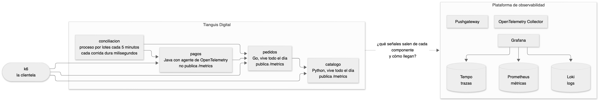
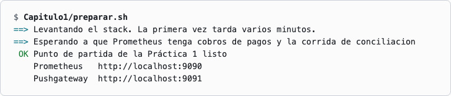
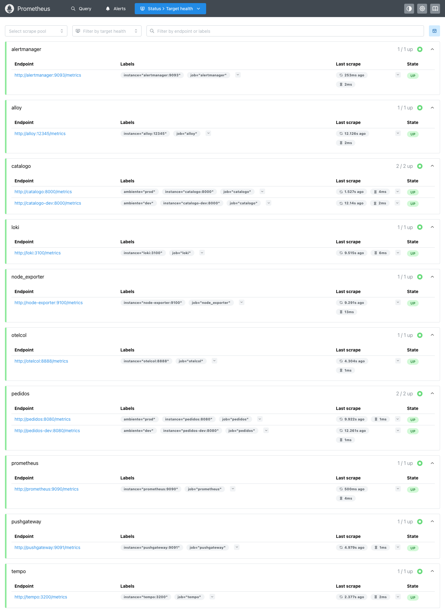
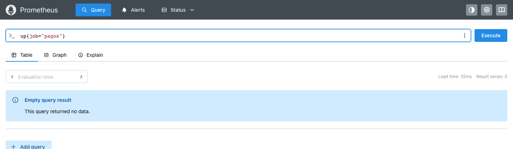
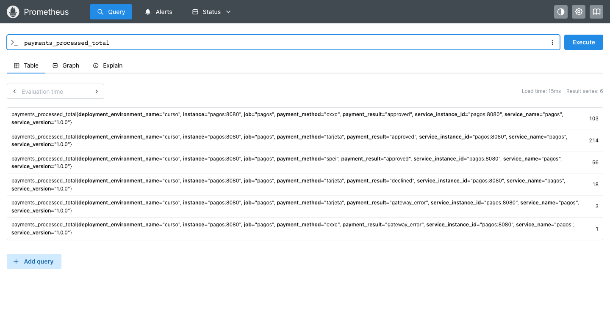
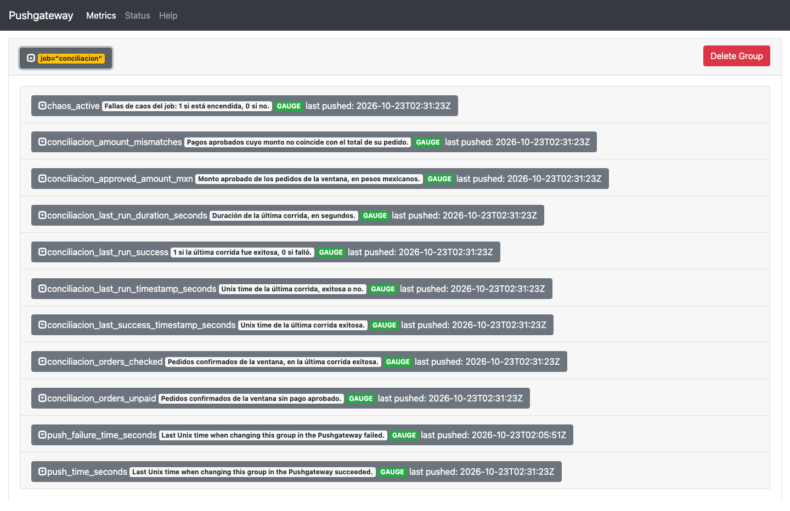
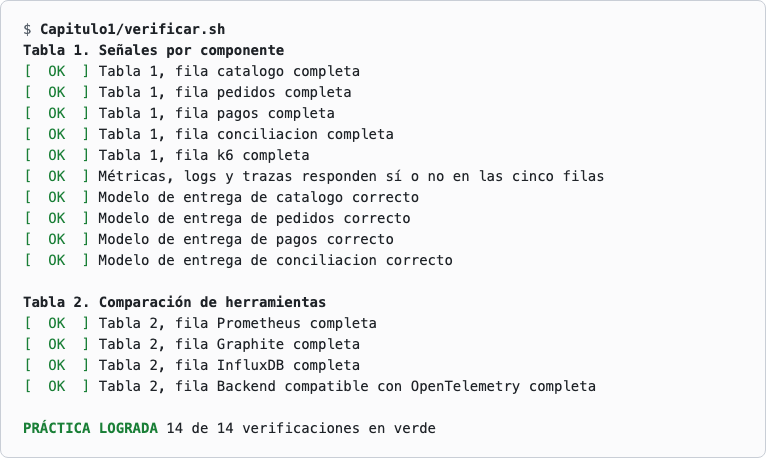

# Práctica 1. Mapa de señales y comparación de herramientas para un caso real

En esta práctica se decide qué señales necesita cada componente de la tienda Tianguis Digital y cómo llega cada una a la plataforma de observabilidad. Primero se decide en papel y después se contrasta con el stack que ya está corriendo.

## Objetivos
- Distinguir métricas, logs y trazas en un caso concreto.
- Elegir entre pull, push OTLP y Pushgateway según cómo vive cada componente.
- Comparar Prometheus, Graphite, InfluxDB y un backend compatible con OpenTelemetry para este caso.
- Comprobar en Prometheus y en el Pushgateway cómo llegan de verdad las métricas.

## El problema y la solución

Una tienda en línea se parece a un tianguis con muchos puestos.
Cada puesto lleva un contador en la caja, que dice cuánto vendió, y una libreta, donde anota qué pasó con cada venta.
A veces también interesa seguir a un cliente de puesto en puesto para saber dónde se demoró.

Sin un plan, cada puestero reporta lo que quiere y como quiere.
Unos esperan a que el inspector pase a preguntar y otros caminan a la oficina a dejar su reporte.
Cuando falta un reporte, en la oficina nadie sabe si el puesto cerró o si nadie fue a buscarlo.
Además cada oficina archiva los reportes a su manera y eso cambia lo que se le puede preguntar después.

En esta práctica se arma un mapa de señales para la tienda Tianguis Digital.
Para cada componente se decide qué se mide, qué se anota y cómo llega el reporte a la oficina.
Después se compara ese mapa con la plataforma que ya está corriendo, para ver si el papel coincide con la realidad.

En el NOC este mapa responde la primera pregunta de un turno cuando un servicio deja de mostrar datos en Grafana.
Antes de escalar hay que saber si ese servicio se consulta, envía sus métricas o las deja en el buzón, porque cada camino falla de una forma distinta y se revisa en un lugar distinto.

## Duración aproximada
- 40 minutos.

---
<div style="width: 400px;">
        <table width="50%">
            <tr>
                <td style="text-align: center;">
                    <a href="../"></a>
                    <br>anterior
                </td>
                <td style="text-align: center;">
                   <a href="../README.md">Lista Laboratorios</a>
                </td>
<td style="text-align: center;">
                    <a href="../Capitulo2/"></a>
                    <br>siguiente
                </td>
            </tr>
        </table>
</div>

---

## Diagrama



<br>

## Instrucciones

### Preparar el punto de partida

Antes de recorrer el tianguis hay que esperar a que los puestos abran y llegue la clientela.
El script levanta la tienda y la plataforma, y deja tráfico simulado para que haya datos que mirar.

1. Abrir una terminal en la carpeta del repositorio. En Windows usar Git Bash.

2. Ejecutar el script que deja el stack listo para la práctica. La primera vez tarda varios minutos porque descarga y construye las imágenes.

```bash
Capitulo1/preparar.sh
```



>**Nota.** Las direcciones que imprime el script son las de tu máquina. Si no cambiaste nada, Prometheus queda en http://localhost:9090 y el Pushgateway en http://localhost:9091. Usa siempre las que imprime el script.

### Conocer la tienda

Al inspector le sirve saber quién es quién antes de salir a recorrer el tianguis.
Cada componente vive de una forma distinta y esa forma decide cómo se pueden recoger sus señales.
Por eso se mira la arquitectura antes de decidir nada.

3. Revisar el diagrama de arriba y esta ficha de los cinco componentes.

| Componente | Qué hace | Cómo vive |
|---|---|---|
| catalogo | Responde la lista de productos y el detalle de cada uno | Servicio HTTP en Python que corre todo el día y publica `/metrics` |
| pedidos | Crea pedidos y consulta a catalogo | Servicio HTTP en Go que corre todo el día y publica `/metrics` |
| pagos | Cobra los pedidos y consulta a pedidos | Servicio HTTP en Java con el agente de OpenTelemetry. No publica `/metrics` |
| conciliacion | Cruza pedidos con pagos | Proceso por lotes. Arranca cada 5 minutos, trabaja unos milisegundos y termina |
| k6 | Simula a la clientela | Generador de carga. No publica `/metrics` y en este stack no envía métricas |

>**Nota.** Los cinco componentes escriben logs en su salida estándar. Solo pagos genera trazas.

### Completar el mapa de señales

El mapa dice, componente por componente, qué señales produce y cómo llega cada una a la plataforma.
En el tianguis un reporte llega a la oficina por tres caminos.
O el inspector pasa por el puesto a preguntar, o el puestero lo lleva a la oficina, o lo deja en el buzón de la oficina.
La segunda tabla compara oficinas que reciben y archivan los reportes de forma distinta.

4. Abrir el archivo `Capitulo1/mapa-de-senales.md` en un editor de texto.

5. Completar la Tabla 1 con una fila por componente. En Métricas, Logs y Trazas responder sí o no. En Modelo de entrega escribir pull, push OTLP, Pushgateway o ninguno. En Por qué explicar la decisión en una frase.

6. Completar la Tabla 2 con el modelo de datos, la forma de entrega, el lenguaje de consulta y el caso en que se elegiría cada herramienta para esta tienda.

>**Nota.** Esta guía no describe Graphite, InfluxDB ni los backends compatibles con OpenTelemetry. La comparación está en el Capítulo 1, sección 1.3 de la presentación del curso. En la documentación oficial sirven la página de Prometheus que lo compara con otras herramientas, https://prometheus.io/docs/introduction/comparison/, y la especificación del protocolo OTLP, https://opentelemetry.io/docs/specs/otlp/.

7. Guardar el archivo.

### Contrastar con la plataforma real

Un mapa en papel puede estar equivocado sin que nadie lo note.
Prometheus muestra la lista de puestos que el inspector visita en su ronda y el Pushgateway muestra lo que hay en el buzón.
Al compararlos con el mapa se ve por qué camino llega cada reporte.

8. Antes de abrir nada, anotar dos predicciones. Cuántos destinos va a mostrar Prometheus y si pagos va a estar entre ellos.

9. Abrir Prometheus en el navegador y entrar al menú **Status**, opción **Target health**.



>**Nota.** Hay 12 destinos repartidos en 10 grupos. pagos no aparece en ninguno.

10. Entrar a **Query**, escribir la siguiente consulta y pulsar **Execute**.

```promql
up{job="pagos"}
```



11. Repetir con esta otra consulta.

```promql
payments_processed_total
```



>**Nota.** Prometheus no visita a pagos y aun así tiene sus métricas. Llegaron por push OTLP, con `job="pagos"`.

12. Abrir el Pushgateway en el navegador y hacer clic sobre el grupo `job="conciliacion"`.



>**Nota.** Ahí está lo que dejó la última corrida de conciliacion. Prometheus lo recoge desde el Pushgateway, que sí es uno de sus 12 destinos.

13. Volver a `Capitulo1/mapa-de-senales.md` y corregir lo que no haya coincidido con lo que se vio.

### Verificar

Al cierre, el inspector jefe revisa que el mapa del tianguis no tenga puestos sin anotar.
El script solo lee el archivo `Capitulo1/mapa-de-senales.md` y no consulta el stack.

14. Ejecutar la verificación. Cada línea queda en verde si está lograda o en rojo con una pista de lo que falta.

```bash
Capitulo1/verificar.sh
```

## Preguntas frecuentes

**¿Qué diferencia hay entre una métrica, un log y una traza?**
Una métrica es un número que se sigue en el tiempo, como el contador de la caja. Un log es el registro de lo que pasó, como la libreta del puestero. Una traza sigue una petición de servicio en servicio.

**¿Qué significa que Prometheus haga pull?**
Que Prometheus visita cada destino cada cierto tiempo y lee sus métricas por HTTP, normalmente en `/metrics`. Es el inspector que pasa por el puesto a preguntar.

**¿Qué es OTLP?**
Es el protocolo de OpenTelemetry para enviar métricas, logs y trazas. Con OTLP el componente empuja sus datos hacia el destino, como el puestero que lleva su reporte a la oficina.

**¿Para qué sirve el Pushgateway?**
Guarda las métricas que un proceso deja antes de terminar, para que Prometheus las recoja después. Es el buzón de la oficina.

**¿Qué es un destino en Prometheus?**
Es cada dirección que Prometheus visita para leer métricas. La pantalla **Target health** muestra los destinos y si contestaron en la última visita.

**¿Qué es una etiqueta como `job`?**
Es un par de nombre y valor que acompaña a cada serie. La etiqueta `job` indica de qué componente viene el dato y se escribe entre llaves para filtrar una consulta.

**¿Hay que escribir las respuestas del mapa con palabras exactas?**
En Modelo de entrega se usa una de las cuatro opciones que indica el paso 5. En Por qué basta una frase propia. No se cambia el nombre de la primera celda de cada fila, porque la verificación ubica la fila por ese texto.

**¿Qué hacer si la dirección de Prometheus no abre en el navegador?**
Usar las direcciones que imprimió `Capitulo1/preparar.sh`. Si los puertos se cambiaron en la configuración, Prometheus no queda en el 9090.

## Resultado esperado

Las dos tablas quedan completas y el modelo de entrega de cada componente coincide con lo que mostraron Prometheus y el Pushgateway. La verificación termina con todas sus líneas en verde.



`Capitulo1/restaurar.sh` deja las tablas vacías otra vez. Avisa qué archivo cambia y pide escribir SI.

La carpeta `Capitulo1/solucion` trae las dos tablas resueltas para comparar.

Para ver la práctica resuelta de una vez, `Capitulo1/solucion/aplicar.sh` copia las tablas sobre `mapa-de-senales.md`. Avisa qué archivo cambia y pide escribir SI.
