# Práctica 2. Stack de Prometheus y Grafana con Docker Compose

En esta práctica se levanta el stack completo con Docker Compose, se lee la configuración de Prometheus, se cambia de forma segura y se arma el primer dashboard en Grafana.

## Objetivos
- Levantar el stack y revisar el estado de sus servicios.
- Encontrar un destino caído en Prometheus y recuperarlo.
- Usar el explorador de métricas y distinguir un gauge de un contador.
- Leer la estructura de `prometheus.yml` y agregar una etiqueta con `relabel_configs`.
- Validar la configuración con `promtool` y recargarla sin reiniciar Prometheus.
- Revisar el datasource aprovisionado de Grafana y crear un dashboard con pestañas.

## El problema y la solución

Un tianguis tiene muchos puestos y cada uno abre y cierra a su ritmo.
Si un puesto cierra sin avisar, nadie se entera hasta que llega un cliente y lo encuentra vacío.
Con los servicios de una tienda en línea pasa lo mismo.
Un servicio que deja de contestar no le avisa a nadie.

Para eso existe la ronda del inspector.
Prometheus es ese inspector y recorre una lista de puestos cada cierto tiempo.
En cada visita anota si el puesto contestó y qué datos tiene.
La lista y la frecuencia de la ronda están escritas en una hoja de ruta, el archivo `prometheus.yml`.

En esta práctica se abre el tianguis completo con Docker Compose y se sigue la ronda del inspector.
Se cambia su hoja de ruta, se hace revisar el cambio antes de usarlo y se le entrega sin detener la ronda.
Al final Grafana muestra en una pizarra lo que el inspector anotó.

En el NOC esto es el aviso de que un servicio dejó de responder.
Antes de escalar hay que saber qué destino cayó, desde cuándo y si el cambio de configuración que lo afecta ya está aplicado.

## Duración aproximada
- 90 minutos.

---
<div style="width: 400px;">
        <table width="50%">
            <tr>
                <td style="text-align: center;">
                    <a href="../Capitulo1/"></a>
                    <br>anterior
                </td>
                <td style="text-align: center;">
                   <a href="../README.md">Lista Laboratorios</a>
                </td>
<td style="text-align: center;">
                    <a href="../Capitulo3/">
                    </a>
                    <br>siguiente
                </td>
            </tr>
        </table>
</div>

---

## Diagrama

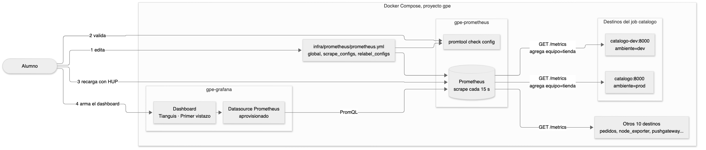

<br>

## Instrucciones

### Levantar el stack

Antes de que el inspector salga a su ronda hay que abrir el tianguis.
Un solo comando levanta todos los contenedores en el orden correcto.
Después se revisa servicio por servicio que cada uno esté atendiendo.

1. Abrir una terminal en la carpeta del repositorio. En Windows usar Git Bash.

2. Levantar el stack. La primera vez tarda varios minutos porque descarga y construye las imágenes.

```bash
bin/up.sh
```

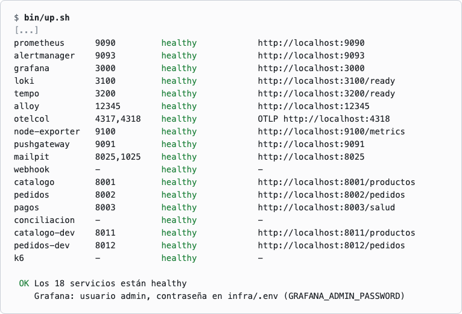

>**Nota.** La columna URL muestra las direcciones de tu máquina. Si no cambiaste nada, Prometheus queda en http://localhost:9090 y Grafana en http://localhost:3000. En el resto de la guía usa siempre las de tu tabla.

3. Dejar el stack en el punto de partida de la práctica.

```bash
Capitulo2/preparar.sh
```

4. Antes de ejecutar el siguiente comando, anotar cuántos servicios van a estar en healthy. Después ejecutarlo.

```bash
bin/estado.sh
```

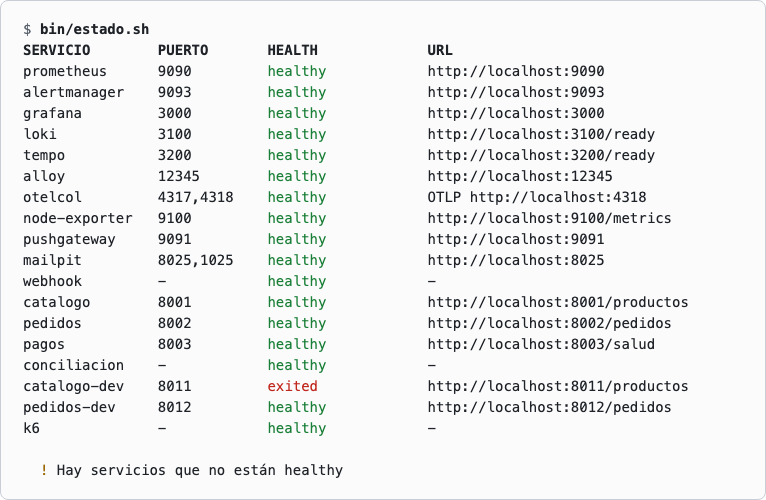

### Encontrar el destino caído

El inspector lleva una lista de puestos y pasa por cada uno en su ronda.
Cuando un puesto no contesta, lo anota en su planilla.
El puesto no avisa que cerró. Es el inspector quien lo descubre al pasar.

5. Abrir Prometheus en el navegador y entrar al menú **Status**, opción **Target health**. Buscar el grupo que no tiene todos sus destinos arriba.

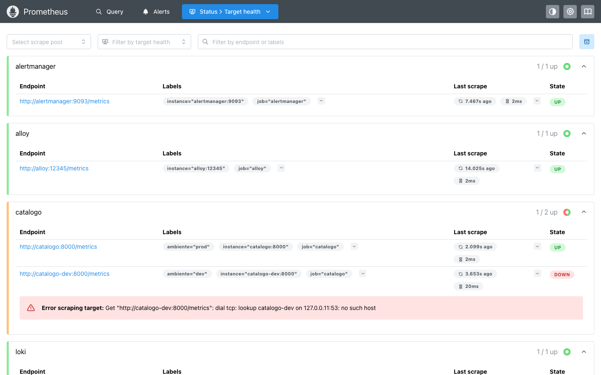

6. Entrar a **Query**, escribir la siguiente consulta y pulsar **Execute**.

```promql
up == 0
```

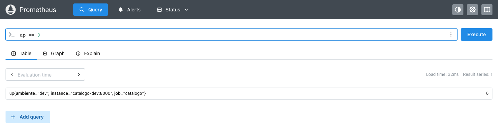

7. Encender el contenedor detenido.

```bash
docker start gpe-catalogo-dev
```

8. Esperar unos 15 segundos y ejecutar esta consulta en Prometheus. Los dos destinos de catalogo deben valer 1.

```promql
up{job="catalogo"}
```

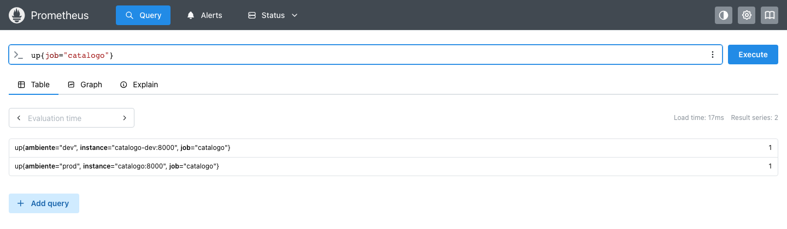

### Explorar las métricas

El inspector no anota una sola clase de dato en su planilla.
Antes de leer o graficar un número hay que saber de qué clase es.
El explorador de métricas muestra esa clase en la columna **Type**.

9. En **Query**, abrir el menú de tres puntos que está a la derecha del cuadro de consulta y elegir **Explore metrics**. Escribir `node_memory_Mem` en el filtro y revisar la columna **Type**.

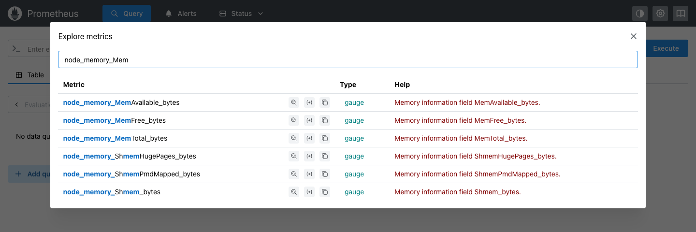

>**Nota.** Qué significa cada valor de **Type** está en el Capítulo 3, sección 3.1 de la presentación del curso, en la diapositiva Los cuatro tipos de métricas, y en la documentación oficial en https://prometheus.io/docs/concepts/metric_types/.

10. Cerrar el explorador, ejecutar la siguiente consulta y leer el valor. Es la memoria disponible en bytes en este instante.

```promql
node_memory_MemAvailable_bytes
```

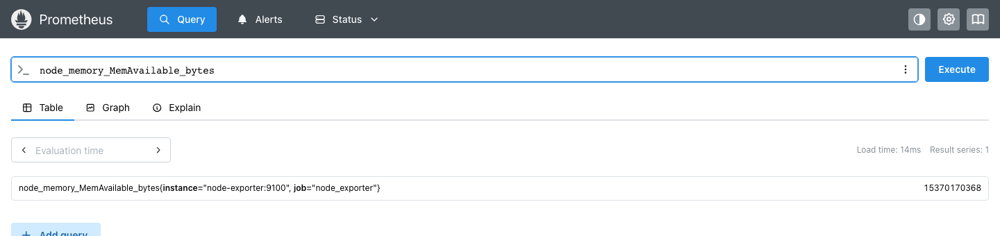

11. Abrir otra vez **Explore metrics** y filtrar por `node_cpu_seconds`. Revisar la columna **Type**.

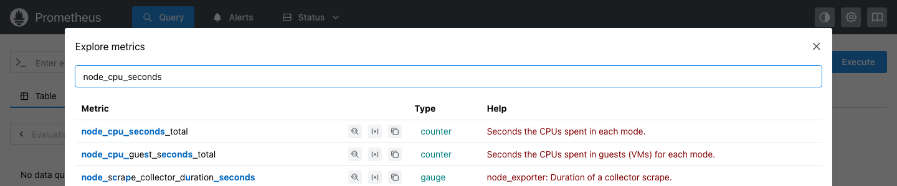

>**Nota.** `node_cpu_seconds_total` es un contador. Acumula segundos de CPU desde que arrancó la máquina y nunca baja, así que su valor suelto no dice nada. Lo que interesa es cuánto crece por segundo.

12. Cerrar el explorador, ejecutar la siguiente consulta y abrir la pestaña **Graph**.

```promql
sum by (mode) (rate(node_cpu_seconds_total[5m]))
```

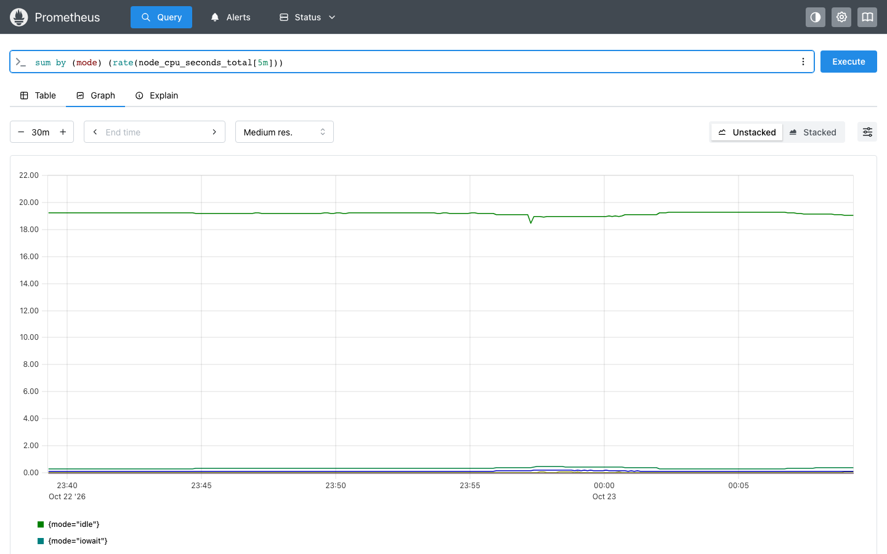

### Leer la configuración de Prometheus

Este archivo es la hoja de ruta del inspector.
Dice cada cuánto sale a caminar y qué puestos visita, agrupados por pasillo.
Saber leerlo permite explicar por qué cada métrica llega con las etiquetas que trae.

13. Abrir el archivo `infra/prometheus/prometheus.yml` en un editor de texto.

14. Ubicar el bloque `global` y leer el valor de `scrape_interval`.

15. Ubicar el bloque `scrape_configs` y dentro el trabajo `catalogo`. Tiene dos destinos y cada uno lleva su etiqueta `ambiente`.

```yaml
  - job_name: catalogo
    scrape_interval: 15s
    static_configs:
      - targets: ["catalogo:8000"]
        labels:
          ambiente: prod
      - targets: ["catalogo-dev:8000"]
        labels:
          ambiente: dev
```

### Agregar una etiqueta con relabel_configs

El inspector puede pegarle una etiqueta a cada reporte antes de archivarlo.
El puesto no escribe esa etiqueta ni necesita cambiar su código.
Antes de usar una hoja de ruta nueva, un jefe la revisa.
Ese jefe es `promtool`.

16. Agregar estas tres líneas al trabajo `catalogo`, justo debajo de la línea `ambiente: dev`. Copiarlas tal cual, con sus espacios. La tercera línea tiene un error de sangría puesto a propósito.

```yaml
    relabel_configs:
      - target_label: equipo
       replacement: tienda
```

17. Guardar el archivo.

18. Validar la configuración con `promtool`, que viene dentro del contenedor de Prometheus.

```bash
MSYS_NO_PATHCONV=1 docker exec gpe-prometheus promtool check config /etc/prometheus/prometheus.yml
```

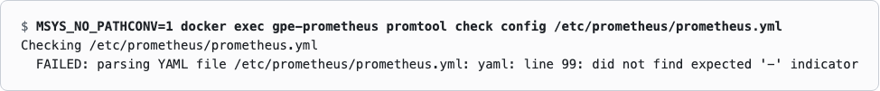

>**Nota.** `promtool` rechaza el archivo y avisa cerca de qué línea está el problema. Prometheus sigue trabajando con la configuración anterior, nada se rompió.

19. Corregir la sangría. `replacement` debe quedar alineado con `target_label`.

```yaml
    relabel_configs:
      - target_label: equipo
        replacement: tienda
```

Así queda el trabajo `catalogo` completo después de la corrección.

```yaml
  - job_name: catalogo
    scrape_interval: 15s
    static_configs:
      - targets: ["catalogo:8000"]
        labels:
          ambiente: prod
      - targets: ["catalogo-dev:8000"]
        labels:
          ambiente: dev
    relabel_configs:
      - target_label: equipo
        replacement: tienda
```

| Línea | Qué hace |
|---|---|
| `relabel_configs:` | Abre la lista de reglas de reetiquetado del trabajo. Lleva la misma sangría que `static_configs` |
| `- target_label: equipo` | Empieza una regla. El guion marca un elemento de la lista y `target_label` es el nombre de la etiqueta que se escribe |
| `replacement: tienda` | Es el valor que recibe la etiqueta. Como la regla no trae `source_labels` ni `regex`, se aplica a todos los destinos del trabajo |

>**Nota.** No hace falta saber programar para este cambio. Es un archivo de configuración en YAML, donde los espacios al inicio de cada línea indican a qué bloque pertenece. La referencia de `relabel_configs` está en el Capítulo 2, sección 2.4 de la presentación del curso y en https://prometheus.io/docs/prometheus/latest/configuration/configuration/#relabel_config.

20. Guardar el archivo y validar otra vez.

```bash
MSYS_NO_PATHCONV=1 docker exec gpe-prometheus promtool check config /etc/prometheus/prometheus.yml
```

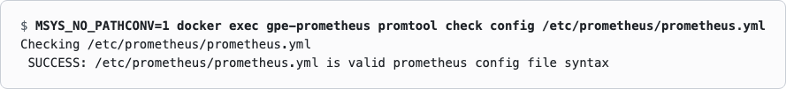

21. Antes de ejecutar la siguiente consulta, anotar una predicción. La configuración ya es válida. ¿Prometheus ya tiene la etiqueta `equipo`? Después ejecutarla.

```promql
count by (equipo) (up{job="catalogo"})
```

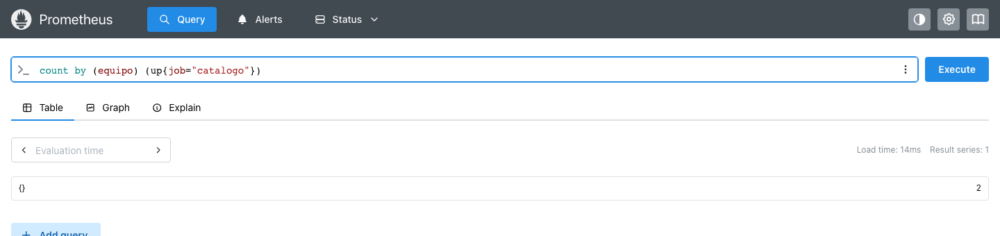

>**Nota.** El resultado no trae `equipo`. Validar no es aplicar. Prometheus lee su configuración al arrancar y cuando se le pide recargar.

### Recargar sin reiniciar

Reiniciar Prometheus para aplicar un cambio deja un hueco en las métricas.
La recarga le entrega la ruta nueva al inspector sin que deje de trabajar.
Termina la visita en la que está y sigue con la hoja nueva.

22. Pedirle a Prometheus que recargue su configuración.

```bash
docker exec gpe-prometheus kill -HUP 1
```

23. Esperar unos 30 segundos y ejecutar esta consulta en Prometheus.

```promql
count by (equipo, ambiente) (http_server_requests_total{job="catalogo", equipo="tienda"})
```

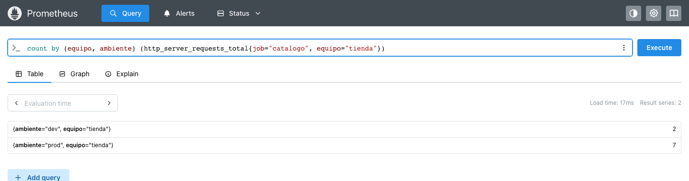

>**Nota.** Durante unos 5 minutos Prometheus puede mostrar también las series anteriores, las que no tienen `equipo`. Dejan de aparecer solas.

### Revisar el datasource de Grafana

Grafana es la ventanilla de la oficina donde se consultan los reportes del inspector.
La ventanilla no guarda datos, solo sabe dónde buscarlos.
Esa dirección viene escrita en un archivo de la oficina y no se cambia desde el mostrador.

24. Abrir Grafana en el navegador e iniciar sesión con el usuario `admin` y la contraseña `tianguis`. Son los valores de `infra/.env`.

25. Entrar a **Connections**, **Data sources** y abrir **Prometheus**.

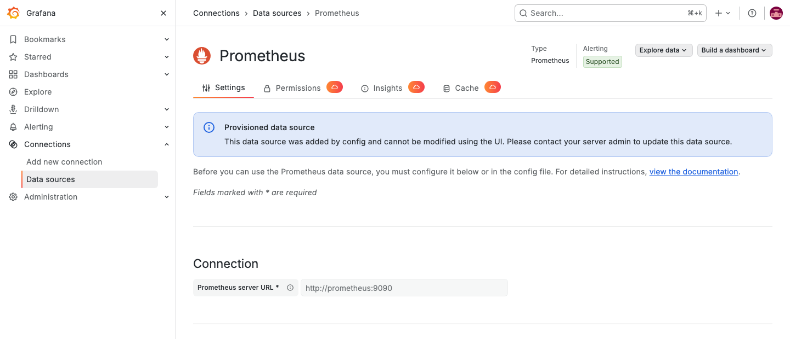

>**Nota.** Este datasource viene del archivo `infra/grafana/provisioning/datasources/datasources.yaml`. Por eso Grafana no deja editarlo desde la interfaz. Si se cambiara a mano, el cambio se perdería en el siguiente arranque.

26. Volver a **Data sources**, pulsar **Add new data source** y elegir **Prometheus**.

27. En **Prometheus server URL** escribir la siguiente dirección. Bajar hasta el final de la página y pulsar **Save & test**.

```text
http://prometheus:9090
```

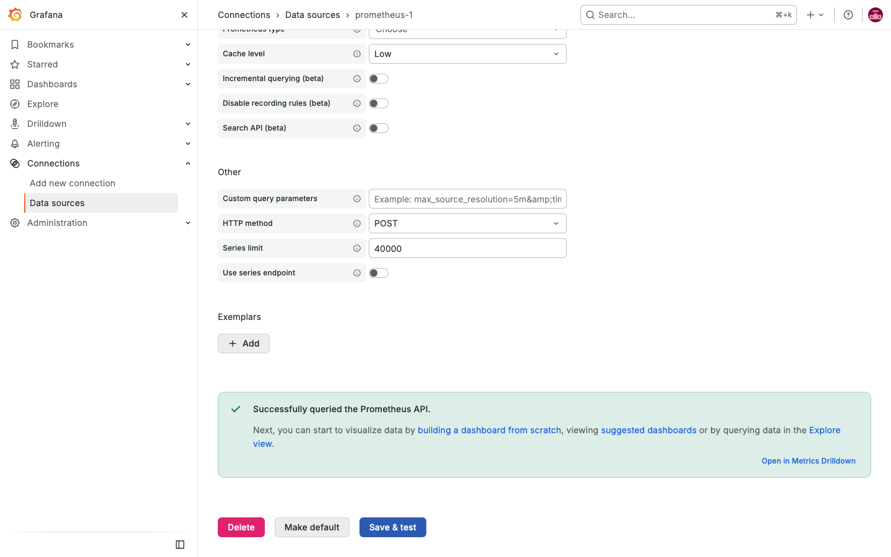

28. Pulsar **Delete** y confirmar. El datasource de práctica ya cumplió su función.

### Crear el primer dashboard

Una consulta suelta en Prometheus se pierde al cerrar la pestaña del navegador.
El dashboard es la pizarra de la oficina y responde siempre las mismas preguntas.
La pizarra no mide nada, copia lo que dice la planilla del inspector cada vez que alguien la mira.

29. Entrar a **Dashboards**, pulsar **New** y elegir **New dashboard**.

30. En el panel de la derecha pulsar **Add tab**. En el campo **Title** escribir `Salud` y pulsar Enter.

31. Pulsar **Add panel** y después **Configure visualization**.

32. En el editor de consultas cambiar de **Builder** a **Code**, escribir la siguiente consulta y pulsar Shift y Enter juntos.

```promql
sum(up)
```

33. En la columna de la derecha abrir **All visualizations** y elegir **Stat**. En **Title** escribir `Destinos que responden`.

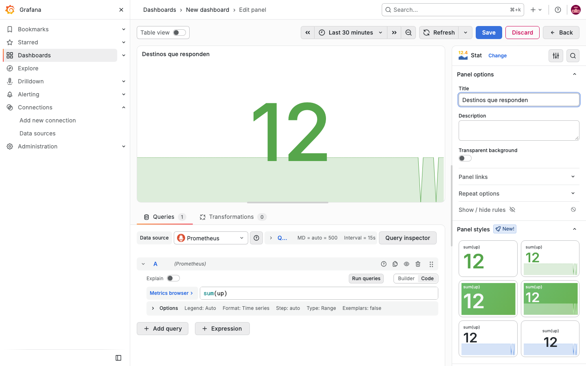

34. Pulsar **Back** para volver al dashboard.

35. Pulsar **New tab**. En el campo **Title** escribir `Tráfico` y pulsar Enter.

36. Pulsar **Add panel** y después **Configure visualization**. Cambiar a **Code**, escribir la siguiente consulta y pulsar Shift y Enter juntos.

```promql
sum by (job) (rate(http_server_requests_total[5m]))
```

37. En **All visualizations** elegir **Time series**. En **Title** escribir `Peticiones por segundo`.

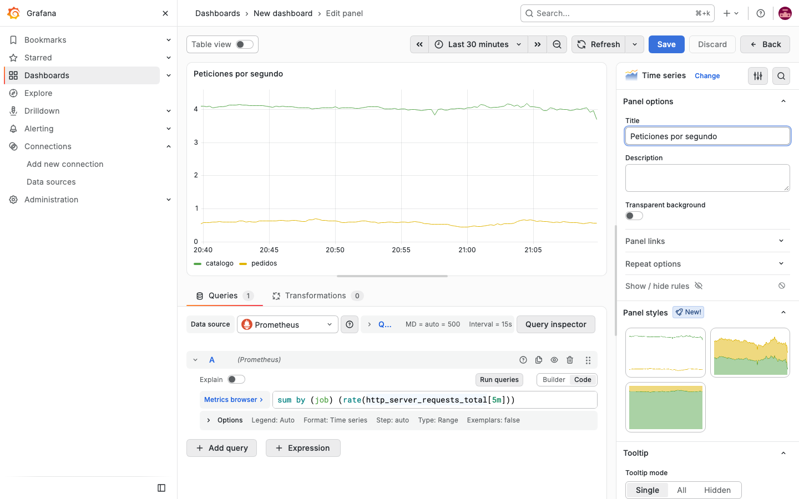

38. Pulsar **Back** y después **Save**. En **Title** copiar el siguiente nombre.

```text
Tianguis · Primer vistazo
```

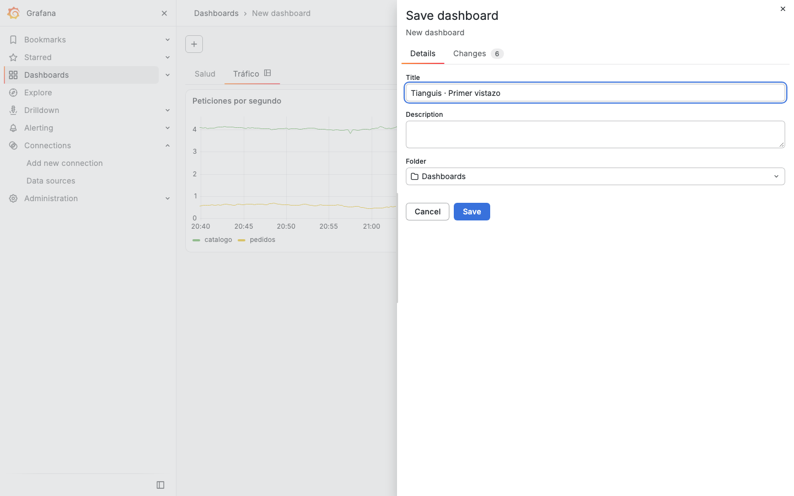

39. Pulsar **Save** en el diálogo.

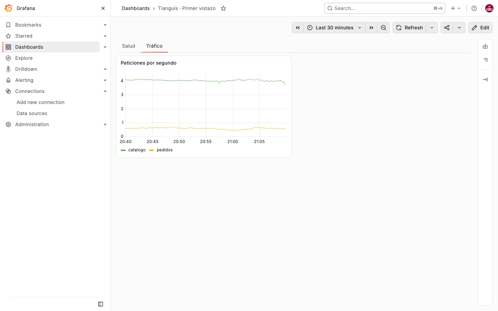

### Verificar

Al cierre del día el jefe repasa la planilla del inspector contra la hoja de ruta.
El script de verificación hace ese repaso en forma automática.
Así se detecta cualquier paso que haya quedado a medias.

40. Ejecutar la verificación. Cada línea queda en verde si está lograda o en rojo con una pista de lo que falta.

```bash
Capitulo2/verificar.sh
```

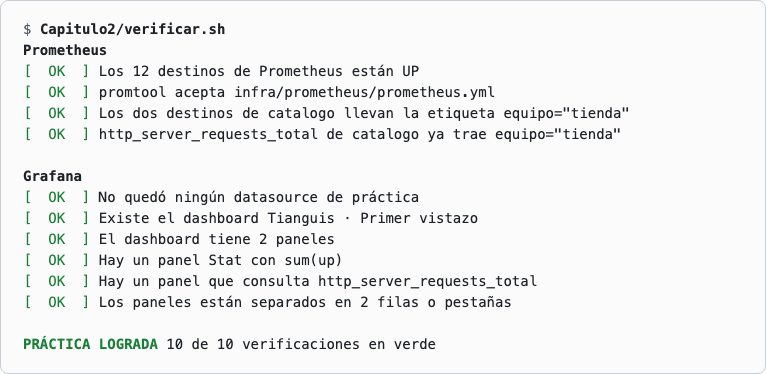

>**Nota.** Para deshacer el cambio de `prometheus.yml` y repetir la práctica existe `Capitulo2/restaurar.sh`. Avisa qué archivo sobrescribe y pide escribir SI.

## Preguntas frecuentes

**¿Qué es un destino en Prometheus?**
Es una dirección `host:puerto` que Prometheus visita para leer métricas. En la ronda del inspector es cada puesto de su lista.

**¿Qué es un scrape?**
Es cada visita en que Prometheus le pide `/metrics` a un destino y guarda lo que recibe. Se repite cada `scrape_interval`.

**¿Qué significa la métrica `up`?**
Prometheus la escribe por cada destino en cada visita. Vale 1 si el destino contestó y 0 si no.

**¿Qué es una etiqueta?**
Es un par de nombre y valor que acompaña a cada serie, como `job="catalogo"`. Sirve para filtrar y agrupar en las consultas.

**¿Qué es PromQL?**
Es el lenguaje de consultas de Prometheus. Se escribe en **Query** y también en los paneles de Grafana.

**¿Qué es un datasource en Grafana?**
Es la conexión que Grafana usa para pedirle datos a otro sistema. En esta práctica el datasource **Prometheus** viene aprovisionado desde un archivo.

**¿Qué diferencia hay entre un panel y una pestaña?**
Un panel muestra una consulta con una visualización, como **Stat** o **Time series**. Una pestaña agrupa paneles dentro del dashboard.

**¿Se puede repetir la práctica desde cero?**
Sí. `Capitulo2/restaurar.sh` devuelve `prometheus.yml` a su versión original y pide escribir SI antes de tocar nada.

## Resultado esperado

Todos los destinos de Prometheus quedan arriba, las series de catalogo llevan la etiqueta `equipo="tienda"` y Grafana tiene el dashboard Tianguis · Primer vistazo con una pestaña Salud y una pestaña Tráfico.

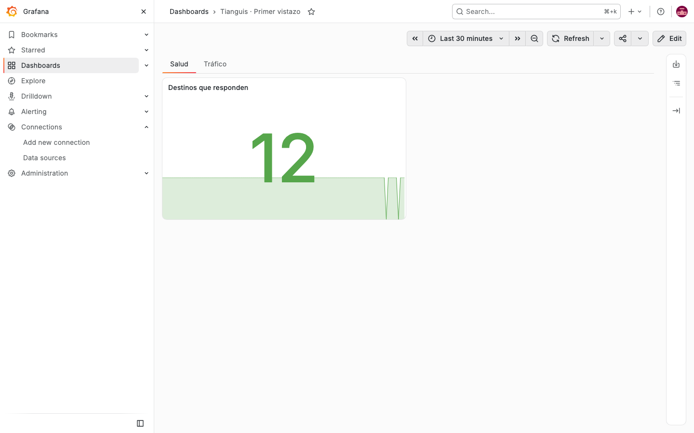

La carpeta `Capitulo2/solucion` trae el `prometheus.yml` resuelto y el dashboard en JSON.

Para ver la práctica resuelta de una vez, `Capitulo2/solucion/aplicar.sh` copia el `prometheus.yml`, recarga Prometheus, enciende gpe-catalogo-dev e importa el dashboard. Avisa qué reemplaza y pide escribir SI.
