# Práctica 3. Consultas PromQL sobre las métricas de un microservicio

En esta práctica se lee el modelo de datos de Prometheus en las métricas de catalogo y pedidos, se consulta con PromQL, se arman las consultas RED y USE, se comparan los tres tipos de distribución y se provoca una bomba de cardinalidad para aprender a encontrarla.

## Objetivos
- Reconocer un counter, un gauge, un histograma y un summary en el formato de exposición.
- Filtrar series con selectores, incluida la sintaxis de nombres entre comillas de Prometheus 3.
- Leer un contador con `rate`, `irate` e `increase` y ver qué hace `rate` cuando el servicio se reinicia.
- Agregar series con `sum by` y `topk`.
- Construir las consultas RED de un servicio y las consultas USE de la máquina.
- Comparar el percentil 95 de un histograma clásico, de un histograma nativo y de un summary.
- Detectar una bomba de cardinalidad y encontrar la métrica y la etiqueta culpables.

## El problema y la solución

Un mercado tiene un medidor del agua en cada puesto y un estanque que abastece a todos.
Cada mañana el administrador recibe los números de todos esos aparatos.
Si no distingue un medidor de un estanque, lee mal los números.
Si mira solo el total del medidor, no sabe si hoy se gasta más agua que ayer.
Y si alguien abre un cuaderno nuevo por cada cliente en vez de uno por producto, la bodega se llena de cuadernos que nadie lee.

Prometheus guarda los números de catalogo y pedidos como esos aparatos, cada uno con su dirección escrita en etiquetas.
PromQL es la forma de leerlos.
En esta práctica se aprende a reconocer cada clase de medidor, a filtrar por su dirección y a calcular cuánto cambia por segundo.

Después se arman las consultas que dicen si un servicio atiende bien y si la máquina alcanza.
Al final se provocan dos fallas a propósito y se buscan solo con consultas.

En el NOC son las consultas que se usan cuando llega una alerta de latencia alta en pedidos o un aviso de que Prometheus está ocupando cada vez más memoria.
Con ellas se confirma si el problema es real, a qué parte de los clientes afecta y qué servicio o etiqueta lo provoca, antes de escalar.

## Duración aproximada
- 120 minutos.

---
<div style="width: 400px;">
        <table width="50%">
            <tr>
                <td style="text-align: center;">
                    <a href="../Capitulo2/"></a>
                    <br>anterior
                </td>
                <td style="text-align: center;">
                   <a href="../README.md">Lista Laboratorios</a>
                </td>
<td style="text-align: center;">
                    <a href="../Capitulo4/">
                    </a>
                    <br>siguiente
                </td>
            </tr>
        </table>
</div>

---

## Diagrama

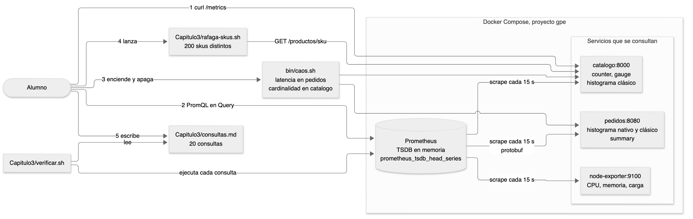

<br>

## Instrucciones

### Preparar el punto de partida

Todas las lecturas de la práctica parten de un mercado en orden.
El script deja los servicios arriba y sin fallas, con los medidores de catalogo recién instalados.
Así los números que se lean después vienen solo del tráfico normal.

1. Abrir una terminal en la carpeta del repositorio. En Windows usar Git Bash.

2. Dejar el stack en el punto de partida de la práctica. El script levanta lo que falte, apaga cualquier falla de caos y reinicia catalogo para que sus series partan limpias.

```bash
Capitulo3/preparar.sh
```

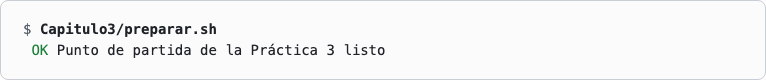

>**Nota.** Los comandos usan los puertos por defecto, 8001 para catalogo y 8002 para pedidos. Si `bin/estado.sh` muestra otros en tu máquina, usa los de tu tabla. Lo mismo vale para Prometheus.

3. Abrir el archivo `Capitulo3/consultas.md` en un editor de texto. Cada vez que la guía diga **pregunta N**, copiar ahí la consulta que respondió esa pregunta.

### Leer el formato de exposición

Antes de leer un aparato del mercado hay que saber qué clase de aparato es.
Un medidor del agua solo sube y el nivel del estanque sube y baja, así que no se leen igual.
En las métricas de un servicio la línea `# TYPE` cumple el papel de la placa de cada aparato.

4. Pedir a catalogo sus métricas y quedarse solo con las líneas que declaran el tipo de cada una.

```bash
curl -s http://localhost:8001/metrics | grep "^# TYPE"
```

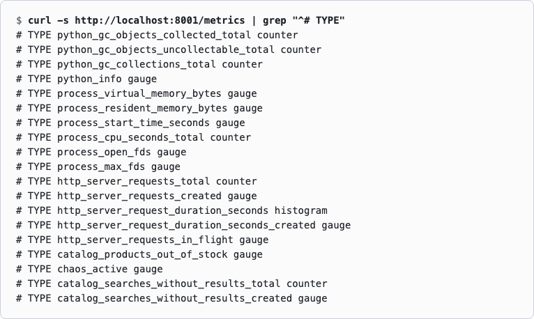

5. Ubicar un counter, un gauge y un histograma. `http_server_requests_total` es un counter, `http_server_requests_in_flight` es un gauge y `http_server_request_duration_seconds` es un histograma.

6. Ver todas las series de una sola ruta de catalogo.

```bash
curl -s http://localhost:8001/metrics | grep 'route="/productos"'
```

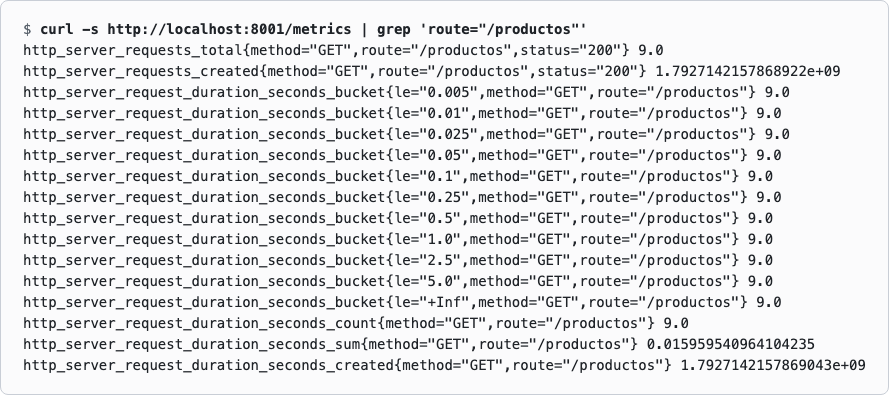

>**Nota.** El histograma no es una serie, son varias. Cada `_bucket` cuenta las peticiones que tardaron menos que su `le`, por eso los valores nunca bajan de un bucket al siguiente. `_count` es el total y `_sum` la suma de todas las duraciones.

7. Pedir a pedidos sus métricas de negocio.

```bash
curl -s http://localhost:8002/metrics | grep orders_
```

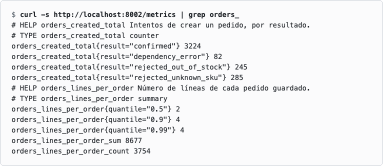

>**Nota.** `orders_lines_per_order` es un summary. Sus percentiles ya vienen calculados por el propio servicio, en la etiqueta `quantile`. pedidos también expone un histograma nativo, pero ese solo viaja en formato binario y no se ve con `curl`. Se consulta más adelante en Prometheus.

### Selectores

Cada puesto del mercado tiene su propio medidor, en varios pasillos y en dos sedes.
Para leer uno solo hay que dar su dirección completa.
En Prometheus esa dirección son las etiquetas, como `job` y `ambiente`, y el selector es la forma de escribirla.

8. Abrir Prometheus en el navegador, entrar a **Query**, escribir la siguiente consulta y pulsar **Execute**.

```promql
http_server_requests_total{job="pedidos", ambiente="prod"}
```

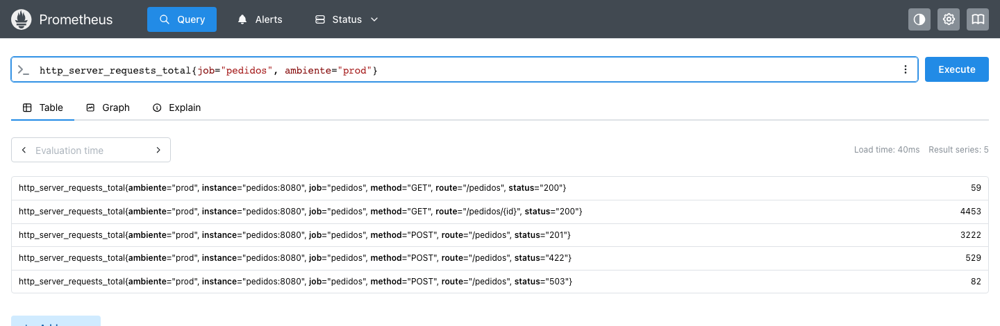

9. Quedarse solo con las respuestas 5xx. El operador `=~` compara contra una expresión regular.

```promql
http_server_requests_total{job="pedidos", ambiente="prod", status=~"5.."}
```

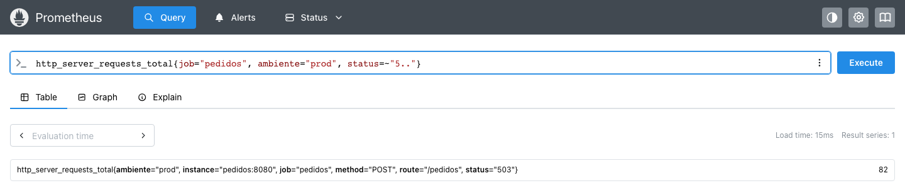

>**Nota.** Un resultado vacío no es un error. Significa que ninguna serie cumple el filtro. pedidos no ha respondido ningún 5xx desde que arrancó.

10. Cambiar el filtro a las respuestas 4xx. Copiar la consulta en la **pregunta 1**.

```promql
http_server_requests_total{job="pedidos", ambiente="prod", status=~"4.."}
```

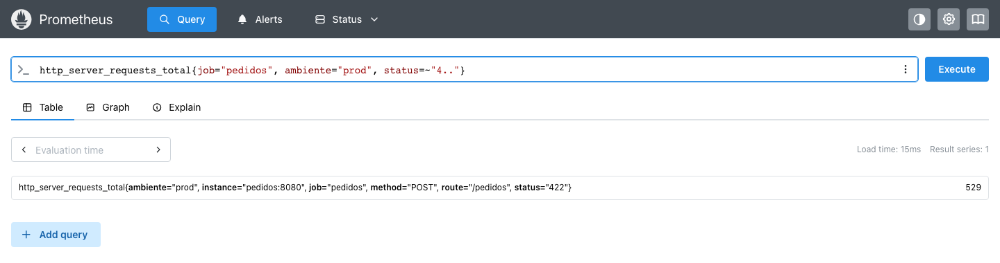

11. Escribir el nombre de la métrica entre comillas, dentro de las llaves. Es la sintaxis de Prometheus 3 para nombres que llevan puntos, como los de OpenTelemetry. Copiar la consulta en la **pregunta 2**.

```promql
{"http_server_requests_total", job="catalogo"}
```

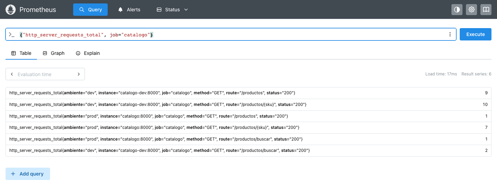

>**Nota.** Los comparadores de etiquetas `=`, `!=`, `=~` y `!~` están en el Capítulo 3, sección 3.3 de la presentación del curso, y los nombres entre comillas en la sección 3.1. La referencia oficial es [Querying basics](https://prometheus.io/docs/prometheus/latest/querying/basics/#time-series-selectors).

### rate, irate e increase

El total de un medidor del agua no dice si hoy se gasta más que ayer.
Para saberlo se mira el medidor dos veces y se divide por el tiempo que pasó.
Eso hacen `rate`, `irate` e `increase` con un counter.
Al final del bloque se reinicia pedidos para ver qué pasa con esa lectura.

12. Ejecutar el contador de pedidos confirmados de prod y abrir la pestaña **Graph**.

```promql
orders_created_total{job="pedidos", ambiente="prod", result="confirmed"}
```

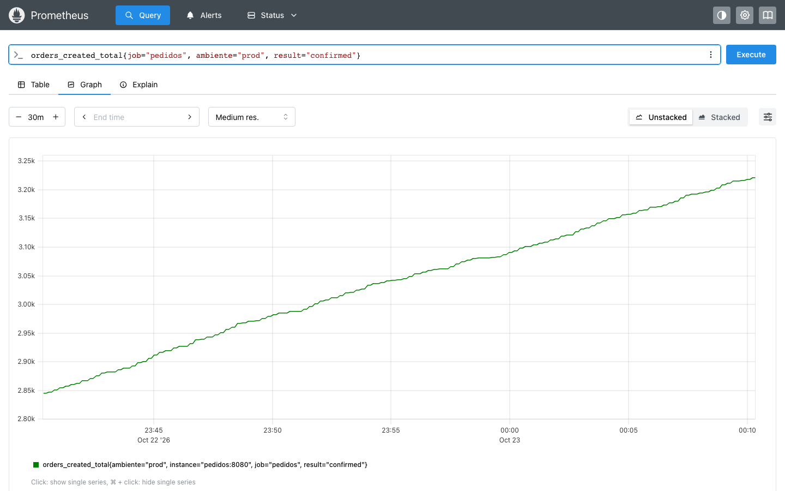

>**Nota.** El valor de un contador solo sube. Leído solo, no dice si hoy se venden más o menos pedidos que hace una hora.

13. Ejecutar `rate` en el primer cuadro. Pulsar **Add query**, ejecutar `irate` en el segundo y abrir **Graph** en los dos. Copiar la consulta de `rate` en la **pregunta 3**.

```promql
rate(orders_created_total{job="pedidos", ambiente="prod", result="confirmed"}[5m])
```

```promql
irate(orders_created_total{job="pedidos", ambiente="prod", result="confirmed"}[5m])
```

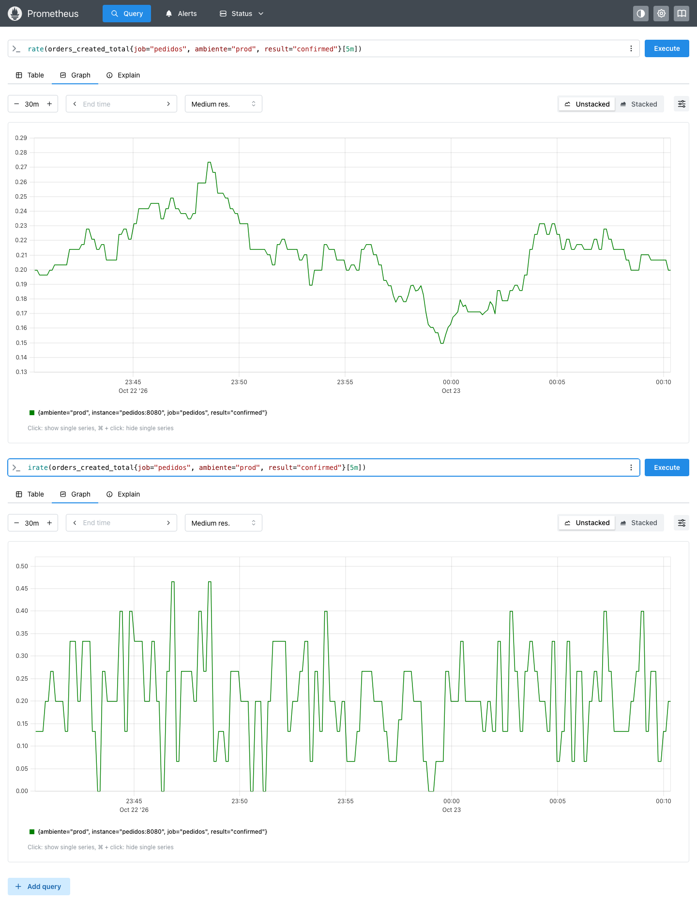

>**Nota.** `rate` promedia todo lo que pasó en los 5 minutos de la ventana. `irate` solo mira las dos últimas muestras, por eso salta tanto.

14. Ejecutar `increase` en la pestaña **Table**. Copiar la consulta en la **pregunta 4**.

```promql
increase(orders_created_total{job="pedidos", ambiente="prod", result="confirmed"}[1h])
```

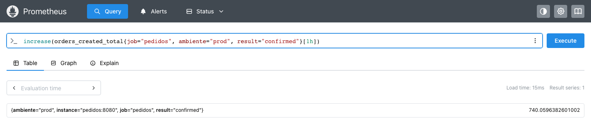

15. Antes de ejecutar el siguiente comando, anotar una predicción. Si pedidos se reinicia, su contador vuelve a cero. ¿Qué va a pasar con el gráfico de `rate`? Después ejecutarlo.

```bash
docker restart gpe-pedidos
```

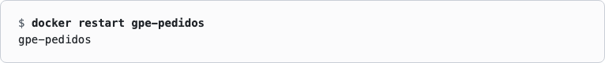

16. Esperar unos 2 minutos. Ejecutar el contador crudo y su `rate` en dos cuadros, los dos en **Graph** con un rango de 15 minutos.

```promql
orders_created_total{job="pedidos", ambiente="prod", result="confirmed"}
```

```promql
rate(orders_created_total{job="pedidos", ambiente="prod", result="confirmed"}[5m])
```

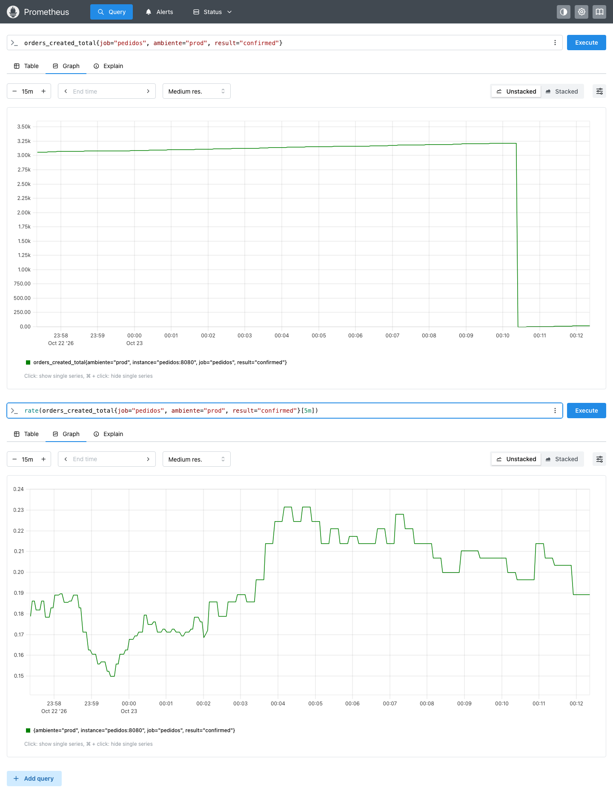

17. Contar cuántas veces volvió a cero el contador. Copiar la consulta en la **pregunta 5**.

```promql
resets(orders_created_total{job="pedidos", ambiente="prod", result="confirmed"}[30m])
```

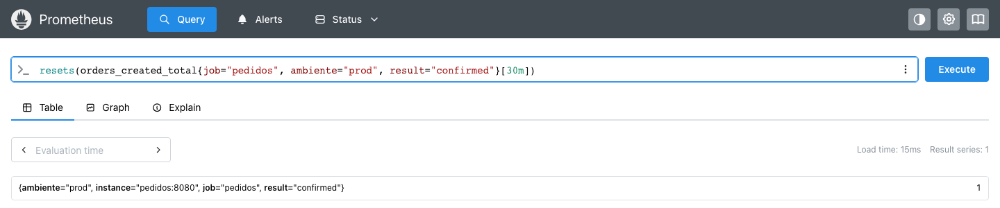

>**Nota.** `rate`, `irate`, `increase` y el manejo de los reinicios se explican en el Capítulo 3, sección 3.4 de la presentación del curso. Cada función tiene su ficha en [Query functions](https://prometheus.io/docs/prometheus/latest/querying/functions/), en los apartados [rate](https://prometheus.io/docs/prometheus/latest/querying/functions/#rate), [irate](https://prometheus.io/docs/prometheus/latest/querying/functions/#irate), [increase](https://prometheus.io/docs/prometheus/latest/querying/functions/#increase) y [resets](https://prometheus.io/docs/prometheus/latest/querying/functions/#resets).

### Agregar series

La administración del mercado no lee el consumo de cada llave por separado.
Quiere el total por pasillo y por sede, y saber qué puestos gastan más.
`sum by` y `topk` hacen ese resumen sobre las series de Prometheus.

18. Ejecutar `rate` sobre todas las peticiones, sin agregar. Revisar cuántas series devuelve en **Result series**.

```promql
rate(http_server_requests_total[5m])
```

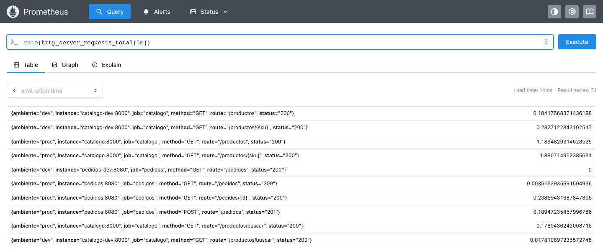

19. Sumar por job y ambiente. Copiar la consulta en la **pregunta 6**.

```promql
sum by (job, ambiente) (rate(http_server_requests_total[5m]))
```

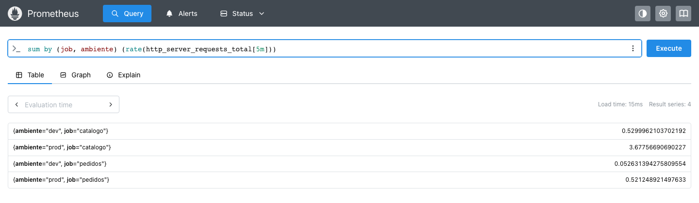

20. Quedarse con las tres rutas más llamadas. Copiar la consulta en la **pregunta 7**.

```promql
topk(3, sum by (job, route) (rate(http_server_requests_total[5m])))
```

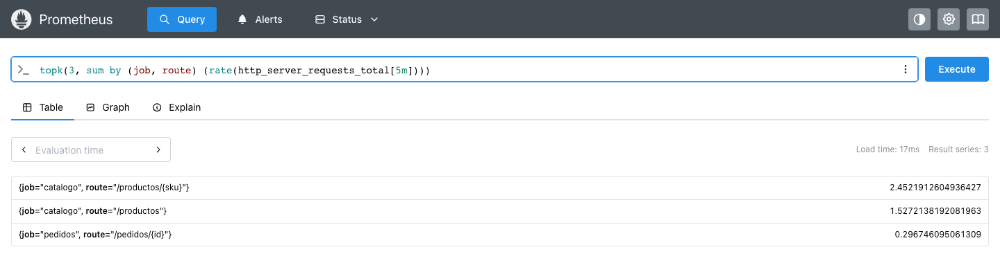

>**Nota.** `sum by`, `without` y `topk` están en el Capítulo 3, sección 3.3 de la presentación del curso. La referencia oficial es [Aggregation operators](https://prometheus.io/docs/prometheus/latest/querying/operators/#aggregation-operators).

### RED de pedidos

Para saber si un puesto atiende bien basta con mirar tres medidores.
Cuántos clientes llegan por minuto, cuántos se van sin comprar y cuánto esperan en la fila.
RED son esas tres consultas aplicadas a pedidos.

21. **Rate**, peticiones por segundo. Copiar la consulta en la **pregunta 8**.

```promql
sum(rate(http_server_requests_total{job="pedidos", ambiente="prod"}[5m]))
```

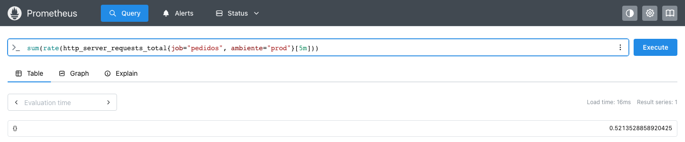

22. **Errors**, proporción de respuestas 5xx. Ejecutar primero esta forma.

```promql
sum(rate(http_server_requests_total{job="pedidos", ambiente="prod", status=~"5.."}[5m])) / sum(rate(http_server_requests_total{job="pedidos", ambiente="prod"}[5m]))
```

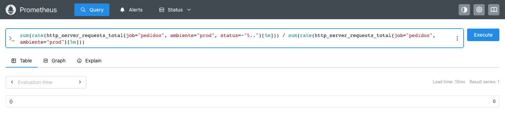

>**Nota.** Sale vacío porque no hay series 5xx que sumar, y una división con un lado vacío también queda vacía. Un panel así diría sin datos justo cuando todo anda bien.

23. Agregar `or vector(0)` al numerador para que valga 0 cuando no hay errores. Copiar la consulta en la **pregunta 9**.

```promql
(sum(rate(http_server_requests_total{job="pedidos", ambiente="prod", status=~"5.."}[5m])) or vector(0))
  /
sum(rate(http_server_requests_total{job="pedidos", ambiente="prod"}[5m]))
```

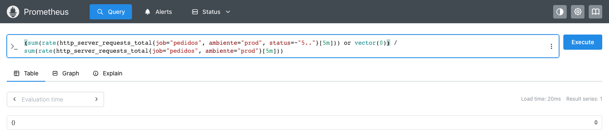

>**Nota.** Las respuestas 422 de pedidos son pedidos rechazados por falta de stock o por un sku que no existe. Son una respuesta correcta del servicio, por eso no cuentan como error en RED.

24. **Duration**, percentil 95 con el histograma nativo de pedidos. Copiar la consulta en la **pregunta 10**.

```promql
histogram_quantile(0.95, sum(rate(http_server_request_duration_seconds{job="pedidos", ambiente="prod"}[5m])))
```

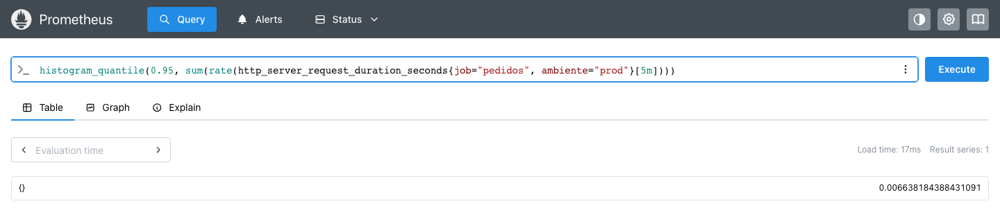

>**Nota.** Las recetas RED y USE están en el Capítulo 3, sección 3.5 de la presentación del curso, y la división entre vectores con `or vector(0)` en la sección 3.3. En la documentación oficial están el operador [or](https://prometheus.io/docs/prometheus/latest/querying/operators/#logicalset-binary-operators), la función [vector](https://prometheus.io/docs/prometheus/latest/querying/functions/#vector) y la función [histogram_quantile](https://prometheus.io/docs/prometheus/latest/querying/functions/#histogram_quantile).

### Tres tipos de distribución

Un tiempo de espera promedio no muestra a los pocos clientes que esperan mucho.
Para verlos se clasifican las peticiones por duración, como la fruta en cajones por tamaño.
Prometheus tiene tres maneras de llevar esa clasificación y este bloque las compara.

25. Calcular el percentil 95 de catalogo con su histograma clásico. Copiar la consulta en la **pregunta 11**.

```promql
histogram_quantile(0.95, sum by (le) (rate(http_server_request_duration_seconds_bucket{job="catalogo", ambiente="prod"}[5m])))
```


>**Nota.** El resultado queda apenas bajo 0.005, que es el límite del primer bucket. Casi todas las peticiones de catalogo tardan menos de 5 ms, así que el histograma clásico solo puede decir que el p95 está entre 0 y 5 ms. El número exacto es una interpolación.

26. Ver el histograma nativo de pedidos tal como lo guarda Prometheus, en la pestaña **Table**.

```promql
http_server_request_duration_seconds{job="pedidos", ambiente="prod", method="POST"}
```

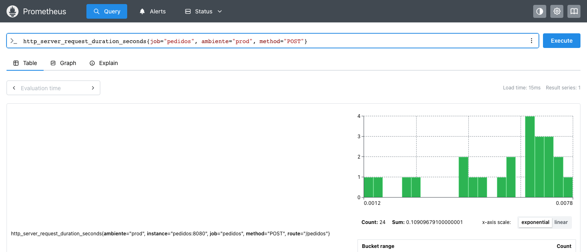

27. Comparar en dos cuadros el percentil 95 de pedidos con el histograma nativo y con su versión clásica. Copiar la consulta clásica en la **pregunta 12**.

```promql
histogram_quantile(0.95, sum(rate(http_server_request_duration_seconds{job="pedidos", ambiente="prod"}[5m])))
```

```promql
histogram_quantile(0.95, sum by (le) (rate(http_server_request_duration_seconds_bucket{job="pedidos", ambiente="prod"}[5m])))
```

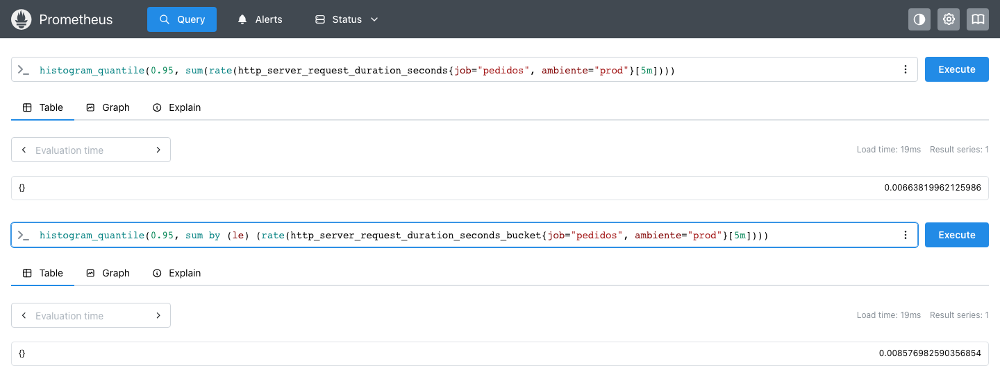

28. Consultar el summary de líneas por pedido. Copiar en la **pregunta 13** la versión que filtra `ambiente="prod"`.

```promql
orders_lines_per_order{quantile="0.9"}
```

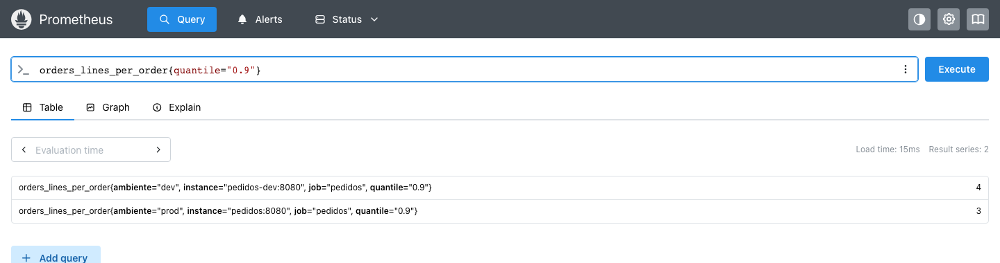

>**Nota.** Hay un percentil 90 por cada instancia. No se pueden sumar ni promediar, porque el promedio de dos percentiles no es el percentil del total. Para eso hace falta un histograma.

29. Anotar una respuesta. De los tres percentiles 95 que se calcularon, ¿cuál es el más confiable y por qué?

>**Nota.** Para responder, comparar lo que se vio en los pasos 25 a 28 con el Capítulo 3, sección 3.2 de la presentación del curso, que trata los histogramas clásicos, los nativos y los resúmenes. La documentación oficial lo explica en [Histograms and summaries](https://prometheus.io/docs/practices/histograms/).

### USE de la máquina

Los medidores de cada puesto dicen cómo atiende el puesto, pero no si la instalación del mercado alcanza.
Para eso se mira cuánto de la cañería se usa, cuánta agua queda en el estanque y cuánta gente espera turno en la llave común.
USE hace esa revisión con la CPU, la memoria y la carga de la máquina.

30. Ejecutar las tres consultas USE en tres cuadros. Copiarlas en las **preguntas 14, 15 y 16**.

```promql
1 - avg(rate(node_cpu_seconds_total{mode="idle"}[5m]))
```

```promql
node_memory_MemAvailable_bytes / node_memory_MemTotal_bytes
```

```promql
sum(node_load1) / count(node_cpu_seconds_total{mode="idle"})
```

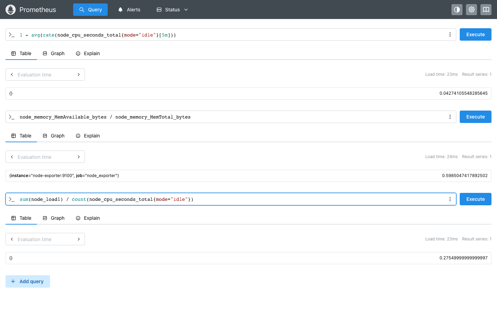

>**Nota.** La primera es la utilización de CPU, la segunda la proporción de memoria libre y la tercera la saturación. Una carga por núcleo sobre 1 significa que hay procesos esperando CPU.

### Caos de latencia

Este bloque enciende a propósito una demora en una parte de las peticiones de pedidos.
Es como si algunos clientes del puesto tuvieran que esperar más en la fila.
El ejercicio consiste en encontrar el efecto solo con las consultas de percentil ya escritas.

31. Encender una falla de latencia en pedidos. El 20 % de las peticiones va a tardar 300 ms más.

```bash
bin/caos.sh pedidos latencia ms=300 porcentaje=20 duracion_s=900
```

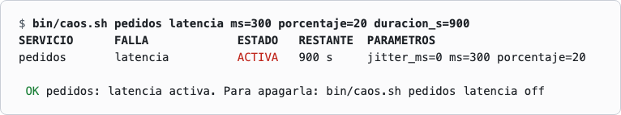

32. Esperar 2 minutos. Ejecutar la consulta de la **pregunta 10** en **Graph** con un rango de 15 minutos. En un segundo cuadro ejecutar la misma consulta con 0.50 en vez de 0.95.

```promql
histogram_quantile(0.50, sum(rate(http_server_request_duration_seconds{job="pedidos", ambiente="prod"}[5m])))
```

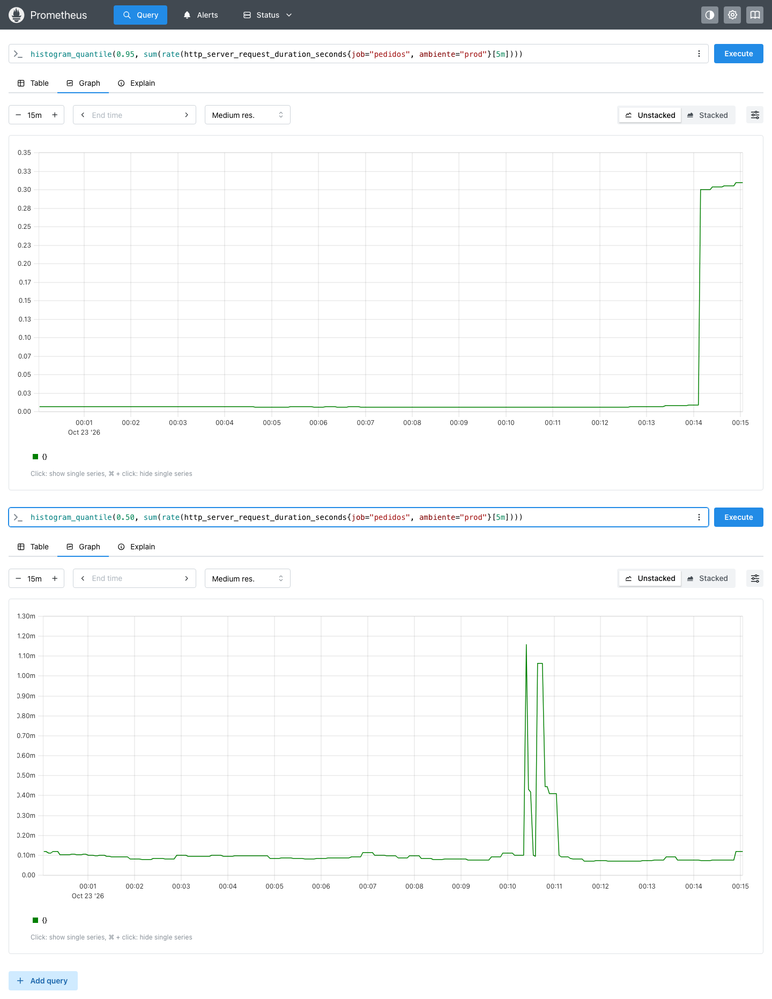

>**Nota.** El p95 salta a unos 300 ms y el p50 casi no se mueve. Ocho de cada diez clientes no notan nada. La mediana sola habría escondido el problema.

33. Apagar la falla.

```bash
bin/caos.sh pedidos latencia off
```

### La bomba de cardinalidad

Cada combinación distinta de etiquetas es una serie, y cada serie ocupa memoria en Prometheus.
En el mercado equivale a llevar un cuaderno por producto en la bodega.
Este bloque cuenta los cuadernos antes y después de una falla que cambia esa regla, y busca la métrica y la etiqueta que la provocan.

34. Medir cuántas series tiene Prometheus en memoria y cuántas tiene catalogo en prod. Anotar los dos números. Copiar la primera consulta en la **pregunta 17**.

```promql
prometheus_tsdb_head_series
```

```promql
count({job="catalogo", ambiente="prod"})
```


35. Contar las series de cada job. Copiar la consulta en la **pregunta 18**.

```promql
sort_desc(count by (job) ({__name__=~".+"}))
```

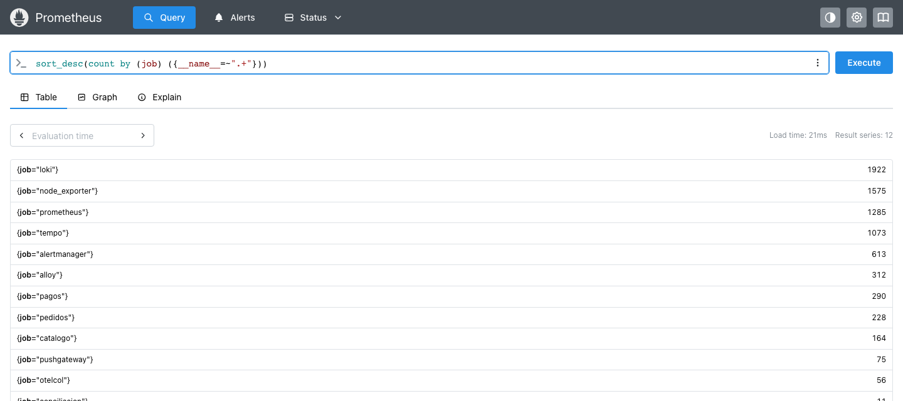

36. Encender la falla de cardinalidad en catalogo. Con ella, la etiqueta `route` lleva la ruta real de cada petición en vez de su plantilla.

```bash
bin/caos.sh catalogo cardinalidad
```

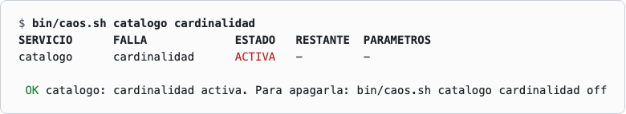

37. Antes de ejecutar el siguiente comando, anotar una predicción. La ráfaga hace 200 peticiones a 200 skus distintos. ¿Cuántas series nuevas va a crear? Después ejecutarlo.

```bash
Capitulo3/rafaga-skus.sh
```

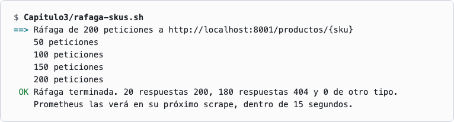

38. Esperar 15 segundos y repetir las dos consultas del paso 34. Compararlas con lo anotado.


39. Buscar la métrica culpable. Copiar la consulta en la **pregunta 19**.

```promql
topk(5, count by (__name__) ({job="catalogo"}))
```

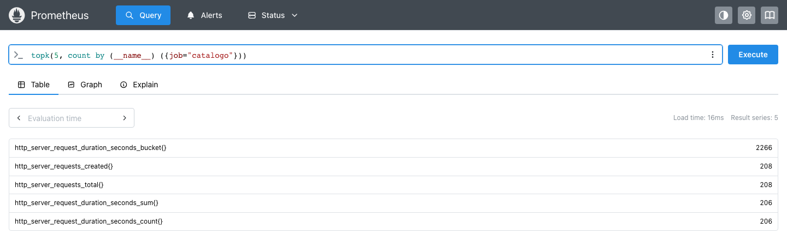

40. Buscar la etiqueta culpable. Revisar **Result series**. Copiar la consulta en la **pregunta 20**.

```promql
count by (route) (http_server_requests_total{job="catalogo", ambiente="prod"})
```

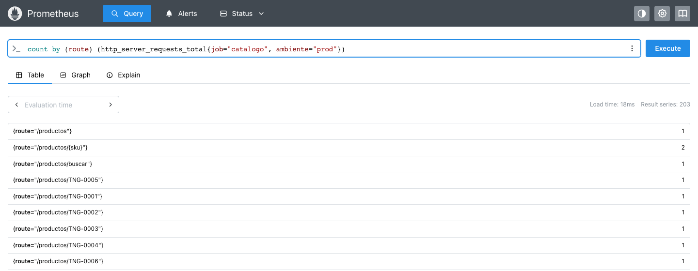

>**Nota.** La cardinalidad y cómo encontrar a la métrica y la etiqueta culpables están en el Capítulo 3, sección 3.6 de la presentación del curso. Las funciones usadas en este bloque están en [count y topk](https://prometheus.io/docs/prometheus/latest/querying/operators/#aggregation-operators) y en [sort_desc](https://prometheus.io/docs/prometheus/latest/querying/functions/#sort_desc).

41. Apagar la falla y reiniciar catalogo. La librería de métricas no olvida una serie mientras el proceso sigue vivo.

```bash
bin/caos.sh catalogo cardinalidad off
```

```bash
docker restart gpe-catalogo
```

42. Esperar 30 segundos y repetir las dos consultas del paso 34.

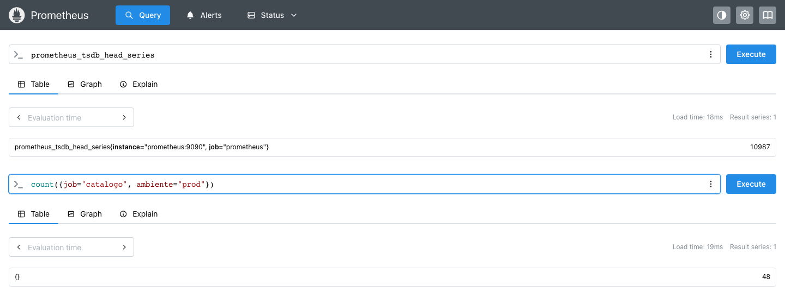

>**Nota.** catalogo vuelve enseguida a su cantidad normal, pero `prometheus_tsdb_head_series` sigue alto. Prometheus ya marcó esas series como vencidas y no las devuelve, pero las mantiene en memoria hasta compactar el bloque donde quedaron, y eso tarda entre 2 y 3 horas. La ráfaga elige skus nuevos cada vez que corre, así que repetirla vuelve a crear series.

### Verificar

Al cierre del día cada puestero deja anotado cómo leyó cada medidor, para que otro pueda repetir la lectura.
`Capitulo3/consultas.md` es ese registro.
La verificación ejecuta cada consulta guardada y revisa que el stack haya quedado sin fallas.

43. Revisar que `Capitulo3/consultas.md` tenga una consulta en cada pregunta y guardarlo.

44. Ejecutar la verificación. Cada línea queda en verde si está lograda o en rojo con una pista de lo que falta.

```bash
Capitulo3/verificar.sh
```

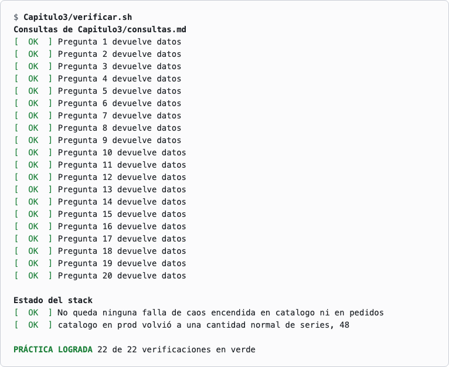

## Preguntas frecuentes

**¿Qué diferencia hay entre una métrica y una serie?**
Una métrica es un nombre, como `http_server_requests_total`. Cada combinación distinta de sus etiquetas forma una serie con sus propios valores en el tiempo.

**¿Qué indica la etiqueta `job`?**
Identifica el servicio del que viene cada serie, como catalogo o pedidos. Es la etiqueta que más se usa para filtrar en esta práctica.

**¿Qué diferencia hay entre las pestañas Table y Graph?**
**Table** muestra el valor de cada serie en el instante actual. **Graph** dibuja esos valores a lo largo del rango de tiempo elegido.

**¿Qué significa `[5m]` al final de una consulta?**
Indica que la función usa todas las muestras de los últimos 5 minutos de cada serie. Una ventana más larga da una curva más suave pero tarda más en reflejar un cambio.

**¿Por qué la guía pide esperar antes de repetir una consulta?**
Prometheus lee las métricas de cada servicio cada 15 segundos. Funciones como `rate` necesitan varias muestras nuevas dentro de su ventana antes de mostrar un cambio.

**¿Qué significan las siglas RED y USE?**
RED es Rate, Errors y Duration, y mira un servicio desde el lado del cliente. USE es Utilization, Saturation y Errors, y mira los recursos de la máquina.

**¿Las fallas de `bin/caos.sh` afectan al computador del alumno?**
No. Cada falla vive dentro del servicio que la recibe y se apaga con `off`.

## Resultado esperado

`Capitulo3/consultas.md` tiene las 20 consultas y todas devuelven datos, no queda ninguna falla de caos encendida y catalogo volvió a su cantidad normal de series. El gráfico de las series de catalogo muestra la bomba y su desactivación.

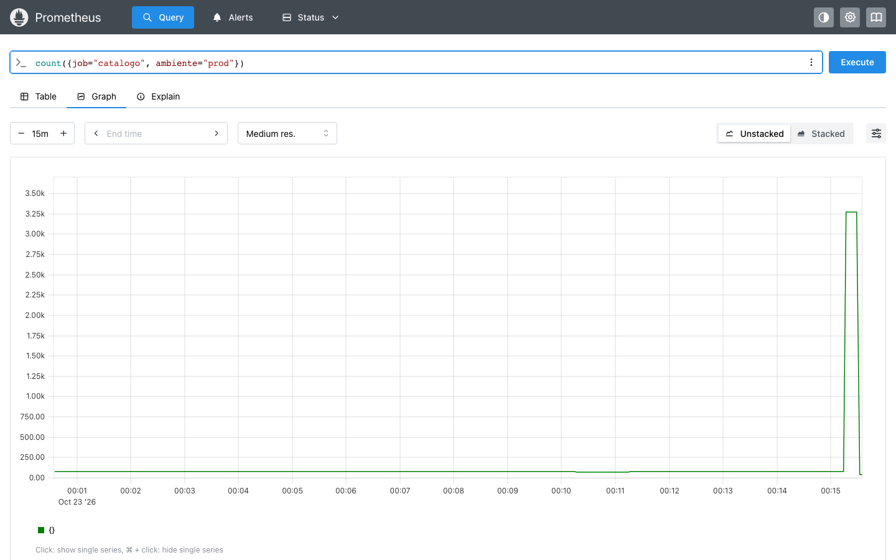

`Capitulo3/restaurar.sh` deja `consultas.md` vacío otra vez. Avisa qué cambia y pide escribir SI.

La carpeta `Capitulo3/solucion` trae `consultas.md` resuelto.

Para ver la práctica resuelta de una vez, `Capitulo3/solucion/aplicar.sh` copia las consultas y apaga el caos. Avisa qué cambia y pide escribir SI.
