# Práctica 4. Dashboard de aplicación web basado en el método RED

En esta práctica se arma en Grafana el dashboard RED de Tianguis Digital. Se usan las visualizaciones del capítulo, transformaciones, opciones de tiempo por panel y una segunda fuente de datos, y al final se exporta el dashboard en JSON.

## Objetivos
- Revisar los dashboards sugeridos de Grafana para una fuente Prometheus.
- Construir paneles Stat, Gauge, Bar gauge, Time series, Heatmap, Table, Text y Dashboard list.
- Configurar unidades, umbrales y transformaciones.
- Comparar contra la hora anterior con un desplazamiento de tiempo y fijar un tiempo relativo propio en un panel.
- Agregar un panel de logs de Loki al lado de las métricas.
- Ordenar el dashboard en filas, guardarlo y exportarlo.

## El problema y la solución

En un mercado grande la administración necesita saber cómo va cada puesto durante el día.
Si cada encargado anota sus números en un cuaderno distinto, nadie ve el conjunto.
Para saber cuántos clientes hubo, cuántos reclamaron y cuánto esperaron, hay que ir puesto por puesto.
Cuando algo anda mal, el aviso llega tarde y sin detalle.

La solución es un pizarrón en la oficina de la administración.
Cada letrero del pizarrón responde una sola pregunta y tiene la forma que mejor la muestra.
Hay un número grande para los clientes de hoy, una aguja de balanza que marca cuando algo pesa demasiado y barras de llenado para comparar las bodegas.
Al lado se pegan las boletas de reclamo y la foto del pizarrón de ayer a la misma hora.

En Tianguis Digital el pizarrón es un dashboard de Grafana y cada letrero es un panel.
Los números vienen de Prometheus y las boletas de reclamo son los logs que guarda Loki.
El dashboard sigue el método RED, que mira la tasa de peticiones, los errores y la duración de cada servicio.
Al terminar se le saca una foto al pizarrón, que es el archivo JSON exportado, para volver a pintarlo igual si se pierde.

En el NOC este es el tablero que se abre cuando llega una alerta de errores en catalogo.
En una sola pantalla se ve cuánto falla, desde cuándo, cómo se compara con la hora anterior y qué dicen los logs, y con eso se decide si escalar y a quién.

## Duración aproximada
- 120 minutos.

---
<div style="width: 400px;">
        <table width="50%">
            <tr>
                <td style="text-align: center;">
                    <a href="../Capitulo3/"></a>
                    <br>anterior
                </td>
                <td style="text-align: center;">
                   <a href="../README.md">Lista Laboratorios</a>
                </td>
<td style="text-align: center;">
                    <a href="../Capitulo5/">
                    </a>
                    <br>siguiente
                </td>
            </tr>
        </table>
</div>

---

## Diagrama

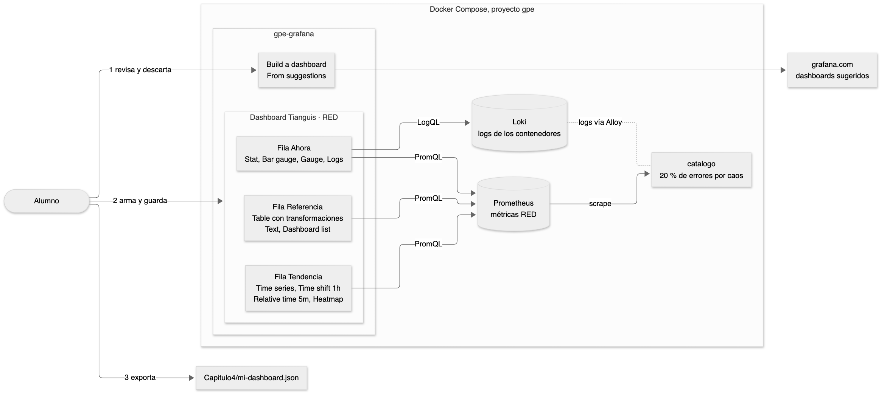

<br>

## Instrucciones

### Preparar el punto de partida

Antes de pintar el pizarrón hace falta que el mercado esté abierto y que haya movimiento que mirar.
El script deja el stack en el estado que necesita la práctica, con catalogo respondiendo errores a propósito.
Así los letreros muestran actividad real desde el primer panel.

1. Abrir una terminal en la carpeta del repositorio. En Windows usar Git Bash.

2. Dejar el stack en el punto de partida de la práctica. El script enciende una falla en catalogo para que el 20 % de sus respuestas sean errores durante 60 minutos.

```bash
Capitulo4/preparar.sh
```

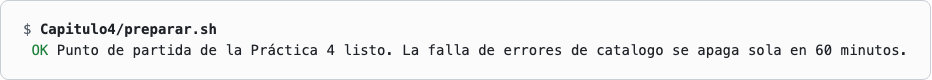

3. Abrir Grafana en el navegador e iniciar sesión con el usuario `admin` y la contraseña `tianguis`. Si cambiaste el puerto o la contraseña, usa los valores de `infra/.env`.

### Revisar los dashboards sugeridos

Antes de pintar un pizarrón propio conviene mirar los que ya vienen hechos.
Grafana ofrece dashboards armados por la comunidad para cada tipo de fuente de datos.
Recorrer uno muestra cómo se organiza un pizarrón ajeno y qué preguntas eligió responder su autor.

4. Entrar a **Connections**, **Data sources** y abrir **Prometheus**. Pulsar **Build a dashboard**.

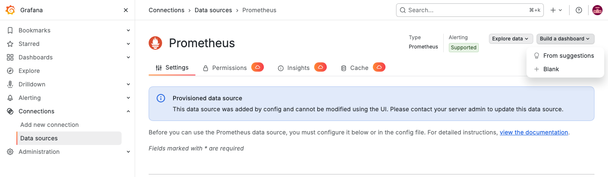

5. Elegir **From suggestions**. Grafana muestra dashboards de la comunidad que sirven para una fuente Prometheus.

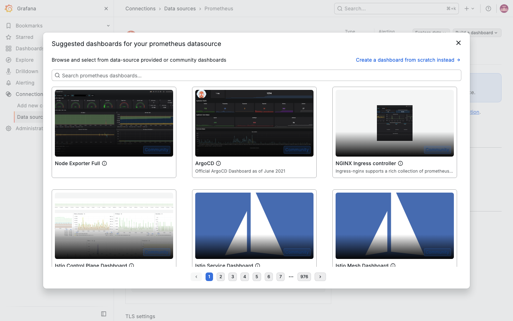

>**Nota.** La lista viene de grafana.com, así que Grafana necesita salida a internet. Si la ventana queda vacía, revisa la conexión.

>**Sin internet.** Si **From suggestions** no carga, cerrar la ventana y usar el dashboard del curso Host · USE, que mira la misma máquina con el método USE. Entrar a **Dashboards**, pulsar **New** y elegir **Import dashboard**. Pulsar **Upload dashboard JSON file**, elegir el archivo `Capitulo4/sin-internet/host-use.json` y pulsar **Import**. Recorrerlo en lugar de Node Exporter Full en el paso 6 y seguir con el paso 7.

6. En la tarjeta **Node Exporter Full** pulsar **View dashboard**. Recorrer el dashboard sin guardarlo.

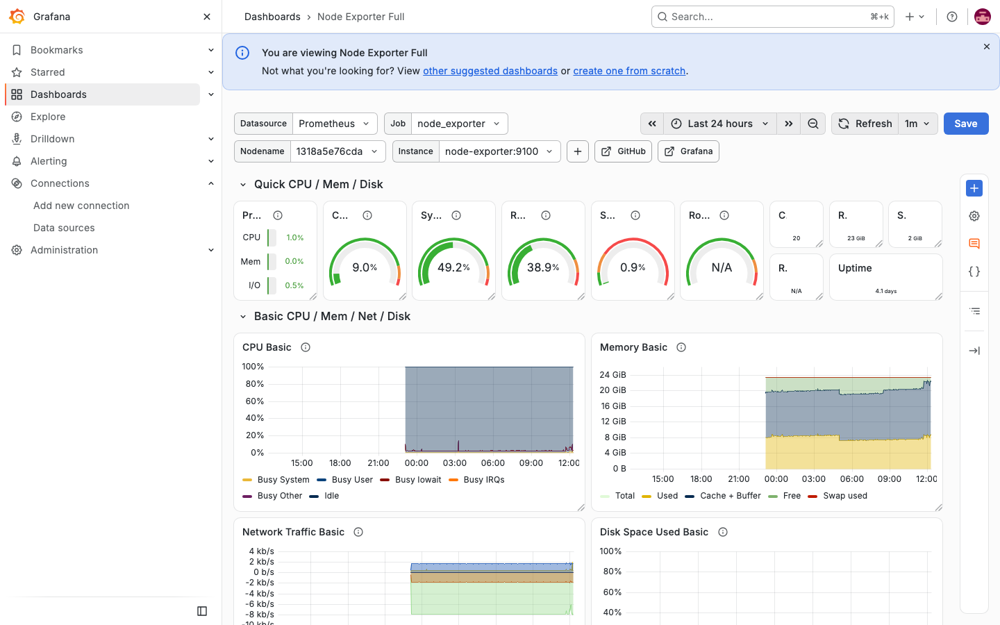

>**Nota.** Este dashboard muestra la máquina que mide node_exporter. Sirve para la infraestructura, pero no dice nada de las peticiones de Tianguis. Por eso se arma uno propio.

7. Entrar a **Dashboards** en el menú. Si Grafana avisa que hay cambios sin guardar, pulsar **Discard**.

### Fila Ahora

La primera sección del pizarrón muestra lo que pasa en este momento.
Cada letrero responde una pregunta del método RED y por eso cada uno usa una visualización distinta.
Al lado de la aguja se pegan las boletas de reclamo, que aquí son los logs de Loki.

8. Pulsar **New** y elegir **New dashboard**. En el panel de la derecha pulsar **Add row**. En el campo **Title** escribir `Ahora` y pulsar Enter.

9. Pulsar **Add panel** y después **Configure visualization**. Cambiar de **Builder** a **Code**, escribir la siguiente consulta y pulsar Shift y Enter juntos.

```promql
sum(rate(http_server_requests_total{ambiente="prod"}[5m]))
```

10. En **All visualizations** elegir **Stat**. En **Title** escribir `Peticiones por segundo en prod`. En **Standard options**, campo **Unit**, escribir `requests/sec (rps)` y pulsar Enter.

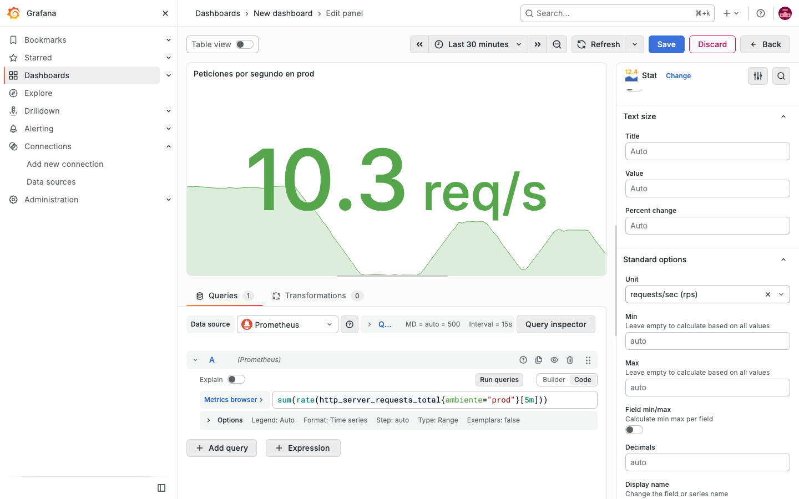

11. Pulsar **Back**. Agregar otro panel con esta consulta.

```promql
histogram_quantile(0.95, sum by (job, le) (rate(http_server_request_duration_seconds_bucket{ambiente!="dev", http_route!="/salud"}[5m])))
```

12. Elegir **Bar gauge**. En **Title** escribir `p95 por servicio en prod` y en **Unit** escribir `seconds (s)` y pulsar Enter.

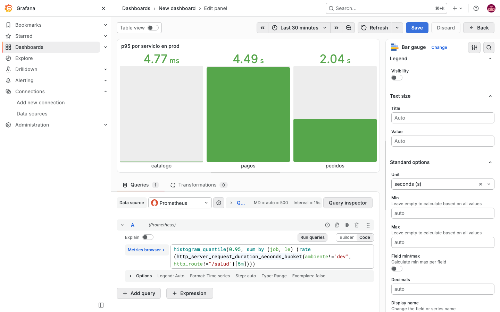

>**Nota.** `ambiente!="dev"` también deja pasar las series que no tienen la etiqueta `ambiente`. Así entra pagos, que manda sus métricas por OpenTelemetry. `http_route!="/salud"` quita de pagos las peticiones del chequeo de salud.

13. Pulsar **Back**. Agregar otro panel con esta consulta.

```promql
sum(rate(http_server_requests_total{ambiente="prod", status=~"5.."}[5m])) / sum(rate(http_server_requests_total{ambiente="prod"}[5m]))
```

14. Elegir **Gauge**. En **Title** escribir `Proporción de errores en prod` y en **Unit** escribir `Percent (0.0-1.0)` y pulsar Enter.

15. Bajar hasta **Thresholds** y pulsar **Add threshold**. Aparece un umbral amarillo con valor 90. Cambiar el rojo de 80 a `0.05` y el amarillo de 90 a `0.01`.

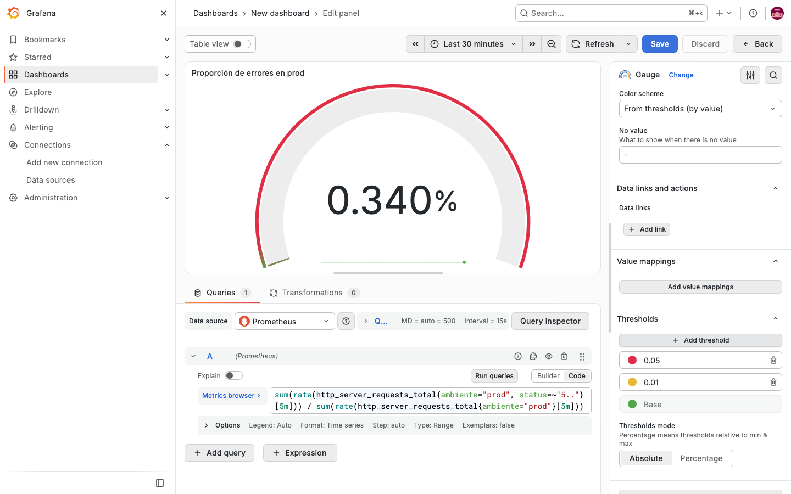

>**Nota.** Bajo 1 % de errores la aguja queda verde, entre 1 % y 5 % amarilla y sobre 5 % roja. Con la falla de catalogo encendida el Gauge debe quedar en rojo.

16. Pulsar **Back** y agregar otro panel. En **Data source** elegir **Loki**. Cambiar a **Code**, escribir la siguiente consulta y pulsar Shift y Enter juntos.

```logql
{compose_service="catalogo"} | json | level="error"
```

17. Elegir **Logs**. En **Title** escribir `Errores de catalogo`.

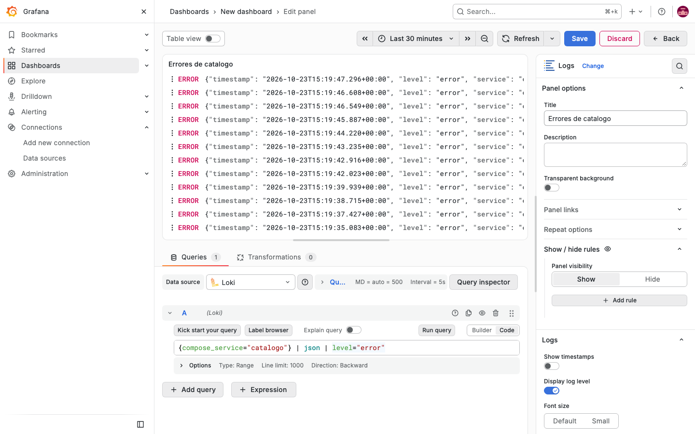

18. Pulsar **Back**. El panel de logs queda al lado del Gauge de errores.

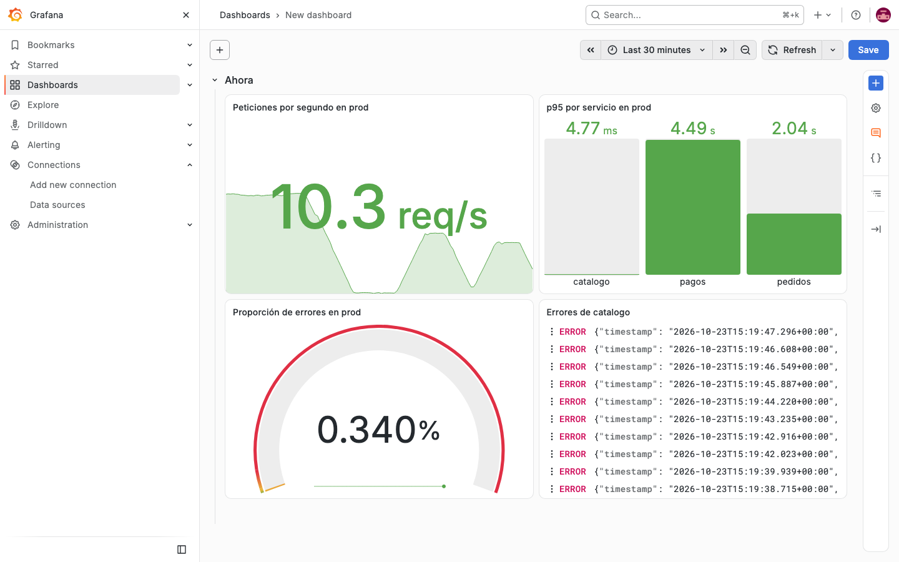

### Fila Tendencia

Un número de ahora no dice si ahora es normal.
Esta sección pega al lado la foto del pizarrón de una hora antes y deja un letrero que mira solo los últimos minutos.
También agrega un mapa de calor, como el de los pasillos más concurridos, para ver cómo se reparten las duraciones.

19. Pulsar **Add row** debajo de los paneles. En **Title** escribir `Tendencia` y pulsar Enter.

20. Agregar un panel con esta consulta. Elegir **Time series**, en **Title** escribir `Peticiones por segundo por job y ambiente` y en **Unit** elegir `requests/sec (rps)`.

```promql
sum by (job, ambiente) (rate(http_server_requests_total[5m]))
```

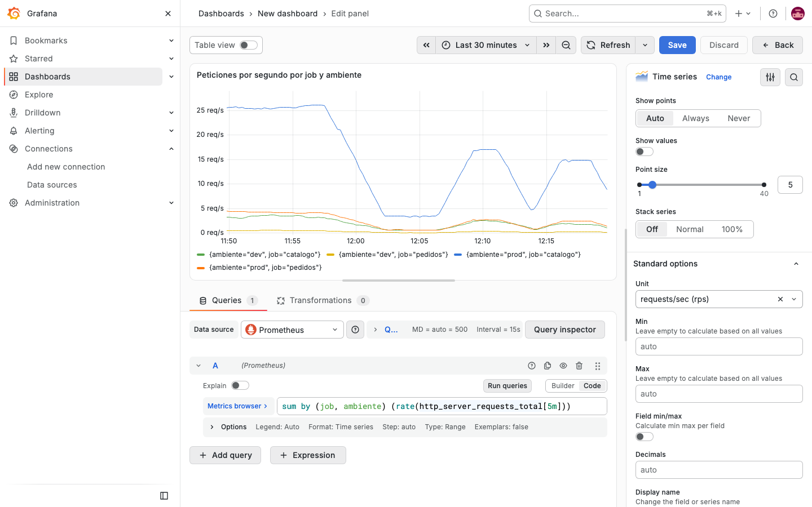

21. Pulsar **Back** y agregar otro panel igual, con la misma consulta, la misma unidad y el título `La misma, una hora antes`.

22. Abrir **Query options**, al lado de **Data source**. En **Time shift** escribir `1h` y hacer clic fuera del campo.

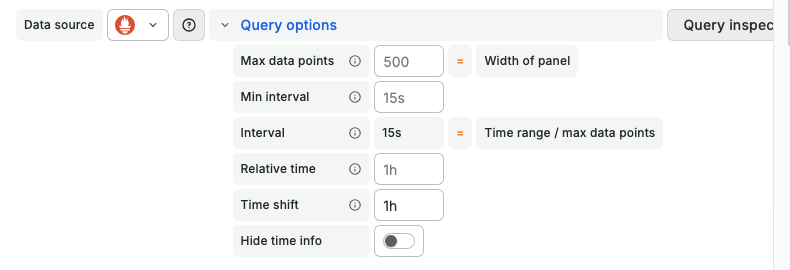

23. Antes de mirar el panel desplazado en el dashboard, anotar una predicción. ¿Qué va a mostrar si el stack lleva menos de una hora arriba?

>**Nota.** Qué hace **Time shift** con el rango de un panel se explica en el Capítulo 4, sección 4.5 de la presentación del curso, y en la sección Time shift de la [documentación de Grafana sobre las opciones de consulta](https://grafana.com/docs/grafana/latest/visualizations/panels-visualizations/query-transform-data/#query-options). Para la predicción conviene pensar desde qué hora tiene datos Prometheus.

24. Pulsar **Back** y agregar un panel con esta consulta. Elegir **Time series**, en **Title** escribir `Errores por segundo, últimos 5 minutos` y en **Unit** elegir `requests/sec (rps)`.

```promql
sum by (job) (rate(http_server_requests_total{status=~"5.."}[1m]))
```

25. En **Query options**, campo **Relative time**, escribir `5m` y hacer clic fuera del campo.

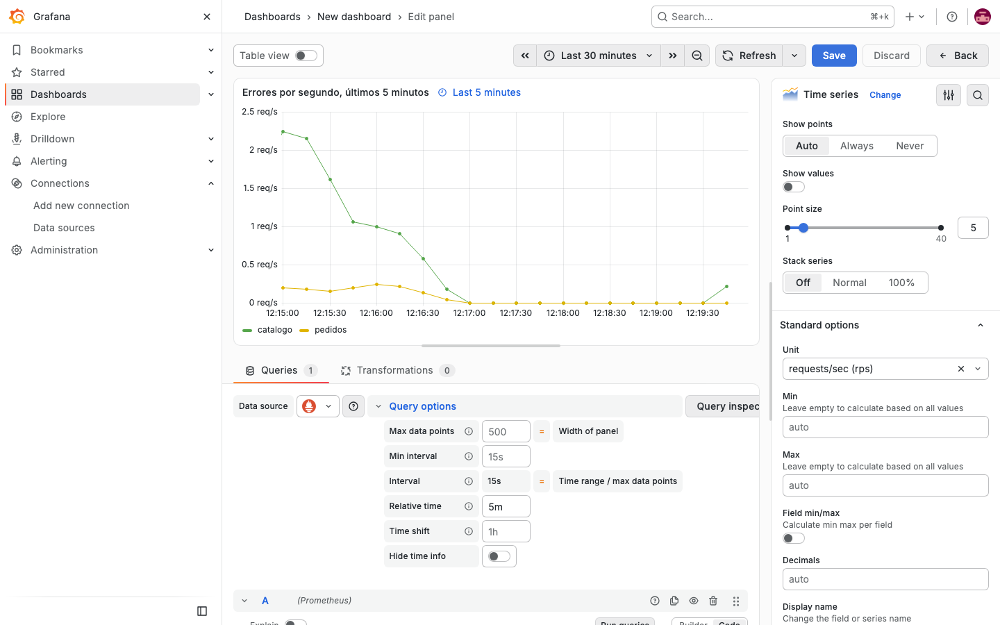

26. Pulsar **Back** y agregar un panel con esta consulta.

```promql
sum by (le) (rate(http_server_request_duration_seconds_bucket{job="pedidos", ambiente="prod"}[5m]))
```

27. Abrir **Options**, debajo de la consulta, y en **Format** elegir **Heatmap**. Elegir la visualización **Heatmap** y en **Title** escribir `Duración de pedidos en prod`.

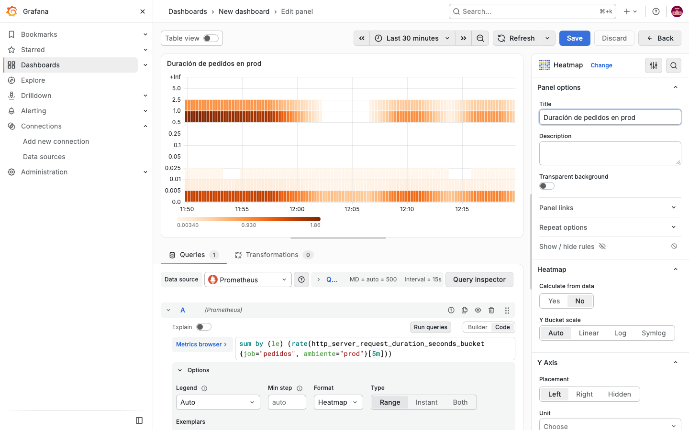

### Fila Referencia

La última sección no avisa de problemas, sirve de consulta.
Tiene una lista de rutas ordenada antes de pegarla, una explicación escrita del método y enlaces a otros pizarrones del curso.
Las transformaciones son las que ordenan y limpian esa lista dentro de Grafana.

28. Pulsar **Back**, después **Add row**, y llamar a la fila `Referencia`.

29. Agregar un panel con esta consulta. En **Options** elegir **Format** **Table** y **Type** **Instant**, y pulsar **Run queries**.

```promql
topk(10, sum by (job, route) (rate(http_server_requests_total{ambiente="prod"}[5m])))
```

30. Elegir **Table** y en **Title** escribir `Rutas más llamadas en prod`.

31. Abrir la pestaña **Transformations**, pulsar **Add transformation** y elegir **Sort by**. En **Field** elegir `Value` y encender **Reverse**.

32. Pulsar **Add another transformation** y elegir **Organize fields by name**. Pulsar el ojo de `Time` para ocultarlo y en **Rename Value** escribir `Por segundo`.

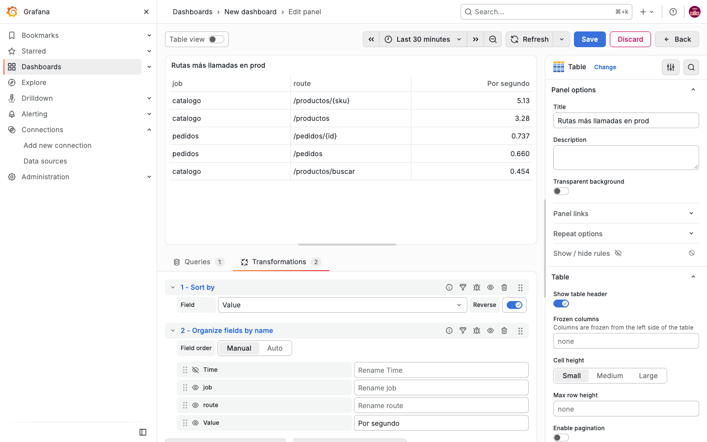

33. Pulsar **Back** y agregar un panel. Elegir **Text** y en **Title** escribir `El método RED`. Reemplazar el contenido de **Content** por el siguiente texto y hacer clic fuera del editor.

```markdown
## Método RED

Tres preguntas para cada servicio que atiende peticiones.

**Rate**, cuántas peticiones por segundo atiende.

**Errors**, qué proporción de esas peticiones falla.

**Duration**, cuánto tardan, medido con el percentil 95.
```

El texto está escrito en Markdown, un formato de texto simple que el panel **Text** convierte en títulos y negritas. No hace falta saber programar para usarlo, basta con copiar el bloque completo.

| Línea | Qué hace |
|---|---|
| `## Método RED` | Los dos `#` al inicio convierten la línea en un título |
| `Tres preguntas para cada servicio...` | Texto normal, se muestra tal cual |
| `**Rate**, cuántas peticiones...` | Lo que va entre dos pares de asteriscos sale en negrita |
| `**Errors**, qué proporción...` | Igual que la anterior, con la segunda pregunta del método |
| `**Duration**, cuánto tardan...` | Igual que la anterior, con la tercera pregunta del método |
| Líneas en blanco | Separan los párrafos. Sin ellas las frases quedan pegadas en uno solo |

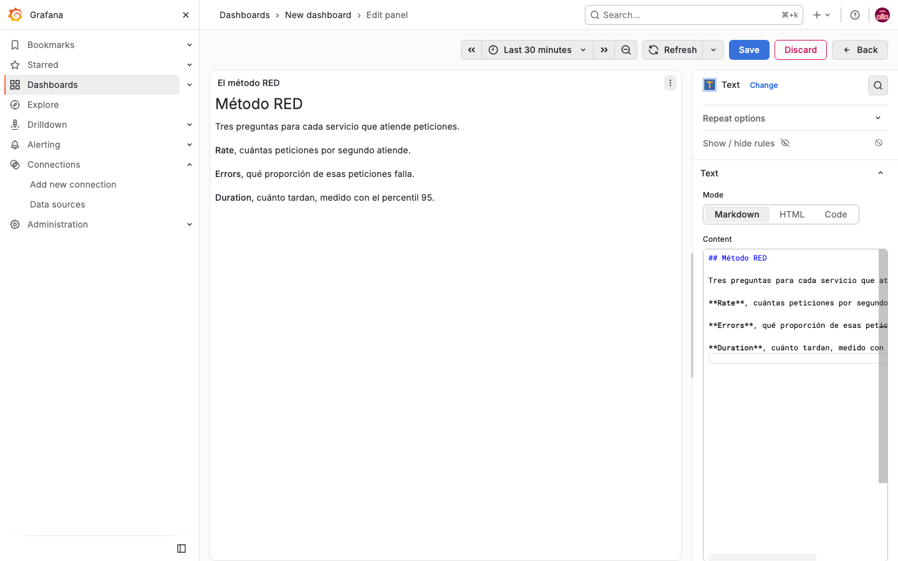

34. Pulsar **Back** y agregar un panel. Elegir **Dashboard list** y en **Title** escribir `Dashboards del curso`. Apagar **Starred**, encender **Search** y en **Query** escribir `Tianguis`.

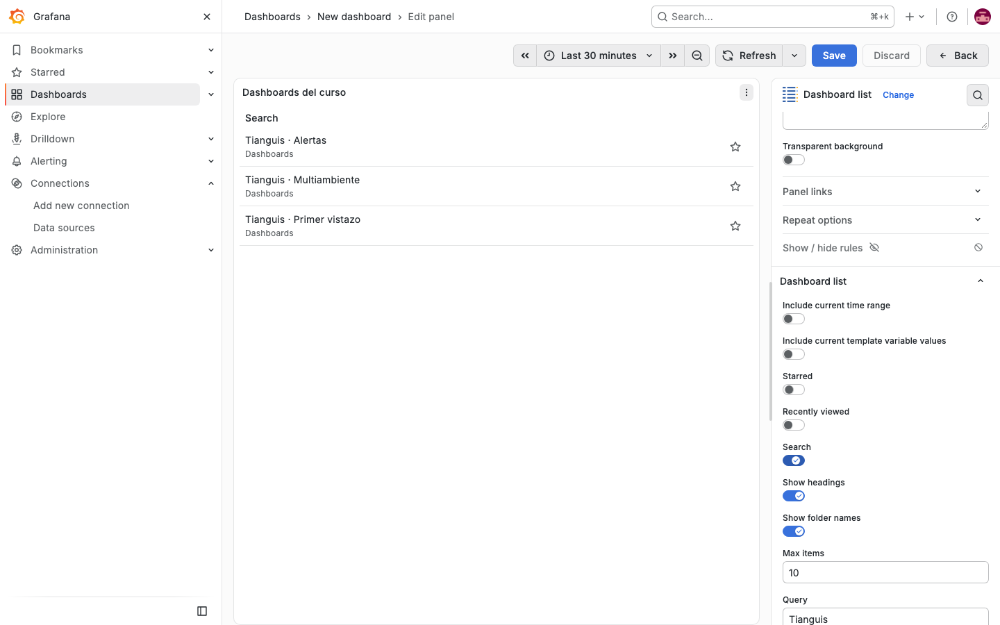

>**Nota.** La lista sale vacía hasta guardar. Busca entre los dashboards guardados, y este todavía no lo está.

### Guardar

Mientras se edita, el pizarrón todavía no queda guardado en Grafana.
Guardarlo con un nombre lo deja disponible para cualquiera que entre a **Dashboards**.
Después se recorre fila por fila para revisar cada letrero.

35. Pulsar **Back** y después **Save**. En **Title** copiar el siguiente nombre y pulsar **Save**.

```text
Tianguis · RED
```

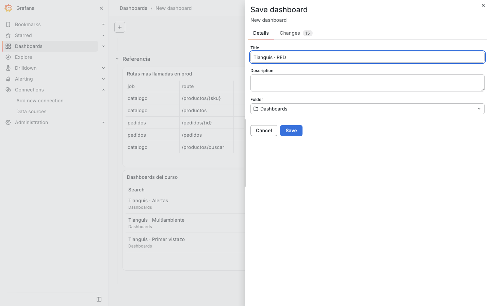

36. Revisar la fila **Ahora**.

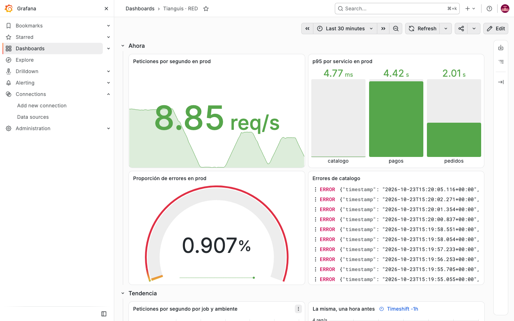

37. Bajar hasta la fila **Tendencia** y comparar el panel desplazado con el anotado en el paso 23.

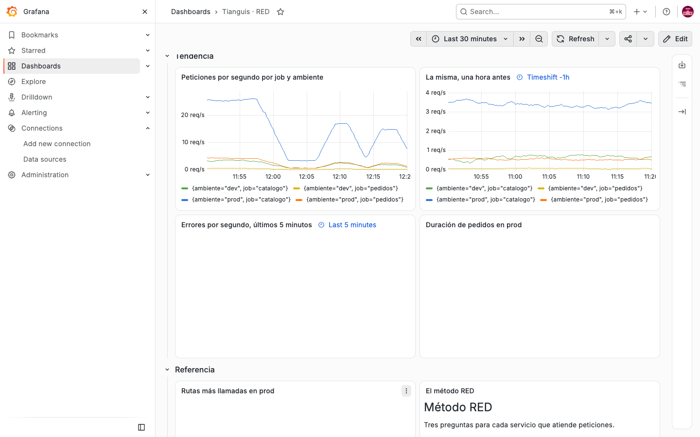

38. Bajar hasta la fila **Referencia**.

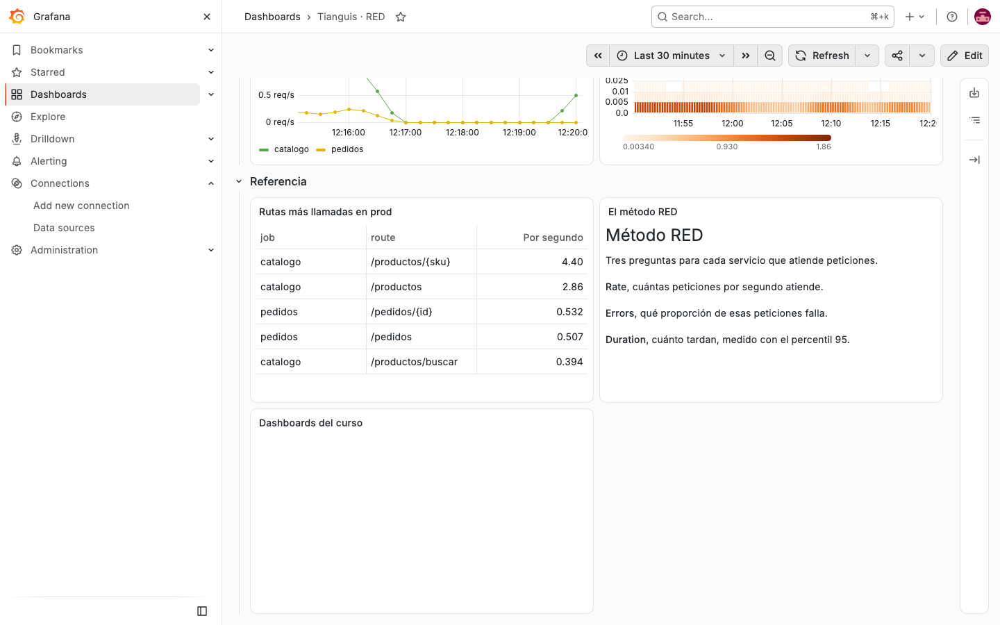

### Exportar

Un dashboard guardado vive dentro de la base de datos de Grafana.
Exportarlo es sacarle una foto al pizarrón y dejarla en la carpeta de la práctica.
Con ese archivo JSON el dashboard se puede volver a cargar si se pierde y se puede guardar en git.

39. En la barra de la derecha pulsar el ícono **Export** y elegir **Export as code**.

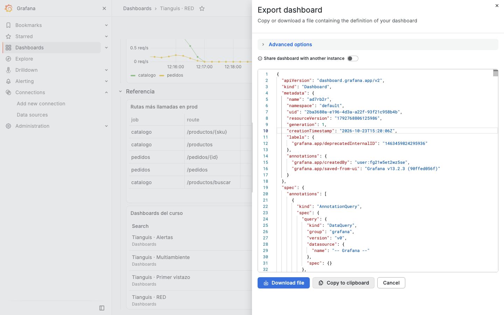

40. Pulsar **Download file**. Mover el archivo descargado a la carpeta de la práctica con el nombre `mi-dashboard.json`.

```bash
mv ~/Downloads/Tianguis*RED*.json Capitulo4/mi-dashboard.json
```

>**Nota.** Si en Descargas hay más de un archivo que empieza con Tianguis, borra los anteriores antes de ejecutar `mv`.

### Verificar

La verificación revisa que el pizarrón tenga los letreros pedidos y que la foto quede donde corresponde.
Consulta Grafana y lee el archivo exportado, así que necesita terminados los dos bloques anteriores.

41. Ejecutar la verificación. Cada línea queda en verde si está lograda o en rojo con una pista de lo que falta.

```bash
Capitulo4/verificar.sh
```

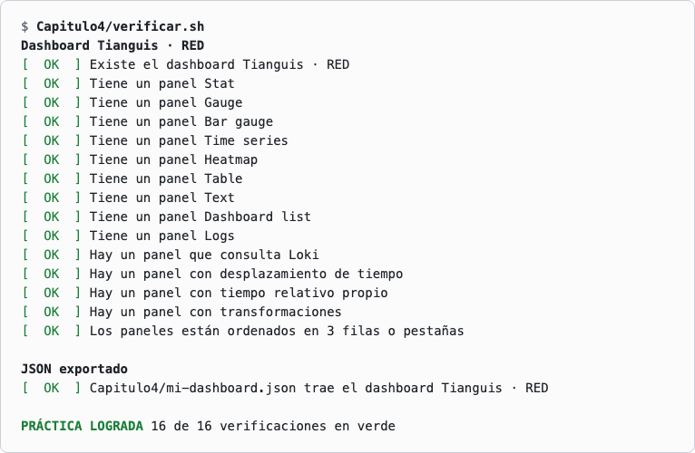

## Preguntas frecuentes

**¿Qué diferencia hay entre Prometheus y Grafana?**
Prometheus junta las métricas y responde consultas en PromQL. Grafana no guarda esas métricas, las pide a sus fuentes de datos y las dibuja en paneles.

**¿Qué es una fuente de datos en Grafana?**
Es la conexión a un sistema que guarda datos, como Prometheus o Loki. Cada panel elige la suya en **Data source**, así un mismo dashboard puede mezclar métricas y logs.

**¿Qué significa `rate(...[5m])` en las consultas?**
`rate` calcula cuánto creció por segundo un contador, promediado en los últimos 5 minutos. Por eso los paneles muestran peticiones por segundo y no un total acumulado.

**¿Por qué se pulsa Shift y Enter después de escribir la consulta?**
Esa combinación ejecuta la consulta en el editor **Code**. Hasta ejecutarla, el panel no muestra el resultado nuevo.

**¿Qué es el percentil 95?**
Es el valor bajo el cual queda el 95 % de las duraciones medidas. Muestra cuánto esperan las peticiones más lentas sin que un caso aislado cambie el número.

**¿Qué es una transformación?**
Es un paso que Grafana aplica al resultado de la consulta antes de dibujarlo, como ordenar filas u ocultar columnas. No cambia los datos guardados en Prometheus.

**¿Para qué sirven las filas del dashboard?**
Agrupan paneles bajo un título y se pueden plegar con su flecha. Los paneles nuevos quedan dentro de la última fila creada, por eso la guía crea cada fila antes de sus paneles.

## Resultado esperado

Grafana tiene el dashboard Tianguis · RED con tres filas. Ahora muestra la tasa, los p95, la proporción de errores en rojo y los logs de errores de catalogo. Tendencia muestra la tasa actual, la de una hora antes, los errores de los últimos 5 minutos y el mapa de calor de pedidos. Referencia muestra las rutas más llamadas, la explicación del método RED y la lista de dashboards del curso.

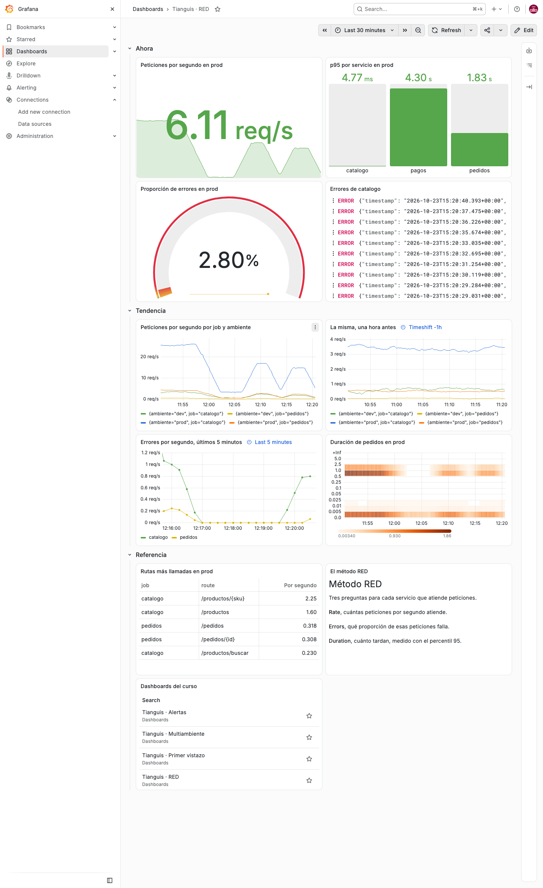

`Capitulo4/restaurar.sh` apaga la falla de catalogo y borra `mi-dashboard.json`. El dashboard queda en Grafana porque la Práctica 9 lo vuelve a usar. Avisa qué cambia y pide escribir SI.

La carpeta `Capitulo4/solucion` trae el dashboard resuelto en `tianguis-red.json`. Se carga desde **Dashboards**, **New**, **Import dashboard**.

Para ver la práctica resuelta de una vez, `Capitulo4/solucion/aplicar.sh` importa el dashboard y deja su JSON en `mi-dashboard.json`. Avisa qué cambia y pide escribir SI.
