<!--  -->
# Práctica 5. Alertas de un microservicio con Alertmanager y Grafana Alerting

En esta práctica se agrega una métrica propia al código de catalogo, se envían métricas a mano por OTLP y por el Pushgateway y se crean reglas de registro. Después se escriben reglas de alerta con sus pruebas, se configura Alertmanager para avisar por correo y por webhook y se provoca un incidente para ver sonar, agruparse, inhibirse, silenciarse y resolverse las alertas. Al final se arma una alerta gestionada por Grafana y un dashboard que marca solo las ventanas de caos.

## Objetivos
- Instrumentar un servicio con un counter nuevo y elegir bien sus etiquetas.
- Comparar la instrumentación con prometheus_client y con la API de OpenTelemetry.
- Enviar métricas a Prometheus por OTLP y por el Pushgateway.
- Crear reglas de registro y reglas de alerta, y probarlas con promtool.
- Configurar en Alertmanager el ruteo, la agrupación, la inhibición y los silencios.
- Crear en Grafana una regla de alerta, un punto de contacto, una política y una plantilla.
- Mostrar en un dashboard las ventanas de caos como anotaciones y las alertas activas.

## El problema y la solución

Un mercado grande tiene muchos puestos y nadie puede recorrerlos todos a cada rato.
Si un puesto deja de vender o un refrigerador se calienta, el dueño se entera al otro día por las quejas.
Y si cada vigilante tocara el silbato por cualquier cosa, el teléfono de la guardia sonaría toda la noche y nadie sabría qué llamada atender.

Esta práctica arma el sistema de avisos de ese mercado para la tienda Tianguis.
Primero se le pone contador a la puerta de un puesto, se reciben reportes por correo certificado y por buzón y se deja hecho el resumen diario.
Después se escriben las condiciones que hacen sonar el silbato y se ensayan con un simulacro.

Los pitazos llegan a una central, que es Alertmanager.
La central junta los pitazos del mismo incendio, sabe a qué teléfono llamar y respeta los pasillos que están en mantención.
Grafana tiene además su propia central, con sus propios teléfonos.
Al final un pizarrón muestra las ventanas en que hubo fallas de prueba y los silbatos que están sonando.

En el NOC esto es lo que llega de madrugada, un correo o un webhook que dice que catalogo falla o que la conciliación no termina bien.
Con esta práctica se aprende a leer ese aviso, a saber a quién se escala según el ruteo y a callarlo durante una mantención sin perder la alerta.

## Duración aproximada
- 180 minutos.

---
<div style="width: 400px;">
        <table width="50%">
            <tr>
                <td style="text-align: center;">
                    <a href="../Capitulo4/"></a>
                    <br>anterior
                </td>
                <td style="text-align: center;">
                   <a href="../README.md">Lista Laboratorios</a>
                </td>
<td style="text-align: center;">
                    <a href="../Capitulo6/">
                    </a>
                    <br>siguiente
                </td>
            </tr>
        </table>
</div>

---

## Diagrama


<br>

## Instrucciones

### Preparar el punto de partida

Antes de instalar avisos el mercado tiene que estar en calma.
Con el tráfico en nivel normal y sin fallas encendidas, lo que suene después se debe a lo que se hace en la práctica.

1. Abrir una terminal en la carpeta del repositorio. En Windows usar Git Bash.

2. Dejar el stack en el punto de partida de la práctica. El script deja el tráfico en nivel normal y apaga todas las fallas de caos.

```bash
Capitulo5/preparar.sh
```

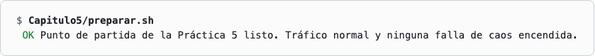

>**Nota.** Si repites la práctica, el script avisa que quedaron cambios de la vez anterior. Para empezar desde cero ejecuta `Capitulo5/restaurar.sh`.

## Parte A. Instrumentación

### Un counter nuevo en catalogo

Las métricas que ya trae catalogo cuentan peticiones y tiempos, pero no dicen qué productos mira la gente.
Ese dato existe solo si alguien pone un contador en la puerta del puesto, dentro del código.
Al ponerlo también se decide qué anota el contador en su libreta.

3. Abrir en un editor el archivo `servicios/catalogo/src/catalogo/metricas.py` y agregar al final el siguiente bloque.

   El archivo termina con la métrica `BUSQUEDAS_SIN_RESULTADOS`, que cierra con un paréntesis `)` solo en su línea. El bloque nuevo va debajo de ese paréntesis. Su primera línea está en blanco a propósito, para separarlo del anterior. Las líneas van pegadas al margen izquierdo, salvo las tres de adentro, que llevan cuatro espacios. No hace falta importar nada, porque `Counter` ya se importa al inicio del archivo.

```python

# Práctica 5. Cuántas veces se abrió el detalle de un producto, por categoría.
VISTAS_DE_PRODUCTO = Counter(
    "catalog_product_views_total",
    "Productos vistos en su detalle, por categoría.",
    ["category"],
)
```

   Qué hace cada línea.

   | Línea | Qué hace |
   |---|---|
   | Línea en blanco | Separa el bloque nuevo de la métrica anterior |
   | `# Práctica 5. ...` | Es un comentario. Python no ejecuta las líneas que empiezan con `#` |
   | `VISTAS_DE_PRODUCTO = Counter(` | Crea un counter y le da un nombre interno, que es el que se usa en el paso 4 |
   | `"catalog_product_views_total",` | Es el nombre con que la métrica aparece en `/metrics` y en Prometheus |
   | `"Productos vistos en su detalle, por categoría.",` | Es el texto de ayuda, que sale en la línea `# HELP` de la exposición |
   | `["category"],` | Es la lista de etiquetas del counter. Aquí hay una sola, `category` |
   | `)` | Cierra la definición del counter |

4. Abrir el archivo `servicios/catalogo/src/catalogo/api/rutas.py` y buscar la función `obtener_producto`. Reemplazar la línea `return ProductoSalida.desde(obtener.ejecutar(sku))` por estas cuatro líneas, con la misma sangría.

```python
        producto = obtener.ejecutar(sku)
        # Práctica 5. Se cuenta después de encontrarlo: un 404 no suma.
        metricas.VISTAS_DE_PRODUCTO.labels(category=producto.categoria).inc()
        return ProductoSalida.desde(producto)
```

   La línea que se reemplaza es la única del cuerpo de la función y tiene ocho espacios al inicio. Las cuatro nuevas llevan los mismos ocho espacios. La función completa queda así.

```python
    @rutas.get("/productos/{sku}", responses={404: {"model": ErrorSalida}})
    def obtener_producto(sku: str) -> ProductoSalida:
        producto = obtener.ejecutar(sku)
        # Práctica 5. Se cuenta después de encontrarlo: un 404 no suma.
        metricas.VISTAS_DE_PRODUCTO.labels(category=producto.categoria).inc()
        return ProductoSalida.desde(producto)
```

   Qué hace cada línea nueva.

   | Línea | Qué hace |
   |---|---|
   | `producto = obtener.ejecutar(sku)` | Busca el producto por su sku y lo guarda en `producto`. Si no existe, la función corta aquí y responde 404 |
   | `# Práctica 5. ...` | Es un comentario. Python no lo ejecuta |
   | `metricas.VISTAS_DE_PRODUCTO.labels(category=producto.categoria).inc()` | Toma el counter del paso 3, elige la serie con la categoría del producto y le suma 1 |
   | `return ProductoSalida.desde(producto)` | Devuelve el producto como respuesta, igual que antes |

   `metricas` ya se importa al inicio de `rutas.py`, así que no hay que agregar nada más en el archivo.

>**Nota.** No hace falta saber programar para hacer los pasos 3 y 4. Basta con copiar los bloques en el lugar indicado y respetar los espacios del inicio de cada línea. En Python la sangría es parte del código, y una línea corrida hace que catalogo no arranque en el paso 7.

5. Revisar los dos cambios con git.

```bash
git diff servicios/catalogo
```

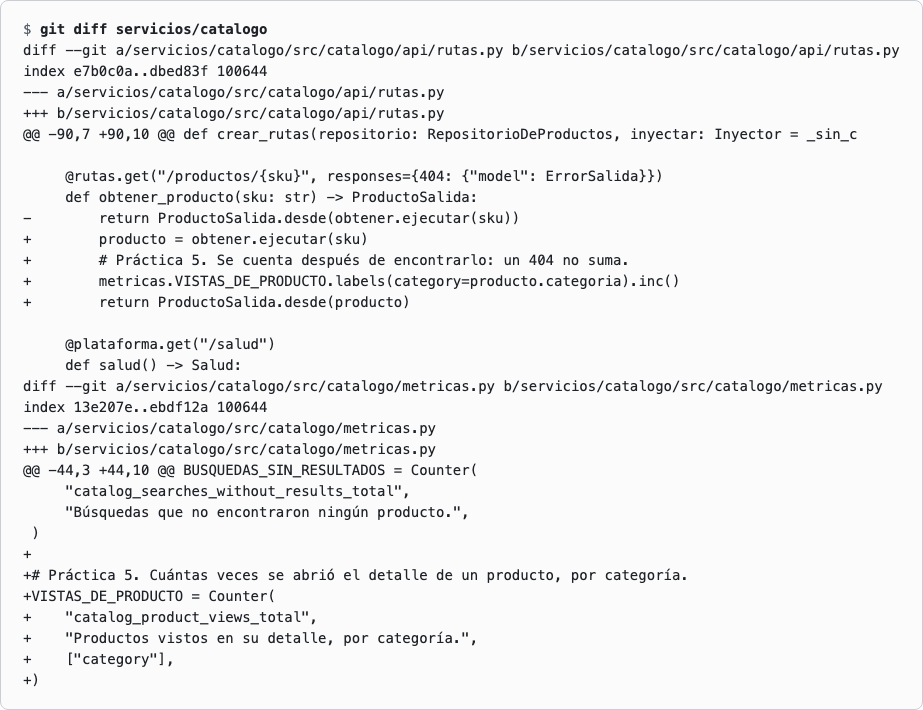

6. Antes de reconstruir, anotar una predicción. ¿Qué etiqueta sería un error ponerle a este counter? Recordar lo que pasó con la ráfaga de la Práctica 3. El tema está en el Capítulo 3, sección 3.6 de la presentación del curso.

7. Reconstruir catalogo. El mismo script levanta el stack completo y espera a que todo quede en healthy.

```bash
bin/up.sh
```

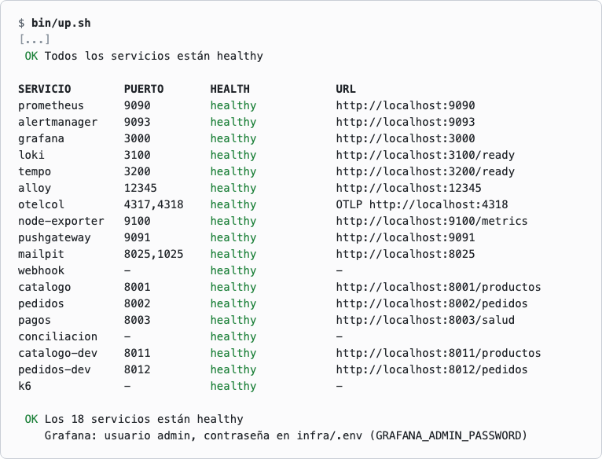

8. Abrir algunos productos para que el counter sume.

```bash
for sku in TNG-0001 TNG-0007 TNG-0013 TNG-0019; do curl -s http://localhost:8001/productos/$sku; echo; done
```

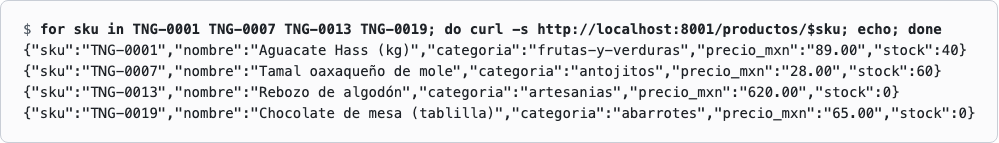

9. Ver la métrica nueva en el formato de exposición de catalogo.

```bash
curl -s http://localhost:8001/metrics | grep catalog_product_views
```

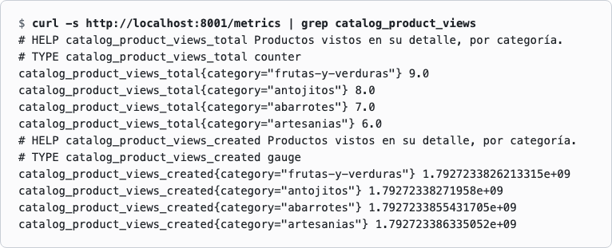

>**Nota.** prometheus_client agrega la serie `catalog_product_views_created` con la hora en que nació cada combinación de etiquetas.

10. Abrir Prometheus en `http://localhost:9090`, ejecutar la siguiente consulta y mirar la pestaña **Table**. Si todavía sale una sola categoría, esperar unos segundos y volver a pulsar **Execute**. El tráfico de la tienda también abre productos.

```promql
sum by (category) (catalog_product_views_total{ambiente="prod"})
```

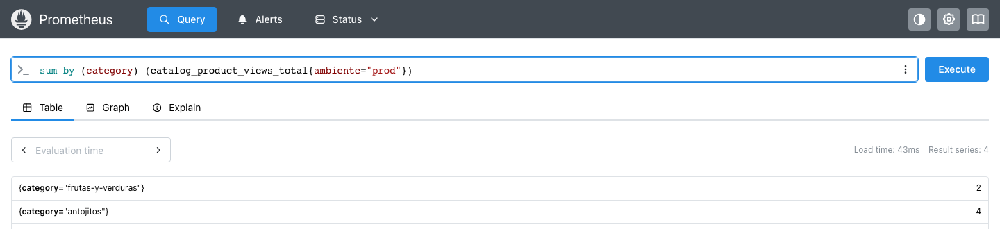

### Las métricas de pagos con OpenTelemetry

No todos los puestos llevan la misma libreta.
pagos está escrito en Java y anota sus cuentas en el formulario oficial de OpenTelemetry.
Este bloque compara esa forma de anotar con la de catalogo y muestra cómo queda en Prometheus.

11. Ver cómo define pagos sus métricas de negocio. pagos está escrito en Java y no usa prometheus_client, usa la API de OpenTelemetry.

```bash
grep -n -A4 'Builder("payments' servicios/pagos/src/main/java/mx/tianguis/pagos/telemetria/MetricasDePagos.java
```

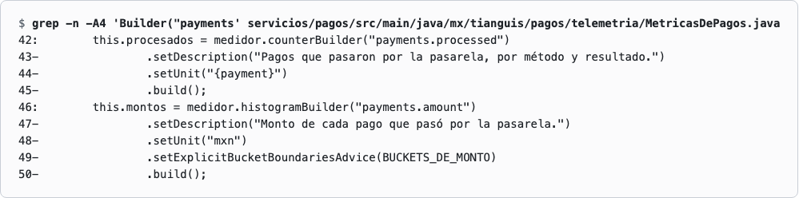

>**Nota.** En catalogo el nombre ya viene en estilo Prometheus, con guiones bajos y `_total`. En pagos el nombre lleva puntos, `payments.processed`, y la unidad va aparte con `setUnit`. Las etiquetas tampoco se declaran al crear la métrica, se pasan como atributos en cada medición.

12. En Prometheus ejecutar esta consulta.

```promql
sum by (payment_method, payment_result) (payments_processed_total)
```

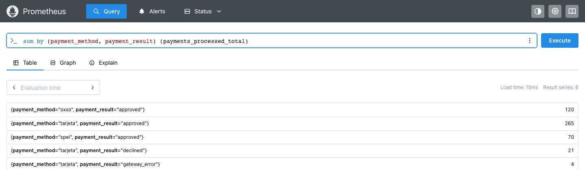

>**Nota.** `payments.processed` llegó como `payments_processed_total` y el atributo `payment.method` como la etiqueta `payment_method`. Prometheus hizo la traducción al recibir la métrica.

### OTLP a mano

Hay puestos que no esperan a que el contador pase a mirar.
Mandan su reporte por correo certificado en formato oficial, que es OTLP, y Prometheus lo recibe por una puerta propia.
Aquí se manda un reporte así a mano, para ver qué llega y cómo queda guardado.

13. Revisar la sección `otlp` de la configuración de Prometheus.

```bash
sed -n '/^otlp:/,/^rule_files:/p' infra/prometheus/prometheus.yml
```

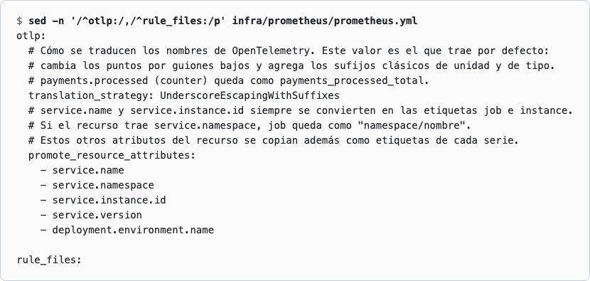

14. Enviar a mano una medición en OTLP HTTP con JSON. Es la temperatura de un refrigerador del pasillo 3, en grados Celsius.

```bash
curl -s -o /dev/null -w '%{http_code}\n' -X POST http://localhost:9090/api/v1/otlp/v1/metrics \
  -H 'Content-Type: application/json' \
  -d '{"resourceMetrics":[{"resource":{"attributes":[{"key":"service.name","value":{"stringValue":"refrigerador"}}]},"scopeMetrics":[{"metrics":[{"name":"tianguis.refrigerador.temperatura","unit":"Cel","gauge":{"dataPoints":[{"asDouble":4.5,"timeUnixNano":"'"$(date +%s)"'000000000","attributes":[{"key":"pasillo","value":{"stringValue":"3"}}]}]}}]}]}]}'
```

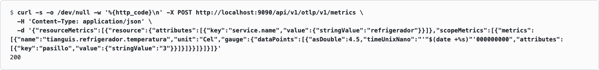

>**Nota.** El 200 dice que Prometheus aceptó la medición. `timeUnixNano` lleva la hora actual en nanosegundos. Si la hora queda muy atrás, Prometheus rechaza la muestra.

15. En Prometheus ejecutar esta consulta.

```promql
{__name__=~"tianguis_refrigerador.*"}
```

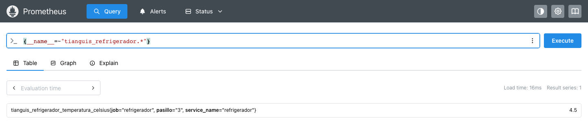

>**Nota.** El nombre quedó como `tianguis_refrigerador_temperatura_celsius`. Los puntos pasaron a guiones bajos y la unidad `Cel` se agregó como sufijo `_celsius`. `service.name` se convirtió en la etiqueta `job`.

### Pushgateway

Un proceso que termina rápido se va antes de que Prometheus pase a rasparlo.
Es como el ambulante que deja su reporte en un buzón antes de irse, y el contador lo recoge en su ronda.
El Pushgateway es ese buzón.

16. Empujar una métrica al Pushgateway, como haría un proceso que termina y no puede esperar a que Prometheus lo raspe.

```bash
echo 'tianguis_corte_de_caja_mxn 15230.50' | curl -s -w '%{http_code}\n' --data-binary @- http://localhost:9091/metrics/job/corte_de_caja/puesto/pasillo3
```

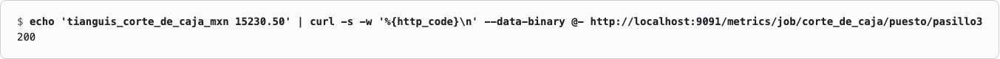

17. Abrir el Pushgateway en `http://localhost:9091`. Aparecen dos grupos, el de conciliacion y el nuevo.

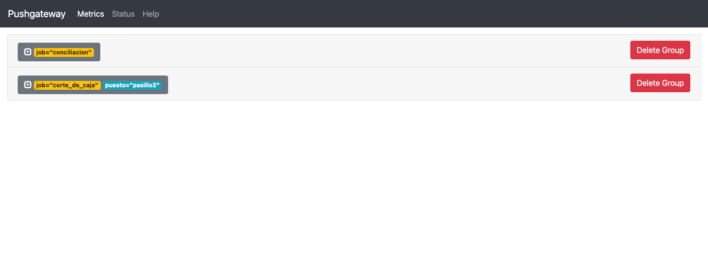

18. Esperar unos 15 segundos a que Prometheus raspe el Pushgateway y ejecutar esta consulta.

```promql
tianguis_corte_de_caja_mxn
```

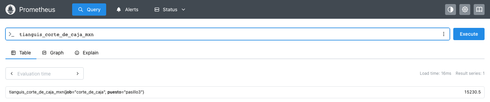

19. Borrar el grupo. Si no se borra, el Pushgateway lo sigue entregando para siempre con el último valor.

```bash
curl -s -w '%{http_code}\n' -X DELETE http://localhost:9091/metrics/job/corte_de_caja/puesto/pasillo3
```

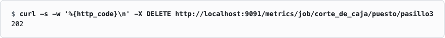

20. Recargar la página del Pushgateway. Queda solo el grupo de conciliacion.

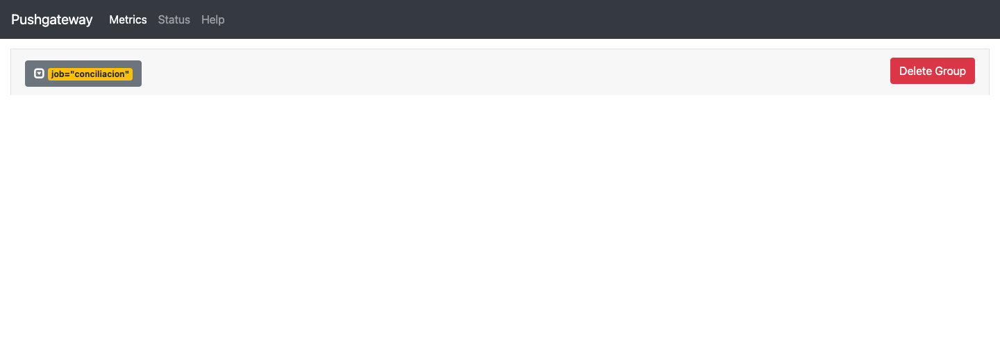

>**Nota.** conciliacion es un job por lotes. Corre cada 5 minutos, termina y no deja ningún puerto abierto, así que Prometheus no tiene a quién raspar. Por eso empuja sus métricas al Pushgateway y Prometheus las recoge de ahí.

### Reglas de registro

La proporción de errores se usa en dashboards y en alertas, y es una consulta larga.
Si cada uno la calcula por su cuenta, cada copia puede decir otra cosa.
Una regla de registro es el resumen diario que el contador deja hecho, y todos leen el mismo número.

21. Crear el archivo `infra/prometheus/rules/tianguis-registro.yml` con este contenido.

```yaml
# Reglas de registro de Tianguis. Prometheus las calcula en cada evaluación y guarda el
# resultado como una serie nueva, así los dashboards y las alertas no repiten la cuenta.
# Nombre de cada serie  nivel:métrica:operaciones.
groups:
  - name: tianguis-registro
    rules:
      # Peticiones por segundo de cada servicio en prod, promediadas en 5 minutos.
      - record: job:http_server_requests:rate5m
        expr: sum by (job) (rate(http_server_requests_total{ambiente="prod"}[5m]))

      # Proporción de respuestas 5xx de cada servicio en prod, entre 0 y 1.
      # Sin errores el numerador no tiene series. El "or" pone un cero en su lugar, para que
      # la proporción valga 0 y no desaparezca.
      - record: job:http_server_errors:ratio_rate5m
        expr: |
          (
            sum by (job) (rate(http_server_requests_total{ambiente="prod", status=~"5.."}[5m]))
            or
            job:http_server_requests:rate5m * 0
          )
          / job:http_server_requests:rate5m
```

   Qué hace cada línea.

   | Línea | Qué hace |
   |---|---|
   | Las que empiezan con `#` | Son comentarios. Prometheus no los lee |
   | `groups:` | Abre la lista de grupos de reglas del archivo |
   | `- name: tianguis-registro` | Nombre del grupo. Es el que aparece en **Rule health** |
   | `rules:` | Abre la lista de reglas del grupo |
   | `- record: job:http_server_requests:rate5m` | Nombre de la serie nueva que va a guardar Prometheus |
   | `expr: sum by (job) (rate(...[5m]))` | Consulta que calcula esa serie, las peticiones por segundo de cada servicio en prod |
   | `- record: job:http_server_errors:ratio_rate5m` | Nombre de la segunda serie nueva |
   | `expr: \|` | La barra vertical deja escribir la consulta en varias líneas |
   | `sum by (job) (rate(...status=~"5.."...))` | Peticiones por segundo que terminaron en un error 5xx |
   | `or` y `job:http_server_requests:rate5m * 0` | Si un servicio no tiene errores, pone un cero en su lugar |
   | `/ job:http_server_requests:rate5m` | Divide los errores por el total y deja la proporción entre 0 y 1 |

>**Nota.** No hace falta saber programar para escribir los archivos YAML de esta práctica. Basta con copiar el bloque completo. YAML usa la sangría para saber qué va dentro de qué, así que hay que respetar los espacios y no usar tabulaciones. Si falta un espacio, promtool lo avisa en el paso siguiente con el número de línea.

22. Validar el archivo con promtool, que viene dentro del contenedor de Prometheus.

```bash
MSYS_NO_PATHCONV=1 docker exec gpe-prometheus promtool check rules /etc/prometheus/rules/tianguis-registro.yml
```

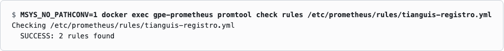

23. Recargar Prometheus para que lea el archivo nuevo.

```bash
docker exec gpe-prometheus kill -HUP 1
```

24. En Prometheus abrir **Status** y elegir **Rule health**. Las dos reglas aparecen con el estado **OK**.

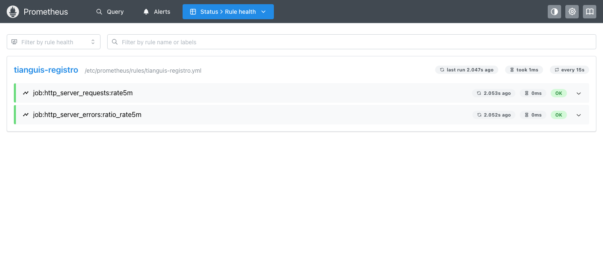

25. Volver a **Query** y ejecutar las dos series nuevas, una en cada panel. Para el segundo panel pulsar **Add query**.

```promql
job:http_server_requests:rate5m
```

```promql
job:http_server_errors:ratio_rate5m
```

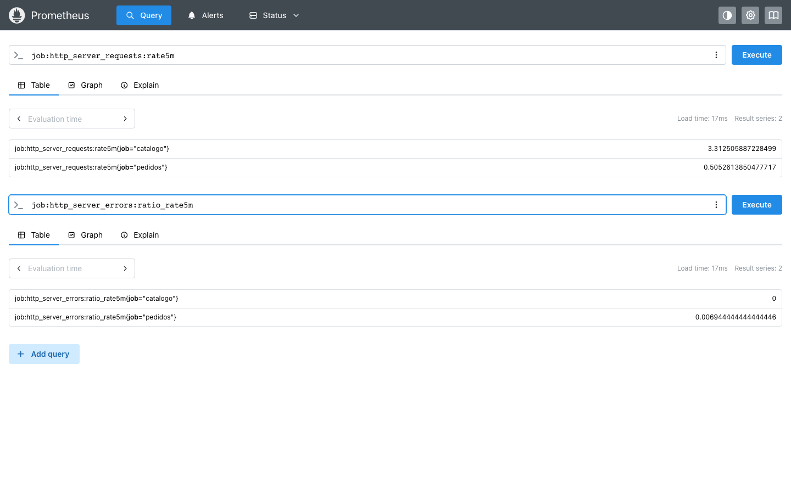

## Parte B. Alertas

### Reglas de alerta

Una regla de alerta es la condición que hace sonar el silbato.
Prometheus la revisa en cada evaluación y, cuando se cumple, avisa a Alertmanager.
`for` hace esperar a que el problema dure antes de pitar, para no pitar por nada.

26. Crear el archivo `infra/prometheus/rules/tianguis-alertas.yml` con este contenido.

```yaml
# Reglas de alerta de Tianguis. Prometheus las evalúa cada 15 segundos y manda a Alertmanager
# las que están sonando. Alertmanager decide a quién avisar.
groups:
  - name: tianguis-alertas
    rules:
      - alert: CatalogoCaido
        expr: up{job="catalogo", ambiente="prod"} == 0
        for: 1m
        labels:
          severity: critica
          team: tienda
        annotations:
          summary: "catalogo no responde en {{ $labels.instance }}"
          description: "Prometheus no logra raspar {{ $labels.instance }} hace más de 1 minuto. up vale {{ $value }}."

      - alert: ErroresAltos
        expr: job:http_server_errors:ratio_rate5m > 0.10
        for: 2m
        labels:
          severity: advertencia
          team: tienda
        annotations:
          summary: "{{ $labels.job }} falla en el {{ $value | humanizePercentage }} de sus peticiones"
          description: "La proporción de respuestas 5xx de {{ $labels.job }} en prod pasa del 10 % hace más de 2 minutos. Ahora vale {{ $value | humanizePercentage }}."

      - alert: ConciliacionSinExito
        expr: time() - conciliacion_last_success_timestamp_seconds > 900
        labels:
          severity: advertencia
          team: finanzas
        annotations:
          summary: "La conciliación lleva {{ $value | humanizeDuration }} sin una corrida exitosa"
          description: "La última corrida exitosa de la conciliación fue hace {{ $value | humanizeDuration }}. Debería correr bien cada 5 minutos."
```

   Qué hace cada línea. Las tres alertas repiten la misma forma.

   | Línea | Qué hace |
   |---|---|
   | Las que empiezan con `#` | Son comentarios. Prometheus no los lee |
   | `groups:`, `- name: tianguis-alertas` y `rules:` | Abren el grupo de reglas y su lista, igual que en el paso 21 |
   | `- alert: CatalogoCaido` | Nombre de la alerta. Es el que llega en el correo y en el webhook |
   | `expr: up{...} == 0` | Condición de la alerta. Mientras devuelve alguna serie, la condición se cumple |
   | `for: 1m` | Tiempo que la condición tiene que cumplirse sin cortes antes de que la alerta suene |
   | `labels:` | Abre las etiquetas que se agregan a la alerta cuando suena |
   | `severity: critica` | Gravedad de la alerta. Alertmanager la usa para el ruteo |
   | `team: tienda` | Equipo dueño del servicio. También se usa para el ruteo |
   | `annotations:` | Abre los textos que acompañan el aviso |
   | `summary: "..."` | Resumen corto del aviso, en una línea |
   | `description: "..."` | Texto largo del aviso |
   | `{{ $labels.instance }}` y `{{ $labels.job }}` | Se reemplazan por el valor de esa etiqueta en la serie que hizo sonar la alerta |
   | `{{ $value }}` | Se reemplaza por el valor que devolvió la condición |
   | `humanizePercentage` y `humanizeDuration` | Muestran el valor como porcentaje, por ejemplo 30%, o como duración, por ejemplo 16m 0s |
   | `expr: job:http_server_errors:ratio_rate5m > 0.10` | Usa la regla de registro del paso 21. Se cumple si la proporción de errores pasa del 10 % |
   | `expr: time() - conciliacion_last_success_timestamp_seconds > 900` | Resta la hora de la última corrida exitosa a la hora actual. Se cumple si pasaron más de 900 segundos |

>**Nota.** ConciliacionSinExito no lleva `for`. La expresión ya mide tiempo, así que la condición solo se cumple después de 15 minutos sin éxito.

27. Validar el archivo y recargar Prometheus.

```bash
MSYS_NO_PATHCONV=1 docker exec gpe-prometheus promtool check rules /etc/prometheus/rules/tianguis-alertas.yml
```

```bash
docker exec gpe-prometheus kill -HUP 1
```

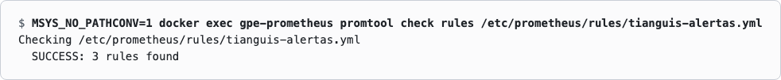

28. En Prometheus abrir **Alerts**. Las tres alertas aparecen en **Inactive**.

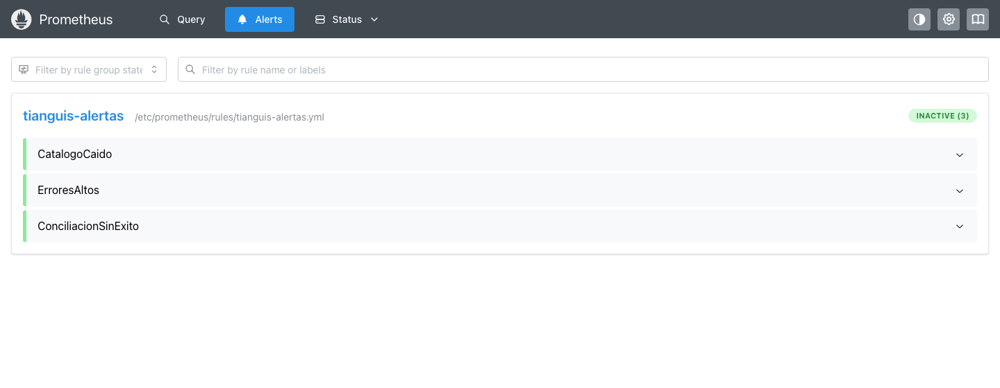

### Pruebas unitarias de las alertas

Para saber si el silbato funciona no conviene esperar un incendio real.
Las pruebas unitarias son un simulacro.
Se inventan las series, se adelanta el reloj y se revisa qué alertas deben estar sonando en cada momento.
Así se comprueba la regla sin tocar el stack.

29. Anotar una predicción. Si catalogo responde con muchos errores durante 90 segundos y después se recupera, ¿suena ErroresAltos?

30. Crear la carpeta `infra/prometheus/pruebas` y dentro el archivo `tianguis-alertas.test.yml` con este contenido.

```yaml
# Pruebas unitarias de las reglas de alerta. Se corren con
#   promtool test rules /etc/prometheus/pruebas/tianguis-alertas.test.yml
# Cada prueba inventa unas series, avanza el reloj y dice qué alertas deben estar sonando.
# El reloj de las pruebas empieza en 0, así que time() vale 0 al inicio.
rule_files:
  - ../rules/tianguis-registro.yml
  - ../rules/tianguis-alertas.yml

evaluation_interval: 15s

tests:
  # catalogo deja de responder a los 30 segundos.
  - name: CatalogoCaido
    interval: 15s
    input_series:
      - series: 'up{job="catalogo", ambiente="prod", instance="catalogo:8000"}'
        values: "1 1 0x20"
    alert_rule_test:
      # 45 segundos caído. Todavía no cumple el minuto, así que no suena.
      - eval_time: 75s
        alertname: CatalogoCaido
        exp_alerts: []
      # Más de un minuto caído. Suena.
      - eval_time: 2m
        alertname: CatalogoCaido
        exp_alerts:
          - exp_labels:
              severity: critica
              team: tienda
              job: catalogo
              ambiente: prod
              instance: catalogo:8000
            exp_annotations:
              summary: "catalogo no responde en catalogo:8000"
              description: "Prometheus no logra raspar catalogo:8000 hace más de 1 minuto. up vale 0."

  # Un problema de 90 segundos. La proporción pasa del 10 % entre los 2:00 y los 3:30.
  - name: ErroresAltos con un problema corto
    interval: 15s
    input_series:
      - series: 'job:http_server_errors:ratio_rate5m{job="catalogo"}'
        values: "0x7 0.3x6 0x30"
    alert_rule_test:
      - eval_time: 3m
        alertname: ErroresAltos
        exp_alerts: []
      - eval_time: 5m
        alertname: ErroresAltos
        exp_alerts: []

  # El mismo problema, pero sigue. Suena 2 minutos después de pasar el umbral.
  - name: ErroresAltos con un problema que sigue
    interval: 15s
    input_series:
      - series: 'job:http_server_errors:ratio_rate5m{job="catalogo"}'
        values: "0x7 0.3x30"
    alert_rule_test:
      - eval_time: 3m
        alertname: ErroresAltos
        exp_alerts: []
      - eval_time: 5m
        alertname: ErroresAltos
        exp_alerts:
          - exp_labels:
              severity: advertencia
              team: tienda
              job: catalogo
            exp_annotations:
              summary: "catalogo falla en el 30% de sus peticiones"
              description: "La proporción de respuestas 5xx de catalogo en prod pasa del 10 % hace más de 2 minutos. Ahora vale 30%."

  # La última corrida exitosa fue en el segundo 0 y no vuelve a haber otra.
  - name: ConciliacionSinExito
    interval: 1m
    input_series:
      - series: 'conciliacion_last_success_timestamp_seconds{job="conciliacion"}'
        values: "0x30"
    alert_rule_test:
      # 14 minutos sin éxito. Todavía no.
      - eval_time: 14m
        alertname: ConciliacionSinExito
        exp_alerts: []
      # 16 minutos sin éxito. Suena.
      - eval_time: 16m
        alertname: ConciliacionSinExito
        exp_alerts:
          - exp_labels:
              severity: advertencia
              team: finanzas
              job: conciliacion
            exp_annotations:
              summary: "La conciliación lleva 16m 0s sin una corrida exitosa"
              description: "La última corrida exitosa de la conciliación fue hace 16m 0s. Debería correr bien cada 5 minutos."
```

   Qué hace cada línea. Las cuatro pruebas repiten la misma forma.

   | Línea | Qué hace |
   |---|---|
   | Las que empiezan con `#` | Son comentarios. promtool no los lee |
   | `rule_files:` y las dos rutas | Archivos de reglas que se prueban. Las rutas son relativas a la carpeta `pruebas` |
   | `evaluation_interval: 15s` | Cada cuánto evalúa las reglas el reloj de la prueba |
   | `tests:` | Abre la lista de pruebas |
   | `- name: ...` | Nombre de la prueba. promtool lo muestra si la prueba falla |
   | `interval: 15s` | Tiempo entre un valor y el siguiente de las series inventadas |
   | `input_series:` | Abre la lista de series inventadas |
   | `- series: '...'` | Nombre y etiquetas de una serie inventada |
   | `values: "1 1 0x20"` | Valores de la serie, uno por intervalo. `0x20` repite el 0 veinte veces más, y `0.3x6` repite el 0.3 seis veces más |
   | `alert_rule_test:` | Abre la lista de revisiones de alertas |
   | `- eval_time: 75s` | Momento del reloj de la prueba en que se revisa |
   | `alertname: ...` | Alerta que se revisa en ese momento |
   | `exp_alerts: []` | Se espera que la alerta no esté sonando |
   | `exp_alerts:` con elementos | Se espera que la alerta esté sonando con esas etiquetas y esas anotaciones |
   | `exp_labels:` | Todas las etiquetas que debe tener la alerta, las de la serie y las de la regla |
   | `exp_annotations:` | Los textos exactos que debe tener la alerta, ya con los valores reemplazados |

31. Correr las pruebas.

```bash
MSYS_NO_PATHCONV=1 docker exec gpe-prometheus promtool test rules /etc/prometheus/pruebas/tianguis-alertas.test.yml
```

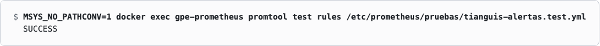

>**Nota.** La segunda prueba responde la predicción del paso 29. La condición dura 90 segundos y `for` pide 2 minutos, así que la alerta queda en Pending y nunca suena. En el stack real la proporción se calcula sobre 5 minutos, y esa ventana estira el problema. Un pico corto pero muy fuerte puede mantener la proporción sobre el 10 % más de 2 minutos.

32. Romper la alerta a propósito. En `infra/prometheus/rules/tianguis-alertas.yml` cambiar `> 0.10` por `> 0.40`, guardar y volver a correr las pruebas.

```bash
MSYS_NO_PATHCONV=1 docker exec gpe-prometheus promtool test rules /etc/prometheus/pruebas/tianguis-alertas.test.yml
```

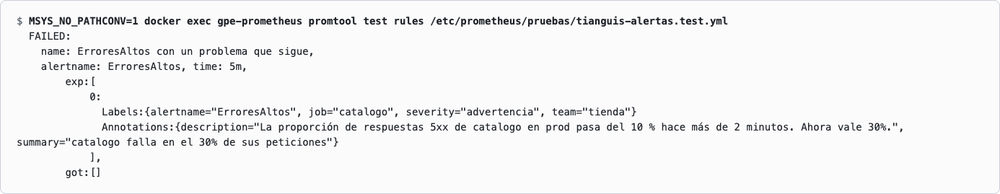

33. Devolver el umbral a `> 0.10` y guardar. Correr las pruebas otra vez y confirmar que vuelven a pasar.

### Alertmanager

Prometheus sabe cuándo algo está mal, pero no a quién avisar ni si ya avisó.
Alertmanager es la central que recibe los pitazos y decide a quién llamar, por qué canal y cada cuánto.
En este bloque se le escriben las rutas, los receptores y la regla de inhibición.

34. Reemplazar todo el contenido de `infra/alertmanager/alertmanager.yml` por este.

```yaml
# Alertmanager del stack gpe, con el ruteo de la Práctica 5.
# El correo sale hacia Mailpit y el webhook hacia gpe-webhook.

global:
  smtp_smarthost: mailpit:1025
  smtp_from: alertmanager@tianguis.local
  smtp_require_tls: false

route:
  receiver: guardia-correo
  # Una notificación por cada combinación de alerta y servicio.
  group_by: ["alertname", "job"]
  # Espera antes de la primera notificación de un grupo, por si llegan más alertas juntas.
  group_wait: 30s
  # Espera entre una notificación y la siguiente del mismo grupo, incluidas las de resuelto.
  group_interval: 1m
  # Si nada cambia, repite el aviso cada 4 horas.
  repeat_interval: 4h
  routes:
    # Todo lo del equipo tienda va a su webhook. continue sigue revisando las rutas de abajo.
    - matchers: ['team="tienda"']
      receiver: tienda-webhook
      continue: true
    # Lo crítico y las advertencias van además por correo a la guardia.
    - matchers: ['severity=~"critica|advertencia"']
      receiver: guardia-correo

# Si catalogo está caído, no avisar que sus respuestas fallan. Es el mismo incendio.
inhibit_rules:
  - source_matchers: ['alertname="CatalogoCaido"']
    target_matchers: ['alertname="ErroresAltos"']
    equal: ["job"]

receivers:
  - name: guardia-correo
    email_configs:
      - to: guardia@tianguis.local
        send_resolved: true
  - name: tienda-webhook
    webhook_configs:
      - url: http://webhook:8080/alertmanager
        send_resolved: true
```

   Frente al archivo que trae el stack, lo nuevo es `job` en `group_by`, el bloque `routes`, el bloque `inhibit_rules` y el receptor `tienda-webhook`. El receptor `guardia` pasa a llamarse `guardia-correo` y se queda solo con el correo, porque el webhook pasa a `tienda-webhook`. `group_interval` baja de 5 minutos a 1.

   Qué hace cada línea.

   | Línea | Qué hace |
   |---|---|
   | Las que empiezan con `#` | Son comentarios. Alertmanager no los lee |
   | `global:` | Abre los valores que comparten todos los receptores |
   | `smtp_smarthost: mailpit:1025` | Servidor de correo por donde salen los avisos. En el curso es Mailpit |
   | `smtp_from: ...` | Remitente de los correos |
   | `smtp_require_tls: false` | Permite mandar correo sin cifrar, porque Mailpit es un servidor de prueba |
   | `route:` | Abre la ruta raíz, por donde entra toda alerta |
   | `receiver: guardia-correo` | Receptor que recibe la alerta si ninguna ruta de más abajo la toma |
   | `group_by: ["alertname", "job"]` | Junta en una sola notificación las alertas con el mismo nombre y el mismo servicio |
   | `group_wait: 30s` | Espera antes de mandar la primera notificación de un grupo nuevo |
   | `group_interval: 1m` | Espera entre una notificación y la siguiente del mismo grupo |
   | `repeat_interval: 4h` | Cada cuánto se repite el aviso si nada cambia |
   | `routes:` | Abre la lista de rutas hijas. Se revisan en orden, de arriba hacia abajo |
   | `- matchers: ['team="tienda"']` | La ruta toma las alertas con la etiqueta `team` igual a `tienda` |
   | `receiver: tienda-webhook` | Receptor de esa ruta |
   | `continue: true` | Después de esta ruta, Alertmanager sigue revisando las de abajo |
   | `- matchers: ['severity=~"critica\|advertencia"']` | La ruta toma las alertas con `severity` igual a `critica` o a `advertencia` |
   | `inhibit_rules:` | Abre la lista de reglas de inhibición |
   | `source_matchers` | Alerta que, mientras suena, calla a otras |
   | `target_matchers` | Alerta que queda callada |
   | `equal: ["job"]` | La inhibición vale solo si las dos alertas tienen el mismo valor de `job` |
   | `receivers:` | Abre la lista de receptores |
   | `- name: ...` | Nombre del receptor, el mismo que usan las rutas |
   | `email_configs:` y `to:` | El receptor manda correo a esa dirección |
   | `webhook_configs:` y `url:` | El receptor manda un POST con la alerta en JSON a esa dirección |
   | `send_resolved: true` | También avisa cuando la alerta se resuelve |

35. Validar la configuración con amtool, que viene dentro del contenedor de Alertmanager.

```bash
MSYS_NO_PATHCONV=1 docker exec gpe-alertmanager amtool check-config /etc/alertmanager/alertmanager.yml
```

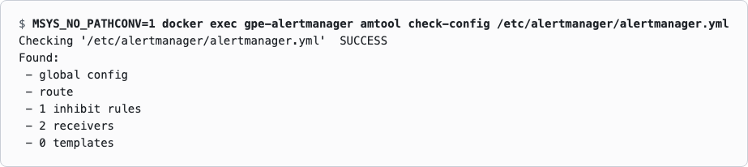

36. Recargar Alertmanager.

```bash
curl -s -w '%{http_code}\n' -X POST http://localhost:9093/-/reload
```

37. Ver el árbol de ruteo que quedó cargado.

```bash
docker exec gpe-alertmanager amtool --alertmanager.url=http://localhost:9093 config routes
```

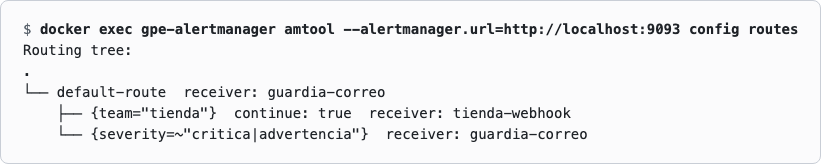

38. Preguntarle a Alertmanager a quién avisaría por una alerta con estas etiquetas.

```bash
docker exec gpe-alertmanager amtool --alertmanager.url=http://localhost:9093 config routes test alertname=ErroresAltos team=tienda severity=advertencia
```

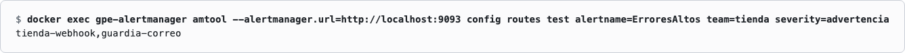

>**Nota.** La alerta llega a los dos receptores. La primera ruta la manda al webhook y, por `continue: true`, Alertmanager sigue mirando y la segunda ruta la manda además por correo.

### El incidente de las 3 de la mañana

En un incidente real suenan varias alertas a la vez.
Este bloque provoca una falla en catalogo para ver a la central trabajar con avisos de verdad.
Se sigue cada aviso desde que suena hasta que se resuelve, con la inhibición y el silencio de por medio.

39. Encender una falla en catalogo. El 30 % de sus respuestas pasa a ser un error 500.

```bash
bin/caos.sh catalogo errores porcentaje=30
```

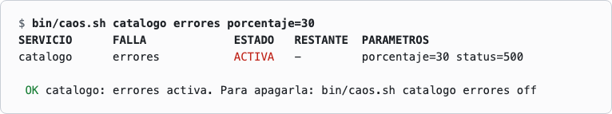

40. En Prometheus abrir **Alerts**. Después de uno o dos minutos ErroresAltos pasa a **Pending**. Recargar la página para ver el cambio.

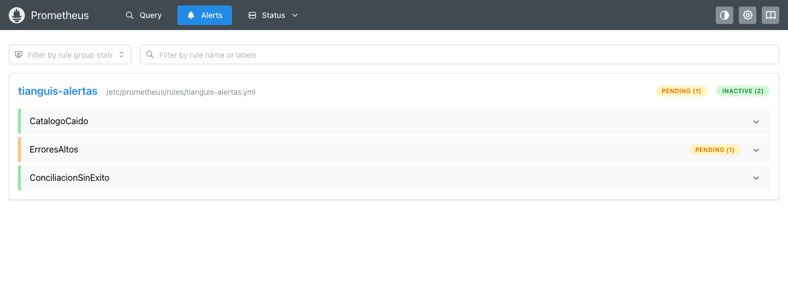

>**Nota.** La alerta no suena todavía. `for: 2m` pide que la condición se mantenga 2 minutos antes de avisar.

41. Esperar unos 2 minutos más y recargar. ErroresAltos pasa a **Firing**. Con el tráfico normal pedidos también suele pasar el umbral, porque cada pedido consulta a catalogo.

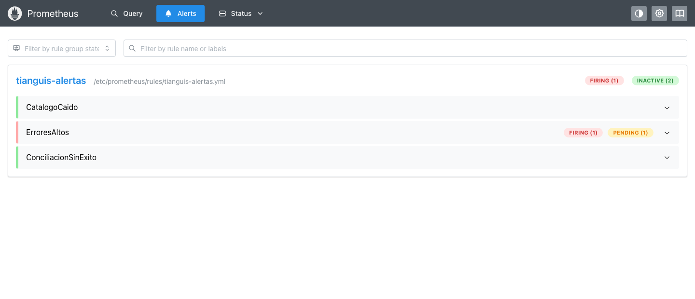

42. Abrir Alertmanager en `http://localhost:9093`. Cada combinación de alerta, servicio y receptor es un grupo.

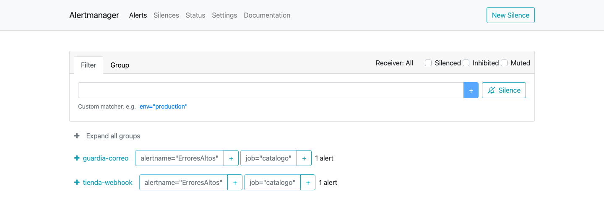

43. Abrir Mailpit en `http://localhost:8025`. Llegaron los correos de la guardia.

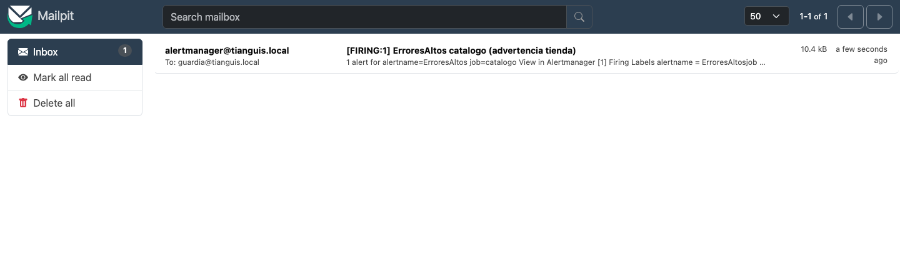

44. Abrir el correo de ErroresAltos de catalogo. El asunto y el cuerpo traen las etiquetas y las anotaciones de la alerta.

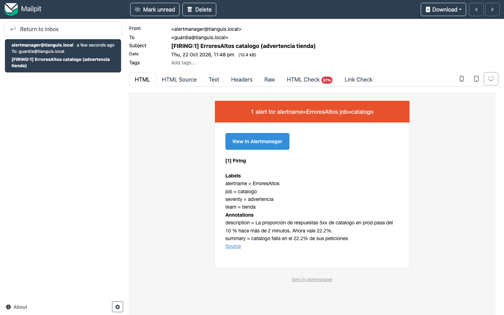

45. En Grafana abrir **Explore**, elegir **Loki**, cambiar a **Code** y ejecutar esta consulta. Cada línea es una notificación que recibió gpe-webhook.

```logql
{compose_service="webhook"} | json | receiver="tienda-webhook"
```

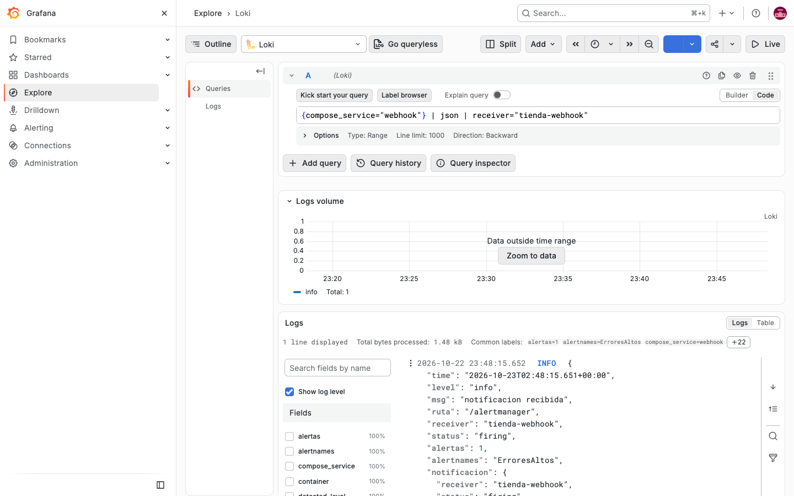

46. Detener catalogo, como si se hubiera caído el servidor.

```bash
docker stop gpe-catalogo
```

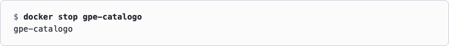

47. Esperar un minuto y medio. CatalogoCaido suena. En Alertmanager marcar **Inhibited**. ErroresAltos de catalogo sigue en la lista, pero ahora como inhibida.

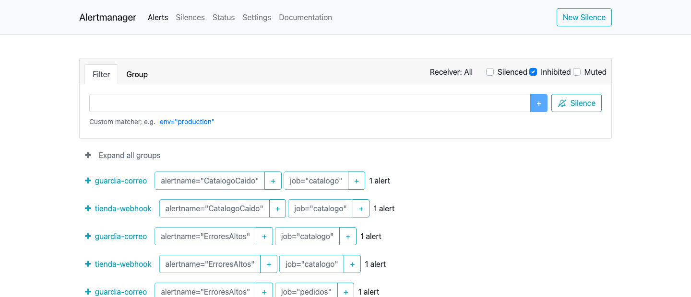

48. Confirmar la inhibición con amtool.

```bash
docker exec gpe-alertmanager amtool --alertmanager.url=http://localhost:9093 alert query --inhibited
```

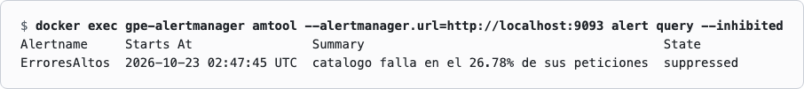

>**Nota.** ErroresAltos de catalogo queda en `suppressed` porque CatalogoCaido está activa para el mismo job. ErroresAltos de pedidos sigue avisando, porque la inhibición pide el mismo valor de `job`.

49. Silenciar ErroresAltos de pedidos mientras dura la caída. Su causa ya se conoce.

```bash
docker exec gpe-alertmanager amtool --alertmanager.url=http://localhost:9093 silence add alertname=ErroresAltos job=pedidos --duration=30m --author=guardia --comment="pedidos falla porque catalogo está caído"
```

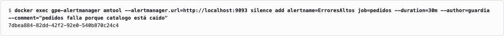

50. En Alertmanager abrir **Silences**. El silencio aparece activo con sus etiquetas, su autor y su comentario.

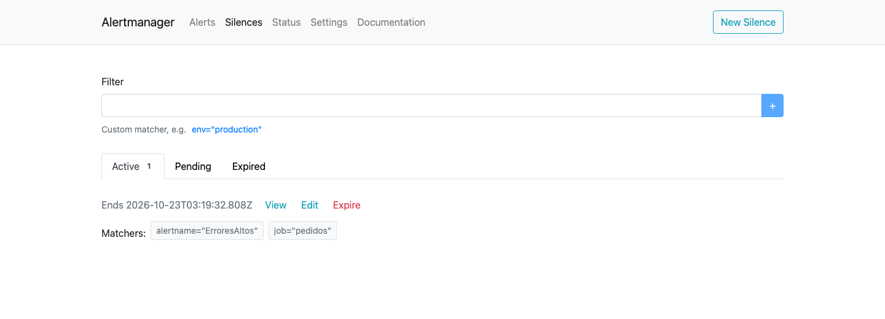

51. Confirmar que la alerta de pedidos quedó silenciada.

```bash
docker exec gpe-alertmanager amtool --alertmanager.url=http://localhost:9093 alert query --silenced
```

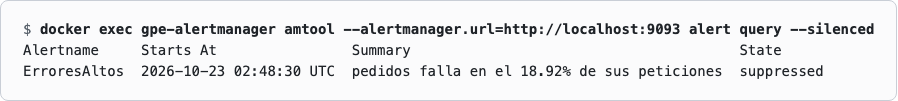

52. Volver todo a la normalidad. `bin/up.sh` levanta catalogo y espera a que quede en healthy. Después se apagan las fallas de caos.

```bash
bin/up.sh
```

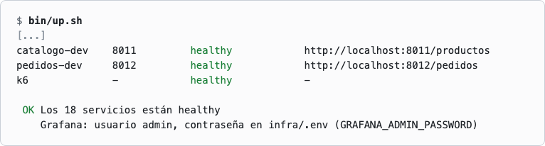

```bash
bin/caos.sh apagar
```


53. Esperar unos 3 minutos y revisar Mailpit. Llegan los correos de resuelto, primero el de CatalogoCaido y después el de ErroresAltos de catalogo.

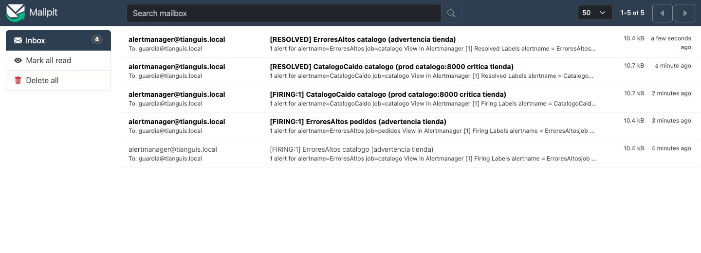

>**Nota.** ErroresAltos tarda más en resolverse porque la proporción se calcula sobre 5 minutos. Los errores viejos siguen dentro de la ventana un rato después de que la falla se apagó. pedidos no manda su resuelto mientras el silencio siga activo.

54. En Explore ejecutar esta consulta para ver los resueltos que llegaron al webhook.

```logql
{compose_service="webhook"} | json | receiver="tienda-webhook" | status="resolved"
```

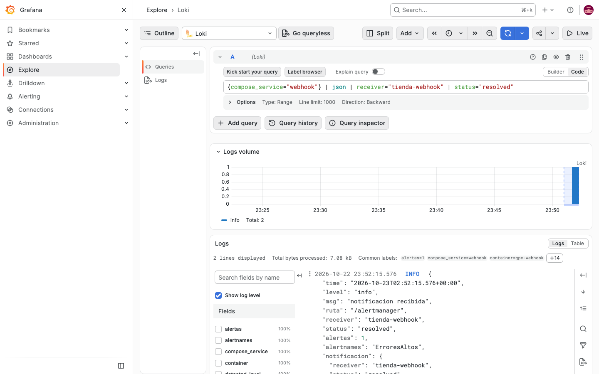

55. Terminar el silencio antes de tiempo.

```bash
docker exec gpe-alertmanager sh -c 'amtool silence expire $(amtool silence query -q --alertmanager.url=http://localhost:9093) --alertmanager.url=http://localhost:9093'
```

### La falla silenciosa, ahora con alarma

Hay fallas que no tumban nada.
Un proceso por lotes puede fallar en cada corrida mientras el buzón sigue mostrando su último reporte.
Este bloque hace fallar a conciliacion para que la alerta escrita antes tenga algo que vigilar.

56. Hacer que todas las corridas de conciliacion fallen.

```bash
bin/caos.sh conciliacion fallar
```

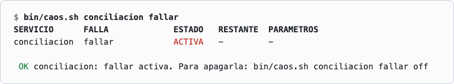

>**Nota.** ConciliacionSinExito tarda entre 10 y 15 minutos en sonar, porque mide el tiempo desde la última corrida exitosa. Mientras tanto seguir con Grafana Alerting y volver a esta alerta en el paso 77.

### Grafana Alerting

Grafana tiene su propia central de avisos, con sus propios teléfonos.
El punto de contacto es el teléfono al que llama la central y la política dice qué avisos van a qué teléfono según sus etiquetas.
La plantilla es el texto que se lee en cada aviso.

57. En Grafana abrir **Alerting**, **Notification configuration** y la pestaña **Templates**. Pulsar **Add notification template group**. En **Template group name** escribir `tianguis-resumen` y en el editor copiar este contenido.

```text
{{ define "tianguis.resumen" }}
{{ range .Alerts }}[{{ .Status }}] {{ .Labels.alertname }}
{{ .Annotations.summary }}
Desde las {{ .StartsAt.Format "15:04:05" }} UTC
{{ end }}
{{ end }}
```

   Qué hace cada línea.

   | Línea | Qué hace |
   |---|---|
   | `{{ define "tianguis.resumen" }}` | Da nombre a la plantilla. Es el nombre que se elige en el paso 60 |
   | `{{ range .Alerts }}` | Repite lo que sigue una vez por cada alerta del aviso |
   | `[{{ .Status }}] {{ .Labels.alertname }}` | Escribe el estado de la alerta, firing o resolved, y su nombre |
   | `{{ .Annotations.summary }}` | Escribe el resumen de la alerta |
   | `Desde las {{ .StartsAt.Format "15:04:05" }} UTC` | Escribe la hora en que empezó la alerta, en horas, minutos y segundos |
   | El primer `{{ end }}` | Cierra la repetición por alerta |
   | El segundo `{{ end }}` | Cierra la plantilla |

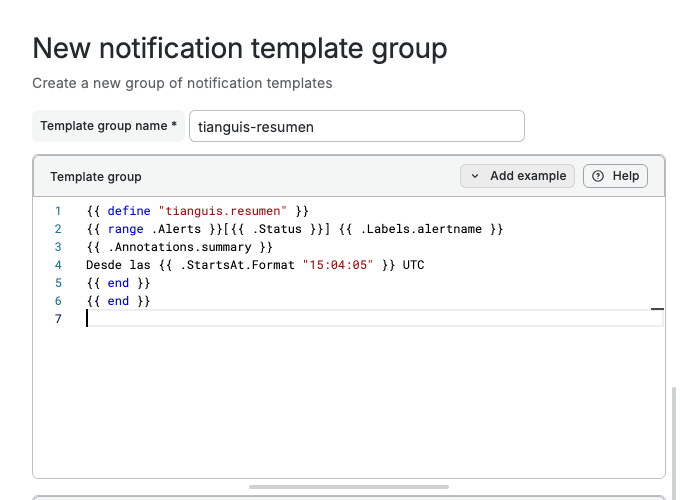

58. Pulsar **Save**.

>**Nota.** El editor cierra solo las llaves que se abren. Si al pegar quedan llaves de más al final de una línea, borrarlas antes de guardar.

59. Abrir la pestaña **Contact points** y pulsar **Create contact point**. En **Name** escribir `equipo-pagos`. En **Integration** dejar **Email** y en **Addresses** escribir `pagos@tianguis.local`.

60. Abrir **Optional Email settings** y pulsar **Edit Message**. En **Select notification template** elegir `tianguis.resumen`. La vista previa muestra cómo queda el mensaje.

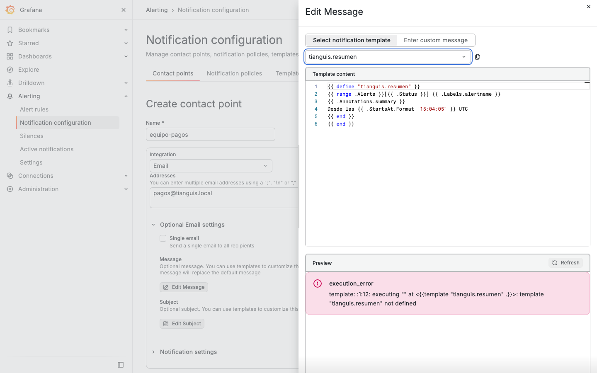

61. Pulsar **Save**. Pulsar **Add contact point integration**, en **Integration** elegir **Webhook** y en **URL** escribir `http://webhook:8080/grafana`.

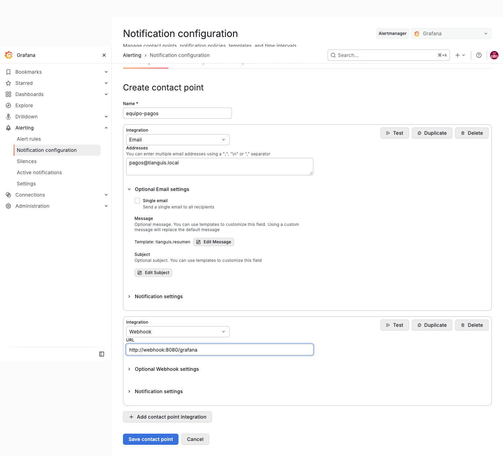

62. Pulsar **Save contact point**.

63. Abrir la pestaña **Notification policies** y en **Default policy** pulsar **Add route**. En **Label** escribir `team`, en **Value** escribir `pagos` y en **Contact point** elegir `equipo-pagos`.

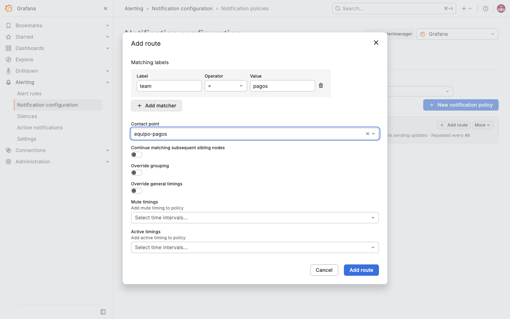

64. Pulsar **Add route**. La política nueva queda debajo de la política por defecto.

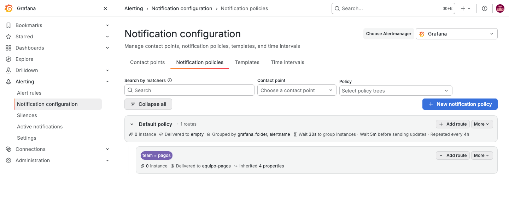

65. Abrir **Alert rules** y pulsar **New alert rule**. En **Name** escribir `PagosLentos`. En la consulta cambiar a **Code** y escribir la siguiente. En **Alert condition** dejar **IS ABOVE** y escribir `1`. Pulsar **Preview alert rule condition**.

```promql
histogram_quantile(0.95, sum by (le) (rate(http_server_request_duration_seconds_bucket{job="pagos", http_route="/pagos"}[5m])))
```

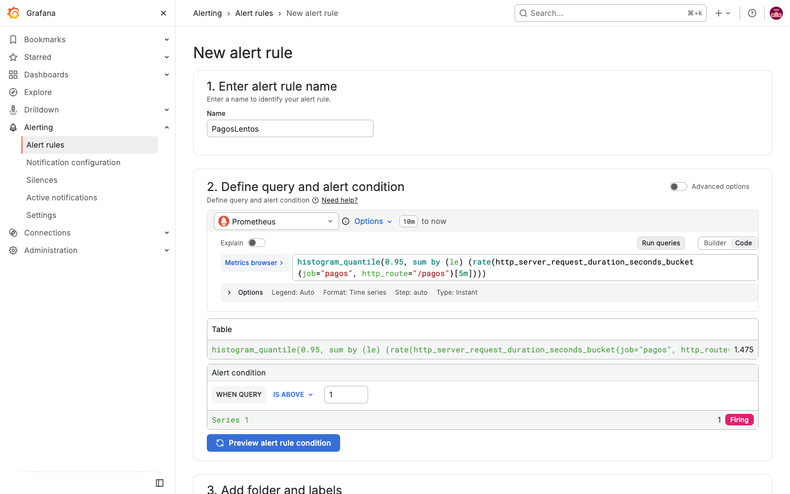

66. En **Folder** pulsar **New folder**, escribir `Tianguis` y pulsar **Create**. Pulsar **Add labels** y agregar `team` con el valor `pagos`. Pulsar **Add more** y agregar `severity` con el valor `advertencia`. Para cada clave y cada valor, escribirlo y pulsar Enter.

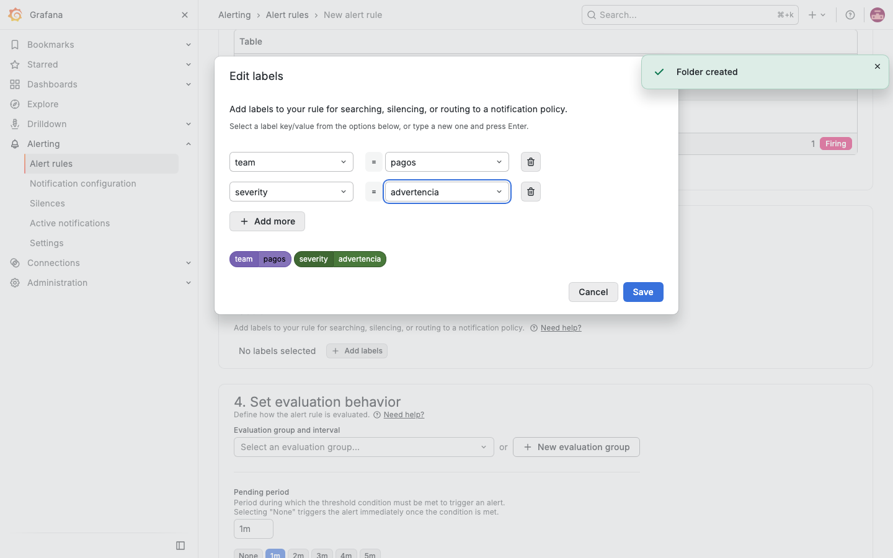

67. Pulsar **Save**. En **Set evaluation behavior** pulsar **New evaluation group**, escribir `pagos`, dejar `1m` y pulsar **Create**. Dejar **Pending period** en `1m`.

68. En **Configure notifications** encender **Advanced options**. Grafana usa la política por etiqueta y muestra que la alerta irá a `equipo-pagos`. En **Summary** escribir este texto.

```text
El p95 de pagos está en {{ printf "%.2f" $values.A.Value }} segundos
```

   `$values.A.Value` es el valor que devolvió la consulta A de la regla y `printf "%.2f"` lo escribe con dos decimales.


69. Pulsar **Save**. La regla aparece en la lista de la carpeta Tianguis.


70. Hacer lenta la pasarela de pagos. La mitad de los cobros tarda 1.5 segundos más, durante 15 minutos.

```bash
bin/caos.sh pagos pasarela_lenta ms=1500 porcentaje=50 duracion_s=900
```


71. Esperar unos 3 minutos y buscar `PagosLentos` en **Alert rules**. La regla pasa por **Pending** y llega a **Firing**.


72. En Mailpit abrir el correo de PagosLentos. El cuerpo usa la plantilla `tianguis.resumen`.


### Dashboard Tianguis · Alertas

Al otro día nadie recuerda a qué hora había una falla encendida.
Este dashboard es el pizarrón del mercado.
Marca sobre la gráfica las ventanas de caos y muestra al lado los silbatos que están sonando.

73. Abrir **Dashboards**, pulsar **New** y elegir **New dashboard**. Cambiar el rango de tiempo a **Last 1 hour**. En el panel de la derecha pulsar **Annotation query**. En **Name** escribir `Caos` y pulsar **Open query editor**. Escribir la siguiente consulta, en **Title** escribir `Caos en {{job}}`, en **Text** escribir `Falla {{type}}` y pulsar **Test annotation query**.

```promql
max by (job, type) (chaos_active) > 0
```


74. Pulsar **Close**. En la barra de la derecha pulsar el ícono **Add** y después el panel. Pulsar **Configure visualization**, cambiar a **Code**, escribir la siguiente consulta y pulsar Shift y Enter juntos. Elegir **Time series** y en **Title** escribir `Proporción de errores en prod`.

```promql
job:http_server_errors:ratio_rate5m
```


>**Nota.** Las franjas rojas son las anotaciones. Marcan solas cada ventana en que una falla de caos estuvo encendida, sin que nadie las dibuje a mano.

75. Pulsar **Back** y agregar otro panel. Elegir **Alert list** y en **Title** escribir `Alertas activas`.


76. Pulsar **Back** y después **Save**. En **Title** copiar el siguiente nombre y pulsar **Save**.

```text
Tianguis · Alertas
```


### Vuelta a la conciliación

La alerta de conciliacion mide el tiempo desde la última corrida exitosa, así que necesita minutos para cumplirse.
Este bloque vuelve a ella, revisa su aviso y apaga las fallas para cerrar el ciclo con los resueltos.

77. Esperar a que ConciliacionSinExito suene en Alertmanager. Si todavía no aparece, esperar unos minutos más y recargar.


78. En Mailpit abrir el correo de ConciliacionSinExito. Llegó por la ruta de severidad, a la guardia.


79. Apagar todas las fallas. Así vuelven a tener éxito las corridas de conciliacion y la pasarela de pagos responde a tiempo otra vez.

```bash
bin/caos.sh apagar
```


80. Esperar unos 5 minutos, que es lo que tarda la siguiente corrida de conciliacion, y revisar Mailpit. Llegan los resueltos de ConciliacionSinExito y de PagosLentos.


### Verificar

El script revisa en Prometheus, Alertmanager, Loki, Mailpit y Grafana lo que quedó hecho.
Es la ronda final antes de cerrar el mercado.

81. Ejecutar la verificación. Cada línea queda en verde si está lograda o en rojo con una pista de lo que falta.

```bash
Capitulo5/verificar.sh
```


## Preguntas frecuentes

**¿Qué diferencia hay entre una regla de registro y una regla de alerta?**
La regla de registro guarda el resultado de una consulta como una serie nueva. La regla de alerta revisa una condición y, si se cumple, la manda a Alertmanager.

**¿Qué significan Inactive, Pending y Firing?**
Inactive es que la condición no se cumple. Pending es que se cumple pero todavía no pasa el tiempo de `for`. Firing es que la alerta está sonando y Prometheus la entrega a Alertmanager.

**¿Por qué se recarga Prometheus con `kill -HUP 1` en vez de reiniciar el contenedor?**
La señal HUP le pide a Prometheus que vuelva a leer su configuración y sus reglas sin detenerse. El raspado sigue funcionando mientras tanto.

**¿Para qué sirve `MSYS_NO_PATHCONV=1` al inicio de algunos comandos?**
Solo hace falta en Git Bash de Windows. Evita que Git Bash convierta rutas como `/etc/prometheus/...` en rutas de Windows. En Linux y macOS no cambia nada.

**¿Qué es amtool?**
Es el cliente de línea de comandos de Alertmanager y viene dentro de su contenedor. Sirve para validar la configuración, probar el ruteo, consultar alertas y crear o terminar silencios.

**¿Qué es Mailpit?**
Es un servidor de correo de prueba que corre dentro del stack. Recibe los correos de las alertas y los muestra en `http://localhost:8025`, sin mandar nada a internet.

**¿Para qué sirven las etiquetas `severity` y `team` de una regla de alerta?**
Se agregan a la alerta cuando suena. Alertmanager y las políticas de Grafana las usan para decidir a quién avisar.

**¿Por qué hay que esperar varios minutos para ver sonar una alerta?**
Las alertas usan sus tiempos reales. El `for` de la regla y el `group_wait` de Alertmanager retrasan el aviso a propósito, y la guía indica en cada paso cuánto esperar.

**¿Cómo callo las alertas durante una mantención programada?**
Para una mantención puntual se crea un silencio con las etiquetas del servicio y la duración de la ventana, con `amtool silence add` o desde **Silences** en la interfaz de Alertmanager. Las alertas de Grafana se silencian en **Alerting**, **Silences**. Para una ventana que se repite, como todos los domingos de 2 a 4, Grafana usa un mute timing asignado a una política y Alertmanager usa `time_intervals` con `mute_time_intervals` en la ruta. En los dos casos la alerta se sigue evaluando y solo deja de notificarse. Más detalle en https://grafana.com/docs/grafana/latest/alerting/configure-notifications/mute-timings/

**¿Cómo sé a quién escalar una alerta?**
Lo dice el ruteo. En Alertmanager `amtool config routes test` con las etiquetas de la alerta muestra qué receptores la reciben, y `amtool config routes` muestra el árbol completo. En Grafana la pestaña **Notification policies** muestra qué etiquetas van a cada punto de contacto, y la regla muestra a qué punto de contacto irá antes de guardarla.

**¿Cómo agrego a una alerta el enlace a su runbook?**
Con la anotación `runbook_url`. En una regla de Prometheus va dentro de `annotations`, junto a `summary` y `description`, con la dirección del procedimiento. En una regla de Grafana se escribe en el campo **Runbook URL** de la sección de notificación. El enlace llega con el aviso y quien atiende sabe qué revisar primero.

## Resultado esperado

catalogo publica `catalog_product_views_total` por categoría y Prometheus calcula las reglas de registro. Las tres alertas tienen sus pruebas en verde, Alertmanager las agrupa, las inhibe y las silencia, y el correo y el webhook recibieron tanto los avisos como los resueltos. Grafana tiene la regla PagosLentos con su punto de contacto, su política y su plantilla, y el dashboard Tianguis · Alertas marca las ventanas de caos y lista las alertas activas.


Para dejar el código de catalogo, las reglas y Alertmanager como estaban, ejecutar `Capitulo5/restaurar.sh`.

La carpeta `Capitulo5/solucion` trae los archivos resueltos con la misma ruta que tienen en el repositorio.

Para ver la práctica resuelta de una vez, `Capitulo5/solucion/aplicar.sh` copia los archivos, repite el incidente con una caída de catalogo y crea en Grafana la plantilla, el punto de contacto, la política, la regla y el dashboard. Tarda unos 5 minutos por los tiempos reales de las alertas. Avisa qué reemplaza y pide escribir SI.
<!--  -->
