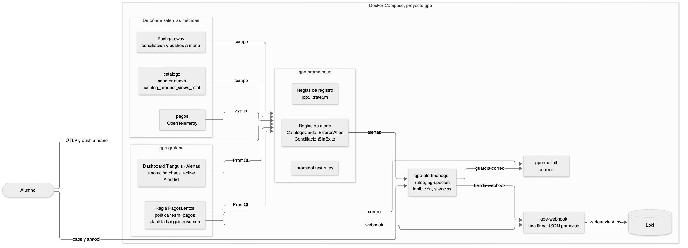

<!--  -->
# Guía del relator. Práctica 5. Alertas de un microservicio con Alertmanager y Grafana Alerting

Capítulo 5 del temario. Duración provisoria de 180 minutos, en dos partes.

La práctica tiene dos ideas. La primera es que una métrica existe porque alguien la puso en el código, y la forma de ponerla decide cuánto cuesta y qué preguntas responde. La segunda es que una alerta tiene dos mitades. Prometheus decide cuándo algo está mal y Alertmanager decide a quién avisar, cuántas veces y cuándo callarse. Casi todos los problemas de alertas en la vida real son de la segunda mitad.

## Diagrama



La fuente editable está en `images/5/diagrama.mmd` y se vuelve a dibujar con `tools/diagramas/render.sh 5`.

## Familia de analogías

Toda la práctica usa el sistema de avisos del mercado. No mezclar con otras analogías.

| Concepto | En el sistema de avisos del mercado |
|---|---|
| Instrumentar | Ponerle contador a la puerta del puesto |
| OTLP | El puesto que manda su reporte por correo certificado en formato oficial |
| Pushgateway | El buzón donde el ambulante deja su reporte antes de irse |
| Regla de registro | El resumen diario que el contador deja hecho para no recalcularlo |
| Regla de alerta | La condición que hace sonar el silbato |
| `for` | Esperar a que el problema dure antes de pitar, para no pitar por nada |
| Alertmanager | La central que recibe los pitazos y decide a quién llamar |
| Agrupación | Juntar todos los pitazos del mismo incendio en una sola llamada |
| Inhibición | Si se cayó la luz del mercado, no avisar que cada refrigerador está tibio |
| Silencio | Avisar a la central que el pasillo 3 está en mantención |
| Punto de contacto | El teléfono al que llama la central |

## Reparto del tiempo

| Bloque | Minutos |
|---|---|
| Preparar y counter nuevo en catalogo | 25 |
| pagos con OpenTelemetry, OTLP a mano y Pushgateway | 25 |
| Reglas de registro | 15 |
| Reglas de alerta y pruebas con promtool | 25 |
| Alertmanager | 15 |
| Incidente, inhibición, silencio y resueltos | 30 |
| Grafana Alerting, mientras suena la conciliación | 30 |
| Dashboard Tianguis · Alertas y verificar | 15 |

## Antes de la clase

- Correr `bin/up.sh` una vez en la máquina del alumno. La Parte A reconstruye catalogo y la primera vez descarga la imagen de Python.
- Confirmar que `bin/estado.sh` muestra los 18 servicios en healthy, incluido webhook.
- Si alguien ya hizo la práctica en esa máquina, correr `Capitulo5/restaurar.sh` y borrar en Grafana la regla PagosLentos, el punto de contacto equipo-pagos, la plantilla tianguis-resumen y el dashboard Tianguis · Alertas.
- Las alertas suenan con sus tiempos reales. ErroresAltos tarda unos 3 minutos, CatalogoCaido un minuto y medio, ConciliacionSinExito entre 10 y 15 minutos y PagosLentos unos 3 minutos. La guía hace la Parte de Grafana mientras espera a la conciliación.
- Tener a mano `Capitulo5/solucion`. Tiene cada archivo con la misma ruta que en el repositorio, así que se puede copiar encima si un alumno se atrasa.

---

## Paso 1. Un counter nuevo en catalogo

**🎯 Problema.** Las métricas que vienen hechas responden preguntas técnicas, cuántas peticiones y cuánto tardan. Ninguna dice qué productos mira la gente. Esa respuesta solo existe si alguien la pone en el código.

**👵 Analogía.** Ponerle contador a la puerta del puesto. El contador no sabe nada que el puestero no le diga, y hay que decidir qué anota. Si anota la sección del puesto, la libreta cabe en el bolsillo. Si anota el nombre de cada cliente, la libreta no alcanza.

**🔮 Predicción.** Antes de reconstruir, preguntar qué etiqueta sería un error ponerle a este counter. La respuesta es `sku`. En la Práctica 3 la ráfaga de skus inexistentes creó miles de series. Con `category` hay cuatro valores posibles y no crece.

**💻 Comando.**

```bash
git diff servicios/catalogo
bin/up.sh
curl -s http://localhost:8001/metrics | grep catalog_product_views
```

| Parte | Qué es |
|---|---|
| `Counter(nombre, ayuda, etiquetas)` | Crea la métrica una sola vez, al importar el módulo |
| `.labels(category=...)` | Elige la serie de esa combinación de etiquetas |
| `.inc()` | Suma uno |
| `git diff servicios/catalogo` | Muestra los dos cambios contra la versión del repositorio |
| `bin/up.sh` | Reconstruye la imagen de catalogo, recrea su contenedor y espera a que todo esté healthy |

**⚙️ Técnico.** prometheus_client acepta el nombre con o sin `_total` y siempre lo expone con `_total`. Además publica `_created` con la hora en que nació cada serie. El `inc()` va después de buscar el producto, así un 404 no suma, porque `obtener.ejecutar` lanza una excepción antes. catalogo-dev usa la misma imagen, así que también publica la métrica. k6 vuelve a encontrar a catalogo en unos segundos porque resuelve los nombres cada 10 segundos.

**📺 Salida.** El diff con 4 líneas en `rutas.py` y 8 en `metricas.py`. `bin/up.sh` termina con los 18 servicios en healthy. El grep muestra `# TYPE catalog_product_views_total counter` y una línea por categoría vista.

**⚠️ Fallas.**

| Qué se ve | Causa | Arreglo |
|---|---|---|
| `bin/up.sh` dice que catalogo no quedó healthy | Error de Python, casi siempre la sangría | `docker logs gpe-catalogo` y corregir el archivo |
| `NameError: Counter` | El bloque se pegó antes del import | Pegarlo al final del archivo |
| El grep no muestra nada | No se abrió ningún producto todavía | Correr el `curl` del paso 8 |

---

## Paso 2. pagos con OpenTelemetry

**🎯 Problema.** No todos los servicios usan la librería de Prometheus. pagos está en Java con la API de OpenTelemetry, que es la forma neutra de instrumentar. Hay que saber leer las dos y entender cómo se encuentran en Prometheus.

**👵 Analogía.** Dos puestos con contador. Uno anota en la libreta del mercado. El otro llena el formulario oficial, con la unidad en una casilla aparte, y la central lo pasa a la libreta del mercado al recibirlo.

**🔮 Predicción.** Preguntar cómo se va a llamar `payments.processed` en Prometheus. La respuesta es `payments_processed_total`. Los puntos pasan a guiones bajos y por ser counter se agrega `_total`.

**💻 Comando.**

```bash
grep -n -A4 'Builder("payments' servicios/pagos/src/main/java/mx/tianguis/pagos/telemetria/MetricasDePagos.java
```

| Parte | Qué es |
|---|---|
| `counterBuilder("payments.processed")` | Counter de OpenTelemetry, nombre con puntos |
| `.setUnit("{payment}")` | Unidad. Las llaves dicen que es una cuenta de cosas, no una unidad física |
| `histogramBuilder("payments.amount")` | Histograma del monto, con unidad `mxn` |
| `add(1, Attributes.of(...))` | Los atributos van en cada medición, no al crear la métrica |

**⚙️ Técnico.** pagos no tiene `/metrics`. El agente de OpenTelemetry empuja sus métricas cada 15 segundos por OTLP directo al receptor de Prometheus. Prometheus aplica `UnderscoreEscapingWithSuffixes`, que cambia puntos por guiones bajos y agrega sufijos de unidad y de tipo. Por eso el histograma queda como `payments_amount_mxn_bucket`. Las llaves de `{payment}` no generan sufijo.

**📺 Salida.** Cuatro líneas de cada builder. La consulta en Prometheus devuelve 8 series, una por método y resultado.

**⚠️ Fallas.**

| Qué se ve | Causa | Arreglo |
|---|---|---|
| La consulta sale vacía | pagos lleva menos de 15 segundos arriba | Esperar y volver a ejecutar |
| Aparecen `payments_amount_MXN` y `payments_amount_mxn` | Datos de una versión anterior del stack | Son series viejas. Mirar las que tienen datos recientes |

---

## Paso 3. OTLP a mano y Pushgateway

**🎯 Problema.** Hay procesos que no se pueden raspar. Uno manda sus métricas en el formato de OpenTelemetry y otro termina antes de que Prometheus llegue. Prometheus tiene una puerta para cada caso.

**👵 Analogía.** El primero es el puesto que manda su reporte por correo certificado en formato oficial. El segundo es el ambulante que deja su reporte en el buzón antes de irse, y el contador pasa a recogerlo cuando hace su ronda.

**🔮 Predicción.** Antes de enviar la temperatura, preguntar cómo va a quedar el nombre `tianguis.refrigerador.temperatura` con unidad `Cel`. La respuesta es `tianguis_refrigerador_temperatura_celsius`.

**💻 Comando.**

```bash
curl -s -o /dev/null -w '%{http_code}\n' -X POST http://localhost:9090/api/v1/otlp/v1/metrics -H 'Content-Type: application/json' -d '...'
echo 'tianguis_corte_de_caja_mxn 15230.50' | curl -s -w '%{http_code}\n' --data-binary @- http://localhost:9091/metrics/job/corte_de_caja/puesto/pasillo3
curl -s -w '%{http_code}\n' -X DELETE http://localhost:9091/metrics/job/corte_de_caja/puesto/pasillo3
```

| Parte | Qué es |
|---|---|
| `/api/v1/otlp/v1/metrics` | Receptor OTLP de Prometheus, se enciende con `--web.enable-otlp-receiver` |
| `-w '%{http_code}\n'` | Imprime solo el código HTTP de la respuesta |
| `resourceMetrics`, `scopeMetrics`, `metrics` | Las tres capas de OTLP. Recurso, librería que mide y métricas |
| `timeUnixNano` | Hora de la medición en nanosegundos, armada con `date +%s` |
| `--data-binary @-` | Manda como cuerpo lo que llega por la tubería |
| `/metrics/job/X/puesto/Y` | El grupo del Pushgateway. Cada par de la ruta es una etiqueta |
| `-X DELETE` | Borra el grupo completo |

**⚙️ Técnico.** OTLP es empuje. Prometheus guarda la muestra con la hora que trae, así que una hora vieja se rechaza o cae fuera de la ventana de muestras fuera de orden, que en este stack es de 10 minutos. El Pushgateway no es empuje hacia Prometheus. Es un intermediario que Prometheus raspa como a cualquier otro, con `honor_labels: true` para respetar el `job` del grupo. El Pushgateway no olvida nunca, por eso hay que borrar los grupos que ya no sirven. conciliacion empuja con `push` cuando la corrida sale bien y con `pushadd` cuando falla, para no borrar la hora del último éxito.

**📺 Salida.** 200 en el envío OTLP. La serie con `job="refrigerador"` y `pasillo="3"`. 200 en el push, dos grupos en la página del Pushgateway, 202 en el borrado y un solo grupo después de recargar.

**⚠️ Fallas.**

| Qué se ve | Causa | Arreglo |
|---|---|---|
| El envío OTLP responde 400 | Se cortó el JSON al copiarlo | Copiar el comando completo, con las comillas |
| El envío responde 200 pero la consulta sale vacía | Se ejecutó la consulta en otro rango o con otro nombre | Usar la consulta con `__name__=~` de la guía |
| En Git Bash `date +%s` imprime otra cosa | Se escribió `date + %s` con espacio | Sin espacio entre `+` y `%s` |
| El push responde 400 | Falta el salto de línea al final | Usar `echo`, que lo agrega |

---

## Paso 4. Reglas de registro

**🎯 Problema.** Las consultas de proporción de errores son largas, se repiten en dashboards y alertas y se recalculan cada vez que alguien abre un panel. Si hay un error en una copia, cada copia dice otra cosa.

**👵 Analogía.** El resumen diario que el contador deja hecho para no recalcularlo. Todos los que necesitan el número leen el resumen, y si hay que corregir la cuenta se corrige en un solo lugar.

**🔮 Predicción.** Preguntar qué devuelve `job:http_server_errors:ratio_rate5m` para catalogo si no hay ningún error. Sin el `or` no devolvería nada, porque el numerador no tendría series. Con el `or` devuelve 0.

**💻 Comando.**

```bash
MSYS_NO_PATHCONV=1 docker exec gpe-prometheus promtool check rules /etc/prometheus/rules/tianguis-registro.yml
docker exec gpe-prometheus kill -HUP 1
```

| Parte | Qué es |
|---|---|
| `MSYS_NO_PATHCONV=1` | Solo para Git Bash. Evita que convierta `/etc/...` en una ruta de Windows |
| `docker exec gpe-prometheus` | Corre el comando dentro del contenedor de Prometheus |
| `promtool check rules` | Valida la sintaxis del archivo y las expresiones sin cargarlas |
| `kill -HUP 1` | Le pide al proceso 1 del contenedor, Prometheus, que vuelva a leer su configuración |
| `record` | Nombre de la serie nueva |
| `nivel:métrica:operaciones` | Convención de nombre. Por qué se agrega, qué se mide y qué se hizo |

**⚙️ Técnico.** `rule_files` de `prometheus.yml` ya incluye `/etc/prometheus/rules/*.yml`, y la carpeta está montada desde `infra/prometheus`. Las reglas de un grupo se evalúan en orden, así que la segunda puede usar la primera en la misma evaluación. El resultado se guarda como cualquier otra serie, con la hora de la evaluación. No se recargan con `docker kill`, que deja el contenedor marcado para no reiniciarse.

**📺 Salida.** `SUCCESS: 2 rules found`. En **Rule health** el grupo tianguis-registro con las dos reglas en OK. Las dos consultas devuelven catalogo y pedidos, la proporción en 0.

**⚠️ Fallas.**

| Qué se ve | Causa | Arreglo |
|---|---|---|
| promtool dice `yaml: line N` | Sangría con tabuladores o mezclada | Usar espacios. Copiar el bloque completo |
| promtool dice `no such file` | El archivo quedó con otro nombre o en otra carpeta | Debe ser `infra/prometheus/rules/tianguis-registro.yml` |
| Git Bash dice `C:/Program Files/Git/etc/prometheus` | Falta `MSYS_NO_PATHCONV=1` | Copiar el comando completo |
| Las reglas no aparecen en Rule health | No se recargó | `docker exec gpe-prometheus kill -HUP 1` |

---

## Paso 5. Reglas de alerta y pruebas

**🎯 Problema.** Una alerta que suena por cualquier pico cansa a la guardia, y una que nunca suena es peor. Hay que poder probar cuándo suena sin esperar un incidente real.

**👵 Analogía.** La regla de alerta es la condición que hace sonar el silbato. `for` es esperar a que el problema dure antes de pitar, para no pitar por nada. Las pruebas son el simulacro, se inventa el humo y se mira si el silbato suena.

**🔮 Predicción.** Preguntar si ErroresAltos suena con un problema de 90 segundos. En la prueba no suena, porque la condición dura 90 segundos y `for` pide 2 minutos. En el stack real depende, porque la ventana de 5 minutos estira el problema.

**💻 Comando.**

```bash
MSYS_NO_PATHCONV=1 docker exec gpe-prometheus promtool test rules /etc/prometheus/pruebas/tianguis-alertas.test.yml
```

| Parte | Qué es |
|---|---|
| `alert` | Nombre de la alerta. Queda en la etiqueta `alertname` |
| `expr` | Expresión. Cada serie que devuelve es una alerta distinta |
| `for` | Tiempo que la condición debe mantenerse. Antes de eso la alerta está en Pending |
| `labels` | Etiquetas que se agregan. Alertmanager rutea con ellas |
| `annotations` | Textos para la persona. `$labels` y `$value` se reemplazan |
| `humanizePercentage` | Muestra 0.3 como 30% |
| `input_series` | Series inventadas. `0x7 0.3x6` son 8 ceros y 7 valores de 0.3 |
| `eval_time` | Momento en que se revisa qué alertas suenan |
| `exp_alerts` | Lo que se espera. `[]` es que no suene nada |

**⚙️ Técnico.** Las pruebas de ErroresAltos le dan valores directos a `job:http_server_errors:ratio_rate5m`, sin pasar por los contadores, para probar solo la regla de alerta. El archivo de pruebas vive en `infra/prometheus/pruebas` y no en `rules`, porque `rule_files` cargaría todo lo que termina en `.yml` dentro de `rules`. promtool compara etiquetas y anotaciones exactas, por eso las pruebas también vigilan los textos.

**📺 Salida.** Tres alertas en Inactive. `SUCCESS` en las pruebas. Con `> 0.40` la prueba ErroresAltos con un problema que sigue sale en `FAILED`, con `got:[]`.

**⚠️ Fallas.**

| Qué se ve | Causa | Arreglo |
|---|---|---|
| `FAILED` en ConciliacionSinExito con otro texto | Se cambió el texto de la anotación en un solo archivo | El texto debe ser igual en la regla y en la prueba |
| `FAILED` en todas | Se dejó el umbral en 0.40 | Volver a 0.10 |
| `could not find rule file` | La prueba no está en `infra/prometheus/pruebas` | Las rutas `../rules` son relativas al archivo de pruebas |
| Las alertas no aparecen en Alerts | No se recargó | `docker exec gpe-prometheus kill -HUP 1` |

---

## Paso 6. Alertmanager

**🎯 Problema.** Prometheus solo sabe que algo está mal. No sabe a quién avisar, por qué canal, ni si ya avisó. Sin un ruteador cada alerta llega a todos, todas las veces.

**👵 Analogía.** Alertmanager es la central que recibe los pitazos y decide a quién llamar. El punto de contacto es el teléfono al que llama. La agrupación es juntar todos los pitazos del mismo incendio en una sola llamada.

**🔮 Predicción.** Antes de `config routes test`, preguntar a quién le llega una ErroresAltos de tienda. Le llega a los dos, al webhook por la ruta de tienda y al correo por la ruta de severidad, gracias a `continue: true`.

**💻 Comando.**

```bash
MSYS_NO_PATHCONV=1 docker exec gpe-alertmanager amtool check-config /etc/alertmanager/alertmanager.yml
curl -s -w '%{http_code}\n' -X POST http://localhost:9093/-/reload
docker exec gpe-alertmanager amtool --alertmanager.url=http://localhost:9093 config routes
```

| Parte | Qué es |
|---|---|
| `amtool` | Cliente de Alertmanager. Viene en su contenedor |
| `check-config` | Valida el archivo sin cargarlo |
| `/-/reload` | Recarga la configuración. En Alertmanager siempre está disponible |
| `--alertmanager.url` | Dónde está Alertmanager. Dentro del contenedor es localhost |
| `group_by` | Etiquetas que definen un grupo. Una notificación por grupo |
| `group_wait` | Cuánto espera la primera notificación de un grupo nuevo |
| `group_interval` | Cuánto espera entre notificaciones del mismo grupo, incluidos los resueltos |
| `continue: true` | Después de esta ruta sigue mirando las de abajo |
| `inhibit_rules` | Si hay una alerta fuente, calla a las destino con el mismo valor en `equal` |
| `send_resolved` | Avisa también cuando la alerta se resuelve |

**⚙️ Técnico.** El árbol se recorre de arriba abajo y la alerta se queda en la primera ruta que calza, salvo que tenga `continue`. Si ninguna ruta hija calza, se usa el receptor de la raíz. El webhook no publica puerto en el host. Alertmanager lo encuentra por el nombre `webhook` en la red de Docker.

**📺 Salida.** `SUCCESS` con 1 regla de inhibición y 2 receptores. 200 en el reload. El árbol con default-route, la ruta de `team="tienda"` con `continue: true` y la de severidad. La prueba de ruteo responde `tienda-webhook,guardia-correo`.

**⚠️ Fallas.**

| Qué se ve | Causa | Arreglo |
|---|---|---|
| `check-config` dice `undefined receiver` | Un nombre de receptor mal escrito en una ruta | El nombre en `routes` debe ser igual al de `receivers` |
| El reload responde 500 | El archivo tiene un error | Correr `check-config` y leer el mensaje |
| `config routes` muestra el árbol viejo | No se recargó | `curl -X POST http://localhost:9093/-/reload` |

---

## Paso 7. El incidente de las 3 de la mañana

**🎯 Problema.** En un incidente real suenan muchas alertas a la vez y casi todas son consecuencia de una sola causa. Si cada una manda su aviso, la guardia no encuentra la importante.

**👵 Analogía.** La inhibición es que si se cayó la luz del mercado, no se avisa que cada refrigerador está tibio. El silencio es avisar a la central que el pasillo 3 está en mantención, para que no llame por lo que ya se sabe.

**🔮 Predicción.** Antes de detener catalogo, preguntar qué pasa con ErroresAltos de catalogo y de pedidos. La de catalogo queda inhibida, porque CatalogoCaido comparte su `job`. La de pedidos sigue avisando, porque su `job` es otro. Por eso hace falta el silencio.

**💻 Comando.**

```bash
bin/caos.sh catalogo errores porcentaje=30
docker stop gpe-catalogo
docker exec gpe-alertmanager amtool --alertmanager.url=http://localhost:9093 alert query --inhibited
docker exec gpe-alertmanager amtool --alertmanager.url=http://localhost:9093 silence add alertname=ErroresAltos job=pedidos --duration=30m --author=guardia --comment="..."
bin/up.sh
bin/caos.sh apagar
```

| Parte | Qué es |
|---|---|
| `alert query --inhibited` | Lista también las alertas inhibidas, que en el estado salen como `suppressed` |
| `silence add` | Crea un silencio. Las etiquetas que siguen son sus condiciones |
| `--duration=30m` | El silencio vence solo en 30 minutos |
| `--author`, `--comment` | Quién silenció y por qué. Quedan registrados |
| `alert query --silenced` | Lista también las silenciadas |
| `silence expire` | Termina un silencio antes de tiempo |

**⚙️ Técnico.** Los tiempos medidos en el stack del curso son estos. ErroresAltos pasa a Pending a los 1 a 2 minutos y a Firing unos 2 minutos después. Llega a Alertmanager y, 30 segundos después, al correo y al webhook. CatalogoCaido suena un minuto y medio después de detener catalogo. Mientras tanto ErroresAltos de catalogo sigue activa en Prometheus, porque `rate` sobre 5 minutos sigue usando las muestras de antes de la caída, y Alertmanager la marca inhibida. El resuelto de CatalogoCaido llega a un minuto de levantar catalogo y el de ErroresAltos a unos 3 minutos. Una alerta silenciada no manda su resuelto mientras dure el silencio.

**📺 Salida.** Pending y luego Firing en Prometheus. Grupos por alerta, servicio y receptor en Alertmanager. Correos con asunto `[FIRING:1] ErroresAltos catalogo (advertencia tienda)`. Líneas JSON del webhook en Loki con `receiver`, `status` y `alertnames`. `suppressed` en las consultas de amtool. Correos `[RESOLVED]` al final.

**⚠️ Fallas.**

| Qué se ve | Causa | Arreglo |
|---|---|---|
| ErroresAltos no pasa a Pending en 5 minutos | El tráfico está pausado | `bin/trafico.sh estado` y `bin/trafico.sh nivel normal` |
| Llega el correo pero no la línea en Loki | Alloy tarda unos segundos en enviar | Esperar y ejecutar de nuevo la consulta |
| No hay nada inhibido | Pasaron más de 5 minutos desde que se detuvo catalogo | La ventana ya no tiene muestras. Repetir desde el paso 39 |
| `silence add` dice `connection refused` | Falta `--alertmanager.url` | Copiar el comando completo |
| catalogo no vuelve con `bin/up.sh` | Otro error en el código del paso 1 | `docker logs gpe-catalogo` |

---

## Paso 8. La falla silenciosa con alarma

**🎯 Problema.** conciliacion puede fallar sin que nada se caiga. Sus métricas siguen ahí, con valores viejos que parecen normales. Solo se nota si alguien mira cuándo fue la última vez que salió bien.

**👵 Analogía.** El ambulante deja de pasar por el buzón y el buzón sigue mostrando su último reporte. El silbato tiene que sonar por el tiempo que lleva sin un reporte bueno, no por lo que dice el reporte.

**🔮 Predicción.** Preguntar cuánto va a tardar ConciliacionSinExito. Entre 10 y 15 minutos. Depende de cuánto hace que salió bien la última corrida, porque la condición pide 15 minutos sin éxito.

**💻 Comando.**

```bash
bin/caos.sh conciliacion fallar
bin/caos.sh apagar
```

| Parte | Qué es |
|---|---|
| `conciliacion fallar` | Hace fallar cada corrida. conciliacion no tiene HTTP, el script entra con `docker exec` |
| `time() - conciliacion_last_success_timestamp_seconds` | Segundos desde la última corrida exitosa |
| `humanizeDuration` | Muestra 960 como `16m 0s` |

**⚙️ Técnico.** Las corridas fallidas usan `pushadd`, que solo reemplaza las métricas que manda. Así `last_success_timestamp` conserva la hora del último éxito. Con `push` el grupo perdería esa métrica y la alerta quedaría ciega. En la corrida del curso la alerta sonó 13 minutos después de encender la falla y el resuelto llegó 4 minutos y medio después de apagarla, en la siguiente corrida.

**📺 Salida.** ConciliacionSinExito en Alertmanager con `severity="advertencia"` y `team="finanzas"`. El correo llega a la guardia por la ruta de severidad, no al webhook, porque no es del equipo tienda.

**⚠️ Fallas.**

| Qué se ve | Causa | Arreglo |
|---|---|---|
| La alerta no suena en 20 minutos | La falla se apagó sola o se reinició conciliacion | `bin/caos.sh estado` |
| La alerta suena apenas se enciende la falla | conciliacion ya venía fallando | Es correcto. Mirar el valor en la anotación |

---

## Paso 9. Grafana Alerting

**🎯 Problema.** Alertmanager se configura con archivos y solo ve lo que manda Prometheus. Hay equipos que prefieren definir alertas desde la interfaz, sobre cualquier fuente de datos, y con mensajes propios.

**👵 Analogía.** Grafana tiene su propia central, con sus propios teléfonos. El punto de contacto es el teléfono al que llama la central, y la política es la libreta que dice qué pitazos van a qué teléfono según su etiqueta. La plantilla es el guion que lee la operadora al llamar.

**🔮 Predicción.** Antes de encender la pasarela lenta, preguntar a qué correo llega PagosLentos. A `pagos@tianguis.local`, porque la regla lleva `team=pagos` y la política manda esa etiqueta al punto de contacto equipo-pagos. No pasa por Alertmanager.

**💻 Comando.** **Alerting**, **Notification configuration**, pestañas **Templates**, **Contact points** y **Notification policies**. Después **Alert rules** y **New alert rule**.

```bash
bin/caos.sh pagos pasarela_lenta ms=1500 porcentaje=50 duracion_s=900
```

| Parte | Qué es |
|---|---|
| Template group | Archivo de plantillas. `define` le pone nombre a cada una |
| `.Alerts`, `.Status`, `.Labels`, `.Annotations` | Datos de la notificación que la plantilla puede usar |
| Contact point | Uno o más canales. Aquí correo con la plantilla y webhook |
| Add route | Política hija de la política por defecto, con su condición de etiquetas |
| Alert condition | Umbral sobre la consulta A. Grafana lo guarda como la expresión C |
| Pending period | Lo mismo que `for` en Prometheus |
| Evaluation group | Grupo de reglas que se evalúan juntas, con su intervalo |
| `$values.A.Value` | Valor de la consulta A en la anotación |

**⚙️ Técnico.** Grafana evalúa la regla en su propio servidor y manda la notificación por su Alertmanager interno, no por gpe-alertmanager. El correo sale por el SMTP de Grafana, que el compose apunta a Mailpit. Las alertas de Prometheus también se ven en Grafana a través del datasource Alertmanager, pero no se editan ahí. La regla usa el histograma de pagos que manda el agente de OpenTelemetry, solo para la ruta `/pagos`.

**📺 Salida.** La plantilla con su vista previa, el punto de contacto con sus dos integraciones, la política `team = pagos` hacia equipo-pagos. La regla en la carpeta Tianguis pasa a Firing unos 3 minutos después de encender la falla. El correo dice El p95 de pagos está en 1.76 segundos o un valor parecido.

**⚠️ Fallas.**

| Qué se ve | Causa | Arreglo |
|---|---|---|
| La plantilla no aparece en Edit Message | No se guardó o tiene un error | Abrir **Templates** y revisar que esté en la lista |
| La plantilla da error de llaves | El editor agregó llaves al pegar | Borrar las llaves de más al final de las líneas |
| El ruteo dice Default policy y no equipo-pagos | La etiqueta de la regla no calza con la política | Revisar `team` y `pagos` en los dos lados |
| La regla queda en Normal | La pasarela lenta no está encendida o pasó su duración | `bin/caos.sh estado` |
| No llega el correo de Grafana | Grafana arrancó antes del SMTP en el compose | `bin/up.sh` |

---

## Paso 10. Dashboard Tianguis · Alertas y verificar

**🎯 Problema.** Cuando se mira un gráfico al otro día, nadie recuerda que a las 3 de la mañana había una falla encendida. Y las alertas viven en otra pantalla. El dashboard tiene que contar las dos cosas.

**👵 Analogía.** En el pizarrón del mercado se pinta solo una franja roja cada vez que alguien encendió una falla de prueba, y al lado un letrero con los silbatos que están sonando.

**🔮 Predicción.** Preguntar cuántas franjas va a mostrar la anotación en la última hora. Una por cada ventana de caos de la práctica. El incidente de catalogo, la conciliación y la pasarela de pagos, separadas por servicio y tipo de falla.

**💻 Comando.** En el dashboard nuevo, **Annotation query** en el panel de la derecha.

```promql
max by (job, type) (chaos_active) > 0
job:http_server_errors:ratio_rate5m
```

```bash
Capitulo5/verificar.sh
```

| Parte | Qué es |
|---|---|
| Annotation query | Consulta que dibuja marcas sobre todos los paneles de tiempo |
| `> 0` | Deja solo los momentos con la falla encendida |
| Title, Text | Textos de la marca. `{{job}}` y `{{type}}` salen de las etiquetas |
| Alert list | Panel con las alertas y su estado |

**⚙️ Técnico.** Con Prometheus, cada tramo continuo de valores no vacíos queda como una región. En Grafana 13.2 las anotaciones se configuran desde el panel lateral del dashboard, ya no desde Settings. Alert list muestra las reglas gestionadas por Grafana, con su estado y desde cuándo. Las alertas de Prometheus se miran en Alertmanager o en **Alerting**, **Alert rules**, donde Grafana las lista en modo lectura. `verificar.sh` consulta Prometheus, Alertmanager, Loki, Mailpit y Grafana, y también corre `promtool test rules`.

**📺 Salida.** Las franjas rojas sobre la gráfica de errores. Alert list con PagosLentos en Firing. `PRÁCTICA LOGRADA` en verde.

**⚠️ Fallas.**

| Qué se ve | Causa | Arreglo |
|---|---|---|
| La anotación da No events found | El rango no llega a las fallas | Poner **Last 1 hour** o más |
| Falta el webhook resolved en verificar | El incidente terminó con el silencio activo para todo | Repetir el incidente sin silenciar catalogo |
| Queda una falla de caos encendida | Se apagó solo una | `bin/caos.sh apagar` |
| gpe-catalogo no está corriendo | Se detuvo en el incidente y no se levantó | `bin/up.sh` |

---

## ❓ Preguntas del alumno

Son preguntas de un alumno de nivel intermedio, que maneja la terminal y Docker básico pero no conoce Prometheus ni Grafana.

**¿Qué es un contenedor y por qué tantos comandos empiezan con `docker exec`?**
Cada servicio del stack corre en su propio contenedor, que es un proceso aislado con sus propios archivos. `docker exec gpe-prometheus` corre el comando dentro del contenedor de Prometheus, donde ya están promtool y las carpetas montadas desde `infra/prometheus`. Lo mismo pasa con amtool en gpe-alertmanager.

**¿Por qué no veo la métrica nueva en Prometheus si acabo de abrir productos?**
Prometheus raspa a catalogo cada cierto tiempo, no al instante. Hay que esperar unos segundos y volver a pulsar **Execute**. Si sigue vacía, revisar con el `curl` a `/metrics` del paso 9 que catalogo la esté publicando.

**¿Qué es una etiqueta?**
Es un par de nombre y valor que acompaña a cada medición, como `category` o `job="catalogo"`. Cada combinación distinta de etiquetas es una serie aparte. Por eso se eligen etiquetas con pocos valores posibles.

**¿Qué es una alerta y quién la manda?**
Es una regla que Prometheus evalúa cada 15 segundos. Cuando la condición se mantiene el tiempo que pide `for`, Prometheus la entrega a Alertmanager, y Alertmanager decide a quién avisar y por qué canal.

**¿Por qué tengo que esperar tanto para que suene una alerta?**
Porque las alertas usan sus tiempos reales. `for` pide que la condición dure, la proporción se calcula sobre 5 minutos y Alertmanager espera `group_wait` antes de la primera notificación. ConciliacionSinExito tarda más porque pide 15 minutos sin una corrida exitosa.

**¿Por qué no poner el sku como etiqueta si quiero saber qué producto se ve más?**
Porque cada sku sería una serie y no hay límite de skus. Para el producto más visto se usan los logs o una base de datos. Las métricas responden preguntas agregadas.

**¿Cuándo uso el Pushgateway y cuándo OTLP?**
El Pushgateway es para procesos por lotes que terminan, y guarda el último valor. OTLP es para servicios que ya usan OpenTelemetry y empujan seguido. Un servicio que vive y tiene puerto se raspa.

**¿Las reglas de registro ahorran almacenamiento?**
No, agregan series. Ahorran cálculo en cada consulta y dejan una definición única. Si la serie original tiene muchas etiquetas, la regla agregada sí permite consultas mucho más rápidas.

**¿Por qué la alerta sigue en Firing un rato después de apagar la falla?**
Porque la proporción se calcula sobre 5 minutos. Los errores viejos siguen dentro de la ventana hasta que salen de ella.

**¿Qué diferencia hay entre inhibir y silenciar?**
La inhibición es automática y depende de otra alerta activa. El silencio lo pone una persona, con autor, comentario y vencimiento. Los dos dejan la alerta visible pero sin notificar.

**¿Uso Grafana Alerting o Prometheus con Alertmanager?**
Si las alertas viven en git junto con las reglas de registro, Prometheus con Alertmanager. Si la alerta mezcla fuentes, como Loki y Prometheus, o el equipo trabaja desde la interfaz, Grafana Alerting. En este curso conviven.

**¿Qué pasa si Alertmanager se cae?**
Prometheus sigue evaluando y reintenta enviar las alertas. Cuando Alertmanager vuelve, las recibe en el siguiente envío. En producción se corren dos o tres en clúster.

**¿Por qué el webhook no usa Slack?**
Para no depender de cuentas ni de internet. gpe-webhook escribe lo que recibe en Loki, que es lo mismo que haría el canal, y se puede consultar con LogQL.
<!--  -->
