# Práctica 6. Dashboard dinámico para múltiples ambientes

En esta práctica se arma un solo dashboard que sirve para prod y para dev. Usa variables de consulta, de intervalo, personalizadas y un filtro ad hoc, repite un panel por cada servicio y muestra una sección solo cuando corresponde. Después se recorren Explore y las aplicaciones de Drilldown, y se sigue un pago lento desde un exemplar hasta su traza y sus logs.

## Objetivos
- Crear variables de consulta, de intervalo y personalizadas, y un filtro ad hoc.
- Hacer que una variable dependa de otra.
- Repetir un panel por cada valor de una variable.
- Mostrar una sección del dashboard solo cuando se cumple una condición.
- Agregar un enlace de datos que abre Explore filtrado por el mismo servicio.
- Comparar Prometheus y Loki lado a lado y recorrer las aplicaciones de Drilldown.
- Ir de un exemplar a su traza en Tempo y de la traza a sus logs en Loki.

## El problema y la solución

Una cadena tiene varios mercados y quiere un pizarrón para ver cómo anda cada uno y cada puesto.
Si se pinta un pizarrón por mercado y un letrero a mano por puesto, cada corrección hay que repetirla en todos.
Tarde o temprano uno queda con la cuenta vieja y nadie lo nota.
Cuando abre un puesto nuevo, nadie se acuerda de pintar su letrero.

En esta práctica se arma el mismo pizarrón para todos los mercados.
Los mercados son los ambientes prod y dev, y los puestos son los servicios.
Un selector arriba elige qué mercado mostrar, y su lista se arma sola preguntándole a Prometheus.
Se pinta un letrero modelo y el pizarrón lo copia para cada puesto.
Algunos letreros solo aparecen si hay algo que mostrar.

Cuando un punto del gráfico se ve raro, trae pegada una boleta de ejemplo.
Con esa boleta se sigue al cliente por todo su recorrido en Tempo y se leen sus logs en Loki.

En el NOC es el tablero que se abre cuando llega una alerta de pagos lentos o de errores en un servicio de dev o de prod.
Con los selectores se aísla el ambiente y el servicio afectados, y desde el exemplar se llega a la traza y los logs que muestran en qué tramo está la demora antes de escalar.

## Duración aproximada
- 120 minutos.

---
<div style="width: 400px;">
        <table width="50%">
            <tr>
                <td style="text-align: center;">
                    <a href="../Capitulo5/"></a>
                    <br>anterior
                </td>
                <td style="text-align: center;">
                   <a href="../README.md">Lista Laboratorios</a>
                </td>
<td style="text-align: center;">
                    <a href="../Capitulo7/">
                    </a>
                    <br>siguiente
                </td>
            </tr>
        </table>
</div>

---

## Diagrama


<br>

## Instrucciones

### Preparar el punto de partida

El pizarrón necesita movimiento en los dos mercados para tener algo que mostrar.
El script deja el stack en un estado conocido, igual para todos los alumnos.
Así lo que se ve en pantalla coincide con lo que describe la guía.

1. Abrir una terminal en la carpeta del repositorio. En Windows usar Git Bash.

2. Dejar el stack en el punto de partida de la práctica. El script sube el tráfico a nivel alto, para que dev tenga datos visibles, y hace lenta la pasarela de pagos en el 20 % de los cobros durante 60 minutos.

```bash
Capitulo6/preparar.sh
```

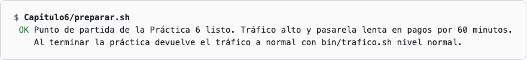

3. Abrir Grafana en el navegador e iniciar sesión con el usuario `admin` y la contraseña `tianguis`. Si cambiaste el puerto o la contraseña, usa los valores de `infra/.env`.

### Variables

Las variables son los selectores del pizarrón.
Una elige el mercado, otra el puesto, otra cada cuánto se hace la cuenta y otra el límite de errores.
Las listas de mercados y puestos no se escriben a mano, se arman solas preguntándole a Prometheus.
El filtro ad hoc agrega una condición al vuelo sin tocar el pizarrón.

4. Pulsar **New** y elegir **New dashboard**. En el panel de la derecha pulsar **Variable** y elegir **Query**. En **Name** escribir `ambiente` y pulsar **Open variable editor**.

5. En **Query type** elegir **Classic query** y en **Classic Query** escribir la siguiente consulta. Pulsar **Run query**. La vista previa muestra los dos ambientes.

```promql
label_values(http_server_requests_total, ambiente)
```

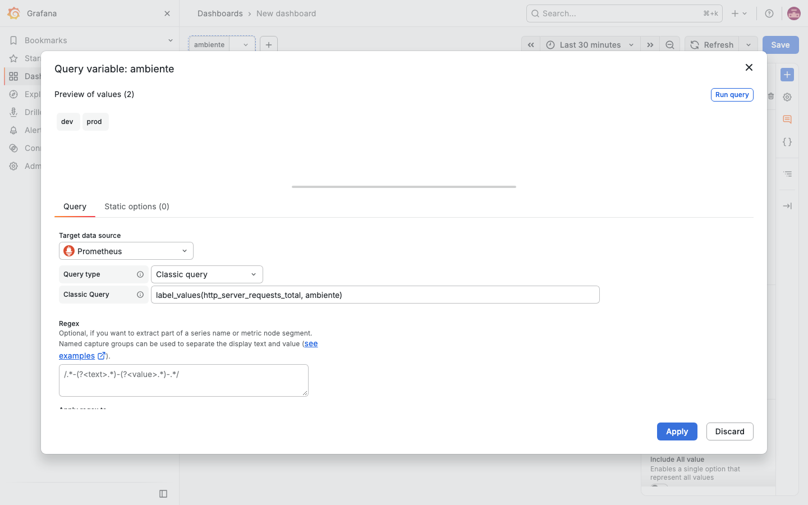

6. Pulsar **Apply**. En la barra derecha pulsar el ícono **Add**, después **Variable**, y elegir **Query**. En **Name** escribir `servicio`, pulsar **Open variable editor** y en **Query type** elegir **Classic query**. Copiar esta consulta en **Classic Query**.

```promql
query_result(count by (job) (label_replace(http_server_request_duration_seconds_count, "ambiente", "prod", "ambiente", "") and on(ambiente) label_replace(vector(1), "ambiente", "$ambiente", "", "")))
```

7. En **Regex** escribir lo siguiente y pulsar **Run query**.

```text
/job="([^"]+)"/
```

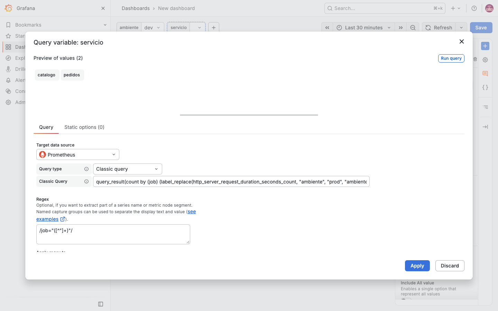

>**Nota.** pagos no lleva la etiqueta `ambiente`, porque solo existe en prod. El primer `label_replace` le pone `ambiente="prod"` a las series que no la tienen. El segundo arma una serie con el valor elegido en `$ambiente`, y `and on(ambiente)` deja solo los servicios de ese ambiente. La expresión regular saca el nombre del servicio de cada resultado.

8. Pulsar **Apply**. En **Selection options** encender **Multi-value** y **Include All value**.

9. Agregar otra variable y elegir **Interval**. En **Name** escribir `intervalo` y en **Values** escribir `1m,5m,15m`. Apagar **Auto option**.

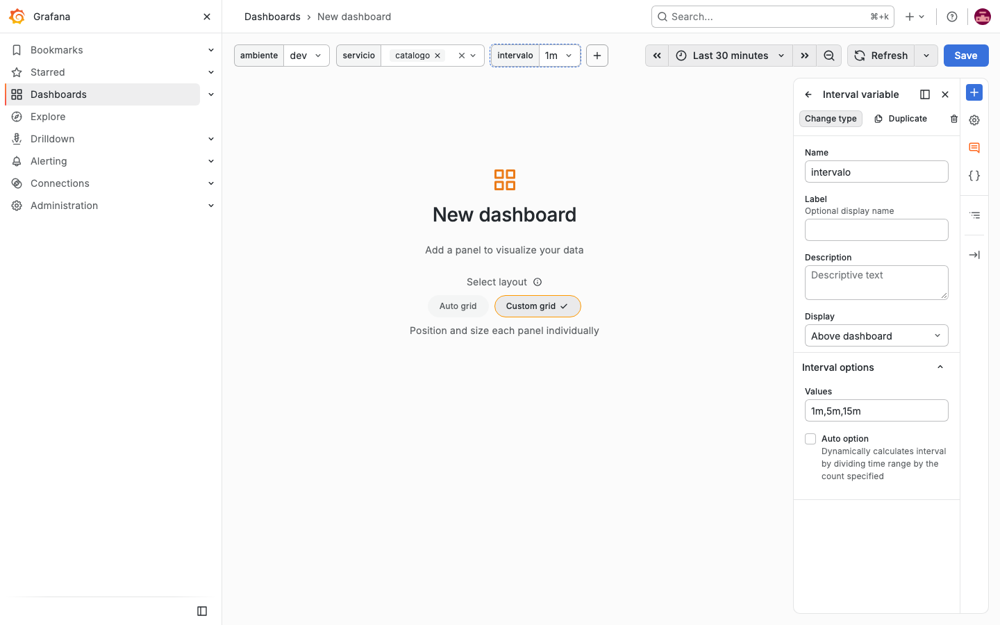

10. Agregar otra variable y elegir **Custom**. En **Name** escribir `umbral` y pulsar **Open variable editor**. Escribir `0.01,0.05,0.10`. La vista previa muestra los tres valores.

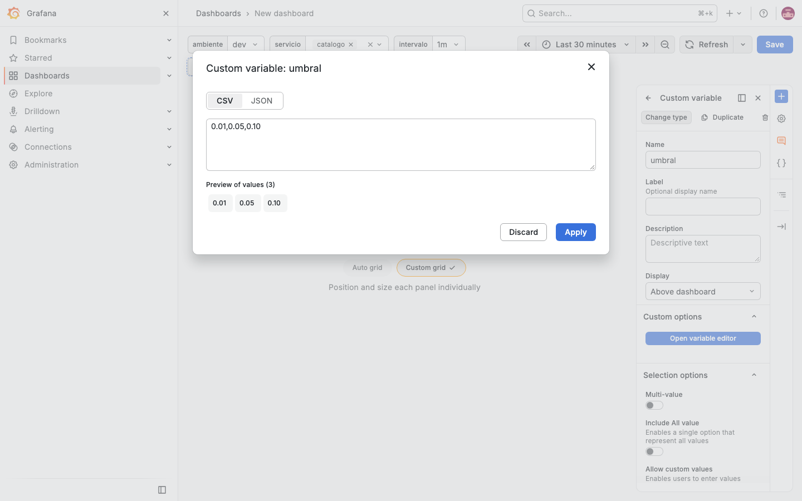

11. Pulsar **Apply**. En el panel **Add** pulsar **Filter and Group by**. En **Name** escribir `filtros` y en **Data source** elegir **Prometheus**.

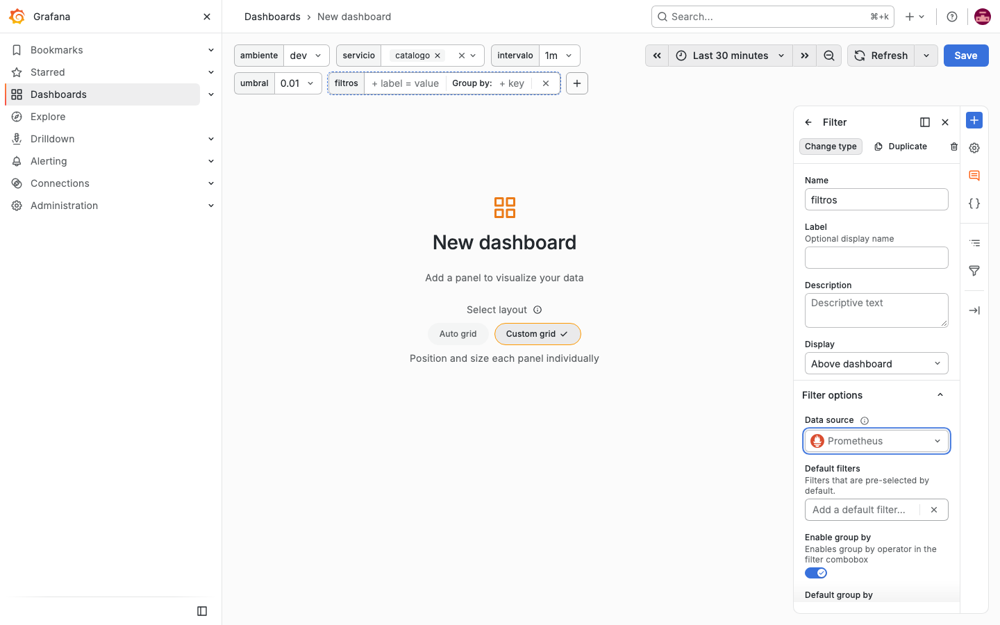

>**Nota.** El filtro ad hoc agrega condiciones a todas las consultas de Prometheus del dashboard, sin editarlas. Sirve para mirar, por ejemplo, solo una ruta o solo un código de respuesta.

### Panel repetido por servicio

Pintar un letrero por puesto sirve con tres puestos, pero no con veinte.
Se pinta un solo letrero modelo y el pizarrón lo copia para cada puesto del mercado elegido.
Si mañana aparece un puesto nuevo, su letrero aparece solo.

12. Arriba del dashboard elegir `prod` en **ambiente**. En el panel **Add** pulsar **Add row**, en **Title** escribir `Servicios` y pulsar Enter.

13. Pulsar **Add panel** y después **Configure visualization**. Cambiar a **Code** y escribir la siguiente consulta. Abrir **Options**, en **Legend** elegir **Custom** y escribir `peticiones por segundo`.

```promql
sum(rate(http_server_request_duration_seconds_count{job="$servicio", ambiente=~"$ambiente|"}[$intervalo]))
```

14. Pulsar **Add query**, cambiar a **Code** y escribir la siguiente. En **Legend** elegir **Custom** y escribir `p95 en segundos`.

```promql
histogram_quantile(0.95, sum by (le) (rate(http_server_request_duration_seconds_bucket{job="$servicio", ambiente=~"$ambiente|"}[$intervalo])))
```

15. Elegir **Time series** y en **Title** escribir `Servicio $servicio`.

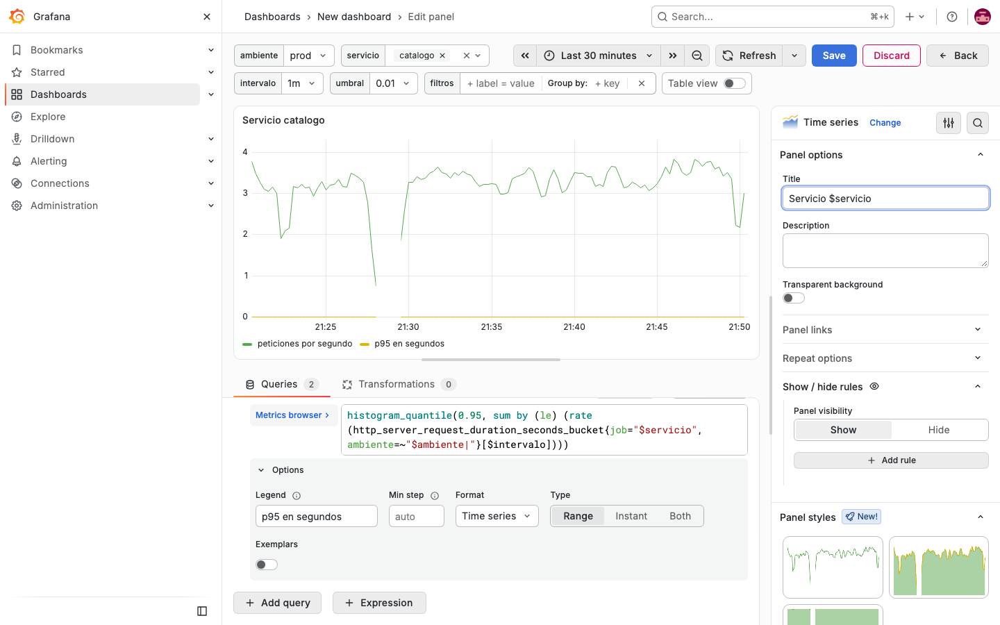

>**Nota.** `ambiente=~"$ambiente|"` acepta el ambiente elegido o ninguno. Así entra pagos, que no tiene la etiqueta. `[$intervalo]` usa la ventana elegida arriba del dashboard.

16. Abrir **Repeat options** y en **Repeat by variable** elegir `servicio`.

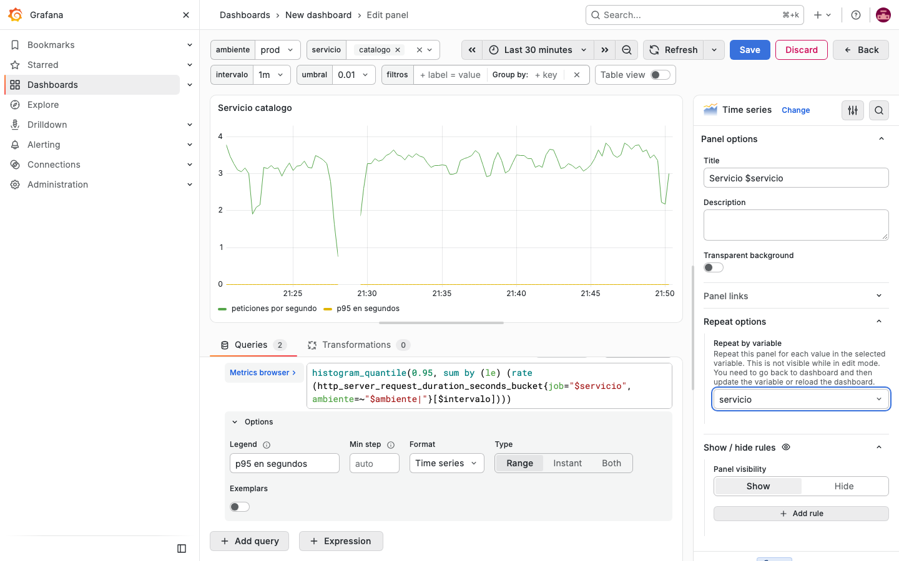

### Enlace de datos hacia Explore

Desde un letrero se quiere llegar rápido al archivo donde se guardan las boletas de ese puesto.
El enlace de datos deja esa dirección pegada en el panel, con el puesto y el mercado ya puestos.
Así no hay que abrir Explore y escribir la consulta a mano.

17. Bajar hasta **Data links and actions** y pulsar **Add link**. En **Title** escribir `Logs de ${servicio} en Explore`. En **URL** copiar la siguiente dirección. Encender **Open in new tab**.

```text
/explore?schemaVersion=1&panes={"a":{"datasource":"loki","queries":[{"refId":"A","expr":"{compose_service=~\"${servicio}(-dev)?\", ambiente=~\"${ambiente}|\"}"}],"range":{"from":"now-30m","to":"now"}}}
```

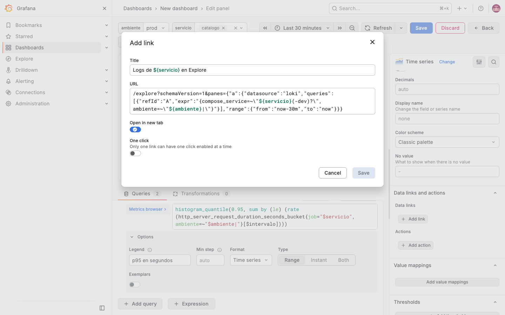

18. Pulsar **Save** en la ventana del enlace.

### Errores sobre el umbral

Mirar todos los puestos para encontrar los que fallan demasiado cansa.
Este panel usa el selector de umbral como límite y deja en el pizarrón solo los puestos que lo pasan.
Al cambiar el valor del selector cambia lo que se considera demasiado.

19. Pulsar **Back**. Agregar una fila llamada `Errores sobre el umbral` y dentro un panel con esta consulta. Elegir **Time series** y en **Title** escribir `Servicios con más errores que el umbral`.

```promql
(sum by (job) (rate(http_server_requests_total{ambiente="$ambiente", status=~"5.."}[$intervalo])) / sum by (job) (rate(http_server_requests_total{ambiente="$ambiente"}[$intervalo]))) > $umbral
```

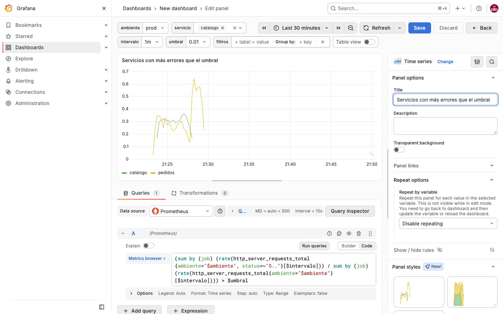

>**Nota.** El panel solo muestra los servicios cuya proporción de errores pasa el valor elegido en **umbral**. Si ninguno lo pasa, dice No data, y eso es una buena noticia.

### Sección condicional para pagos

No todos los letreros tienen sentido en todos los mercados.
Una regla decide cuándo se muestra la fila, según el valor de una variable.

20. Pulsar **Back**. Agregar una fila llamada `Pagos y su pasarela` y dentro un panel con esta consulta. En **Legend** elegir **Custom** y escribir `p95 de pagos`. Encender **Exemplars**. Elegir **Time series** y en **Title** escribir `p95 de pagos con exemplars`.

```promql
histogram_quantile(0.95, sum by (le) (rate(http_server_request_duration_seconds_bucket{job="pagos", http_route="/pagos"}[$intervalo])))
```

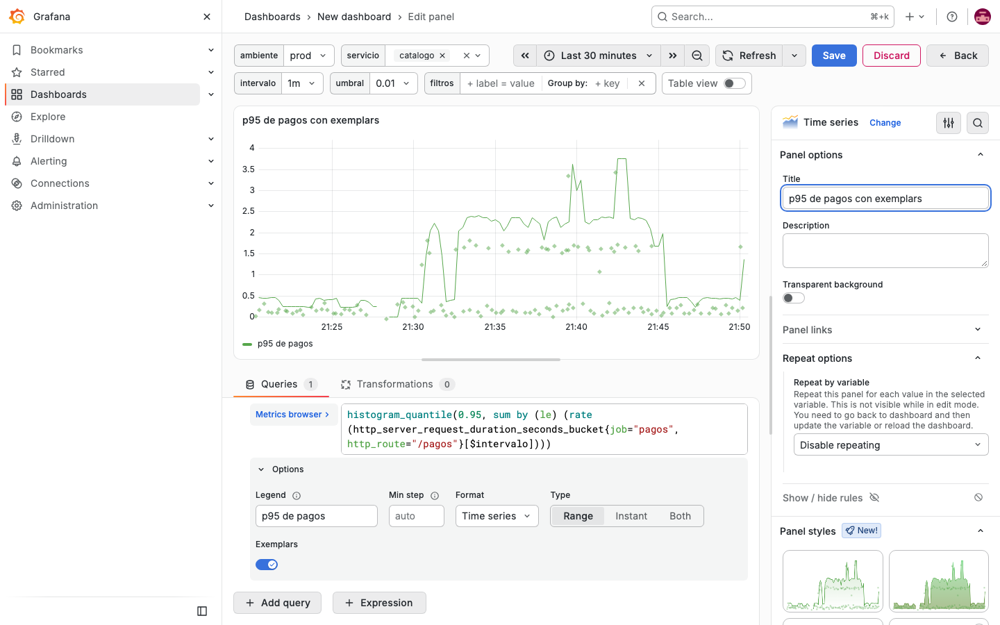

>**Nota.** Cada rombo es un exemplar. Es una medición real con el trace_id de la petición que la produjo. Los de arriba son los pagos lentos.

21. Pulsar **Back** y hacer clic en el título de la fila **Pagos y su pasarela**. En el panel de la derecha bajar hasta **Show / hide rules** y pulsar **Add rule**. Elegir **Template variable**. En **Name** elegir `ambiente`, dejar el operador `=` y en **Value** escribir `prod`.

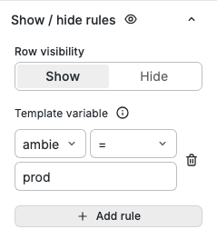

22. Pulsar **Save**. En **Title** copiar el siguiente nombre y pulsar **Save**. Después pulsar **Exit edit**.

```text
Tianguis · Multiambiente
```

23. En **servicio** quitar el valor elegido y elegir **All**. Hacer clic fuera del selector. Aparece un panel por cada servicio de prod.

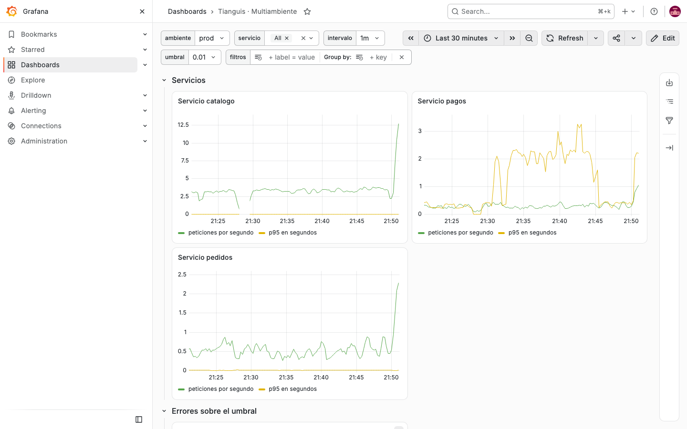

24. Antes de cambiar de ambiente, anotar una predicción. ¿Qué va a pasar con los paneles si se elige dev?

>**Nota.** Para razonarlo, repasar cómo se arma la lista de la variable servicio en el paso 7 y la regla de la fila en el paso 21. Las variables encadenadas y los paneles repetidos están en el Capítulo 6, sección 6.1 de la presentación del curso, y en la documentación de Grafana, https://grafana.com/docs/grafana/latest/visualizations/dashboards/variables/add-template-variables/

25. En **ambiente** elegir `dev`. Comparar con la predicción qué paneles quedan y qué pasa con la fila **Pagos y su pasarela**.

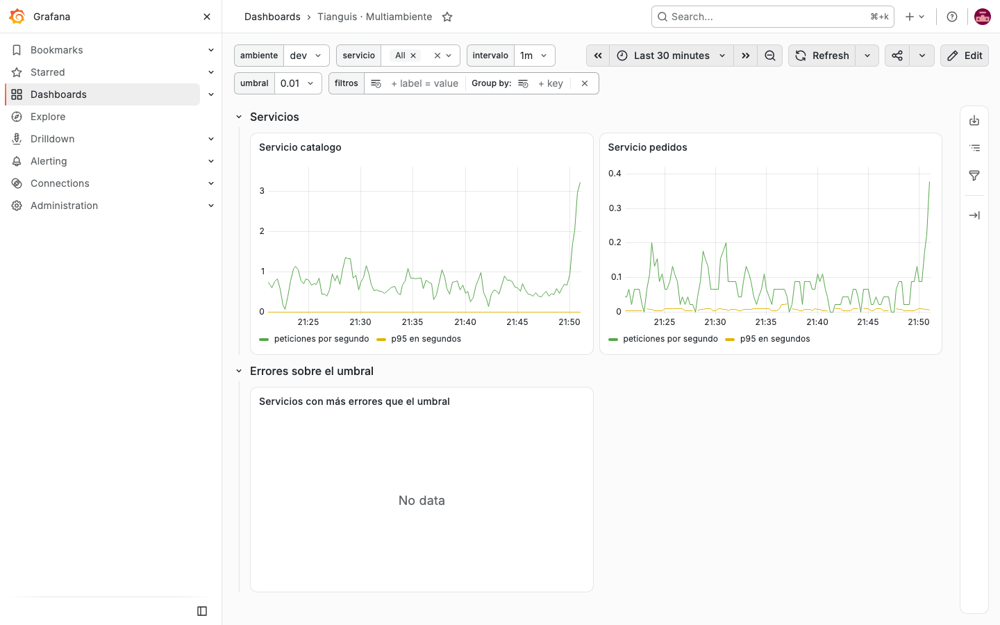

>**Nota.** dev no tiene pagos. La variable servicio se vuelve a consultar al cambiar ambiente y ya no trae pagos, así que su panel no se repite. La fila de pagos se esconde por su regla, porque `ambiente` ya no vale `prod`.

### Explore desde el enlace

Aquí se usa la dirección que quedó pegada en el letrero.
Un clic en el panel de un puesto abre sus boletas en Explore, sin escribir nada.

26. Volver a `prod`. En el panel **Servicio catalogo** pasar el puntero sobre la línea y hacer clic para dejar fijo el cuadro de valores. Aparece el enlace **Logs de catalogo en Explore**.

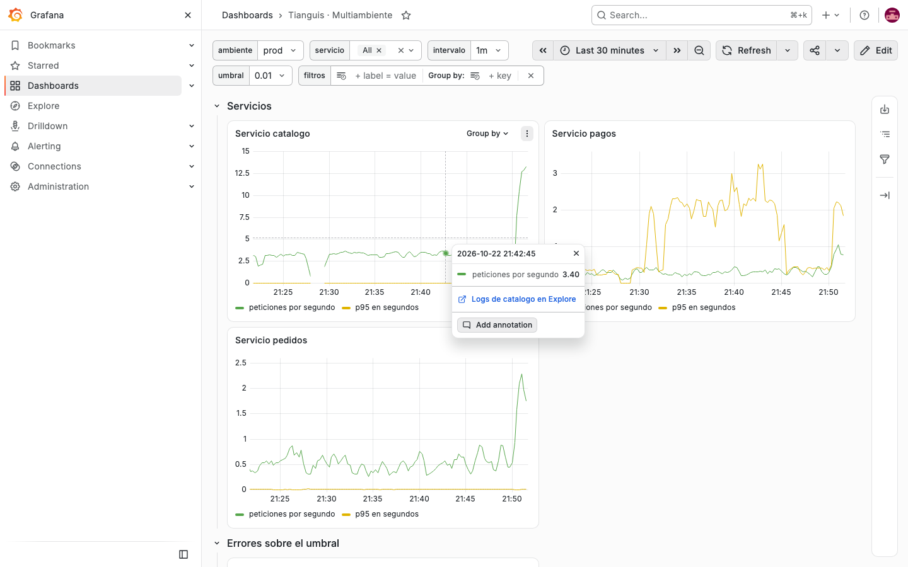

27. Pulsar el enlace. Explore se abre en otra pestaña con los logs de catalogo en prod.

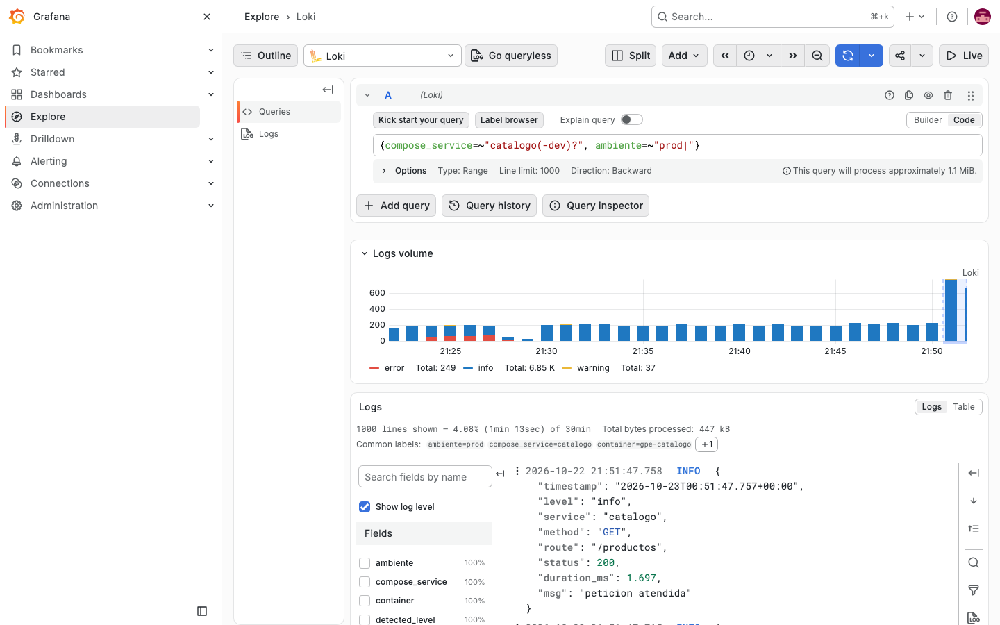

### Prometheus y Loki lado a lado

Las métricas y los logs responden la misma pregunta de dos formas.
Es como tener la cuenta del contador en un pizarrón y las boletas una por una en otro.
Ponerlos lado a lado permite comparar si las dos fuentes cuentan lo mismo.

28. En Explore, con Loki elegido, pulsar **Split**. En el panel de la izquierda elegir **Prometheus**. Escribir una consulta en cada lado y ejecutarlas. Las dos cuentan los pagos por segundo, una desde las métricas y la otra desde los logs. Para tener más ancho, cerrar el menú de Grafana con la equis de arriba a la izquierda.

```promql
sum(rate(http_server_request_duration_seconds_count{job="pagos", http_route="/pagos"}[1m]))
```

```logql
sum(rate({compose_service="pagos"} | json | msg="pago procesado" [1m]))
```

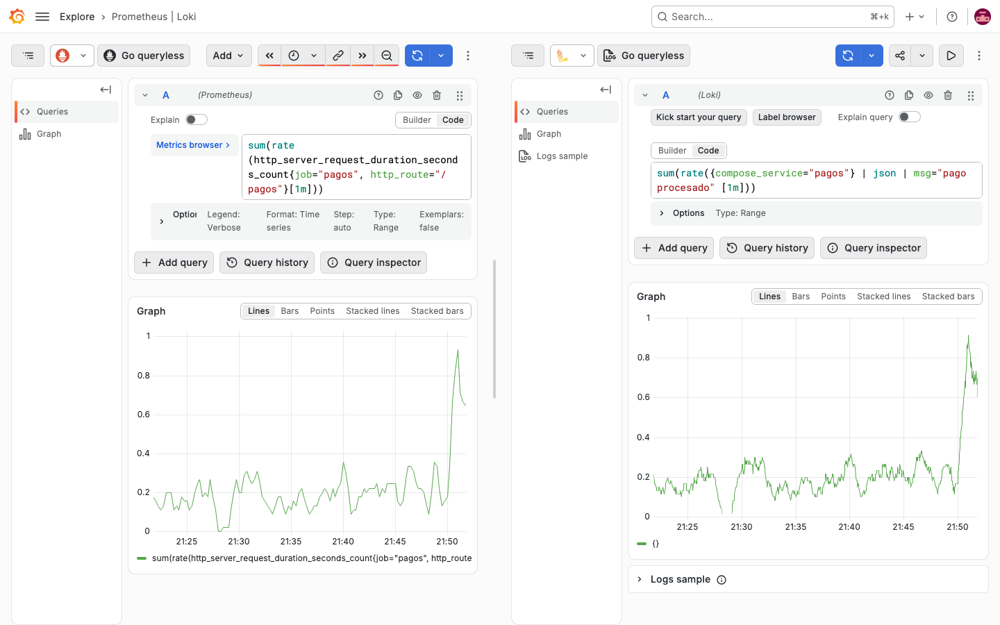

### Drilldown

Quien llega nuevo al mercado no sabe qué puestos hay ni cómo se llaman.
Drilldown funciona como un recorrido guiado, se elige un pasillo y muestra lo que hay.
Sirve para explorar métricas, logs y trazas sin escribir consultas.

29. En el menú abrir **Drilldown** y elegir **Metrics**. En **Search metric** escribir `payments`.

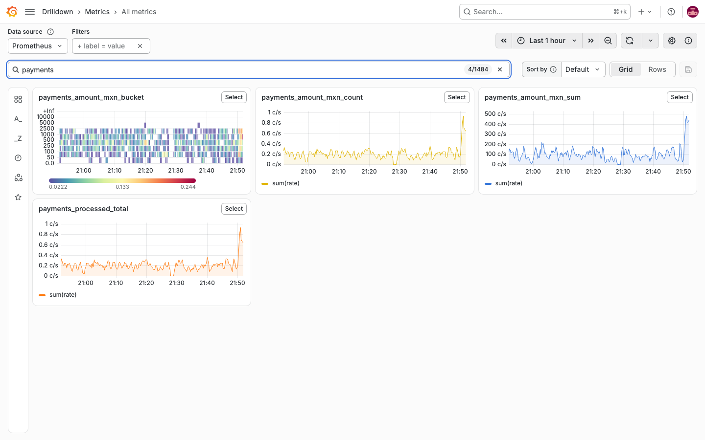

30. Elegir **Logs**. En el buscador de **service** escribir `pagos` y elegir `gpe-pagos`.

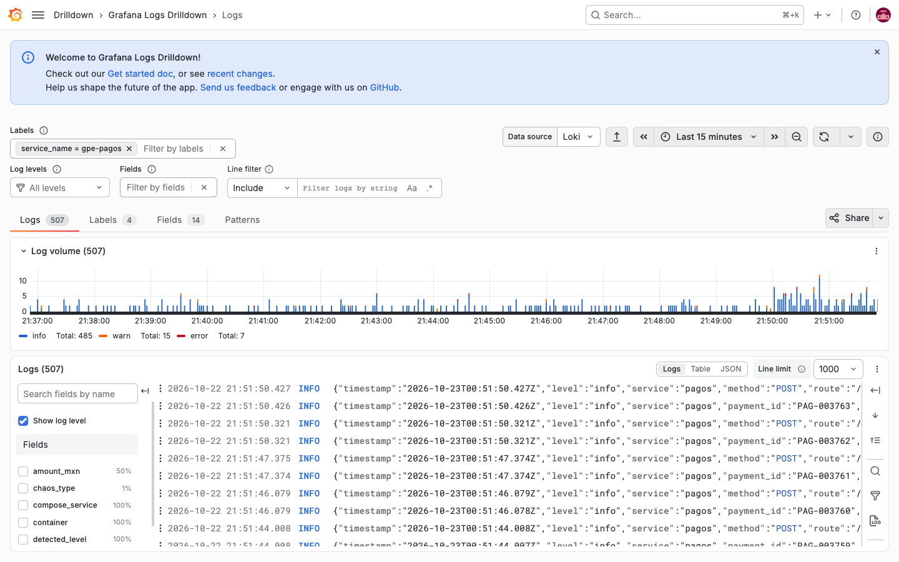

31. Elegir **Traces**. La pestaña **Breakdown** muestra las trazas agrupadas por servicio, con pagos.

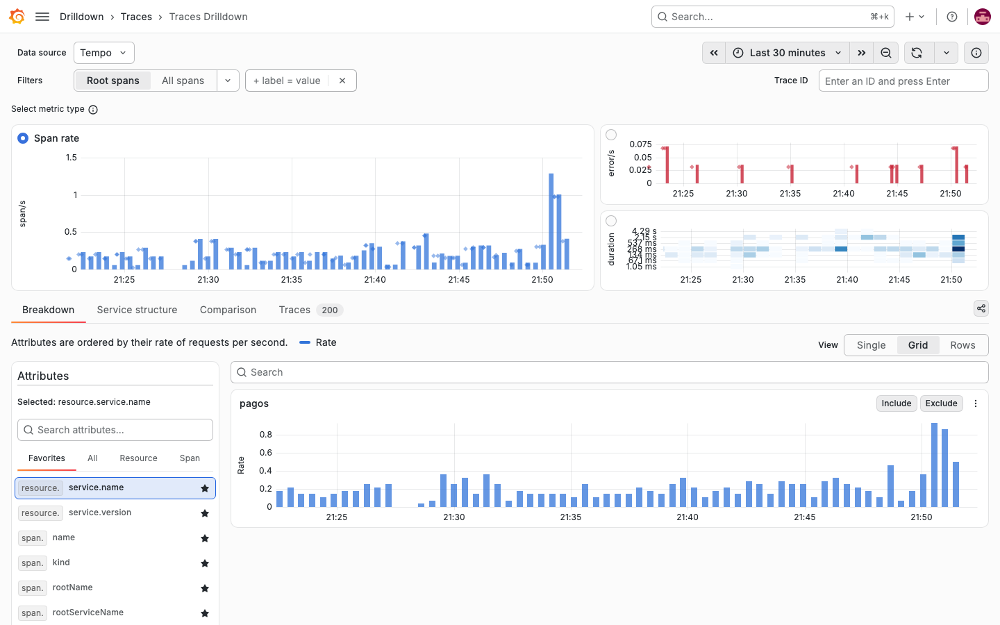

>**Nota.** Las tres aplicaciones arman las consultas solas. Sirven para explorar sin saber PromQL, LogQL ni TraceQL, y cada gráfico se puede abrir en Explore para ver la consulta.

### De un exemplar a la traza y a los logs

El p95 avisa que algunos pagos tardan, pero no dice cuáles ni por qué.
El exemplar es la boleta de ejemplo pegada al punto del gráfico, con la que se sigue al cliente.
Con ella se abre su recorrido completo y se leen las notas que dejó cada puesto.

32. Volver al dashboard Tianguis · Multiambiente, con `prod` y **All**, y bajar hasta **Pagos y su pasarela**. Pasar el puntero sobre uno de los rombos de más arriba. El cuadro muestra el valor del exemplar y su `trace_id`.

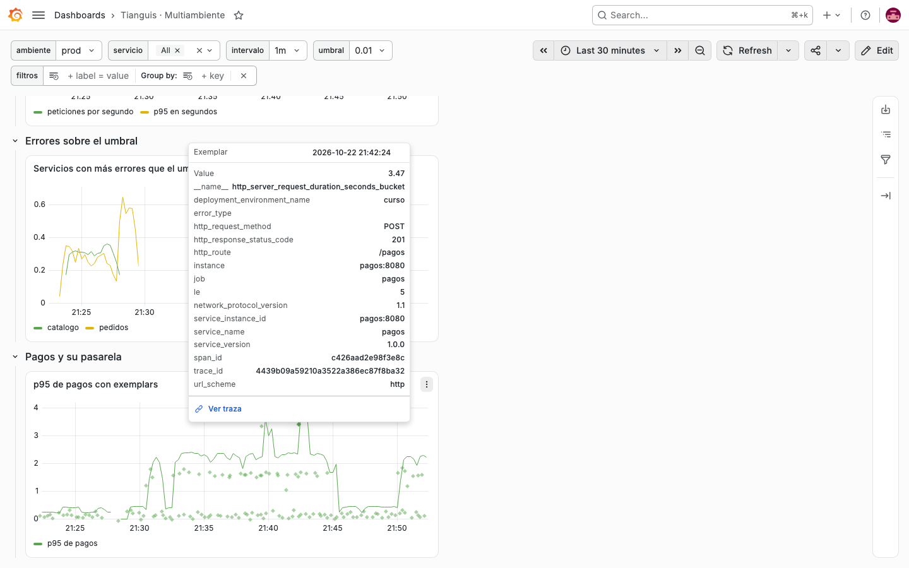

33. Copiar el `trace_id` y pulsar **Ver traza**. Explore abre la traza en Tempo. Si los paneles quedan angostos, cerrar el menú de Grafana con la equis de arriba a la izquierda. Buscar en la traza el span que ocupa casi toda la duración del pago y hacer clic en él.

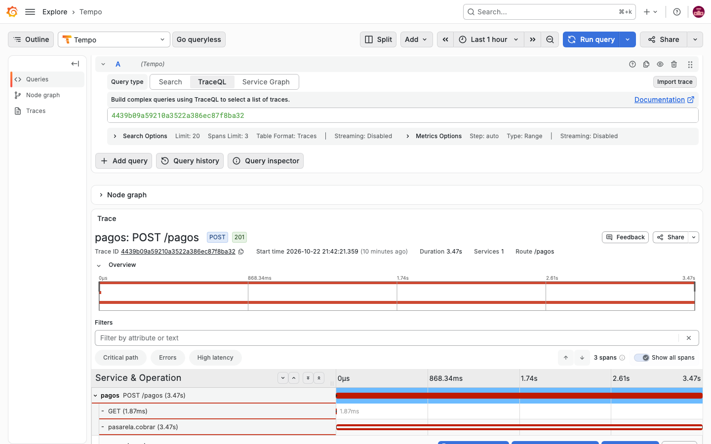

>**Nota.** El span que se lleva el tiempo es `pasarela.cobrar`, la llamada a la pasarela de pagos que el paso 2 dejó lenta. Así se ve en la traza dónde está la demora, algo que el p95 solo no dice.

34. En el detalle del span pulsar **Logs for this trace**. Explore abre al lado los logs de pagos que tienen ese `trace_id`.

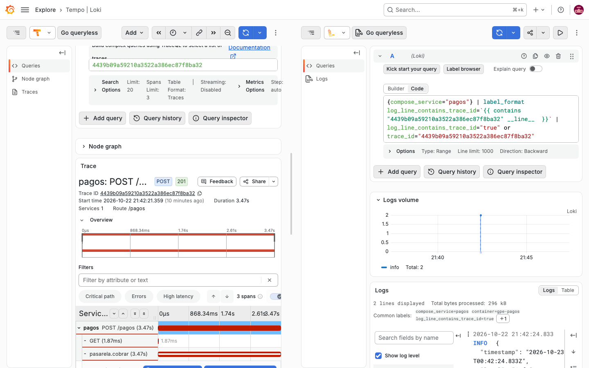

35. Abrir `Capitulo6/hallazgo.md` en un editor, pegar el `trace_id` en la última línea y guardar. Revisarlo.

```bash
cat Capitulo6/hallazgo.md
```

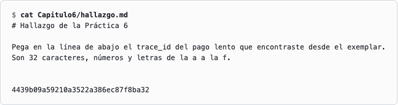

### Exportar

Un pizarrón que solo vive en Grafana se puede perder.
Exportarlo es sacarle una foto al pizarrón terminado y guardarla junto a la práctica.

36. En el dashboard pulsar el ícono **Export** y elegir **Export as code**.

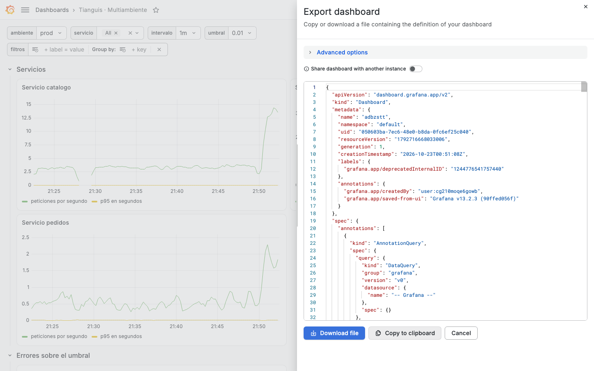

37. Pulsar **Download file**. Mover el archivo descargado a la carpeta de la práctica con el nombre `mi-dashboard.json`.

```bash
mv ~/Downloads/Tianguis*Multiambiente*.json Capitulo6/mi-dashboard.json
```

>**Nota.** Si en Descargas hay más de un archivo que empieza con Tianguis, borra los anteriores antes de ejecutar `mv`.

### Volver a la normalidad

Antes de cerrar el mercado se apagan las luces de prueba.
Si el tráfico alto y la falla quedan encendidos, la siguiente práctica parte con datos que engañan.

38. Devolver el tráfico a nivel normal.

```bash
bin/trafico.sh nivel normal
```

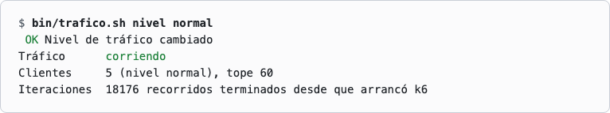

39. Apagar la pasarela lenta y cualquier otra falla. Esperar unos 30 segundos antes de verificar, que es lo que tarda Prometheus en recibir el cambio de pagos.

```bash
bin/caos.sh apagar
```


### Verificar

La verificación revisa el pizarrón guardado, la foto exportada y la boleta anotada.
También confirma que el mercado quedó con las luces de prueba apagadas.

40. Ejecutar la verificación. Cada línea queda en verde si está lograda o en rojo con una pista de lo que falta.

```bash
Capitulo6/verificar.sh
```

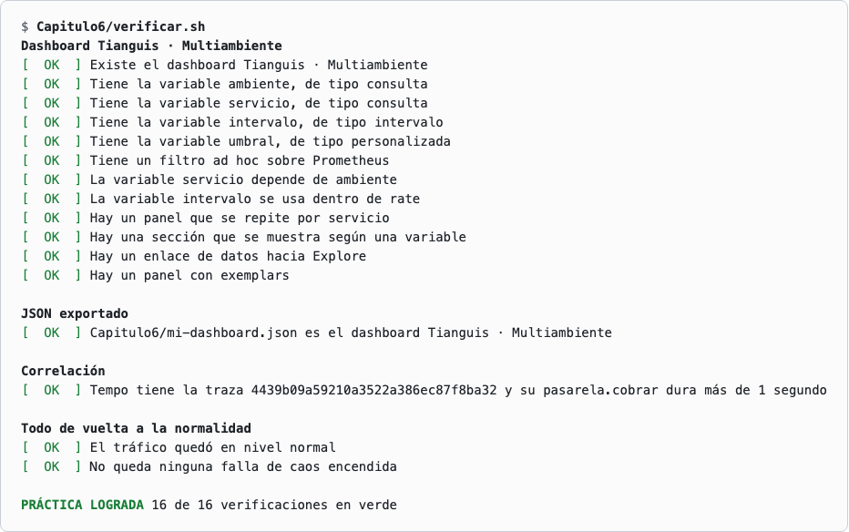

## Preguntas frecuentes

**¿Qué es una variable en un dashboard?**
Es un selector que aparece arriba del dashboard. Grafana reemplaza `$nombre` en cada consulta por el valor elegido y vuelve a dibujar los paneles.

**¿Qué diferencia hay entre una variable de consulta y una personalizada?**
La de consulta saca sus valores de Prometheus, así que la lista se actualiza sola. La personalizada tiene valores escritos a mano, como los de umbral.

**¿Qué es una etiqueta en Prometheus?**
Es un par de nombre y valor que acompaña a cada serie, como `job` o `ambiente`. Las consultas usan las etiquetas para filtrar y para agrupar.

**¿Para qué sirve elegir All en servicio?**
Hace que la variable tome todos sus valores a la vez. Con la repetición encendida, cada valor recibe su propio panel.

**¿Qué es un exemplar?**
Es una medición real que se guarda junto al trace_id de la petición que la produjo. Permite pasar de un punto del gráfico a una traza concreta.

**¿Qué es una traza?**
Es el registro del recorrido de una petición por los servicios. Se divide en spans, uno por tramo, cada uno con su duración. En este stack las guarda Tempo.

**¿Por qué un panel dice No data?**
La consulta no encontró series para los valores elegidos y el rango de tiempo. Conviene revisar los selectores de arriba y el rango antes de tocar la consulta.

**¿Para qué sirve Explore si ya hay un dashboard?**
Explore permite escribir consultas sueltas sin crear paneles. Se usa para investigar sin tocar el dashboard guardado.

## Resultado esperado

Grafana tiene el dashboard Tianguis · Multiambiente con cinco variables. Con prod muestra un panel por servicio, la proporción de errores sobre el umbral y la fila de pagos con sus exemplars. Al cambiar de ambiente, los paneles y la fila de pagos se ajustan solos a lo que existe en cada uno. `Capitulo6/hallazgo.md` tiene el trace_id de un pago lento, y desde su traza se sabe en qué tramo del pago está la demora.

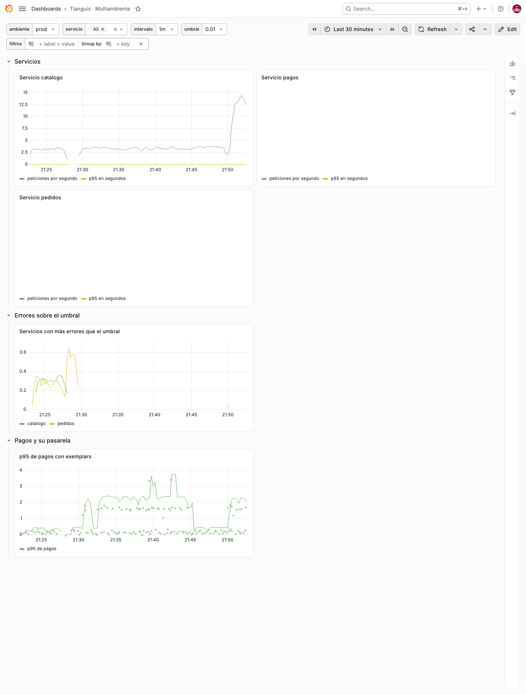

El tráfico volvió a nivel normal y no queda ninguna falla de caos encendida.

`Capitulo6/restaurar.sh` devuelve el tráfico a normal, apaga el caos, deja `hallazgo.md` como estaba y borra `mi-dashboard.json`. Avisa qué cambia y pide escribir SI.

La carpeta `Capitulo6/solucion` trae el dashboard resuelto en `tianguis-multiambiente.json`. Para ver la práctica resuelta de una vez, `Capitulo6/solucion/aplicar.sh` lo importa, deja su JSON en `mi-dashboard.json` y anota en `hallazgo.md` el trace_id de un pago lento sacado de Tempo. Avisa qué cambia y pide escribir SI.
