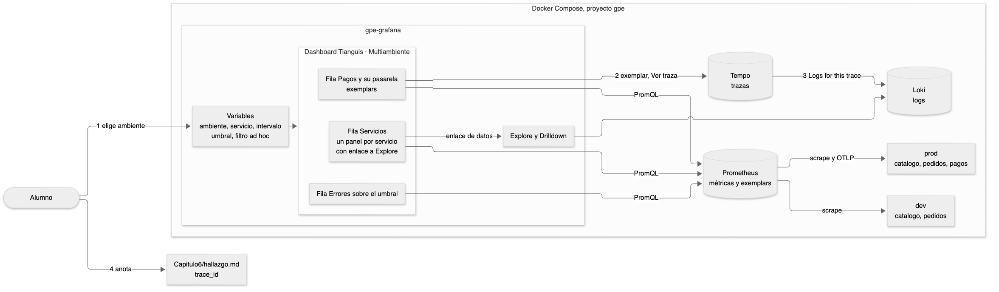

# Guía del relator. Práctica 6. Dashboard dinámico para múltiples ambientes

Capítulo 6 del temario. Duración provisoria de 120 minutos.

La práctica tiene dos ideas. La primera es que un dashboard bien hecho no se copia por ambiente ni por servicio. Se escribe una vez con variables y Grafana lo arma para cada caso. La segunda es que las tres señales se tocan. Desde un punto de una métrica se llega a la traza exacta que lo produjo, y desde la traza a sus logs, sin copiar nada a mano salvo el trace_id final.

## Diagrama



La fuente editable está en `images/6/diagrama.mmd` y se vuelve a dibujar con `tools/diagramas/render.sh 6`.

## Familia de analogías

Toda la práctica usa el mismo pizarrón para todos los mercados. No mezclar con otras analogías.

| Concepto | En el mismo pizarrón para todos los mercados |
|---|---|
| Variable | El selector de qué mercado mostrar en el pizarrón |
| Variable de consulta | La lista de mercados que se arma sola preguntándole a Prometheus |
| Intervalo | Cada cuánto se hace la cuenta |
| Ad hoc | Agregar un filtro al vuelo sin tocar el pizarrón |
| Panel repetido | Un letrero por puesto, sin pintarlos uno por uno |
| Sección condicional | El letrero que solo aparece si hay algo que mostrar |
| Exemplar | La boleta de ejemplo pegada al punto del gráfico, con la que se sigue al cliente |

## Reparto del tiempo

| Bloque | Minutos |
|---|---|
| Preparar y variables | 25 |
| Panel repetido y enlace de datos | 20 |
| Errores sobre el umbral y sección condicional | 15 |
| Prod contra dev | 10 |
| Explore lado a lado y Drilldown | 20 |
| Correlación desde el exemplar | 20 |
| Exportar, volver a la normalidad y verificar | 10 |

## Antes de la clase

- Correr `bin/up.sh` una vez en la máquina del alumno y confirmar los 18 servicios en healthy.
- `preparar.sh` deja el tráfico en alto y la pasarela lenta por 60 minutos. Si la clase se alarga, volver a correrlo antes de la correlación.
- Confirmar que no existe un dashboard llamado Tianguis · Multiambiente de una clase anterior.
- `Capitulo6/hallazgo.md` debe estar igual a git. Si tiene un trace_id viejo, `git checkout -- Capitulo6/hallazgo.md`.
- Tener a mano `Capitulo6/solucion/tianguis-multiambiente.json`. Se carga desde **Dashboards**, **New**, **Import dashboard**.

---

## Paso 1. Variables

**🎯 Problema.** Sin variables hay un dashboard por ambiente y otro por servicio. Cuando se corrige una consulta, se corrige en uno y los demás quedan mal.

**👵 Analogía.** El mismo pizarrón para todos los mercados, con un selector de qué mercado mostrar. La lista del selector no se escribe a mano, se arma sola preguntándole a Prometheus qué mercados existen.

**🔮 Predicción.** Antes de **Run query** en la variable servicio, preguntar cuántos valores va a mostrar con `ambiente` en dev. Dos, catalogo y pedidos. pagos solo existe en prod.

**💻 Comando.**

```promql
label_values(http_server_requests_total, ambiente)
query_result(count by (job) (label_replace(http_server_request_duration_seconds_count, "ambiente", "prod", "ambiente", "") and on(ambiente) label_replace(vector(1), "ambiente", "$ambiente", "", "")))
```

| Parte | Qué es |
|---|---|
| Query, **Classic query** | Variable cuyos valores salen de una función de Grafana sobre Prometheus |
| `label_values(métrica, etiqueta)` | Los valores distintos de esa etiqueta en esa métrica |
| `query_result(expresión)` | Ejecuta PromQL y devuelve cada serie como texto |
| Regex `/job="([^"]+)"/` | Se queda con lo que está entre paréntesis, el nombre del servicio |
| `label_replace(v, "ambiente", "prod", "ambiente", "")` | Pone `ambiente="prod"` solo donde la etiqueta está vacía |
| `and on(ambiente)` | Deja las series cuyo `ambiente` coincide con el lado derecho |
| Multi-value, Include All value | Permiten elegir varios servicios o todos |
| Interval | Variable con ventanas de tiempo, para usar dentro de `rate` |
| Custom | Valores escritos a mano, separados por coma |
| Filter and Group by | Filtro ad hoc. Agrega condiciones a todas las consultas de una fuente |

**⚙️ Técnico.** Cuando cambia `ambiente`, Grafana vuelve a consultar las variables que lo usan, en este caso servicio. Las variables se guardan con el dashboard, junto con el valor elegido al guardar. En Grafana 13.2 se crean desde el panel lateral del dashboard y su editor se abre en una ventana aparte con vista previa.

**📺 Salida.** ambiente con dev y prod. servicio con catalogo y pedidos mientras ambiente vale dev. intervalo con 1m, 5m y 15m. umbral con 0.01, 0.05 y 0.10. Los cinco selectores arriba del dashboard.

**⚠️ Fallas.**

| Qué se ve | Causa | Arreglo |
|---|---|---|
| servicio no muestra valores | Falta la expresión regular o tiene otra comilla | Copiar `/job="([^"]+)"/` tal cual |
| servicio muestra textos largos con llaves | Se olvidó la expresión regular | Agregarla en **Regex** |
| ambiente no muestra nada | Se eligió **Label values** y no **Classic query** | Cambiar **Query type** |
| No aparece **Variable** en el panel derecho | El panel **Add** está cerrado | Pulsar el ícono **Add** de la barra derecha |

---

## Paso 2. Panel repetido por servicio

**🎯 Problema.** Con tres servicios se pueden pintar tres paneles. Con veinte ya no, y cuando se agrega uno nuevo nadie se acuerda de pintar su panel.

**👵 Analogía.** Un letrero por puesto, sin pintarlos uno por uno. Se pinta un letrero modelo y el pizarrón lo copia para cada puesto del mercado elegido.

**🔮 Predicción.** Antes de elegir dev, preguntar qué pasa con los paneles. Queda uno por catalogo y otro por pedidos. El de pagos desaparece porque servicio ya no lo trae.

**💻 Comando.**

```promql
sum(rate(http_server_request_duration_seconds_count{job="$servicio", ambiente=~"$ambiente|"}[$intervalo]))
histogram_quantile(0.95, sum by (le) (rate(http_server_request_duration_seconds_bucket{job="$servicio", ambiente=~"$ambiente|"}[$intervalo])))
```

| Parte | Qué es |
|---|---|
| `$servicio` | Dentro de cada copia vale un solo servicio |
| `ambiente=~"$ambiente|"` | El ambiente elegido o ninguno. Así entra pagos |
| `[$intervalo]` | La ventana de `rate` sale del selector |
| Legend, **Custom** | Nombre fijo de la serie en la leyenda |
| **Repeat by variable** | Hace una copia del panel por cada valor elegido |
| Título `Servicio $servicio` | Cada copia muestra su servicio en el título |

**⚙️ Técnico.** Se usa `http_server_request_duration_seconds_count` y no `http_server_requests_total` porque es la única métrica que tienen los tres servicios. pagos la manda por OpenTelemetry. La repetición no se ve mientras se edita el panel. Se ve al volver al dashboard y con varios valores elegidos en servicio.

**📺 Salida.** Con prod y All, tres paneles. pagos con un p95 cerca de 2 segundos por la pasarela lenta. catalogo con más de 10 peticiones por segundo por el tráfico alto. Con dev, dos paneles.

**⚠️ Fallas.**

| Qué se ve | Causa | Arreglo |
|---|---|---|
| Un solo panel | servicio tiene un valor elegido, no All | Quitar el valor y elegir All |
| Elegí All y no cambia | El selector sigue abierto | Hacer clic fuera del selector |
| El panel de pagos sale vacío | Falta el `|` en `ambiente=~"$ambiente|"` | Copiar la consulta de la guía |
| La leyenda dice Value | La leyenda quedó en Auto | **Options**, **Legend**, **Custom** |

---

## Paso 3. Sección condicional

**🎯 Problema.** Hay partes del dashboard que no tienen sentido en todos los casos. Una fila de pagos en dev queda vacía y confunde.

**👵 Analogía.** El letrero que solo aparece si hay algo que mostrar. El pizarrón de un mercado sin caja no muestra el letrero de la caja.

**🔮 Predicción.** Preguntar qué va a pasar con la fila Pagos y su pasarela al elegir dev. Desaparece entera, con su título.

**💻 Comando.** Clic en el título de la fila, **Show / hide rules**, **Add rule**, **Template variable**, `ambiente` `=` `prod`.

| Parte | Qué es |
|---|---|
| Show / hide rules | Reglas de visibilidad de una fila o de un panel. Así se llama en Grafana 13.2 |
| Row visibility Show o Hide | Si las reglas que se cumplen muestran o esconden la fila |
| Template variable | Regla según el valor de una variable |
| Time range less than | Regla según el largo del rango de tiempo |

**⚙️ Técnico.** Es parte de los dashboards dinámicos, que en Grafana 13.2 vienen encendidos. En el JSON exportado la regla queda en `conditionalRendering`. En un panel, además de esas dos reglas, existe una que mira si el panel tiene datos. Las filas no la tienen.

**📺 Salida.** Con prod la fila aparece al final. Con dev desaparece.

**⚠️ Fallas.**

| Qué se ve | Causa | Arreglo |
|---|---|---|
| No se ve **Add rule** | La ventana es baja y el panel no llega | Bajar dentro del panel derecho o agrandar la ventana |
| La fila desaparece también en prod | Se eligió **Hide** en Row visibility | Dejar **Show** |
| La regla no hace nada | El valor tiene un espacio de más | Escribir `prod` sin espacios |

---

## Paso 4. Enlace de datos hacia Explore

**🎯 Problema.** Desde un gráfico raro se quiere ver qué pasó en los logs de ese servicio. Sin enlace, hay que abrir Explore, elegir Loki y escribir la consulta a mano.

**👵 Analogía.** Cada letrero del pizarrón tiene pegada la dirección del archivo donde se guardan las boletas de ese puesto.

**🔮 Predicción.** Preguntar qué logs se abren desde el panel de catalogo con ambiente en dev. Los de catalogo-dev, porque la consulta acepta el nombre con `-dev` y filtra por ese ambiente.

**💻 Comando.** **Data links and actions**, **Add link**.

| Parte | Qué es |
|---|---|
| `/explore?schemaVersion=1&panes=...` | Dirección de Explore con la consulta ya escrita |
| `${servicio}`, `${ambiente}` | Se reemplazan por los valores del panel donde se hizo clic |
| `compose_service=~"${servicio}(-dev)?"` | En Loki el contenedor de dev se llama con `-dev` al final |
| Open in new tab | Abre Explore sin salir del dashboard |

**⚙️ Técnico.** El enlace se guarda en la configuración de campos del panel, así que lo heredan todas las copias. Grafana reemplaza las variables al hacer clic. Las comillas dentro de la consulta van con barra invertida porque están dentro de un texto JSON.

**📺 Salida.** El cuadro de valores fijo con el enlace Logs de catalogo en Explore. Explore con Loki y las líneas de catalogo en prod.

**⚠️ Fallas.**

| Qué se ve | Causa | Arreglo |
|---|---|---|
| El enlace no aparece | El cuadro de valores no quedó fijo | Pasar el puntero sobre la línea y hacer clic |
| Explore abre sin consulta | Se cortó la URL al copiarla | Copiar la URL completa de la guía |
| Explore dice parse error | Faltan las barras invertidas antes de las comillas | Copiar la URL de la guía |

---

## Paso 5. Explore lado a lado

**🎯 Problema.** Métricas y logs responden la misma pregunta de dos formas. Si no coinciden, una de las dos fuentes está mal o falta información.

**👵 Analogía.** Dos pizarrones del mismo mercado, uno con la cuenta del contador y otro con las boletas una por una. Contar boletas debe dar lo mismo que la cuenta.

**🔮 Predicción.** Preguntar si las dos curvas van a coincidir. Coinciden en forma y casi en valor. Las métricas cuentan cada respuesta del endpoint y los logs cuentan cada pago procesado.

**💻 Comando.**

```promql
sum(rate(http_server_request_duration_seconds_count{job="pagos", http_route="/pagos"}[1m]))
```

```logql
sum(rate({compose_service="pagos"} | json | msg="pago procesado" [1m]))
```

| Parte | Qué es |
|---|---|
| Split | Abre un segundo panel de Explore al lado |
| `| json` | Convierte la línea JSON en etiquetas |
| `msg="pago procesado"` | Deja solo las líneas de ese mensaje |
| `rate(...[1m])` en LogQL | Líneas por segundo, como `rate` en PromQL |

**⚙️ Técnico.** Las dos consultas son métricas. Loki calcula la serie leyendo las líneas, por eso cuesta más que Prometheus para el mismo rango. Explore muestra cuánto va a procesar la consulta de Loki antes de correrla.

**📺 Salida.** Dos gráficos con la misma forma, cerca de 1 pago por segundo con tráfico alto.

**⚠️ Fallas.**

| Qué se ve | Causa | Arreglo |
|---|---|---|
| El lado de Loki dice No data | Se escribió `msg="pago procesado"` con otra tilde o espacio | Copiar la consulta de la guía |
| El lado izquierdo sigue en Loki | No se cambió la fuente | Elegir **Prometheus** en ese panel |

---

## Paso 6. Drilldown

**🎯 Problema.** Para explorar hay que saber tres lenguajes de consulta. Quien llega nuevo a un sistema no sabe ni qué métricas existen.

**👵 Analogía.** Un recorrido guiado por el mercado. Se elige un pasillo y el guía muestra lo que hay, sin que uno tenga que saber el nombre de cada puesto.

**🔮 Predicción.** Preguntar cuántas métricas de payments va a encontrar Metrics Drilldown. Las de `payments_processed_total` y las del histograma de montos.

**💻 Comando.** **Drilldown**, **Metrics**, **Logs** y **Traces**.

| Parte | Qué es |
|---|---|
| Metrics | Lista y grafica las métricas de Prometheus sin escribir PromQL |
| Logs | Agrupa los logs por servicio y nivel sin escribir LogQL |
| Traces | Agrupa las trazas por atributo, con tasa, errores y duración |

**⚙️ Técnico.** Son aplicaciones de Grafana que vienen instaladas en la 13.2. En Logs, el servicio se llama `gpe-pagos` porque Loki arma `service_name` con el nombre del contenedor. Cada gráfico de Drilldown se puede abrir en Explore con la consulta que lo generó.

**📺 Salida.** Metrics con las métricas de payments. Logs con el volumen de gpe-pagos por nivel. Traces con la tasa de spans de pagos.

**⚠️ Fallas.**

| Qué se ve | Causa | Arreglo |
|---|---|---|
| Logs no muestra pagos | Se buscó `pagos` y no se eligió la opción | Elegir `gpe-pagos` en la lista |
| Aparece un aviso de bienvenida | Primera vez que se abre la aplicación | Cerrarlo con la equis |

---

## Paso 7. Del exemplar a la traza y a los logs

**🎯 Problema.** El p95 dice que algunos pagos son lentos, pero no dice cuáles ni por qué. Buscar a mano una traza lenta entre cientos cuesta.

**👵 Analogía.** El exemplar es la boleta de ejemplo pegada al punto del gráfico, con la que se sigue al cliente. Con la boleta se encuentra su recorrido completo por el mercado y lo que anotó cada puesto.

**🔮 Predicción.** Antes de abrir la traza, preguntar en qué parte del pago está la demora. En `pasarela.cobrar`, que es la llamada que hace lenta la falla de caos.

**💻 Comando.** Pasar el puntero sobre un exemplar alto, **Ver traza**, clic en `pasarela.cobrar`, **Logs for this trace**.

```bash
cat Capitulo6/hallazgo.md
```

| Parte | Qué es |
|---|---|
| Exemplar | Una medición del histograma con el trace_id de la petición |
| Ver traza | Enlace que arma el datasource de Prometheus con `exemplarTraceIdDestinations` |
| Span `pasarela.cobrar` | El tramo de la traza que llama a la pasarela |
| Logs for this trace | Enlace de Tempo a Loki, configurado en `tracesToLogsV2` |

**⚙️ Técnico.** El agente de OpenTelemetry de pagos guarda el trace_id en cada medición hecha dentro de una traza muestreada y lo manda por OTLP. Prometheus lo guarda porque arranca con `exemplar-storage`. El datasource de Tempo busca en Loki las líneas de `compose_service` pagos que contienen el trace_id. `verificar.sh` busca la traza en Tempo con TraceQL y pide que `pasarela.cobrar` dure más de 1 segundo.

**📺 Salida.** El cuadro del exemplar con un valor sobre 1.5 segundos y su trace_id. La traza con tres spans, donde `pasarela.cobrar` ocupa casi toda la barra. Dos líneas de log con el mismo trace_id, peticion atendida y pago procesado.

**⚠️ Fallas.**

| Qué se ve | Causa | Arreglo |
|---|---|---|
| No hay rombos en el gráfico | No se encendió **Exemplars** | Editar el panel y encenderlo |
| La traza dura poco | Se eligió un rombo de abajo | Elegir uno de los más altos |
| Logs for this trace no trae líneas | La traza tiene más de una hora | Elegir un exemplar reciente |
| verificar dice que no tiene trace_id | Se pegó con espacios en medio o incompleto | Pegar los 32 caracteres seguidos |

---

## Paso 8. Exportar, volver a la normalidad y verificar

**🎯 Problema.** Un dashboard que solo vive en Grafana se pierde con el volumen. Y un stack que queda con tráfico alto y fallas encendidas engaña a la siguiente práctica.

**👵 Analogía.** Sacar la foto del pizarrón terminado para guardarla, y apagar las luces de prueba antes de cerrar el mercado.

**🔮 Predicción.** Preguntar si `verificar.sh` va a quedar en verde apenas se apaga la falla. Puede salir en rojo la línea de caos durante unos segundos, hasta que pagos informa el cambio.

**💻 Comando.**

```bash
mv ~/Downloads/Tianguis*Multiambiente*.json Capitulo6/mi-dashboard.json
bin/trafico.sh nivel normal
bin/caos.sh apagar
Capitulo6/verificar.sh
```

| Parte | Qué es |
|---|---|
| Export as code | Exporta el dashboard en el formato v2 de Grafana 13 |
| `bin/trafico.sh nivel normal` | Vuelve a 5 clientes |
| `bin/caos.sh apagar` | Apaga todas las fallas de todos los servicios |

**⚙️ Técnico.** `verificar.sh` lee el dashboard por la API v2, donde aparecen las variables, la repetición, la regla y el enlace. Revisa el JSON exportado, busca la traza en Tempo, consulta el nivel de tráfico con `bin/trafico.sh estado` y la suma de `chaos_active` en Prometheus.

**📺 Salida.** 5 clientes en nivel normal, todas las fallas apagadas y `PRÁCTICA LOGRADA` con 16 verificaciones en verde.

**⚠️ Fallas.**

| Qué se ve | Causa | Arreglo |
|---|---|---|
| Queda una falla de caos encendida | Se verificó apenas apagada | Esperar 30 segundos y repetir |
| Falta mi-dashboard.json | El navegador descarga en otra carpeta | Buscar el archivo y moverlo a mano |
| El tráfico no está en normal | Se saltó el paso 38 | `bin/trafico.sh nivel normal` |

---

## ❓ Preguntas del alumno

Son preguntas de un alumno de nivel intermedio, que maneja la terminal y Docker básico pero no conoce Prometheus ni Grafana.

**¿Qué es un contenedor y por qué hay un catalogo y un catalogo-dev?**
Un contenedor es un programa empaquetado que Docker corre aislado. catalogo y catalogo-dev son dos contenedores del mismo servicio, uno por ambiente. En Loki se distinguen por `compose_service`, y por eso el enlace de datos acepta el nombre con `-dev`.

**¿Por qué un panel no muestra datos?**
Lo común es que la consulta no encuentre series con los valores elegidos arriba del dashboard, o que el rango de tiempo no cubra el tráfico. Revisar los selectores y el rango, y copiar la consulta tal cual de la guía. En el panel de errores sobre el umbral, No data es un resultado válido.

**¿Qué es una etiqueta?**
Un par de nombre y valor pegado a cada serie, como `job="pagos"` o `ambiente="dev"`. Las llaves de una consulta PromQL filtran por etiquetas y `by` agrupa por ellas.

**¿Qué es una variable de Grafana?**
Un selector arriba del dashboard. Antes de mandar cada consulta, Grafana reemplaza `$ambiente` o `$servicio` por el valor elegido.

**¿Qué es una traza y qué es un span?**
La traza es el recorrido completo de una petición, identificado por su trace_id. Cada span es un tramo de ese recorrido, con nombre y duración. En este stack las trazas las guarda Tempo.

**¿Qué es el p95?**
La duración bajo la cual queda el 95 % de las peticiones. `histogram_quantile(0.95, ...)` la estima a partir de los baldes del histograma, la serie `_bucket`.

**¿Por qué no poner la etiqueta `ambiente` también en pagos?**
Porque pagos existe una sola vez. La etiqueta diría siempre prod y no aportaría nada en las consultas propias de pagos. El costo es la consulta de la variable servicio, que tiene que tratar la falta de etiqueta.

**¿Qué diferencia hay entre `$intervalo` y `$__rate_interval`?**
`$intervalo` lo elige la persona. `$__rate_interval` lo calcula Grafana según el rango y el scrape. Para comparar ventanas a mano conviene la variable, para el uso diario `$__rate_interval`.

**¿El filtro ad hoc cambia las consultas guardadas?**
No. Grafana agrega las condiciones al vuelo antes de mandar cada consulta de esa fuente. El dashboard guardado queda igual.

**¿Puedo repetir una fila entera en vez de un panel?**
Sí. Las filas también tienen **Repeat options**. Sirve cuando cada servicio necesita varios paneles.

**¿Los exemplars ocupan mucho espacio?**
Poco. Prometheus guarda una cantidad fija en memoria, en este stack 100000, y descarta los más viejos. No se guardan en disco por mucho tiempo.

**¿Por qué la traza tiene solo tres spans?**
Porque la traza nace en pagos. La llamada a pedidos aparece como un span de salida y la pasarela simulada como otro. Si pedidos estuviera instrumentado con trazas, aparecerían también sus spans.

**¿El JSON exportado sirve para Grafana 12?**
No siempre. El formato v2 con filas y reglas de visibilidad es de los dashboards dinámicos. Para versiones anteriores hay que exportar en el formato clásico.
