<!--  -->
# Práctica 7. Red segura y certificados TLS para Prometheus y Grafana

En esta práctica se protege el stack de observabilidad. Se mide qué queda expuesto, se crea una CA propia con sus certificados y se ponen TLS y autenticación básica en node_exporter, Prometheus y Alertmanager. Después Grafana pasa a HTTPS, se conecta con Dex para entrar con OAuth y se reparten permisos con roles, equipos y una cuenta de servicio. Al final las claves salen del texto plano y quedan en archivos.

## Objetivos
- Medir la superficie de exposición del stack.
- Crear una CA propia y certificados con openssl.
- Configurar TLS y autenticación básica en node_exporter, Prometheus y Alertmanager con su web config.
- Raspar y enviar alertas por TLS con credenciales.
- Servir Grafana por HTTPS y entrar con OAuth contra Dex.
- Separar permisos con roles, equipos, carpetas y una cuenta de servicio con token.
- Sacar las claves de los archivos de configuración y leerlas desde archivos montados.

## El problema y la solución

Un mercado guarda en su bodega lo que vende y en su oficina el registro de cada caja.
Si sus puertas quedan abiertas a la calle, cualquiera entra, mira los libros y se va sin que nadie lo note.
Un stack de observabilidad está en la misma situación, porque ve todo lo que pasa en los servicios de la empresa.

La práctica comienza por recorrer el perímetro y contar las puertas abiertas.
Después una CA propia hace de municipalidad y emite una credencial con foto para cada guardia, que es el certificado de cada componente.
Con esas credenciales la información viaja como en un camión blindado, que es TLS, y en cada puerta un guardia pide nombre y clave.

Grafana recibe a las personas con una credencial municipal que emite Dex y sirve para entrar sin tener una clave distinta en cada edificio.
Dentro, cada uno mira o escribe en el pizarrón según su rol, y el camión repartidor recibe una llave propia que se puede anular.
Al final las claves pasan de la pizarra a la caja fuerte, es decir, de los archivos de configuración a archivos aparte.

En el NOC esto aparece como un destino caído con un error `x509` o `401` después de un cambio de certificados o de claves, o como un usuario que no ve una carpeta de dashboards que necesita.
Con esta práctica se aprende a leer esos errores y a saber qué puerta, qué certificado o qué permiso revisar antes de escalar.

## Duración aproximada
- 150 minutos.

---
<div style="width: 400px;">
        <table width="50%">
            <tr>
                <td style="text-align: center;">
                    <a href="../Capitulo6/"></a>
                    <br>anterior
                </td>
                <td style="text-align: center;">
                   <a href="../README.md">Lista Laboratorios</a>
                </td>
<td style="text-align: center;">
                    <a href="../Capitulo8/">
                    </a>
                    <br>siguiente
                </td>
            </tr>
        </table>
</div>

---

## Diagrama


<br>

## Instrucciones

>**Nota.** Todo lo que se crea en esta práctica vive en `Capitulo7/trabajo` y en `Capitulo7/compose.seguridad.yaml`. La configuración de `infra` no se toca. Al terminar, `Capitulo7/restaurar.sh` deja el stack como estaba.

### Preparar el punto de partida

Antes de poner guardias hay que conocer el estado del mercado.
El script deja el stack base en un estado conocido y revisa que openssl esté disponible, porque con él se fabrican las credenciales.

1. Abrir una terminal en la carpeta del repositorio. En Windows usar Git Bash.

2. Dejar el stack base en el punto de partida. El script también confirma que openssl está disponible.

```bash
Capitulo7/preparar.sh
```

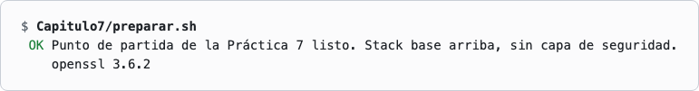

### Superficie de exposición

Antes de cerrar puertas hay que contarlas.
Este bloque recorre el perímetro del stack y revisa qué responde cada puerto a quien llega sin presentarse.
Lo que se anote aquí sirve para comparar al final de la práctica.

3. Listar los contenedores del proyecto y los puertos que publican en la máquina.

```bash
docker ps --filter label=com.docker.compose.project=gpe --format 'table {{.Names}}\t{{.Ports}}'
```

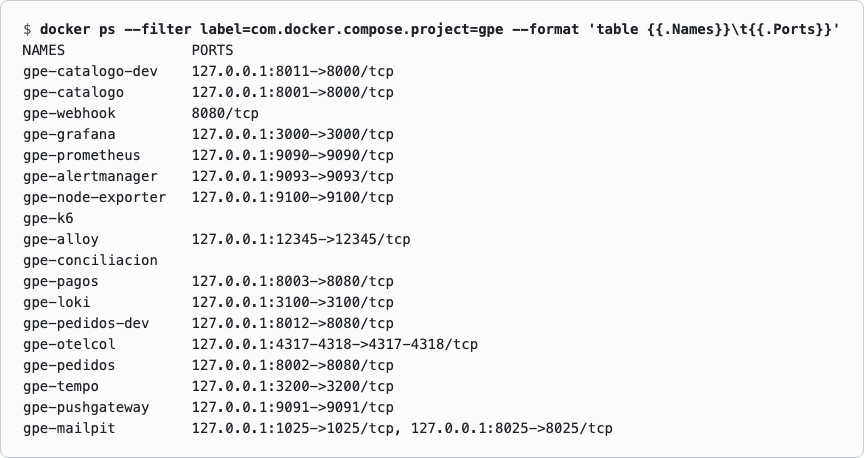

4. Antes de abrir las siguientes direcciones, anotar una predicción. ¿Qué podría ver alguien de la red con solo abrirlas?

5. Abrir `http://localhost:9090/config`. Prometheus muestra su configuración completa sin pedir nada.

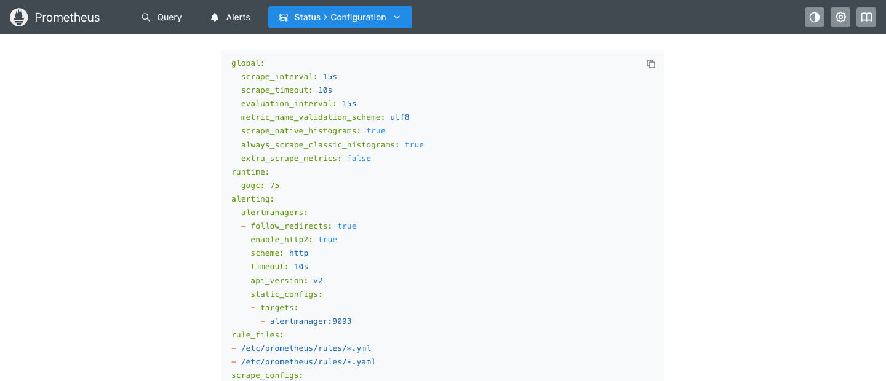

6. Abrir `http://localhost:9090/targets`. Aparecen todos los destinos con sus direcciones internas.

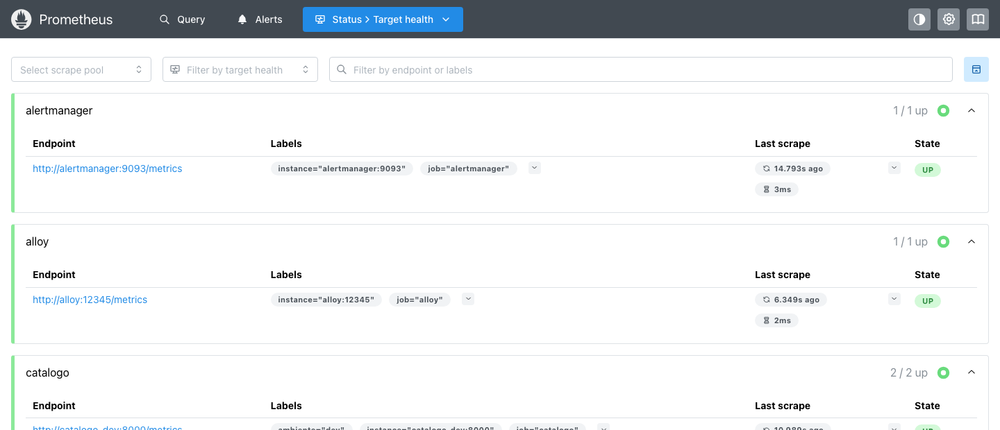

7. Pedir las métricas de node_exporter.

```bash
curl -s http://localhost:9100/metrics | grep -m 8 '^node_uname_info\|^node_os_info\|^node_filesystem_size_bytes'
```

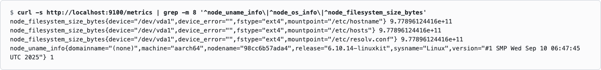

>**Nota.** El nombre de la máquina, el kernel y los discos están a la vista. Todos los puertos escuchan solo en 127.0.0.1, pero en un servidor real cualquiera de la red llegaría igual.

### CA propia y certificados

Un guardia sin credencial no puede demostrar quién es.
Aquí se crea la municipalidad del curso, que es la CA, y con ella se emite una credencial con foto para cada componente.
Quien conozca el sello de la CA puede revisar cualquiera de esas credenciales.

8. Crear la carpeta de los certificados y una CA propia, válida por un año.

```bash
mkdir -p Capitulo7/trabajo/certs
MSYS_NO_PATHCONV=1 openssl req -x509 -newkey rsa:2048 -nodes -days 365 -keyout Capitulo7/trabajo/certs/ca.key -out Capitulo7/trabajo/certs/ca.crt -subj "/CN=CA del Tianguis"
openssl x509 -in Capitulo7/trabajo/certs/ca.crt -noout -subject -issuer -dates
```

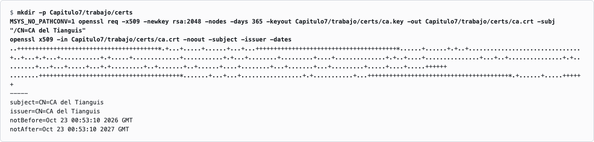

>**Nota.** `MSYS_NO_PATHCONV=1` es para Git Bash, que si no convierte `/CN=...` en una ruta de Windows. En macOS no hace nada.

9. Crear una clave y un certificado firmado por la CA para cada componente. El certificado vale para el nombre interno de Docker, para `localhost` y para `127.0.0.1`.

```bash
for s in prometheus node-exporter alertmanager grafana; do
  MSYS_NO_PATHCONV=1 openssl req -newkey rsa:2048 -nodes -keyout Capitulo7/trabajo/certs/$s.key -out Capitulo7/trabajo/certs/$s.csr -subj "/CN=$s"
  printf 'subjectAltName=DNS:%s,DNS:localhost,IP:127.0.0.1\n' $s > Capitulo7/trabajo/certs/$s.ext
  openssl x509 -req -in Capitulo7/trabajo/certs/$s.csr -CA Capitulo7/trabajo/certs/ca.crt -CAkey Capitulo7/trabajo/certs/ca.key -CAcreateserial -days 365 -extfile Capitulo7/trabajo/certs/$s.ext -out Capitulo7/trabajo/certs/$s.crt
done
chmod 644 Capitulo7/trabajo/certs/*.key
ls Capitulo7/trabajo/certs
```

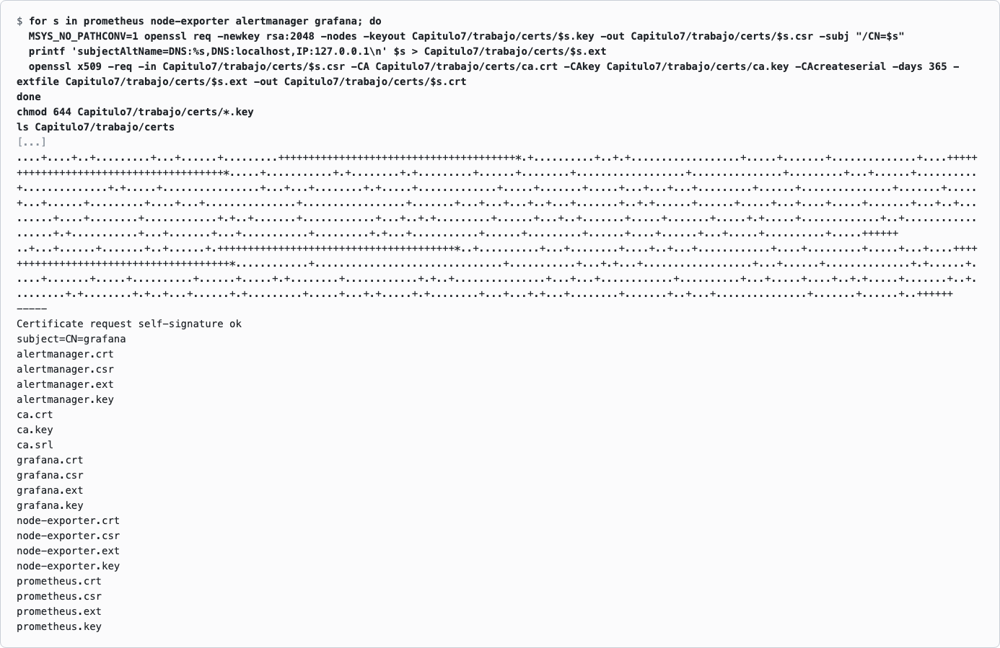

>**Nota.** `chmod 644` deja que los contenedores lean las claves, porque corren con otro usuario. En un servidor real las claves se protegen con su dueño y un permiso 600.

10. Comprobar que el certificado de Prometheus está firmado por la CA y ver sus nombres.

```bash
openssl verify -CAfile Capitulo7/trabajo/certs/ca.crt Capitulo7/trabajo/certs/prometheus.crt
openssl x509 -in Capitulo7/trabajo/certs/prometheus.crt -noout -text | grep -A1 'Subject Alternative Name'
```

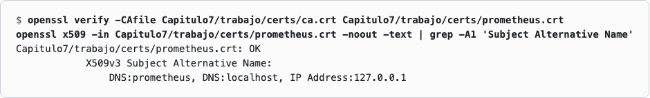

### node_exporter con TLS y autenticación

node_exporter es la primera puerta que recibe guardia.
El guardia muestra su credencial a quien llega y pide nombre y clave antes de dejar pasar.
Prometheus es quien más entra por esa puerta, así que también tiene que aprender a presentarse.

11. Calcular el hash bcrypt de la clave con la que Prometheus va a raspar a node_exporter. `htpasswd` corre dentro de un contenedor, así no hace falta instalar nada.

```bash
docker run --rm httpd:2.4.68-alpine htpasswd -nbBC 10 prometheus raspar-2026
```

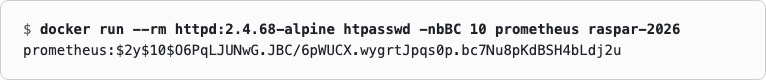

12. Crear el archivo `Capitulo7/trabajo/node-exporter/web.yml` con este contenido. Reemplazar `HASH` por lo que aparece después de `prometheus:` en la salida del paso anterior.

```yaml
# node_exporter con TLS y autenticación básica.
tls_server_config:
  cert_file: /etc/tls/node-exporter.crt
  key_file: /etc/tls/node-exporter.key
basic_auth_users:
  prometheus: HASH
```

| Línea | Qué hace |
|---|---|
| `# node_exporter con TLS...` | Comentario. node_exporter lo ignora |
| `tls_server_config` | Activa TLS en node_exporter |
| `cert_file` | Certificado que node_exporter presenta, el que firmó la CA en el paso 9 |
| `key_file` | Clave privada de ese certificado |
| `basic_auth_users` | Usuarios que pueden entrar |
| `prometheus: HASH` | El usuario `prometheus` con el hash bcrypt de su clave, nunca la clave en texto |

>**Nota.** No hace falta saber programar para este paso. Se copia el bloque en un archivo nuevo y se cambia solo la palabra `HASH`. Si la carpeta `node-exporter` no existe, el editor la crea al guardar. Las rutas `/etc/tls/...` son las de dentro del contenedor, donde el compose del paso 15 monta la carpeta `certs`. El formato de este archivo es el mismo en node_exporter, Prometheus y Alertmanager y está en la documentación de Prometheus, https://prometheus.io/docs/prometheus/latest/configuration/https/

13. Copiar la configuración de Prometheus a la carpeta de trabajo.

```bash
mkdir -p Capitulo7/trabajo/prometheus
cp infra/prometheus/prometheus.yml Capitulo7/trabajo/prometheus/prometheus.yml
```

14. En `Capitulo7/trabajo/prometheus/prometheus.yml` reemplazar el job `node_exporter` por este. Todavía sin la CA.

```yaml
  - job_name: node_exporter
    scheme: https
    tls_config:
      # Todavía sin ca_file. Ver el paso 18.
    basic_auth:
      username: prometheus
      password: raspar-2026
    static_configs:
      - targets: ["node-exporter:9100"]
```

| Línea | Qué hace |
|---|---|
| `job_name` | Nombre del job, el mismo que ya tenía |
| `scheme: https` | Prometheus raspa por TLS y no por http |
| `tls_config` | Cómo revisa Prometheus el certificado de node_exporter. El comentario de adentro se cambia en el paso 18 |
| `basic_auth` | Usuario y clave con que Prometheus se presenta |
| `username` y `password` | El usuario y la clave cuyo hash quedó en `web.yml` |
| `static_configs` y `targets` | La dirección de node_exporter en la red de Docker, sin cambios |

>**Nota.** No hace falta saber programar. Se borra el job `node_exporter` que trae el archivo, desde su línea `- job_name` hasta antes del siguiente `- job_name`, y se pega este en su lugar con la misma sangría. Los campos de un job están en la documentación de Prometheus, https://prometheus.io/docs/prometheus/latest/configuration/configuration/

15. Reemplazar todo el contenido de `Capitulo7/compose.seguridad.yaml` por este.

```yaml
# Capa de seguridad de la Práctica 7. Se suma al compose del stack con un segundo -f.
#
#   docker compose -p gpe --env-file infra/.env -f infra/compose.yaml \
#     -f Capitulo7/compose.seguridad.yaml up -d
#
# Las rutas son relativas a infra/, la carpeta del primer archivo, por eso empiezan con ../
# Lo que se escribe aquí reemplaza o se agrega a lo de infra/compose.yaml. Lo demás queda igual.

services:
  node-exporter:
    command:
      - --web.config.file=/etc/node-exporter/web.yml
    volumes:
      - ../Capitulo7/trabajo/node-exporter:/etc/node-exporter:ro
      - ../Capitulo7/trabajo/certs:/etc/tls:ro
    healthcheck:
      # Sano si responde por TLS y pide clave. El 401 confirma las dos cosas.
      test: ["CMD", "sh", "-c", "wget -q -O /dev/null --no-check-certificate https://127.0.0.1:9100/ 2>&1 | grep -q 401"]

  prometheus:
    command:
      - --config.file=/etc/prometheus-seguridad/prometheus.yml
      - --storage.tsdb.path=/prometheus
      - --web.enable-otlp-receiver
      - --enable-feature=exemplar-storage
    volumes:
      - ../Capitulo7/trabajo/prometheus:/etc/prometheus-seguridad:ro
      - ../Capitulo7/trabajo/certs:/etc/tls:ro
```

16. Aplicar la capa. Compose recrea solo los contenedores que cambiaron.

```bash
docker compose -p gpe --env-file infra/.env -f infra/compose.yaml -f Capitulo7/compose.seguridad.yaml up -d
```

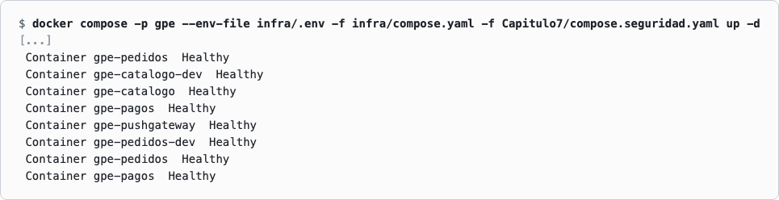

17. Esperar unos 30 segundos y abrir `http://localhost:9090/targets`. Antes de mirar, anotar qué va a pasar con node_exporter si Prometheus todavía no tiene la CA. Para razonarlo, repasar en la introducción de CA propia y certificados quién puede revisar una credencial.

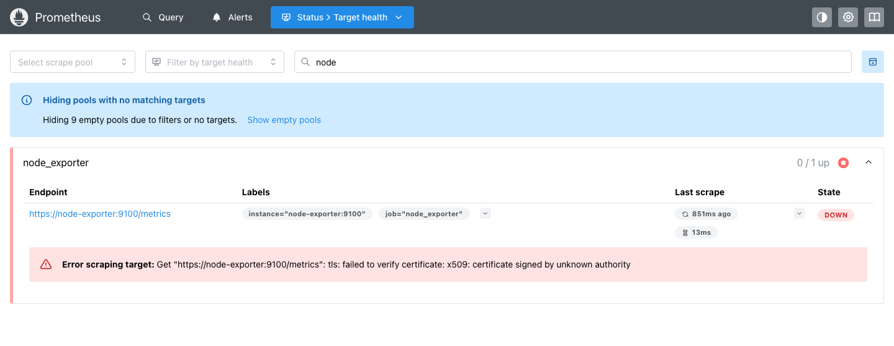

>**Nota.** El destino queda abajo con un error x509. Prometheus llega por TLS, pero no reconoce a quien firmó el certificado y corta la conexión.

18. En el job `node_exporter` reemplazar la línea del comentario por `ca_file: /etc/tls/ca.crt`, dentro de `tls_config`. El job queda así.

```yaml
  - job_name: node_exporter
    scheme: https
    tls_config:
      ca_file: /etc/tls/ca.crt
    basic_auth:
      username: prometheus
      password: raspar-2026
    static_configs:
      - targets: ["node-exporter:9100"]
```

`ca_file` es el certificado de la CA, montado en el contenedor de Prometheus. Con él Prometheus revisa la credencial que presenta node_exporter. Guardar y recargar Prometheus.

```bash
docker exec gpe-prometheus kill -HUP 1
```

19. Recargar la página de destinos. node_exporter queda UP por https.

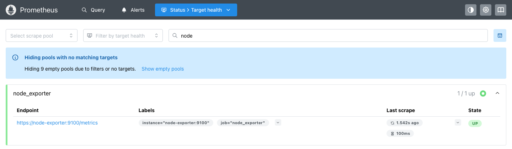

20. Probar node_exporter sin clave y con clave.

>**Nota.** En Git Bash de Windows, antes de este paso correr `alias curl='curl --ssl-no-revoke'` en la terminal. El curl de Git Bash revisa si el certificado fue revocado, y la CA del curso no publica esa lista, así que sin el alias responde `the revocation status is unknown`. En macOS y Linux no hace falta.

```bash
curl -s -o /dev/null -w '%{http_code}\n' --cacert Capitulo7/trabajo/certs/ca.crt https://localhost:9100/metrics
curl -s -o /dev/null -w '%{http_code}\n' --cacert Capitulo7/trabajo/certs/ca.crt -u prometheus:raspar-2026 https://localhost:9100/metrics
```

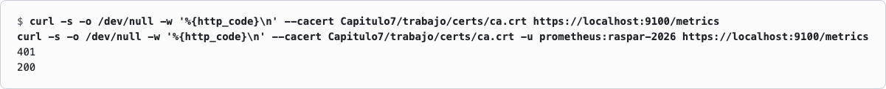

### Prometheus con TLS y autenticación

Prometheus es la puerta principal del mercado, con su interfaz y su API.
Ahora el guardia se pone también ahí, y cada visita muestra su credencial, incluido el propio Prometheus cuando se revisa a sí mismo.
Grafana es una de esas visitas, por eso su datasource también cambia.

21. Calcular el hash de la clave para entrar a Prometheus y a Alertmanager.

```bash
docker run --rm httpd:2.4.68-alpine htpasswd -nbBC 10 tianguis mirar-2026
```

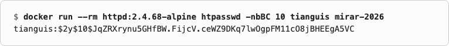

22. Crear `Capitulo7/trabajo/prometheus/web.yml` con este contenido, con el hash de tianguis. Las líneas son las mismas del paso 12, con el certificado de Prometheus y el usuario `tianguis`.

```yaml
# La interfaz y la API de Prometheus, con TLS y autenticación básica.
tls_server_config:
  cert_file: /etc/tls/prometheus.crt
  key_file: /etc/tls/prometheus.key
basic_auth_users:
  tianguis: HASH
```

23. En `Capitulo7/trabajo/prometheus/prometheus.yml` reemplazar el job `prometheus` por este. Prometheus se raspa a sí mismo y ahora también tiene que presentarse.

```yaml
  - job_name: prometheus
    scheme: https
    tls_config:
      ca_file: /etc/tls/ca.crt
    basic_auth:
      username: tianguis
      password: mirar-2026
    static_configs:
      - targets: ["prometheus:9090"]
```

24. Copiar los datasources de Grafana a la carpeta de trabajo.

```bash
mkdir -p Capitulo7/trabajo/grafana/datasources
cp infra/grafana/provisioning/datasources/datasources.yaml Capitulo7/trabajo/grafana/datasources/datasources.yaml
```

25. En `Capitulo7/trabajo/grafana/datasources/datasources.yaml` reemplazar el datasource Prometheus por este.

```yaml
  - name: Prometheus
    uid: prometheus
    type: prometheus
    access: proxy
    url: https://prometheus:9090
    basicAuth: true
    basicAuthUser: tianguis
    isDefault: true
    editable: false
    jsonData:
      httpMethod: POST
      timeInterval: 15s
      prometheusType: Prometheus
      # Métrica a traza: cada exemplar trae una etiqueta trace_id, y el punto de la gráfica
      # abre esa traza en Tempo.
      exemplarTraceIdDestinations:
        - name: trace_id
          datasourceUid: tempo
          urlDisplayLabel: Ver traza
      tlsAuthWithCACert: true
    secureJsonData:
      basicAuthPassword: mirar-2026
      tlsCACert: $__file{/etc/tls/ca.crt}
```

26. En `compose.seguridad.yaml` reemplazar el bloque `prometheus` por el siguiente y agregar al final el bloque `grafana`.

```yaml
  prometheus:
    command:
      - --config.file=/etc/prometheus-seguridad/prometheus.yml
      - --web.config.file=/etc/prometheus-seguridad/web.yml
      - --storage.tsdb.path=/prometheus
      - --web.enable-otlp-receiver
      - --enable-feature=exemplar-storage
    volumes:
      - ../Capitulo7/trabajo/prometheus:/etc/prometheus-seguridad:ro
      - ../Capitulo7/trabajo/certs:/etc/tls:ro
    healthcheck:
      test: ["CMD", "sh", "-c", "wget -q -O /dev/null --no-check-certificate https://127.0.0.1:9090/-/ready 2>&1 | grep -q 401"]

  grafana:
    volumes:
      - ../Capitulo7/trabajo/certs:/etc/tls:ro
      - ../Capitulo7/trabajo/grafana/datasources:/etc/grafana/provisioning/datasources:ro
```

27. Aplicar la capa. Compose recrea solo los contenedores que cambiaron.

```bash
docker compose -p gpe --env-file infra/.env -f infra/compose.yaml -f Capitulo7/compose.seguridad.yaml up -d
```

28. Probar la API de Prometheus sin clave y con clave.

```bash
curl -s -o /dev/null -w '%{http_code}\n' --cacert Capitulo7/trabajo/certs/ca.crt https://localhost:9090/api/v1/status/config
curl -s -o /dev/null -w '%{http_code}\n' --cacert Capitulo7/trabajo/certs/ca.crt -u tianguis:mirar-2026 https://localhost:9090/api/v1/status/config
```

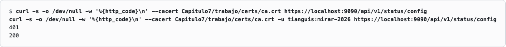

29. Abrir `https://localhost:9090/targets`. El navegador avisa que no conoce la CA. Aceptar el riesgo para continuar y entrar con el usuario `tianguis` y la clave `mirar-2026`.

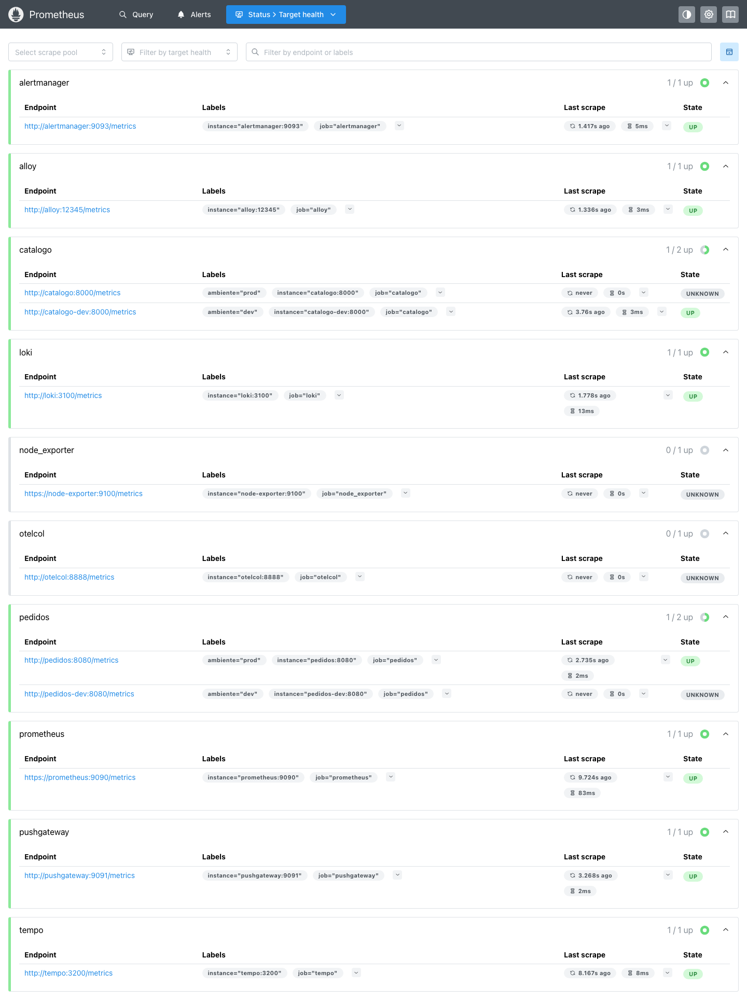

>**Nota.** El aviso aparece porque la CA es nuestra y el navegador no la conoce. En una empresa la CA interna se instala en los equipos y el aviso desaparece.

30. En Grafana abrir **Explore** y ejecutar `up{job=~"prometheus|node_exporter"}`. Grafana llega a Prometheus por TLS y con clave.

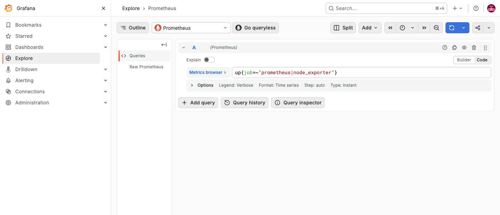

### Alertmanager con TLS y autenticación

Alertmanager es la sala de la central de avisos del mercado.
Quien entra ahí maneja los avisos de todos los servicios, así que recibe el mismo guardia que Prometheus.
Prometheus le lleva las alertas en el camión blindado y mostrando su credencial.

31. Crear `Capitulo7/trabajo/alertmanager/web.yml` con el mismo hash de tianguis. Las líneas son las mismas del paso 12, con el certificado de Alertmanager.

```yaml
# La interfaz y la API de Alertmanager, con TLS y autenticación básica.
tls_server_config:
  cert_file: /etc/tls/alertmanager.crt
  key_file: /etc/tls/alertmanager.key
basic_auth_users:
  tianguis: HASH
```

32. En `Capitulo7/trabajo/prometheus/prometheus.yml` reemplazar la sección `alerting` y el job `alertmanager` por estos.

```yaml
alerting:
  alertmanagers:
    # Prometheus le habla a Alertmanager por TLS y con clave.
    - scheme: https
      tls_config:
        ca_file: /etc/tls/ca.crt
      basic_auth:
        username: tianguis
        password: mirar-2026
      static_configs:
        - targets: ["alertmanager:9093"]

  - job_name: alertmanager
    scheme: https
    tls_config:
      ca_file: /etc/tls/ca.crt
    basic_auth:
      username: tianguis
      password: mirar-2026
    static_configs:
      - targets: ["alertmanager:9093"]
```

33. En `Capitulo7/trabajo/grafana/datasources/datasources.yaml` reemplazar el datasource Alertmanager por este.

```yaml
  - name: Alertmanager
    uid: alertmanager
    type: alertmanager
    access: proxy
    url: https://alertmanager:9093
    basicAuth: true
    basicAuthUser: tianguis
    editable: false
    jsonData:
      implementation: prometheus
      handleGrafanaManagedAlerts: false
      tlsAuthWithCACert: true
    secureJsonData:
      basicAuthPassword: mirar-2026
      tlsCACert: $__file{/etc/tls/ca.crt}
```

34. En `compose.seguridad.yaml` agregar este bloque antes de `grafana`.

```yaml
  alertmanager:
    command:
      - --config.file=/etc/alertmanager/alertmanager.yml
      - --web.config.file=/etc/alertmanager-seguridad/web.yml
      - --storage.path=/alertmanager
      - --web.external-url=https://localhost:${PUERTO_ALERTMANAGER}
    volumes:
      - ../Capitulo7/trabajo/alertmanager:/etc/alertmanager-seguridad:ro
      - ../Capitulo7/trabajo/certs:/etc/tls:ro
    healthcheck:
      test: ["CMD", "sh", "-c", "wget -q -O /dev/null --no-check-certificate https://127.0.0.1:9093/-/ready 2>&1 | grep -q 401"]
```

35. Aplicar la capa. Compose recrea solo los contenedores que cambiaron.

```bash
docker compose -p gpe --env-file infra/.env -f infra/compose.yaml -f Capitulo7/compose.seguridad.yaml up -d
```

36. Recargar Prometheus, que leyó `prometheus.yml` nuevo, y comprobar que Alertmanager pide clave y que Prometheus le envía las alertas por https.

```bash
docker exec gpe-prometheus kill -HUP 1
curl -s -o /dev/null -w '%{http_code}\n' --cacert Capitulo7/trabajo/certs/ca.crt https://localhost:9093/api/v2/status
curl -s --cacert Capitulo7/trabajo/certs/ca.crt -u tianguis:mirar-2026 https://localhost:9090/api/v1/alertmanagers
```

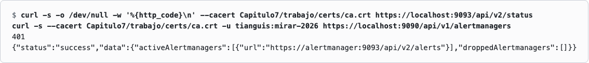

### Grafana en HTTPS

Grafana es la puerta que usan las personas y guarda sus sesiones.
Sin HTTPS esa información viaja por la calle a la vista de cualquiera.
Aquí Grafana recibe su propia credencial de la CA y comienza a usar el camión blindado.

37. En `compose.seguridad.yaml` reemplazar el bloque `grafana` por este.

```yaml
  grafana:
    environment:
      # HTTPS con el certificado de la CA del curso.
      GF_SERVER_PROTOCOL: https
      GF_SERVER_CERT_FILE: /etc/tls/grafana.crt
      GF_SERVER_CERT_KEY: /etc/tls/grafana.key
      GF_SERVER_ROOT_URL: https://localhost:${PUERTO_GRAFANA}/
    volumes:
      - ../Capitulo7/trabajo/certs:/etc/tls:ro
      - ../Capitulo7/trabajo/grafana/datasources:/etc/grafana/provisioning/datasources:ro
    healthcheck:
      test: ["CMD", "wget", "-q", "-O", "/dev/null", "--no-check-certificate", "https://127.0.0.1:3000/api/health"]
```

38. Aplicar la capa. Compose recrea solo los contenedores que cambiaron.

```bash
docker compose -p gpe --env-file infra/.env -f infra/compose.yaml -f Capitulo7/compose.seguridad.yaml up -d
```

39. Ver el certificado que presenta Grafana y comprobar que lo firmó la CA del curso.

```bash
openssl s_client -connect localhost:3000 -servername localhost -CAfile Capitulo7/trabajo/certs/ca.crt </dev/null 2>/dev/null | grep -E 'subject=|issuer=|Verify return code'
```

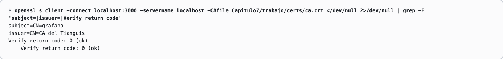

40. Consultar la salud de Grafana por https.

```bash
curl -s --cacert Capitulo7/trabajo/certs/ca.crt https://localhost:3000/api/health
```

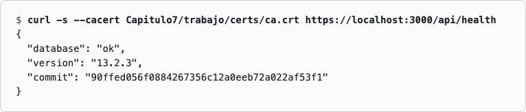

41. Abrir `https://localhost:3000`, aceptar el aviso del navegador y pulsar el candado o el aviso de la barra de direcciones. El certificado dice que lo emitió **CA del Tianguis** y que vale para `grafana`, `localhost` y `127.0.0.1`.

### Login con Dex

Una clave distinta en cada herramienta termina escrita en un papel.
Dex es la oficina municipal que emite una sola credencial para entrar a todos los edificios.
Para esos usuarios Grafana no guarda clave y solo le pregunta a Dex quién es la persona.

42. Calcular los hashes de las claves de Ana y Beto, dos usuarios de Dex.

```bash
docker run --rm httpd:2.4.68-alpine htpasswd -nbBC 10 ana ana-2026
docker run --rm httpd:2.4.68-alpine htpasswd -nbBC 10 beto beto-2026
```

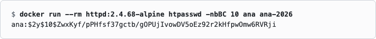

43. Crear `Capitulo7/trabajo/dex/config.yaml` copiando `Capitulo7/dex/config.yaml`. Reemplazar `HASH_ANA` y `HASH_BETO` por los hashes, `SECRETO_OAUTH` por `secreto-de-grafana-2026` y `PUERTO_GRAFANA` por el puerto de Grafana de `infra/.env`, que es 3000 si no se cambió.

```bash
mkdir -p Capitulo7/trabajo/dex
cp Capitulo7/dex/config.yaml Capitulo7/trabajo/dex/config.yaml
```

Con el secreto y el puerto ya puestos, el archivo queda así. Falta cambiar `HASH_ANA` y `HASH_BETO` por lo que aparece después de `ana:` y de `beto:` en la salida del paso 42. Si en `infra/.env` el puerto de Grafana no es 3000, cambiarlo también en `redirectURIs`.

```yaml
# Dex, el proveedor OIDC de la Práctica 7. Guarda todo en memoria: al reiniciar no recuerda
# sesiones, pero los usuarios y el cliente salen de este archivo.
#
# El emisor es la dirección con que el navegador ve a Dex. Grafana le pide el token por la red
# interna, en http://dex:5556.
issuer: http://localhost:5556/dex

storage:
  type: memory

web:
  http: 0.0.0.0:5556

telemetry:
  http: 0.0.0.0:5558

oauth2:
  # Sin la pantalla que pide aprobar los permisos en cada entrada.
  skipApprovalScreen: true

# Grafana es el único cliente. En la dirección de vuelta PUERTO_GRAFANA se reemplaza por el puerto
# de Grafana en infra/.env, que es 3000 si no se cambió.
staticClients:
  - id: grafana
    name: Grafana del Tianguis
    secret: secreto-de-grafana-2026
    redirectURIs:
      - https://localhost:3000/login/generic_oauth

# Usuarios de prueba con clave. El hash es bcrypt, igual que en los web config.
enablePasswordDB: true
staticPasswords:
  - email: ana@tianguis.local
    username: ana
    userID: 1f7b0c1e-0001-4d6a-9e00-000000000001
    hash: HASH_ANA
  - email: beto@tianguis.local
    username: beto
    userID: 1f7b0c1e-0002-4d6a-9e00-000000000002
    hash: HASH_BETO
```

| Línea | Qué hace |
|---|---|
| `issuer` | Dirección con que el navegador llega a Dex |
| `storage` | Dex guarda las sesiones en memoria |
| `web` y `telemetry` | Puertos donde Dex atiende el login y su chequeo de salud |
| `skipApprovalScreen` | No pide aprobar permisos en cada entrada |
| `staticClients` | Las aplicaciones que pueden usar Dex. Aquí solo Grafana |
| `id` y `secret` | Nombre y clave con que Grafana se presenta ante Dex. Son los mismos del compose del paso 44 |
| `redirectURIs` | Dirección de Grafana a la que Dex devuelve a la persona después del login |
| `enablePasswordDB` | Activa los usuarios con clave escritos en este archivo |
| `staticPasswords` | Los usuarios Ana y Beto, con su email, su nombre, un identificador fijo y el hash bcrypt de su clave |

>**Nota.** No hace falta saber programar. Basta abrir el archivo copiado y cambiar las cuatro palabras en mayúsculas. Los usuarios con clave de Dex están en https://dexidp.io/docs/connectors/local/ y las variables de Grafana del paso 44 en https://grafana.com/docs/grafana/latest/setup-grafana/configure-access/configure-authentication/generic-oauth/

44. En `compose.seguridad.yaml` reemplazar el bloque `grafana` por el siguiente y agregar al final el bloque `dex`.

```yaml
  grafana:
    environment:
      # HTTPS con el certificado de la CA del curso.
      GF_SERVER_PROTOCOL: https
      GF_SERVER_CERT_FILE: /etc/tls/grafana.crt
      GF_SERVER_CERT_KEY: /etc/tls/grafana.key
      GF_SERVER_ROOT_URL: https://localhost:${PUERTO_GRAFANA}/
      # Login con Dex. El navegador va a localhost:5556 y Grafana pide el token por la red interna.
      GF_AUTH_GENERIC_OAUTH_ENABLED: "true"
      GF_AUTH_GENERIC_OAUTH_NAME: Dex
      GF_AUTH_GENERIC_OAUTH_CLIENT_ID: grafana
      GF_AUTH_GENERIC_OAUTH_CLIENT_SECRET: secreto-de-grafana-2026
      GF_AUTH_GENERIC_OAUTH_SCOPES: openid profile email
      GF_AUTH_GENERIC_OAUTH_AUTH_URL: http://localhost:5556/dex/auth
      GF_AUTH_GENERIC_OAUTH_TOKEN_URL: http://dex:5556/dex/token
      GF_AUTH_GENERIC_OAUTH_API_URL: http://dex:5556/dex/userinfo
      GF_AUTH_GENERIC_OAUTH_ALLOW_SIGN_UP: "true"
      # Ana entra como Editor. Cualquier otro usuario de Dex entra como Viewer.
      GF_AUTH_GENERIC_OAUTH_ROLE_ATTRIBUTE_PATH: "email == 'ana@tianguis.local' && 'Editor' || 'Viewer'"
    volumes:
      - ../Capitulo7/trabajo/certs:/etc/tls:ro
      - ../Capitulo7/trabajo/grafana/datasources:/etc/grafana/provisioning/datasources:ro
    healthcheck:
      test: ["CMD", "wget", "-q", "-O", "/dev/null", "--no-check-certificate", "https://127.0.0.1:3000/api/health"]

  dex:
    container_name: gpe-dex
    image: dexidp/dex:v2.45.1
    command: ["dex", "serve", "/etc/dex/config.yaml"]
    restart: unless-stopped
    volumes:
      - ../Capitulo7/trabajo/dex:/etc/dex:ro
    ports:
      - "127.0.0.1:5556:5556"
    healthcheck:
      test: ["CMD", "wget", "-q", "-O", "/dev/null", "http://127.0.0.1:5558/healthz"]
      interval: 10s
      timeout: 5s
      retries: 6
      start_period: 10s
    mem_limit: 64m
```

45. Aplicar la capa. Compose recrea solo los contenedores que cambiaron.

```bash
docker compose -p gpe --env-file infra/.env -f infra/compose.yaml -f Capitulo7/compose.seguridad.yaml up -d
```

46. Cerrar la sesión de Grafana y abrir `https://localhost:3000/login`. Aparece el botón **Sign in with Dex**.

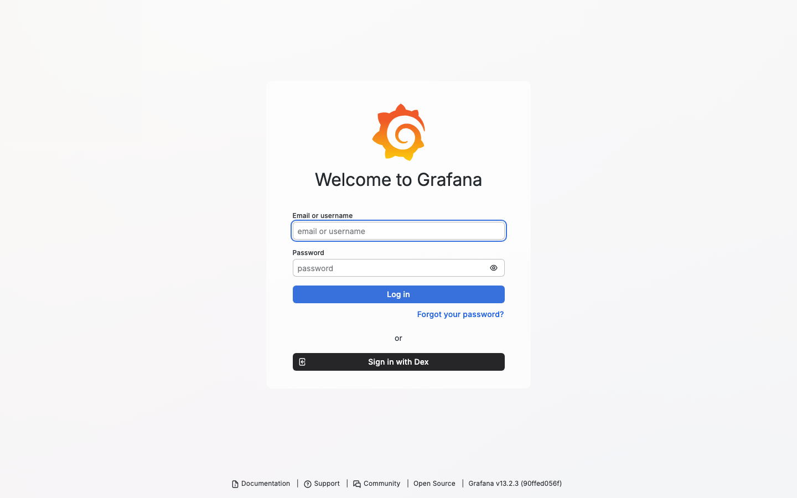

47. Pulsar **Sign in with Dex**. En la página de Dex entrar con `beto@tianguis.local` y la clave `beto-2026`.

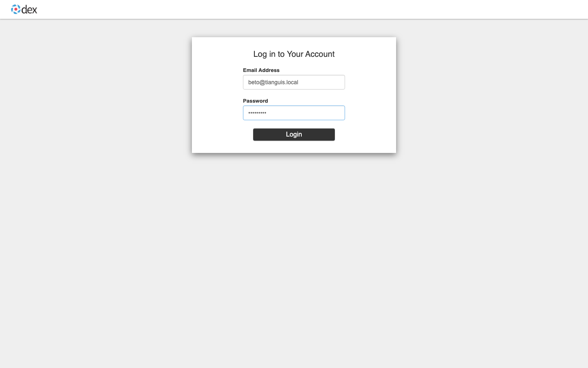

48. Grafana crea el usuario la primera vez que entra. Abrir el perfil, arriba a la derecha, y bajar hasta **Organizations**. Beto entró como **Viewer**.

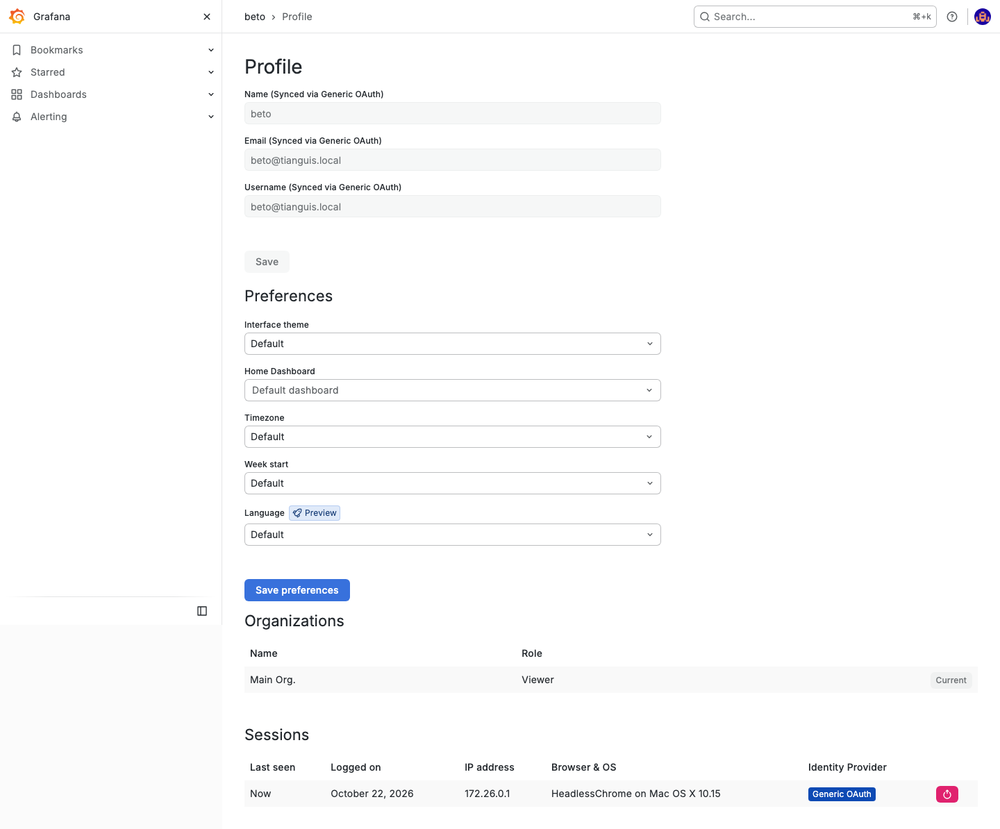

>**Nota.** La regla `GF_AUTH_GENERIC_OAUTH_ROLE_ATTRIBUTE_PATH` le da Editor solo a `ana@tianguis.local`. Cualquier otro usuario de Dex entra como Viewer.

49. Cerrar la sesión y entrar con `admin`. En **Administration**, **Users and access**, **Users**, Beto aparece con el origen **Generic OAuth**.

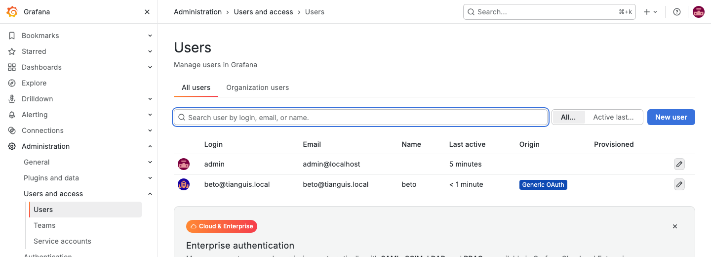

### Roles, equipo y carpeta restringida

Una vez dentro, no todos tienen que hacer lo mismo.
Algunos solo miran el pizarrón y otros pueden escribir en él.
Además se arma una vitrina con llave para el equipo de pagos.

50. En **Users** pulsar **New user**. Crear a Vera con el login `vera`, el email `vera@tianguis.local` y la clave `vera-2026`. Pulsar **Create user**.

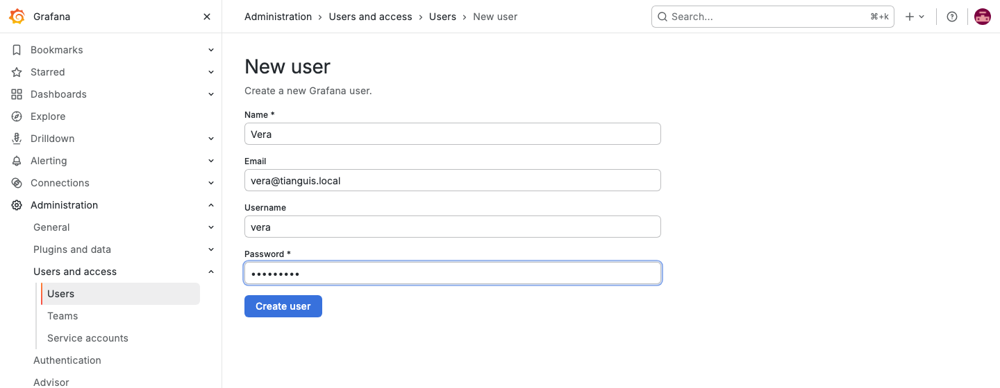

51. Crear de la misma forma a Edu, con el login `edu`, el email `edu@tianguis.local` y la clave `edu-2026`.

52. Abrir la pestaña **Organization users** y en la fila de Edu cambiar **Role** a **Editor**. Vera queda como **Viewer**.

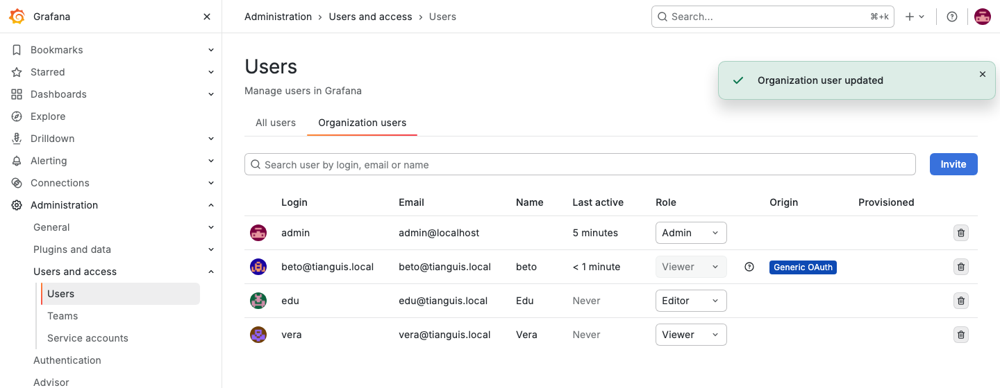

53. Abrir **Teams**, pulsar **New team**, escribir `equipo-pagos` y pulsar **Create**. Entrar al equipo, pulsar **Add member**, elegir **User**, elegir a `edu` y pulsar **Save**.

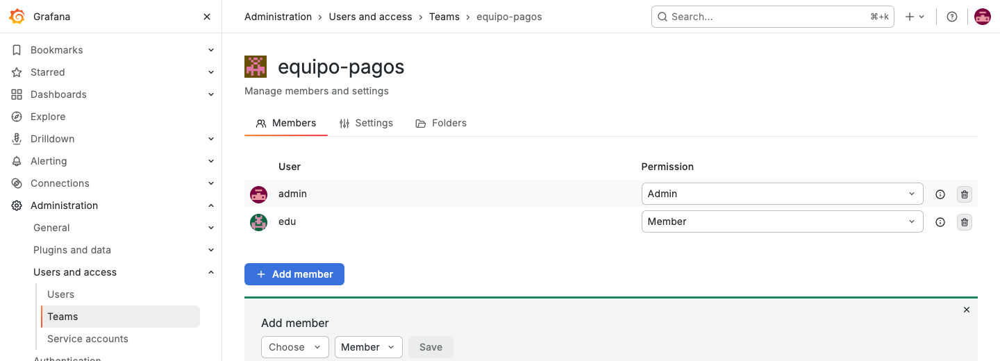

54. Abrir **Dashboards**, pulsar **New** y elegir **New folder**. Llamarla `Pagos restringido` y pulsar **Create**. En **Folder actions** elegir **Manage permissions**. Quitar los permisos de los roles **Editor** y **Viewer** con el ícono de la papelera y pulsar **Add a permission**.

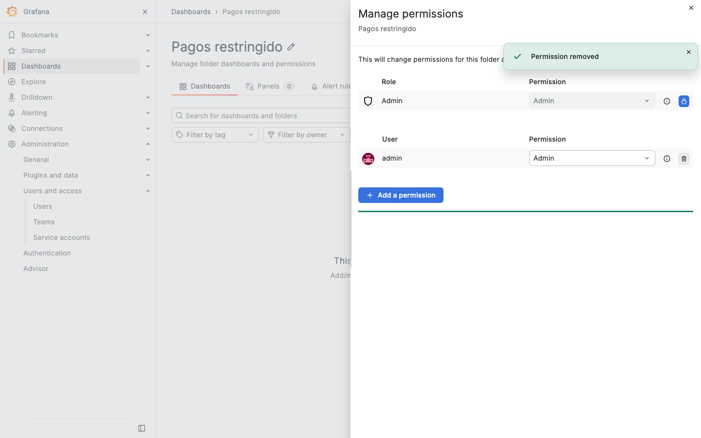

55. En **Add permission for** elegir **Team**, después `equipo-pagos`, el permiso **Edit**, y pulsar **Save**.

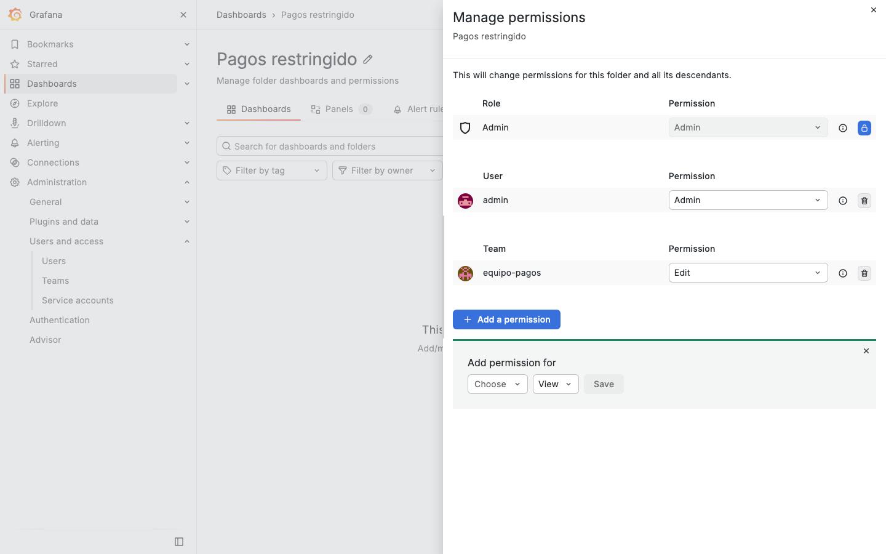

56. Abrir **Dashboards**, **New**, **Import dashboard**. Subir el archivo `Capitulo4/sin-internet/host-use.json`, elegir la carpeta `Pagos restringido` y pulsar **Import**.

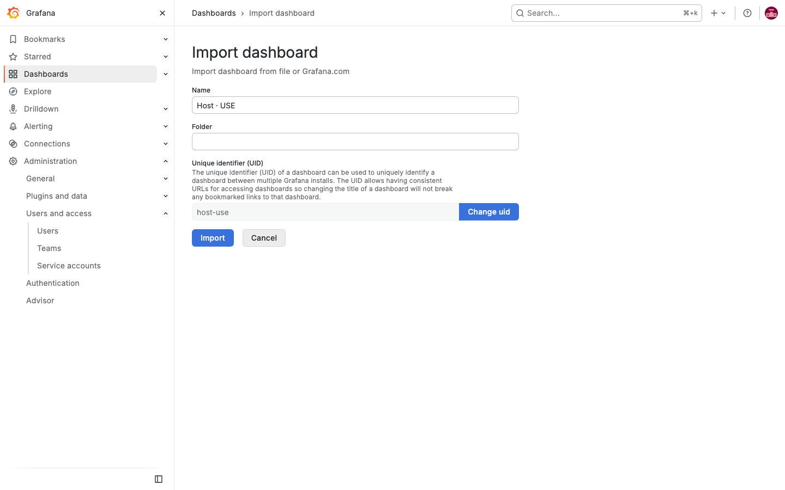

57. Cerrar la sesión y entrar como `vera`. En **Dashboards** la carpeta `Pagos restringido` no aparece.

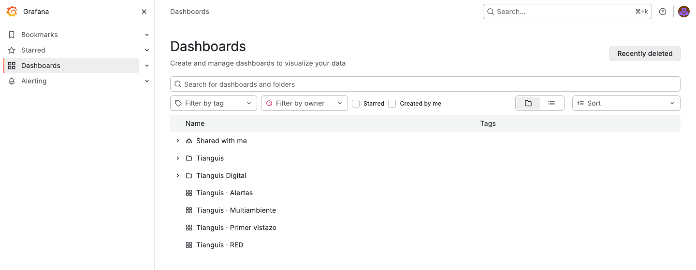

58. Cerrar la sesión y entrar como `edu`. La carpeta aparece con el dashboard Host · USE, que Edu puede editar por el equipo.

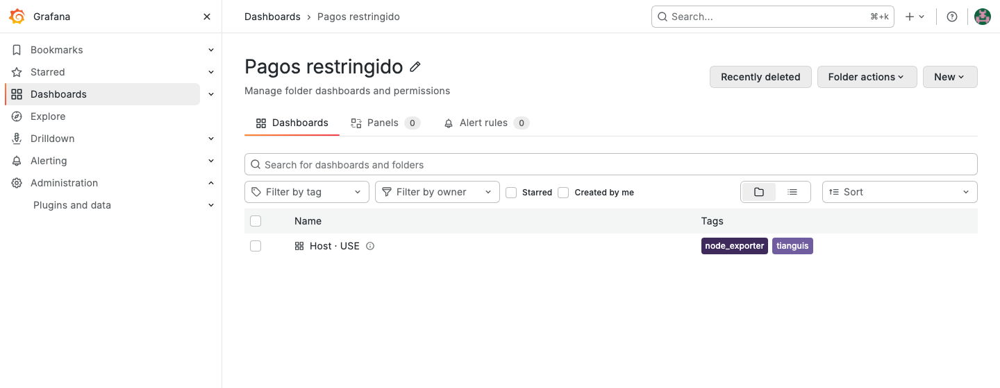

### Cuenta de servicio y token

Los scripts también llaman a Grafana y no deberían usar la clave de una persona.
La cuenta de servicio es el camión repartidor, con su propia llave y su propio registro.
Esa llave se puede anular sin tocar las de nadie más.

59. Cerrar la sesión y entrar con `admin`. En **Users and access** abrir **Service accounts** y pulsar **Add service account**. Llamarla `repartidor`, dejar el rol **Viewer** y pulsar **Create**. Pulsar **Add service account token** y después **Generate token**.

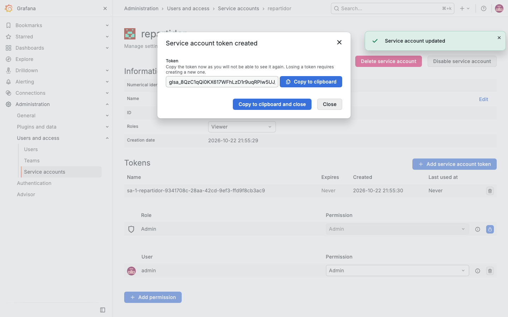

60. Copiar el token, que empieza con `glsa_`, y pegarlo en un archivo nuevo `Capitulo7/trabajo/token-repartidor`. Grafana no lo vuelve a mostrar. Después pulsar **Close**.

61. Consultar la API de Grafana con el token.

```bash
curl -s --cacert Capitulo7/trabajo/certs/ca.crt -H "Authorization: Bearer $(cat Capitulo7/trabajo/token-repartidor)" "https://localhost:3000/api/search?query=Tianguis"
```

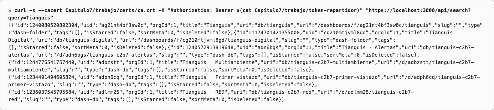

>**Nota.** La respuesta no trae la carpeta `Pagos restringido`. El token tiene el rol Viewer de la cuenta de servicio y la carpeta solo es para el equipo.

62. En la fila del token pulsar el ícono de la papelera y confirmar con **Delete**.

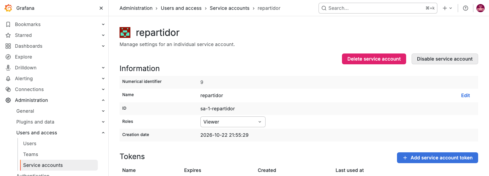

63. Repetir la consulta. Ahora la respuesta es 401.

```bash
curl -s -o /dev/null -w '%{http_code}\n' --cacert Capitulo7/trabajo/certs/ca.crt -H "Authorization: Bearer $(cat Capitulo7/trabajo/token-repartidor)" "https://localhost:3000/api/search?query=Tianguis"
```

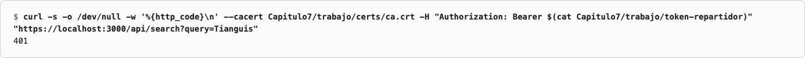

### Secretos en archivos

Hasta aquí las claves quedaron escritas en la pizarra, a la vista de quien lea la configuración.
Esos archivos se copian, se suben a git y se pegan en chats.
Ahora cada clave pasa a la caja fuerte, y la configuración solo dice dónde está.

64. Hasta aquí las claves quedaron escritas en `prometheus.yml`, en los datasources y en el compose. Crear un archivo por clave en `Capitulo7/trabajo/secretos`.

```bash
mkdir -p Capitulo7/trabajo/secretos
printf '%s' 'raspar-2026' > Capitulo7/trabajo/secretos/raspar
printf '%s' 'mirar-2026' > Capitulo7/trabajo/secretos/mirar
printf '%s' 'secreto-de-grafana-2026' > Capitulo7/trabajo/secretos/oauth_grafana
grep '^GRAFANA_ADMIN_PASSWORD=' infra/.env | cut -d= -f2- | tr -d '\r\n' > Capitulo7/trabajo/secretos/grafana_admin
chmod 644 Capitulo7/trabajo/secretos/*
ls -l Capitulo7/trabajo/secretos
```

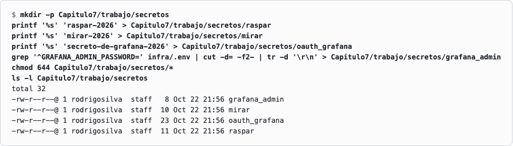

65. En `Capitulo7/trabajo/prometheus/prometheus.yml` cambiar cada línea `password: ...` por `password_file` con el archivo que corresponde. Así queda el job `node_exporter`.

```yaml
  - job_name: node_exporter
    scheme: https
    tls_config:
      ca_file: /etc/tls/ca.crt
    basic_auth:
      username: prometheus
      password_file: /run/secretos/raspar
    static_configs:
      - targets: ["node-exporter:9100"]
```

>**Nota.** Los jobs `prometheus` y `alertmanager` y la sección `alerting` usan `password_file: /run/secretos/mirar`.

Para no editar línea por línea, se puede reemplazar todo el contenido de `Capitulo7/trabajo/prometheus/prometheus.yml` por este, que ya trae los cuatro cambios.

```yaml
# Prometheus del stack gpe, versión de la Práctica 7 con TLS y autenticación.
# Es una copia de infra/prometheus/prometheus.yml. Cambian alerting y los jobs prometheus,
# node_exporter y alertmanager.
# El receptor OTLP y el almacenamiento de exemplars se activan por línea de comandos en
# infra/compose.yaml. La retención va en storage.tsdb.retention.

global:
  scrape_interval: 15s
  scrape_timeout: 10s
  evaluation_interval: 15s
  # Histogramas nativos. Desde Prometheus 3.9 se habilitan con esta opción
  # de configuración, ya no con un feature flag.
  scrape_native_histograms: true
  # Se conservan también los _bucket clásicos para poder comparar ambos.
  always_scrape_classic_histograms: true

storage:
  exemplars:
    max_exemplars: 100000
  tsdb:
    # Margen para muestras que llegan por OTLP con algo de retraso.
    out_of_order_time_window: 10m
    # Cuánto tiempo se guardan las muestras. Desde Prometheus 3.13 va aquí y no con el flag
    # --storage.tsdb.retention.time.
    retention:
      time: 7d

# Receptor OTLP nativo en /api/v1/otlp/v1/metrics. Por aquí llegan las métricas de pagos,
# que no tiene /metrics ni job de scrape.
otlp:
  # Cómo se traducen los nombres de OpenTelemetry. Este valor es el que trae por defecto:
  # cambia los puntos por guiones bajos y agrega los sufijos clásicos de unidad y de tipo.
  # payments.processed (counter) queda como payments_processed_total.
  translation_strategy: UnderscoreEscapingWithSuffixes
  # service.name y service.instance.id siempre se convierten en las etiquetas job e instance.
  # Si el recurso trae service.namespace, job queda como "namespace/nombre".
  # Estos otros atributos del recurso se copian además como etiquetas de cada serie.
  promote_resource_attributes:
    - service.name
    - service.namespace
    - service.instance.id
    - service.version
    - deployment.environment.name

rule_files:
  - /etc/prometheus/rules/*.yml
  - /etc/prometheus/rules/*.yaml

alerting:
  alertmanagers:
    # Prometheus le habla a Alertmanager por TLS y con clave.
    - scheme: https
      tls_config:
        ca_file: /etc/tls/ca.crt
      basic_auth:
        username: tianguis
        password_file: /run/secretos/mirar
      static_configs:
        - targets: ["alertmanager:9093"]

scrape_configs:
  - job_name: prometheus
    scheme: https
    tls_config:
      ca_file: /etc/tls/ca.crt
    basic_auth:
      username: tianguis
      password_file: /run/secretos/mirar
    static_configs:
      - targets: ["prometheus:9090"]

  - job_name: node_exporter
    scheme: https
    tls_config:
      ca_file: /etc/tls/ca.crt
    basic_auth:
      username: prometheus
      password_file: /run/secretos/raspar
    static_configs:
      - targets: ["node-exporter:9100"]

  - job_name: pushgateway
    honor_labels: true
    static_configs:
      - targets: ["pushgateway:9091"]

  - job_name: alertmanager
    scheme: https
    tls_config:
      ca_file: /etc/tls/ca.crt
    basic_auth:
      username: tianguis
      password_file: /run/secretos/mirar
    static_configs:
      - targets: ["alertmanager:9093"]

  - job_name: loki
    static_configs:
      - targets: ["loki:3100"]

  - job_name: tempo
    static_configs:
      - targets: ["tempo:3200"]

  - job_name: alloy
    static_configs:
      - targets: ["alloy:12345"]

  - job_name: otelcol
    static_configs:
      - targets: ["otelcol:8888"]

  # catalogo y pedidos corren en dos ambientes. El job se llama igual en los dos; lo que los
  # distingue es la etiqueta ambiente, que se pone aquí, a cada destino.
  # Nada más lleva esa etiqueta: pagos, conciliacion y la infraestructura existen una sola vez.
  - job_name: catalogo
    scrape_interval: 15s
    static_configs:
      - targets: ["catalogo:8000"]
        labels:
          ambiente: prod
      - targets: ["catalogo-dev:8000"]
        labels:
          ambiente: dev

  # pedidos expone la duración HTTP como histograma nativo y clásico a la vez.
  # Las dos opciones ya valen true en global; se repiten aquí para que se vea qué hace falta:
  #   scrape_native_histograms          ingiere la parte nativa (y negocia protobuf con el target)
  #   always_scrape_classic_histograms  conserva además las series _bucket clásicas
  - job_name: pedidos
    scrape_interval: 15s
    scrape_native_histograms: true
    always_scrape_classic_histograms: true
    static_configs:
      - targets: ["pedidos:8080"]
        labels:
          ambiente: prod
      - targets: ["pedidos-dev:8080"]
        labels:
          ambiente: dev
```

| Línea | Qué hace |
|---|---|
| `password_file: /run/secretos/raspar` | Prometheus lee la clave de node_exporter del archivo `raspar` en cada raspado |
| `password_file: /run/secretos/mirar` | Lo mismo para Prometheus y Alertmanager, con el archivo `mirar` |
| `/run/secretos` | Ruta dentro del contenedor, donde el compose del paso 67 monta la carpeta `secretos` |

>**Nota.** No hace falta saber programar. El resto del archivo es igual al que se copió en el paso 13 con los cambios de los pasos 14, 18, 23 y 32.

66. En `Capitulo7/trabajo/grafana/datasources/datasources.yaml` cambiar las dos líneas `basicAuthPassword: mirar-2026` por esta.

```yaml
      basicAuthPassword: $__file{/run/secretos/mirar}
```

67. Reemplazar todo el contenido de `compose.seguridad.yaml` por este. Prometheus y Grafana montan la carpeta de secretos, la clave de OAuth se lee con `__FILE` y lo mismo la clave de admin.

```yaml
# Capa de seguridad de la Práctica 7. Se suma al compose del stack con un segundo -f.
#
#   docker compose -p gpe --env-file infra/.env -f infra/compose.yaml \
#     -f Capitulo7/compose.seguridad.yaml up -d
#
# Las rutas son relativas a infra/, la carpeta del primer archivo, por eso empiezan con ../
# Lo que se escribe aquí reemplaza o se agrega a lo de infra/compose.yaml. Lo demás queda igual.
# Ninguna clave va escrita en este archivo: se leen de Capitulo7/trabajo/secretos.

services:
  node-exporter:
    command:
      - --web.config.file=/etc/node-exporter/web.yml
    volumes:
      - ../Capitulo7/trabajo/node-exporter:/etc/node-exporter:ro
      - ../Capitulo7/trabajo/certs:/etc/tls:ro
    healthcheck:
      # Sano si responde por TLS y pide clave. El 401 confirma las dos cosas.
      test: ["CMD", "sh", "-c", "wget -q -O /dev/null --no-check-certificate https://127.0.0.1:9100/ 2>&1 | grep -q 401"]

  prometheus:
    command:
      - --config.file=/etc/prometheus-seguridad/prometheus.yml
      - --web.config.file=/etc/prometheus-seguridad/web.yml
      - --storage.tsdb.path=/prometheus
      - --web.enable-otlp-receiver
      - --enable-feature=exemplar-storage
    volumes:
      - ../Capitulo7/trabajo/prometheus:/etc/prometheus-seguridad:ro
      - ../Capitulo7/trabajo/certs:/etc/tls:ro
      - ../Capitulo7/trabajo/secretos:/run/secretos:ro
    healthcheck:
      test: ["CMD", "sh", "-c", "wget -q -O /dev/null --no-check-certificate https://127.0.0.1:9090/-/ready 2>&1 | grep -q 401"]

  alertmanager:
    command:
      - --config.file=/etc/alertmanager/alertmanager.yml
      - --web.config.file=/etc/alertmanager-seguridad/web.yml
      - --storage.path=/alertmanager
      - --web.external-url=https://localhost:${PUERTO_ALERTMANAGER}
    volumes:
      - ../Capitulo7/trabajo/alertmanager:/etc/alertmanager-seguridad:ro
      - ../Capitulo7/trabajo/certs:/etc/tls:ro
    healthcheck:
      test: ["CMD", "sh", "-c", "wget -q -O /dev/null --no-check-certificate https://127.0.0.1:9093/-/ready 2>&1 | grep -q 401"]

  grafana:
    environment:
      # HTTPS con el certificado de la CA del curso.
      GF_SERVER_PROTOCOL: https
      GF_SERVER_CERT_FILE: /etc/tls/grafana.crt
      GF_SERVER_CERT_KEY: /etc/tls/grafana.key
      GF_SERVER_ROOT_URL: https://localhost:${PUERTO_GRAFANA}/
      # La clave de admin sale de un archivo. Solo cuenta la primera vez que arranca Grafana.
      # La variable sin __FILE viene del compose base y Grafana no acepta las dos: aquí se vacía.
      GF_SECURITY_ADMIN_PASSWORD: ""
      GF_SECURITY_ADMIN_PASSWORD__FILE: /run/secretos/grafana_admin
      # Login con Dex. El navegador va a localhost:5556 y Grafana pide el token por la red interna.
      GF_AUTH_GENERIC_OAUTH_ENABLED: "true"
      GF_AUTH_GENERIC_OAUTH_NAME: Dex
      GF_AUTH_GENERIC_OAUTH_CLIENT_ID: grafana
      GF_AUTH_GENERIC_OAUTH_CLIENT_SECRET__FILE: /run/secretos/oauth_grafana
      GF_AUTH_GENERIC_OAUTH_SCOPES: openid profile email
      GF_AUTH_GENERIC_OAUTH_AUTH_URL: http://localhost:5556/dex/auth
      GF_AUTH_GENERIC_OAUTH_TOKEN_URL: http://dex:5556/dex/token
      GF_AUTH_GENERIC_OAUTH_API_URL: http://dex:5556/dex/userinfo
      GF_AUTH_GENERIC_OAUTH_ALLOW_SIGN_UP: "true"
      # Ana entra como Editor. Cualquier otro usuario de Dex entra como Viewer.
      GF_AUTH_GENERIC_OAUTH_ROLE_ATTRIBUTE_PATH: "email == 'ana@tianguis.local' && 'Editor' || 'Viewer'"
    volumes:
      - ../Capitulo7/trabajo/certs:/etc/tls:ro
      - ../Capitulo7/trabajo/secretos:/run/secretos:ro
      - ../Capitulo7/trabajo/grafana/datasources:/etc/grafana/provisioning/datasources:ro
    healthcheck:
      test: ["CMD", "wget", "-q", "-O", "/dev/null", "--no-check-certificate", "https://127.0.0.1:3000/api/health"]

  dex:
    container_name: gpe-dex
    image: dexidp/dex:v2.45.1
    command: ["dex", "serve", "/etc/dex/config.yaml"]
    restart: unless-stopped
    volumes:
      - ../Capitulo7/trabajo/dex:/etc/dex:ro
    ports:
      - "127.0.0.1:5556:5556"
    healthcheck:
      test: ["CMD", "wget", "-q", "-O", "/dev/null", "http://127.0.0.1:5558/healthz"]
      interval: 10s
      timeout: 5s
      retries: 6
      start_period: 10s
    mem_limit: 64m
```

68. Aplicar la capa. Compose recrea solo los contenedores que cambiaron.

```bash
docker compose -p gpe --env-file infra/.env -f infra/compose.yaml -f Capitulo7/compose.seguridad.yaml up -d
```

69. Buscar claves en el compose. Solo quedan nombres de variables y rutas de archivos.

```bash
grep -n -i -E 'password|secret' Capitulo7/compose.seguridad.yaml
```

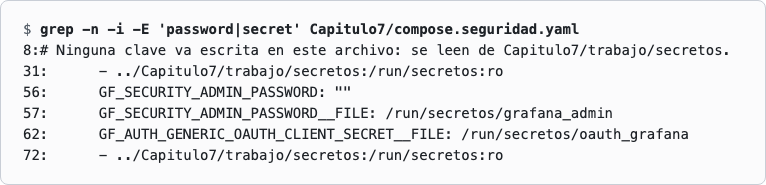

### La superficie otra vez

Con los guardias puestos se vuelve a recorrer el perímetro.
Las mismas pruebas del principio muestran qué cambió en cada puerta.
El resultado se compara con lo que se anotó al inicio.

70. Repetir las pruebas del principio contra los mismos puertos.

```bash
curl -s -o /dev/null -w 'node_exporter por http   %{http_code}\n' http://localhost:9100/metrics
curl -s -o /dev/null -w 'node_exporter sin clave  %{http_code}\n' --cacert Capitulo7/trabajo/certs/ca.crt https://localhost:9100/metrics
curl -s -o /dev/null -w 'configuración sin clave  %{http_code}\n' --cacert Capitulo7/trabajo/certs/ca.crt https://localhost:9090/api/v1/status/config
curl -s -o /dev/null -w 'destinos sin clave       %{http_code}\n' --cacert Capitulo7/trabajo/certs/ca.crt https://localhost:9090/api/v1/targets
```

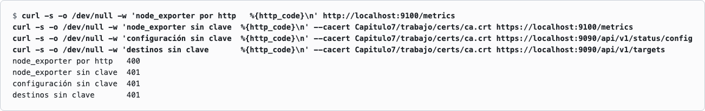

>**Nota.** Por http node_exporter responde 400, porque ahora solo habla TLS. Por https sin clave, 401 en todo.

### Verificar

El script recorre el mercado como lo haría un supervisor de seguridad.
Revisa las puertas, las credenciales y los permisos que se armaron en la práctica.

71. Esperar unos 30 segundos, para que Prometheus vuelva a raspar todos sus destinos después de recrearse, y ejecutar la verificación.

```bash
Capitulo7/verificar.sh
```

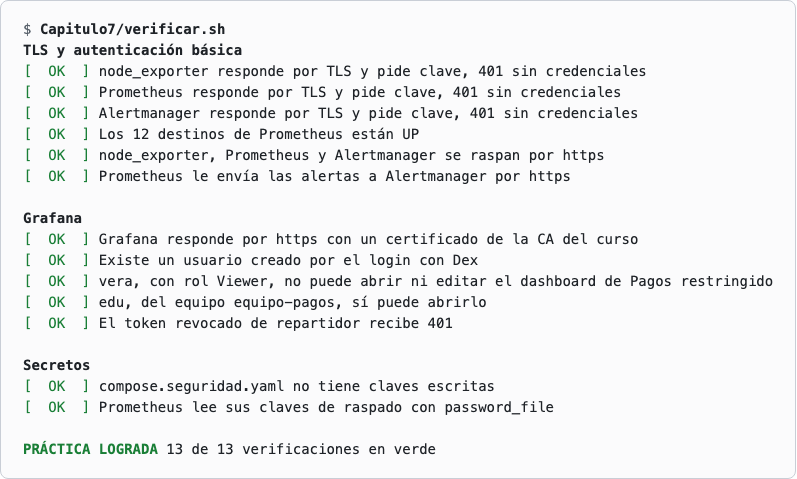

## Preguntas frecuentes

**¿Qué diferencia hay entre http y https?**
Con https la conexión va cifrada con TLS y el servidor presenta un certificado. Con http todo viaja en texto plano y cualquiera en el camino lo puede leer.

**¿Qué es un hash bcrypt y por qué no se guarda la clave tal cual?**
El hash es una transformación de la clave que no se puede revertir. El servidor calcula el hash de lo que llega y lo compara con el guardado, así que quien lea el archivo no obtiene la clave.

**¿Por qué la capa va en un archivo aparte y no se edita `infra/compose.yaml`?**
Compose suma los dos archivos y el segundo cambia solo lo que declara. Así la configuración de `infra` queda intacta y volver atrás es dejar de usar la capa.

**¿Qué hace `kill -HUP 1` en el contenedor de Prometheus?**
Le manda a Prometheus la señal HUP, que le pide releer `prometheus.yml` sin reiniciar el contenedor. Dentro del contenedor Prometheus es el proceso número 1.

**¿Qué es OAuth?**
Es un protocolo con el que una aplicación deja en manos de otra la tarea de identificar a las personas. Grafana manda al navegador a Dex, Dex pide la clave y después le confirma a Grafana quién entró.

**¿Qué diferencia hay entre un usuario y una cuenta de servicio?**
El usuario es una persona que entra por la interfaz. La cuenta de servicio es una identidad para scripts y herramientas, con su propio rol y sus tokens, que no depende de ninguna persona.

**¿Por qué el token se guarda en un archivo y no se escribe en el comando?**
Escrito en el comando queda en el historial de la terminal. Con `$(cat archivo)` la terminal lo lee del archivo en el momento de llamar a curl.

## Resultado esperado

node_exporter, Prometheus y Alertmanager hablan solo TLS y piden clave. Prometheus raspa y envía alertas por TLS con credenciales que lee de archivos. Grafana responde por HTTPS con un certificado de la CA del curso, acepta el login con Dex y separa lo que ve cada usuario con roles, un equipo y una carpeta restringida. El token de la cuenta de servicio quedó revocado y ninguna clave está escrita en el compose.

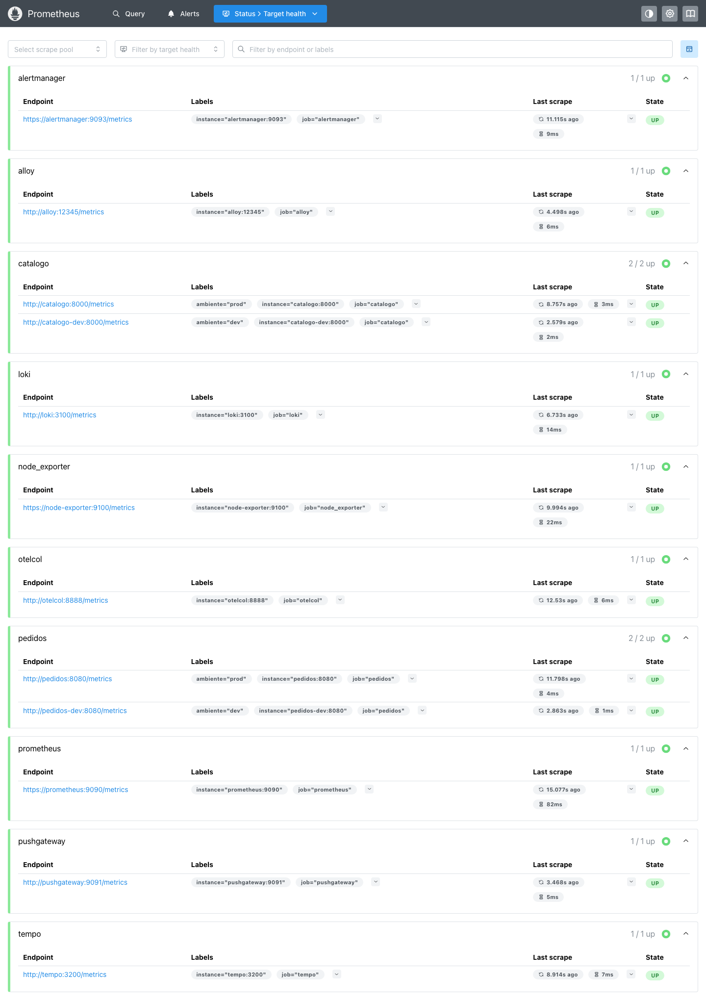

## Volver al stack base

72. La Práctica 8 necesita el stack sin la capa de seguridad. Ejecutar el siguiente script y escribir `SI`. Baja la capa, borra `Capitulo7/trabajo`, devuelve `compose.seguridad.yaml` a git y borra en Grafana los usuarios, el equipo, la carpeta y la cuenta de servicio de la práctica.

```bash
Capitulo7/restaurar.sh
```

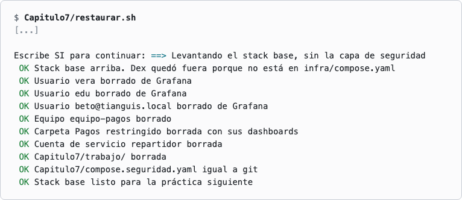

La carpeta `Capitulo7/solucion` trae `trabajo` y `compose.seguridad.yaml` resueltos, salvo las claves privadas y los hashes. `Capitulo7/solucion/generar.sh` los genera y deja todo listo para aplicar la capa con el comando de los pasos anteriores.

Para ver la práctica resuelta de una vez, `Capitulo7/solucion/aplicar.sh` corre `generar.sh`, aplica la capa, entra una vez con Dex y crea en Grafana los usuarios, el equipo, la carpeta y la cuenta de servicio con su token revocado. Avisa qué reemplaza y pide escribir SI.
<!--  -->
