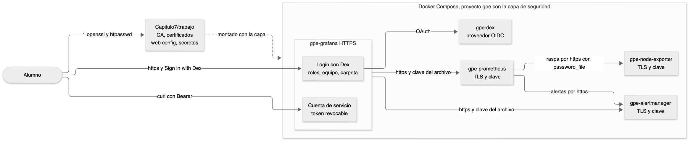

<!--  -->
# Guía del relator. Práctica 7. Red segura y certificados TLS para Prometheus y Grafana

Capítulo 7 del temario. Duración provisoria de 150 minutos.

La práctica tiene una idea. Un stack de observabilidad ve todo lo que pasa en la empresa, así que es un blanco. Protegerlo tiene tres capas que se suman. Cifrar el camino con TLS, pedir identidad con autenticación y limitar lo que cada identidad puede hacer con roles. Y las claves que sostienen todo eso no pueden quedar escritas donde cualquiera las lee.

## Diagrama



La fuente editable está en `images/7/diagrama.mmd` y se vuelve a dibujar con `tools/diagramas/render.sh 7`.

## Familia de analogías

Toda la práctica usa la seguridad del mercado. No mezclar con otras analogías.

| Concepto | En la seguridad del mercado |
|---|---|
| Superficie de exposición | Cuántas puertas tiene el mercado abiertas a la calle |
| TLS | El camión blindado entre la bodega y el banco |
| CA propia | La municipalidad que emite las credenciales de los guardias |
| Certificado | La credencial con foto del guardia |
| Autenticación básica | El guardia que pide nombre y clave en la puerta |
| OAuth con Dex | La credencial municipal que sirve para entrar a todos los edificios sin tener una clave en cada uno |
| Roles | Quién puede mirar el pizarrón y quién puede escribir en él |
| Cuenta de servicio y token | La llave que se le presta al camión repartidor, con su propio registro y que se puede anular sin cambiar las demás |
| Secretos en archivos | La clave guardada en la caja fuerte y no escrita en la pizarra |

## Reparto del tiempo

| Bloque | Minutos |
|---|---|
| Preparar y superficie de exposición | 15 |
| CA y certificados | 20 |
| node_exporter con TLS y la predicción de la CA | 20 |
| Prometheus y Alertmanager con TLS | 25 |
| Grafana en HTTPS y login con Dex | 25 |
| Roles, equipo y carpeta | 20 |
| Cuenta de servicio, secretos y verificar | 20 |
| Volver al stack base | 5 |

## Antes de la clase

- Correr `bin/up.sh` y dejar descargadas las imágenes `httpd:2.4.68-alpine` y `dexidp/dex:v2.45.1` con `docker pull`. La red de la sala puede ser lenta.
- Confirmar que `openssl version` responde en Git Bash. Viene con Git para Windows. En macOS sirve el de fábrica, que es LibreSSL, y el de Homebrew.
- El puerto 5556 tiene que estar libre en la máquina del alumno. Lo usa Dex.
- Si alguien ya hizo la práctica, correr `Capitulo7/restaurar.sh`.
- Tener a mano `Capitulo7/solucion/generar.sh`. Deja `trabajo` resuelto en segundos si un alumno se pierde con los certificados.
- Con la capa arriba, pagos y el OTel Collector no pueden empujar métricas a Prometheus, porque no tienen credenciales. Es esperado y sirve para la pregunta de los clientes que empujan.

---

## Paso 1. Superficie de exposición

**🎯 Problema.** Prometheus, node_exporter y Alertmanager vienen sin autenticación. Quien llegue a sus puertos ve la configuración completa, las direcciones internas y datos de la máquina, y puede silenciar alertas.

**👵 Analogía.** Cuántas puertas tiene el mercado abiertas a la calle. Antes de poner guardias hay que recorrer el perímetro y contar las puertas.

**🔮 Predicción.** Preguntar qué podría ver alguien de la red con solo abrir esas URL. La configuración entera con los nombres de todos los servicios, los destinos y sus errores, el nombre de la máquina, el kernel y los discos. Con Alertmanager abierto, además, podría crear silencios.

**💻 Comando.**

```bash
docker ps --filter label=com.docker.compose.project=gpe --format 'table {{.Names}}\t{{.Ports}}'
curl -s http://localhost:9100/metrics | grep -m 8 '^node_uname_info\|^node_os_info\|^node_filesystem_size_bytes'
```

| Parte | Qué es |
|---|---|
| `--filter label=com.docker.compose.project=gpe` | Solo los contenedores de este proyecto |
| `--format 'table {{.Names}}\t{{.Ports}}'` | Tabla con nombre y puertos publicados |
| `grep -m 8` | Corta en las primeras 8 coincidencias |

**⚙️ Técnico.** En este stack todos los puertos escuchan en 127.0.0.1, así que solo se llega desde la misma máquina. En un servidor real escucharían en todas las interfaces. Las interfaces de Prometheus y Alertmanager no tienen usuarios por defecto, y por eso existe el web config.

**📺 Salida.** 18 contenedores con sus puertos en 127.0.0.1. La configuración y los destinos de Prometheus sin pedir clave. `node_uname_info` con el nombre de la máquina y el kernel.

**⚠️ Fallas.**

| Qué se ve | Causa | Arreglo |
|---|---|---|
| `docker ps` sale vacío | El stack está abajo | `Capitulo7/preparar.sh` |
| `curl` falla con SSL | Quedó la capa de una corrida anterior | `Capitulo7/restaurar.sh` |

---

## Paso 2. CA propia y certificados

**🎯 Problema.** TLS necesita que cada servidor presente un certificado y que el cliente confíe en quien lo firmó. Comprar un certificado para nombres internos como `prometheus` no se puede.

**👵 Analogía.** La municipalidad que emite las credenciales de los guardias. La CA es la municipalidad y cada certificado es la credencial con foto de un guardia. Quien conoce el sello de la municipalidad puede revisar cualquier credencial.

**🔮 Predicción.** Antes del `openssl verify`, preguntar qué responde si se le da otra CA. Responde que no puede armar la cadena, `unable to get local issuer certificate`.

**💻 Comando.**

```bash
MSYS_NO_PATHCONV=1 openssl req -x509 -newkey rsa:2048 -nodes -days 365 -keyout ca.key -out ca.crt -subj "/CN=CA del Tianguis"
MSYS_NO_PATHCONV=1 openssl req -newkey rsa:2048 -nodes -keyout prometheus.key -out prometheus.csr -subj "/CN=prometheus"
openssl x509 -req -in prometheus.csr -CA ca.crt -CAkey ca.key -CAcreateserial -days 365 -extfile prometheus.ext -out prometheus.crt
```

| Parte | Qué es |
|---|---|
| `req -x509` | Crea un certificado firmado por sí mismo. Es la CA |
| `-newkey rsa:2048 -nodes` | Clave nueva de 2048 bits, sin contraseña |
| `-subj "/CN=..."` | Nombre del certificado |
| `MSYS_NO_PATHCONV=1` | Evita que Git Bash convierta `/CN=` en una ruta |
| `req` sin `-x509` | Crea una solicitud de firma, el `.csr` |
| `x509 -req -CA -CAkey` | La CA firma la solicitud |
| `-extfile` con `subjectAltName` | Los nombres para los que vale. Los clientes miran estos y no el CN |
| `-CAcreateserial` | Crea `ca.srl` con el número de serie |

**⚙️ Técnico.** Los clientes modernos ignoran el CN y validan contra `subjectAltName`. Por eso cada certificado lleva el nombre interno de Docker, que usa Prometheus, y `localhost`, que usa el navegador. Las claves se generan sin contraseña porque los servicios arrancan solos. Se usa `-extfile` y no `-addext` porque funciona igual en OpenSSL 3, en LibreSSL de macOS y en el openssl de Git Bash.

**📺 Salida.** `subject=CN=CA del Tianguis` con issuer igual al subject. Cuatro certificados con su clave. `prometheus.crt: OK` y la línea `DNS:prometheus, DNS:localhost, IP Address:127.0.0.1`.

**⚠️ Fallas.**

| Qué se ve | Causa | Arreglo |
|---|---|---|
| `Subject does not start with '/'` en Git Bash | Falta `MSYS_NO_PATHCONV=1` | Copiar el comando completo |
| `Can't open "/c/..."` en Git Bash | Con `MSYS_NO_PATHCONV=1` una ruta absoluta tampoco se convierte | Usar rutas relativas, como en la guía |
| `ca.key: No such file` | Se corrió el bucle sin crear la CA | Crear la CA primero |
| Un contenedor dice `permission denied` con la clave | Las claves quedaron con permiso 600 | `chmod 644 Capitulo7/trabajo/certs/*.key` |

---

## Paso 3. node_exporter con TLS y autenticación

**🎯 Problema.** node_exporter es el primer servidor que se protege. Hay que decidir cómo se presenta, quién puede entrar y cómo se entera Prometheus.

**👵 Analogía.** El guardia que pide nombre y clave en la puerta. Y el camión blindado que lleva la información de la bodega al banco, que solo abre la puerta si reconoce la credencial del otro lado.

**🔮 Predicción.** Preguntar qué pasa con el destino si Prometheus todavía no tiene la CA. Queda DOWN con un error x509, `certificate signed by unknown authority`. TLS funciona, pero Prometheus no confía en quien firmó.

**💻 Comando.**

```bash
docker run --rm httpd:2.4.68-alpine htpasswd -nbBC 10 prometheus raspar-2026
docker compose -p gpe --env-file infra/.env -f infra/compose.yaml -f Capitulo7/compose.seguridad.yaml up -d
docker exec gpe-prometheus kill -HUP 1
```

| Parte | Qué es |
|---|---|
| `docker run --rm httpd:2.4.68-alpine` | Corre `htpasswd` en un contenedor que se borra al terminar. Sin instalar nada y sin python |
| `htpasswd -nbBC 10` | Imprime en pantalla, clave en la línea de comandos, bcrypt, costo 10 |
| `web.yml` | Archivo de web config. Mismo formato en node_exporter, Prometheus y Alertmanager |
| `tls_server_config` | Certificado y clave del servidor |
| `basic_auth_users` | Usuario y hash bcrypt. Nunca la clave en texto |
| `-f infra/compose.yaml -f Capitulo7/compose.seguridad.yaml` | El segundo archivo se suma al primero |
| `--env-file infra/.env` | Los puertos y versiones del stack |
| `scheme`, `tls_config`, `basic_auth` | Lo que Prometheus necesita para raspar un destino protegido |

**⚙️ Técnico.** Compose combina los dos archivos. `command` y `healthcheck` del segundo reemplazan los del primero y `volumes` se suma. Las rutas del segundo archivo son relativas a `infra`, la carpeta del primero. El healthcheck de node_exporter pide la página por TLS y espera un 401. Así confirma que TLS y autenticación están activos sin poner la clave en el compose. Prometheus usa ahora su configuración de `trabajo`, porque el compose cambia `--config.file`.

**📺 Salida.** node_exporter DOWN con `x509: certificate signed by unknown authority`. Con `ca_file` y la recarga, UP en `https://node-exporter:9100/metrics`. curl sin clave 401, con clave 200.

**⚠️ Fallas.**

| Qué se ve | Causa | Arreglo |
|---|---|---|
| `the revocation status is unknown` en Git Bash de Windows | El curl de Git Bash revisa la revocación y la CA del curso no publica esa lista | `alias curl='curl --ssl-no-revoke'`, como dice la nota del paso 20 de la guía |
| El destino dice `server returned HTTP status 401` | La clave en `prometheus.yml` no coincide con el hash | Volver a calcular el hash y copiarlo entero |
| El destino dice `x509` con la CA puesta | Faltó recargar | `docker exec gpe-prometheus kill -HUP 1` |
| node_exporter queda unhealthy | Error en `web.yml`, casi siempre la sangría | `docker logs gpe-node-exporter` |
| `htpasswd` pide contraseña | Se escribió `-nBC` sin la b | Usar `-nbBC` |

---

## Paso 4. Prometheus y Alertmanager con TLS y autenticación

**🎯 Problema.** La interfaz y la API de Prometheus muestran todo y permiten consultar cualquier métrica. Alertmanager además deja crear silencios. Proteger solo a node_exporter deja abiertas las puertas grandes.

**👵 Analogía.** El guardia también en la puerta principal y en la sala de la central de avisos. Cada visita, incluido el propio Prometheus cuando se mira a sí mismo, muestra su credencial.

**🔮 Predicción.** Antes de recargar el datasource de Grafana, preguntar si Grafana va a seguir mostrando datos. Sí, porque el datasource de la capa tiene la URL https, el usuario, la clave y la CA.

**💻 Comando.**

```bash
curl -s -o /dev/null -w '%{http_code}\n' --cacert Capitulo7/trabajo/certs/ca.crt https://localhost:9090/api/v1/status/config
curl -s --cacert Capitulo7/trabajo/certs/ca.crt -u tianguis:mirar-2026 https://localhost:9090/api/v1/alertmanagers
```

| Parte | Qué es |
|---|---|
| `--web.config.file` | Activa el web config en Prometheus y Alertmanager |
| `--cacert` | curl valida el certificado con nuestra CA. Sin esto falla |
| `-u usuario:clave` | Autenticación básica |
| `alerting` con `scheme: https` | Cómo envía Prometheus las alertas a Alertmanager |
| `basicAuth` y `tlsAuthWithCACert` en el datasource | Credenciales y CA del datasource de Grafana |
| `$__file{/etc/tls/ca.crt}` | Grafana lee el contenido de ese archivo al aprovisionar |

**⚙️ Técnico.** Prometheus relee el web config en cada petición, sin recargar. El `prometheus.yml` sí necesita `kill -HUP`. El datasource de la capa se monta encima de la carpeta de datasources de `infra`, y al bajar la capa Grafana vuelve a aprovisionar los originales. Con TLS en Prometheus, pagos y el Collector, que empujan métricas por OTLP sin credenciales, reciben error. El relator lo usa para la pregunta de los clientes que empujan.

**📺 Salida.** 401 sin clave y 200 con clave. En el navegador, el aviso de certificado y después el pedido de usuario y clave. Los tres jobs en https. Explore con `up` en 1. `activeAlertmanagers` con `https://alertmanager:9093/api/v2/alerts`.

**⚠️ Fallas.**

| Qué se ve | Causa | Arreglo |
|---|---|---|
| Prometheus queda unhealthy | Error en `web.yml` o en `prometheus.yml` | `docker logs gpe-prometheus` |
| curl dice `SSL certificate problem` | Falta `--cacert` | Copiar el comando completo |
| Grafana dice `bad gateway` en Explore | El datasource sigue en http | Revisar que el compose monte la carpeta de datasources de trabajo |
| `activeAlertmanagers` vacío | Faltó recargar Prometheus | `docker exec gpe-prometheus kill -HUP 1` |

---

## Paso 5. Grafana en HTTPS y login con Dex

**🎯 Problema.** Grafana guarda sesiones y claves y es la puerta que usan las personas. Sin HTTPS la cookie de sesión viaja en claro. Y una clave distinta en cada herramienta termina escrita en un papel.

**👵 Analogía.** La credencial municipal que sirve para entrar a todos los edificios sin tener una clave en cada uno. Dex es la oficina que la emite. Grafana solo pregunta a esa oficina quién es la persona.

**🔮 Predicción.** Antes de entrar con Beto, preguntar con qué rol va a quedar. Viewer, porque la regla le da Editor solo a Ana.

**💻 Comando.**

```bash
openssl s_client -connect localhost:3000 -servername localhost -CAfile Capitulo7/trabajo/certs/ca.crt </dev/null 2>/dev/null | grep -E 'subject=|issuer=|Verify return code'
```

| Parte | Qué es |
|---|---|
| `GF_SERVER_PROTOCOL: https` y los archivos del certificado | Grafana sirve HTTPS |
| `GF_SERVER_ROOT_URL` | Dirección pública de Grafana. Dex devuelve a la persona ahí |
| `GF_AUTH_GENERIC_OAUTH_*` | Cliente OAuth genérico. URL de autorización, de token y de datos del usuario |
| `AUTH_URL` con localhost y `TOKEN_URL` con `dex` | El navegador va a Dex por localhost. Grafana le pide el token por la red de Docker |
| `ROLE_ATTRIBUTE_PATH` | Expresión JMESPath que decide el rol con los datos que manda Dex |
| `staticPasswords` en Dex | Usuarios de prueba. En una empresa Dex se conecta a LDAP, a GitHub o a otro proveedor |
| `s_client` | Abre una conexión TLS y muestra lo que presenta el servidor |

**⚙️ Técnico.** El flujo es el de código de autorización de OAuth 2.0 con OpenID Connect. Grafana manda al navegador a Dex, Dex pide la clave, vuelve a Grafana con un código y Grafana cambia ese código por un token llamando a Dex directo. Con `ALLOW_SIGN_UP` Grafana crea el usuario la primera vez. Dex guarda todo en memoria, así que reiniciarlo cierra las sesiones pero no borra usuarios, que salen de su archivo.

**📺 Salida.** `subject=CN=grafana`, `issuer=CN=CA del Tianguis` y `Verify return code: 0 (ok)`. La pantalla de login con **Sign in with Dex**. El perfil de Beto con Synced via Generic OAuth y rol Viewer. Beto en la lista de usuarios con el origen Generic OAuth.

**⚠️ Fallas.**

| Qué se ve | Causa | Arreglo |
|---|---|---|
| Grafana se reinicia sin parar | `GF_SECURITY_ADMIN_PASSWORD` y su `__FILE` juntos | La capa vacía la variable sin `__FILE`. Copiar el bloque de la guía |
| Dex dice `Invalid redirect URI` | En `redirectURIs` quedó un puerto distinto al de Grafana en `infra/.env` | Poner ese puerto en la configuración de Dex y reiniciarlo con `docker restart gpe-dex` |
| Grafana dice `login.OAuthLogin(NewTransportWithCode)` | Grafana no llega a Dex por la red interna | Revisar que Dex esté healthy y que `TOKEN_URL` use `dex:5556` |
| Dex dice `Invalid Email Address and password` | Clave mal escrita o hash de otra clave | Revisar el hash en la configuración de Dex |

---

## Paso 6. Roles, equipo y carpeta restringida

**🎯 Problema.** Con todos como Admin cualquiera borra un dashboard ajeno. Con todos como Viewer nadie puede trabajar. Hace falta dar a cada grupo lo justo, y solo en lo suyo.

**👵 Analogía.** Quién puede mirar el pizarrón y quién puede escribir en él. Y una vitrina con llave que solo abre el equipo de pagos.

**🔮 Predicción.** Antes de entrar como Vera, preguntar si va a ver la carpeta. No. Se le quitó el permiso al rol Viewer y Vera no está en el equipo.

**💻 Comando.** **Administration**, **Users and access**, **Users**, **Teams**. **Dashboards**, **New folder**, **Folder actions**, **Manage permissions**.

| Parte | Qué es |
|---|---|
| Viewer, Editor, Admin | Roles de la organización. Valen en todo Grafana |
| Equipo | Grupo de usuarios para dar permisos de una vez |
| Permisos de carpeta | View, Edit o Admin para un rol, un equipo o un usuario |
| Quitar Editor y Viewer | La carpeta deja de heredar el permiso por rol |

**⚙️ Técnico.** Un usuario recibe el mayor permiso que le dé cualquier camino, su rol, su equipo o un permiso directo. Edu es Editor en la organización, pero sin el equipo tampoco vería la carpeta, porque se le quitó el permiso al rol Editor. Los dashboards heredan los permisos de su carpeta. `verificar.sh` prueba con las credenciales de Vera que no puede abrir ni guardar el dashboard.

**📺 Salida.** Vera Viewer y Edu Editor en Organization users. El equipo con Edu. La carpeta con Admin y equipo-pagos con Edit. Vera no ve la carpeta. Edu la ve con Host · USE.

**⚠️ Fallas.**

| Qué se ve | Causa | Arreglo |
|---|---|---|
| Vera ve la carpeta | Quedó el permiso del rol Viewer | Quitarlo en **Manage permissions** |
| Edu no ve la carpeta | Falta en el equipo o el permiso es para otro equipo | Revisar los miembros y el permiso |
| El selector de **Add member** no abre | Se hizo clic mientras el panel aparecía | Esperar un segundo y volver a hacer clic |

---

## Paso 7. Cuenta de servicio y token

**🎯 Problema.** Los scripts y otras herramientas también llaman a Grafana. Si usan la clave de una persona, cuando esa persona se va todo se rompe, y no se sabe qué hizo el script y qué hizo la persona.

**👵 Analogía.** La llave que se le presta al camión repartidor, con su propio registro y que se puede anular sin cambiar las demás.

**🔮 Predicción.** Antes del primer curl, preguntar si el token va a ver la carpeta restringida. No. La cuenta de servicio tiene rol Viewer y la carpeta solo es para el equipo.

**💻 Comando.**

```bash
curl -s --cacert Capitulo7/trabajo/certs/ca.crt -H "Authorization: Bearer $(cat Capitulo7/trabajo/token-repartidor)" "https://localhost:3000/api/search?query=Tianguis"
```

| Parte | Qué es |
|---|---|
| Service account | Identidad sin persona, con su rol |
| Token `glsa_` | Credencial de la cuenta. Grafana la muestra una sola vez |
| `Authorization: Bearer` | Cabecera con la que se presenta el token |
| `$(cat archivo)` | Lee el token del archivo, así no queda en el historial |

**⚙️ Técnico.** Grafana guarda solo un hash del token. Por eso no lo puede volver a mostrar. Al borrarlo deja de valer al instante, sin tocar la cuenta ni otros tokens. Los tokens pueden tener vencimiento y conviene ponerlo.

**📺 Salida.** JSON con los dashboards Tianguis que ve un Viewer. Después de borrar el token, 401.

**⚠️ Fallas.**

| Qué se ve | Causa | Arreglo |
|---|---|---|
| 401 con el token recién creado | Se copió incompleto o con un salto de línea de más | Generar otro y pegarlo entero |
| Respuesta vacía `[]` | No hay dashboards con Tianguis visibles para Viewer | Es correcto si no se hicieron las prácticas anteriores |
| verificar dice que el token funciona | Se cerró el diálogo sin borrar | Borrar el token en la cuenta de servicio |

---

## Paso 8. Secretos en archivos y la superficie otra vez

**🎯 Problema.** Las claves quedaron escritas en `prometheus.yml`, en los datasources y en el compose. Esos archivos se copian, se suben a git y se pegan en chats.

**👵 Analogía.** La clave guardada en la caja fuerte y no escrita en la pizarra. La configuración dice dónde está la caja fuerte, nunca la clave.

**🔮 Predicción.** Antes del último bloque de curl, preguntar qué responde node_exporter por http. 400, `Client sent an HTTP request to an HTTPS server`. Ya no habla sin TLS.

**💻 Comando.**

```bash
grep -n -i -E 'password|secret' Capitulo7/compose.seguridad.yaml
Capitulo7/verificar.sh
Capitulo7/restaurar.sh
```

| Parte | Qué es |
|---|---|
| `password_file` | Prometheus lee la clave de un archivo en cada raspado |
| `__FILE` | Cualquier variable `GF_` de Grafana lee su valor de un archivo |
| `$__file{ruta}` | Lo mismo dentro de los archivos de aprovisionamiento |
| `GF_SECURITY_ADMIN_PASSWORD: ""` | Vacía la variable del compose base, porque Grafana no acepta las dos |

**⚙️ Técnico.** La clave de admin solo cuenta la primera vez que Grafana crea su base. Después se cambia en la interfaz o con `grafana cli admin reset-admin-password`. En Docker Swarm y Kubernetes los archivos de secretos los monta la plataforma desde un almacén cifrado. Aquí son archivos de `trabajo`, que git ignora. `restaurar.sh` levanta el stack base, borra `trabajo`, devuelve el compose a git y borra en Grafana lo que creó la práctica.

**📺 Salida.** El grep muestra solo nombres de variables y rutas. 400 por http y 401 por https sin clave. `PRÁCTICA LOGRADA` con 13 verificaciones. Después de `restaurar.sh`, los 18 servicios en healthy y Dex fuera.

**⚠️ Fallas.**

| Qué se ve | Causa | Arreglo |
|---|---|---|
| Un destino DOWN con 401 después de los secretos | El archivo de la clave tiene un salto de línea | Crearlo con `printf '%s'`, que no agrega salto |
| Grafana dice `failed to read file` | Falta montar la carpeta de secretos | Copiar el compose completo de la guía |
| verificar da rojo en los destinos | Se corrió apenas aplicada la capa | Esperar 30 segundos y repetir |

---

## ❓ Preguntas del alumno

Son preguntas de un alumno de nivel intermedio, que maneja la terminal y Docker básico pero no conoce Prometheus ni Grafana.

**¿Qué es un certificado?**
Es un archivo que dice quién es un servidor y que lleva la firma de una CA. El cliente revisa esa firma con el certificado de la CA y, si la reconoce, confía en el servidor. En la práctica la CA es `ca.crt` y cada componente tiene su `.crt` y su `.key`.

**¿Qué es un puerto y por qué cada servicio tiene uno?**
Es el número con el que la máquina sabe a qué programa entregar una conexión. Grafana escucha en el 3000, Prometheus en el 9090, Alertmanager en el 9093 y node_exporter en el 9100. Docker publica esos puertos de los contenedores en la máquina, y `docker ps` los muestra.

**¿Qué es un contenedor?**
Es un programa que corre aislado, con sus propios archivos, a partir de una imagen. Cada servicio del stack es un contenedor. `docker run --rm` levanta uno de paso, como el de `htpasswd`, y lo borra al terminar.

**¿Por qué el navegador avisa que el sitio no es seguro?**
El navegador solo confía en las CA que trae instaladas, y la CA del Tianguis se creó en la práctica. La conexión igual va cifrada. En una empresa la CA interna se instala en los equipos y el aviso desaparece.

**¿Qué diferencia hay entre TLS y la autenticación básica?**
TLS cifra el camino y muestra quién es el servidor. La autenticación básica pide usuario y clave a quien llega. Se usan juntas, porque sin TLS la clave viajaría a la vista y sin autenticación la puerta quedaría abierta.

**¿Y si en vez de autenticación básica quiero certificados de cliente?**
El web config acepta `client_auth_type: RequireAndVerifyClientCert` y `client_ca_file`. Prometheus presenta su certificado con `cert_file` y `key_file` en `tls_config`. Es TLS mutuo y no hace falta clave.

**¿Por qué no un certificado de Let's Encrypt?**
Let's Encrypt firma nombres de dominio públicos que puede comprobar. `prometheus` o `node-exporter` solo existen dentro de la red de Docker. Para nombres internos se usa una CA propia, como en las empresas.

**¿Cómo se conecta Grafana a LDAP o a Active Directory?**
Con `[auth.ldap]` y un archivo `ldap.toml` con el servidor, la búsqueda del usuario y el mapeo de grupos a roles. Grafana consulta el directorio en cada login. Dex también puede usar LDAP como origen y dejar a Grafana con OAuth.

**¿Y SAML?**
SAML es otro protocolo de inicio de sesión único, común en empresas con un proveedor de identidad como ADFS u Okta. En Grafana está en la edición Enterprise y en Grafana Cloud. OAuth con OpenID Connect resuelve lo mismo y viene en la edición libre.

**¿Qué pasa con pagos mientras la capa está arriba?**
pagos y el OTel Collector empujan métricas a Prometheus por OTLP y no tienen credenciales, así que reciben error. En producción cada cliente que empuja lleva su usuario y la CA, igual que Grafana.

**¿Puedo limitar qué métricas ve cada usuario de Prometheus?**
No. La autenticación de Prometheus es todo o nada. Para separar datos por equipo se usa Grafana con permisos por carpeta o una base multiusuario como Mimir.

**¿El token de la cuenta de servicio expira?**
Solo si se le pone vencimiento al crearlo. Sin vencimiento vale hasta que alguien lo borra, por eso conviene ponerlo siempre.

**¿Por qué el hash con docker run y no con python?**
Porque tiene que funcionar igual en macOS y en Windows sin instalar nada. Docker ya está, y la imagen de httpd trae `htpasswd`. La versión queda fijada para que el resultado no cambie.
<!--  -->
