<!--  -->
# Práctica 8. Implementación de Loki y Alloy con microservicios

En esta práctica se trabaja el camino de los logs de Tianguis. Se lee la configuración de Loki y se recorre Alloy, después se le agrega a Alloy un pipeline que descarta, parsea, pone etiquetas y deja metadatos sin crear streams de más. También se convierte una configuración de Promtail, se envía un log por OTLP, se practica LogQL y se arma una alerta sobre logs con el ruler de Loki.

## Objetivos
- Reconocer el modo de despliegue, el almacenamiento, la retención y los límites de Loki.
- Recorrer el grafo de componentes de Alloy.
- Escribir un pipeline de Alloy que descarte líneas, lea JSON, ponga etiquetas y guarde metadatos estructurados.
- Medir el efecto de las etiquetas en la cantidad de streams.
- Convertir una configuración de Promtail a Alloy.
- Enviar logs a Loki por OTLP.
- Consultar logs con filtros, parsers, formato y consultas de métrica en LogQL.
- Crear una alerta sobre logs en el ruler de Loki y verla llegar y resolverse.

## El problema y la solución

En una oficina de correos de mercado llegan cartas todo el día.
Si se apilan sin orden, encontrar una sola carta obliga a revisar la pila completa.
Si además nadie tira la propaganda, la pila crece con papeles que nadie va a leer.
Y cuando llega una ola de reclamos, nadie se entera hasta que alguien revisa la pila por casualidad.

Con los logs de una aplicación pasa lo mismo.
Cada línea de log es una carta y Loki es la sala de casilleros donde se guardan.
Alloy es la mesa del cartero, donde las cartas se ordenan antes de entrar a la sala.
En esa mesa se decide qué se tira, qué se escribe en la puerta del casillero y qué queda anotado solo en el sobre.

Con las cartas guardadas, LogQL permite abrir casilleros y leer o contar lo que hay adentro.
El ruler de Loki hace de encargado que cuenta las cartas de reclamo cada minuto y avisa cuando son muchas.

En el NOC esto sirve cuando llega una alerta que nace de los logs y no de una métrica, y hay que encontrar en los logs qué servicio falla, con qué error y desde cuándo.
También ayuda a diagnosticar por qué los logs de un servicio dejaron de llegar a Grafana.

## Duración aproximada
- 150 minutos.

---
<div style="width: 400px;">
        <table width="50%">
            <tr>
                <td style="text-align: center;">
                    <a href="../Capitulo7/"></a>
                    <br>anterior
                </td>
                <td style="text-align: center;">
                   <a href="../README.md">Lista Laboratorios</a>
                </td>
<td style="text-align: center;">
                    <a href="../Capitulo9/">
                    </a>
                    <br>siguiente
                </td>
            </tr>
        </table>
</div>

---

## Diagrama


<br>

## Instrucciones

### Preparar el punto de partida

Antes de ordenar cartas hace falta una oficina abierta y con correspondencia llegando.
El script deja el stack en un estado conocido para que todos partan del mismo lugar.

1. Abrir una terminal en la carpeta del repositorio. En Windows usar Git Bash.

2. Dejar el stack en el punto de partida. El script levanta el stack base, sin la capa de seguridad de la Práctica 7, y enciende una falla en catalogo para que el 15 % de sus respuestas sean errores durante 60 minutos.

```bash
Capitulo8/preparar.sh
```

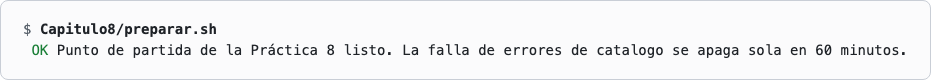

### Arquitectura de Loki

Antes de mandar cartas a la sala de casilleros se revisa cómo está construida.
Cuánto tiempo guarda las cartas y cuántos casilleros admite por cliente son límites que pesan en todo lo que viene después.

3. Leer la configuración de Loki del stack.

```bash
cat infra/loki/loki.yaml
```

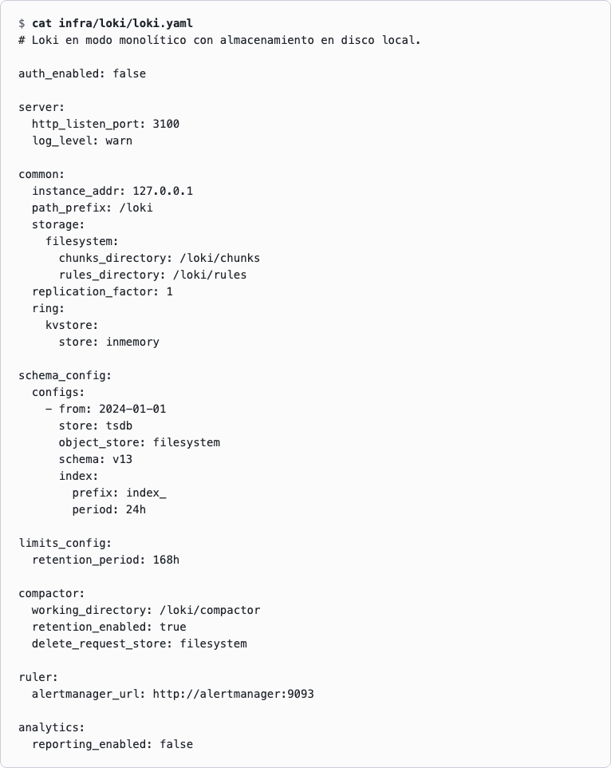

>**Nota.** Loki corre en modo monolítico, con todos sus componentes en un solo proceso. Guarda los chunks y el índice TSDB en disco local, con el esquema v13. La retención es de 168 horas y la aplica el compactor.

4. Pedirle a Loki la configuración completa con la que está corriendo y buscar algunos valores.

```bash
curl -s http://localhost:3100/config | grep -E '^target:|retention_period:|ingestion_rate_mb:|max_global_streams_per_user:|allow_structured_metadata:|otlp_config:'
```

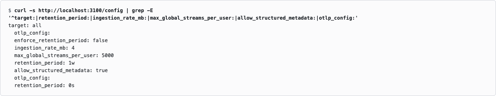

>**Nota.** `target: all` es el modo monolítico. `ingestion_rate_mb` y `max_global_streams_per_user` son límites por tenant. `allow_structured_metadata` en true deja guardar metadatos que no son etiquetas.

### La interfaz de Alloy

Alloy es la mesa del cartero.
Su interfaz muestra las bandejas por las que pasa cada carta y en qué orden.
Así se sabe dónde agregar un paso nuevo.

5. Abrir Alloy en `http://localhost:12345` y elegir **Graph**. El pipeline actual tiene cuatro componentes en fila.

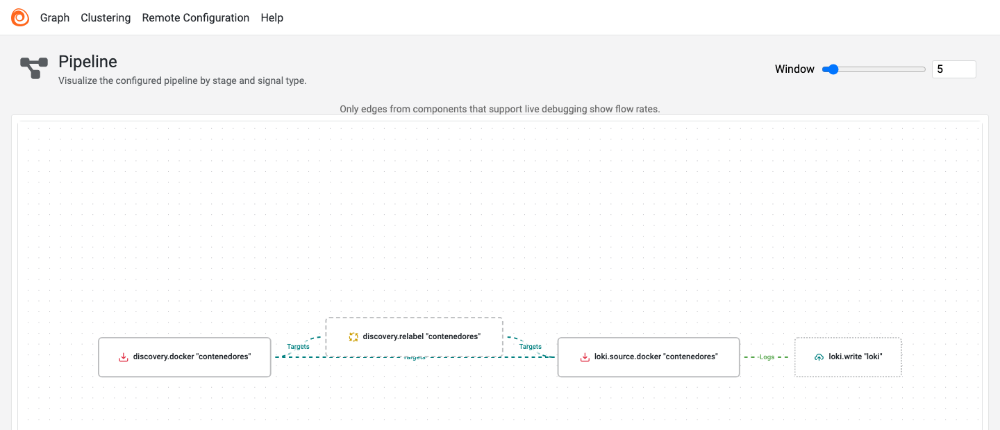

6. Hacer clic en `loki.source.docker.contenedores`. Alloy muestra sus argumentos, su estado y a qué componente le entrega las líneas.

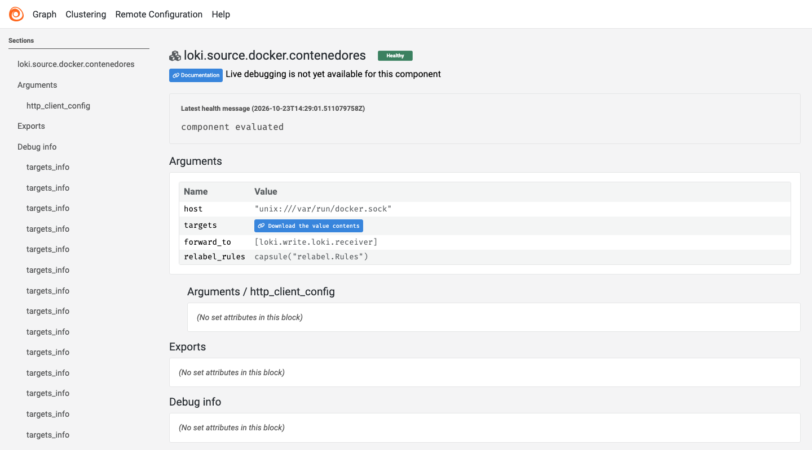

### El pipeline de Alloy

En esta parte se arma la mesa del cartero con varias etapas en orden.
Lo que se escribe en la puerta del casillero decide en qué casillero queda cada carta, por eso cada etiqueta se elige con cuidado.
Lo que solo sirve para buscar una carta puntual queda escrito en el sobre.

7. Contar los streams que recibieron líneas en los últimos 2 minutos.

```bash
ahora=$(date +%s)
curl -s -G http://localhost:3100/loki/api/v1/series --data-urlencode 'match[]={compose_service=~".+"}' --data-urlencode "start=$((ahora - 120))000000000" | grep -o '"compose_service":"[^"]*"' | wc -l
```


8. Antes de seguir, anotar una predicción. ¿Qué le pasaría a Loki si `trace_id` fuera una etiqueta? Recordar lo que pasó con la ráfaga de skus en la Práctica 3. Para pensarla sirve el Capítulo 8, sección 8.4 de la presentación del curso, que trata las etiquetas y los metadatos estructurados de Loki.

9. Abrir `infra/alloy/config.alloy`. En el bloque `loki.source.docker "contenedores"` cambiar `forward_to` para que entregue las líneas al pipeline nuevo.

```alloy
	forward_to    = [loki.process.tianguis.receiver]
```

Esa línea reemplaza a la que hoy apunta a `loki.write.loki.receiver`. Así las líneas de los contenedores pasan primero por el pipeline `tianguis` del paso siguiente y recién después van a Loki.

10. Agregar este bloque antes de `loki.write "loki"`.

```alloy
// Práctica 8. La mesa del cartero. Cada línea pasa por estas etapas en orden antes de ir a Loki.
loki.process "tianguis" {
	// 1. Descarta las líneas de healthcheck que todavía lleguen. Los servicios ya no las
	// escriben, pero una imagen nueva podría hacerlo. El motivo queda en la métrica
	// loki_process_dropped_lines_total.
	stage.drop {
		expression          = ".*\"route\": ?\"/(salud|metrics)\".*"
		drop_counter_reason = "healthcheck"
	}

	// 2. Lee el JSON de los servicios. Las líneas que no son JSON pasan igual, sin estos campos.
	stage.json {
		expressions = {
			level    = "level",
			trace_id = "trace_id",
		}
	}

	// 3. level sube como etiqueta. Tiene pocos valores, así que agrega pocos streams.
	stage.labels {
		values = {
			level = "",
		}
	}

	// 4. trace_id queda como metadato estructurado. Se puede filtrar por él, pero no crea streams.
	stage.structured_metadata {
		values = {
			trace_id = "",
		}
	}

	forward_to = [loki.write.loki.receiver]
}
```

| Línea | Qué hace |
|---|---|
| `loki.process "tianguis" {` | Crea un componente de Alloy que procesa líneas de log. Se llama `tianguis` y su entrada es `loki.process.tianguis.receiver` |
| `stage.drop { ... }` | Descarta las líneas que calzan con `expression` |
| `expression = ...` | Expresión regular que reconoce las líneas cuya ruta es `/salud` o `/metrics` |
| `drop_counter_reason = "healthcheck"` | Motivo con que se cuenta cada línea descartada en `loki_process_dropped_lines_total` |
| `stage.json { expressions = { ... } }` | Lee la línea como JSON y saca los campos `level` y `trace_id` para las etapas siguientes |
| `stage.labels { values = { level = "" } }` | Convierte `level` en etiqueta del stream. El `""` significa usar el campo con el mismo nombre |
| `stage.structured_metadata { values = { trace_id = "" } }` | Guarda `trace_id` junto a la línea como metadato estructurado, sin convertirlo en etiqueta |
| `forward_to = [loki.write.loki.receiver]` | Entrega las líneas ya procesadas al componente que las escribe en Loki |
| Líneas que empiezan con `//` | Comentarios. Alloy no las ejecuta |

>**Nota.** No hace falta saber programar para estos pasos. Basta con copiar los bloques en el lugar indicado y respetar las llaves. Si algo queda mal, el paso 11 lo detecta antes de recargar. Cada etapa está descrita en la documentación de [loki.process](https://grafana.com/docs/alloy/latest/reference/components/loki/loki.process/).

11. Validar la configuración dentro del contenedor de Alloy y recargarla sin reiniciar nada.

```bash
MSYS_NO_PATHCONV=1 docker exec gpe-alloy alloy validate /etc/alloy/config.alloy && echo "configuración válida"
curl -s -w '%{http_code}\n' -X POST http://localhost:12345/-/reload
```

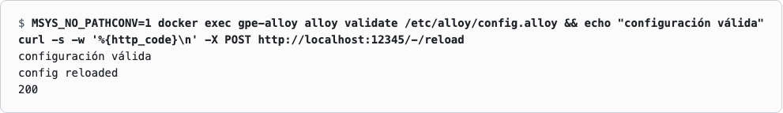

12. Volver a **Graph** en Alloy. Aparece `loki.process.tianguis` entre la fuente y el envío a Loki.

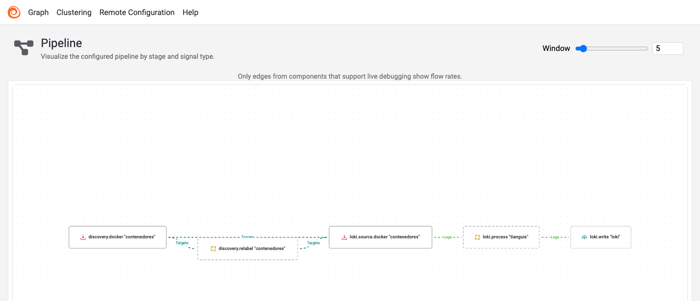

13. Escribir en la salida de catalogo una línea de healthcheck de prueba y ver la métrica de líneas descartadas de Alloy.

```bash
docker exec gpe-catalogo sh -c 'echo "{\"level\": \"info\", \"service\": \"catalogo\", \"route\": \"/salud\", \"status\": 200, \"msg\": \"healthcheck de prueba\"}" > /proc/1/fd/1'
curl -s http://localhost:12345/metrics | grep 'loki_process_dropped_lines_total{'
```

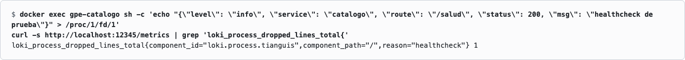

>**Nota.** `/proc/1/fd/1` es la salida del proceso principal del contenedor, la misma que lee Docker. La línea entra a Alloy como cualquier otra y `stage.drop` la descarta antes de Loki.

14. Esperar 2 minutos y pedir las etiquetas que conoce Loki. Aparece `level` y no aparece `trace_id`.

```bash
curl -s http://localhost:3100/loki/api/v1/labels
```

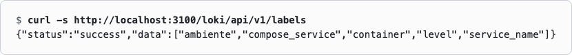

15. Volver a contar los streams con el comando del paso 7.

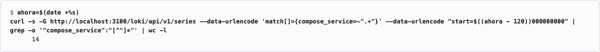

>**Nota.** Los streams suben un poco por `level`, porque cada servicio separa ahora sus líneas info, warning y error. `trace_id` no suma ninguno. Si fuera etiqueta, pagos tendría un stream por cada traza, decenas por minuto y sin límite.

16. En Grafana abrir **Explore**, elegir **Loki**, cambiar a **Code** y ejecutar esta consulta. Abrir una línea. `trace_id` aparece entre los campos aunque la consulta no usa `json`.

```logql
{compose_service="pagos"} | trace_id != ""
```

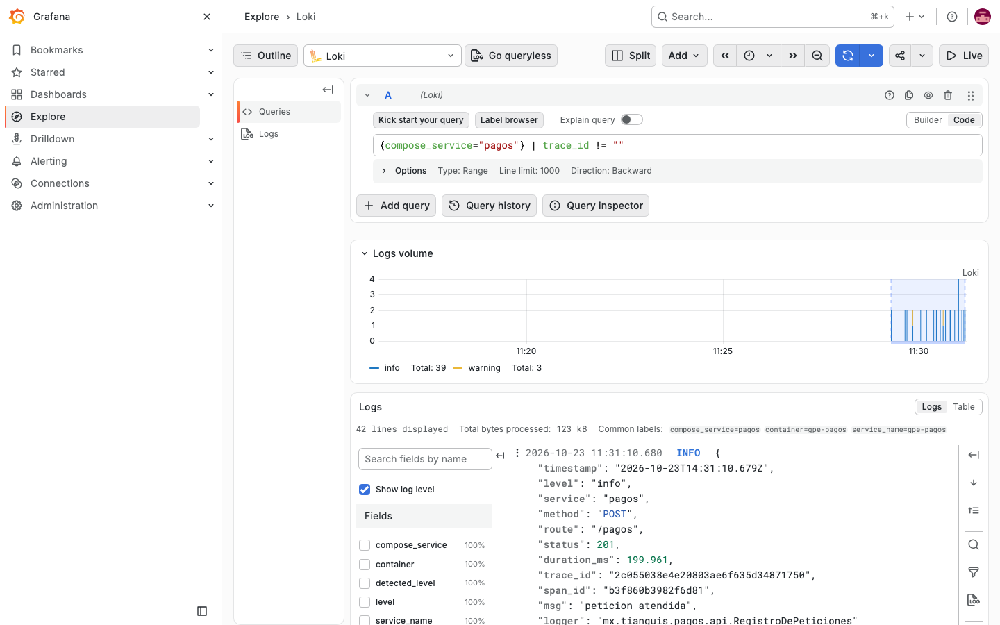

### Migración desde Promtail

Promtail era el cartero anterior y muchas oficinas todavía usan su planilla.
`alloy convert` pasa esa planilla al formato nuevo sin reescribirla a mano.

17. Convertir a Alloy la configuración de Promtail de ejemplo que trae la práctica. `alloy convert` corre dentro del contenedor y lee el archivo por la entrada estándar.

```bash
MSYS_NO_PATHCONV=1 docker exec -i gpe-alloy alloy convert --source-format=promtail --output=/dev/stdout /dev/stdin < Capitulo8/promtail-ejemplo.yaml
```

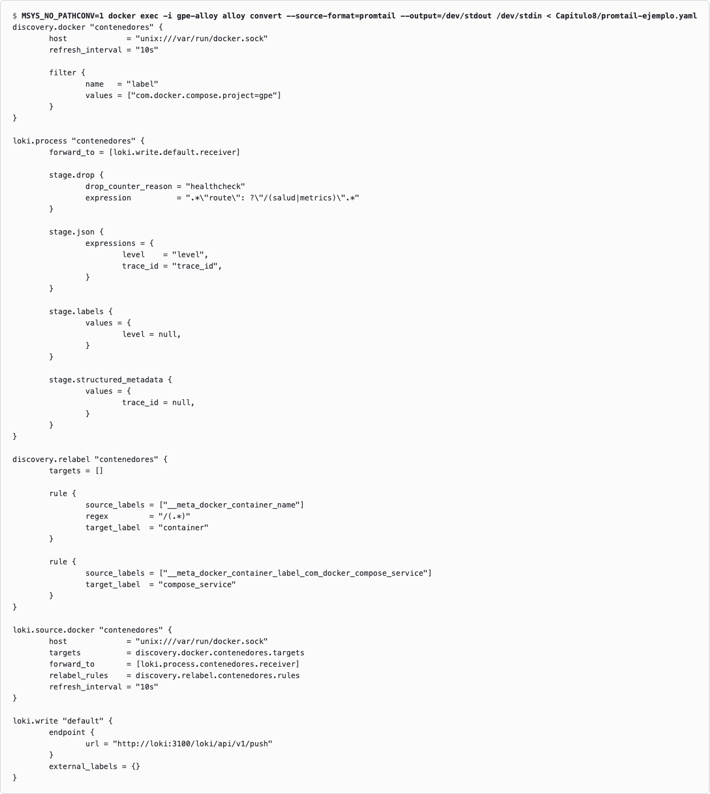

18. Comparar el resultado con `infra/alloy/config.alloy`. Las etapas de `pipeline_stages` de Promtail quedaron como un `loki.process` con las mismas etapas.

### Ingesta por OTLP

No todas las cartas pasan por la mesa del cartero.
Algunas llegan por courier con un formulario estándar ya lleno, y eso es OTLP.
Se envía una de esas cartas directo a la sala para ver cómo queda guardada.

19. Enviar una línea de log a Loki en OTLP HTTP con JSON. Es un aviso del refrigerador del pasillo 3.

```bash
curl -s -o /dev/null -w '%{http_code}\n' -X POST http://localhost:3100/otlp/v1/logs \
  -H 'Content-Type: application/json' \
  -d '{"resourceLogs":[{"resource":{"attributes":[{"key":"service.name","value":{"stringValue":"refrigerador"}}]},"scopeLogs":[{"logRecords":[{"timeUnixNano":"'"$(date +%s)"'000000000","severityText":"WARN","body":{"stringValue":"la puerta del refrigerador qued\u00f3 abierta"},"attributes":[{"key":"pasillo","value":{"stringValue":"3"}},{"key":"temperatura","value":{"doubleValue":9.5}}]}]}]}]}'
```

>**Nota.** En el JSON la tilde de quedó va como `\u00f3`. Loki guarda `quedó` igual. Así el comando funciona también en Git Bash de Windows, donde curl no recibe bien las tildes escritas en la línea de comandos.

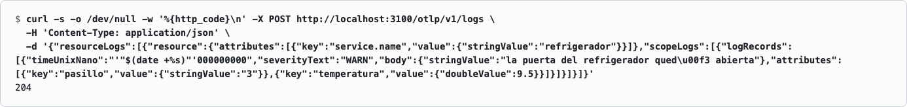

20. En Explore ejecutar `{service_name="refrigerador"}` y abrir la línea.

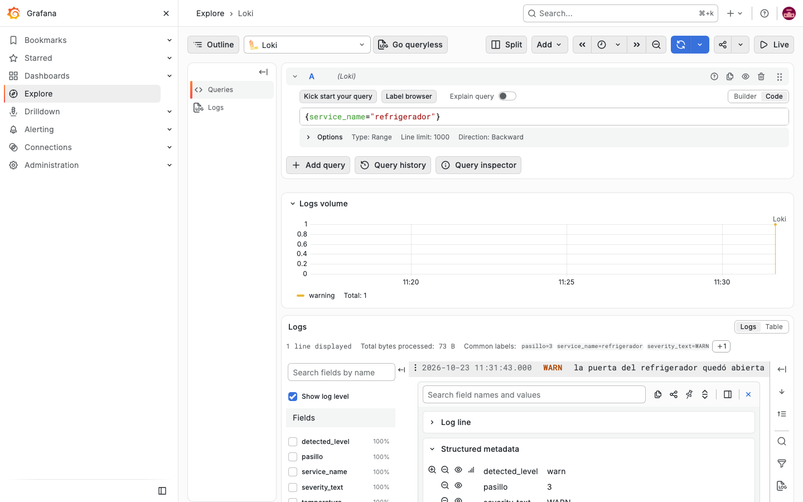

>**Nota.** `service.name` se convirtió en la etiqueta `service_name`. `pasillo`, `temperatura` y la severidad quedaron como metadatos estructurados.

### LogQL

Con las cartas guardadas toca encontrarlas.
LogQL elige casilleros por lo que dice su puerta y después filtra, da formato o cuenta las cartas de adentro.

21. Abrir `Capitulo8/consultas.md`. Para cada pregunta escribir la consulta en Explore, ejecutarla y, cuando devuelva datos, copiarla en su bloque.

Cada pregunta nombra la pieza de LogQL que pide. Esas piezas se explican en el Capítulo 8, sección 8.5 de la presentación del curso. En la documentación de Loki están los filtros de línea, el parser `json` y los filtros por campo en [Log queries](https://grafana.com/docs/loki/latest/query/log_queries/), `line_format` en [Template functions](https://grafana.com/docs/loki/latest/query/template_functions/) y `count_over_time`, `rate`, `quantile_over_time` y `unwrap` en [Metric queries](https://grafana.com/docs/loki/latest/query/metric_queries/). El filtro por un metadato estructurado se practicó en el paso 16.

Así se ven los resultados de las preguntas 3, 6 y 7.

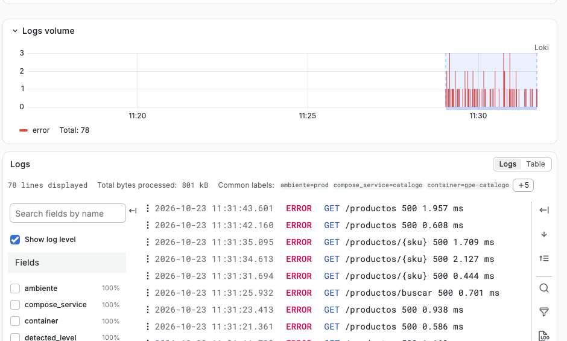

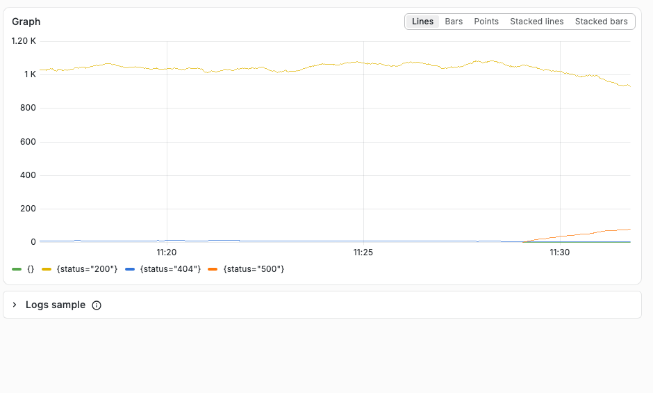

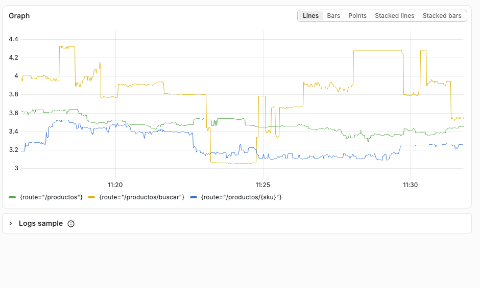

>**Nota.** `unwrap duration_ms` toma el número de ese campo como valor de la serie. Así se calcula un percentil desde los logs, sin métricas.

### Logs Drilldown

Drilldown recorre los casilleros sin que haga falta escribir una consulta.
Sirve para explorar qué campos traen las cartas antes de saber qué buscar.

22. En el menú abrir **Drilldown** y elegir **Logs**. Buscar `catalogo`, elegir `gpe-catalogo` y abrir la pestaña **Fields**. Drilldown detecta los campos del JSON y grafica cada uno. En **Field** elegir `status`. Aparece un gráfico con los 500 sobre los 200 y uno por cada valor, sin escribir ninguna consulta.

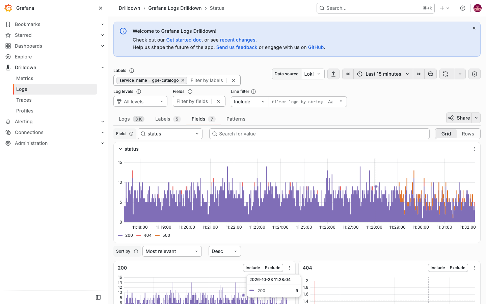

### Alerta sobre logs

Revisar los casilleros a mano no alcanza para enterarse a tiempo de un problema.
El ruler de Loki hace de encargado y cuenta cartas cada minuto con una regla de LogQL.
Cuando la cuenta pasa un umbral, avisa por el mismo Alertmanager que usan las métricas.

23. En `infra/loki/loki.yaml` reemplazar la sección `ruler` por esta.

```yaml
# Práctica 8. El ruler evalúa reglas de LogQL cada minuto y manda las alertas a Alertmanager.
# Las reglas se leen de infra/loki/reglas. La subcarpeta fake es el tenant, porque auth_enabled
# vale false.
ruler:
  alertmanager_url: http://alertmanager:9093
  enable_api: true
  evaluation_interval: 1m
  rule_path: /loki/ruler-temporal
  storage:
    type: local
    local:
      directory: /etc/loki/reglas
```

| Línea | Qué hace |
|---|---|
| `ruler:` | Abre la sección del ruler, el componente de Loki que evalúa reglas |
| `alertmanager_url: http://alertmanager:9093` | A qué Alertmanager manda las alertas. `alertmanager` es el nombre del contenedor dentro de la red de Docker |
| `enable_api: true` | Habilita la API que lista reglas y alertas, como `/loki/api/v1/rules` |
| `evaluation_interval: 1m` | Cada cuánto evalúa las reglas |
| `rule_path: /loki/ruler-temporal` | Carpeta donde el ruler deja sus archivos de trabajo |
| `storage:` con `type: local` | Las reglas se leen desde archivos en disco |
| `directory: /etc/loki/reglas` | La carpeta de reglas dentro del contenedor. Es `infra/loki/reglas` del repositorio |
| Líneas que empiezan con `#` | Comentarios. Loki no las lee |

La sangría de dos espacios es parte del YAML. Si se corre una línea, Loki no arranca.

24. Crear la carpeta `infra/loki/reglas/fake` y dentro el archivo `tianguis-logs.yaml` con este contenido.

```yaml
# Reglas de alerta sobre logs. El ruler de Loki las evalúa con LogQL, como Prometheus con PromQL.
groups:
  - name: tianguis-logs
    rules:
      - alert: CatalogoErroresEnLogs
        # Respuestas 5xx que catalogo escribió en el último minuto.
        expr: sum(count_over_time({compose_service="catalogo"} | json | status >= 500 [1m])) > 10
        for: 2m
        labels:
          severity: advertencia
          team: tienda
        annotations:
          summary: "catalogo escribió {{ $value }} respuestas 5xx en el último minuto"
          description: "Los logs de catalogo muestran más de 10 errores por minuto hace más de 2 minutos."
```

La carpeta se puede crear desde la terminal, en la raíz del repositorio.

```bash
mkdir -p infra/loki/reglas/fake
```

| Línea | Qué hace |
|---|---|
| `groups:` y `- name: tianguis-logs` | Un grupo de reglas con su nombre. Las reglas de un grupo se evalúan juntas |
| `- alert: CatalogoErroresEnLogs` | El nombre de la alerta. Es el `alertname` que llega a Alertmanager |
| `expr:` | La consulta de LogQL. Cuenta las líneas 5xx de catalogo del último minuto y la alerta se activa cuando pasan de 10 |
| `for: 2m` | La condición tiene que cumplirse 2 minutos seguidos antes de pasar a firing |
| `labels:` con `severity` y `team` | Etiquetas que se suman a la alerta. Alertmanager puede rutear por ellas |
| `annotations:` con `summary` y `description` | Textos para quien recibe el aviso. `{{ $value }}` se reemplaza por el valor de la consulta |

>**Nota.** No hace falta saber programar para los pasos 23 y 24. Basta con copiar los bloques y respetar la sangría. El formato de las reglas es el mismo de Prometheus y está descrito en la documentación de [alertas de Loki](https://grafana.com/docs/loki/latest/alert/).

25. Reiniciar Loki para que lea la configuración nueva. Loki no recarga su archivo de configuración en caliente.

```bash
docker restart gpe-loki
```

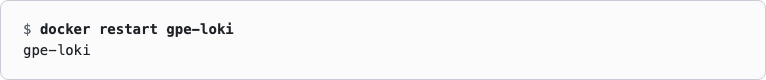

26. Esperar unos 30 segundos y ver las reglas que cargó el ruler.

```bash
curl -s http://localhost:3100/loki/api/v1/rules
```

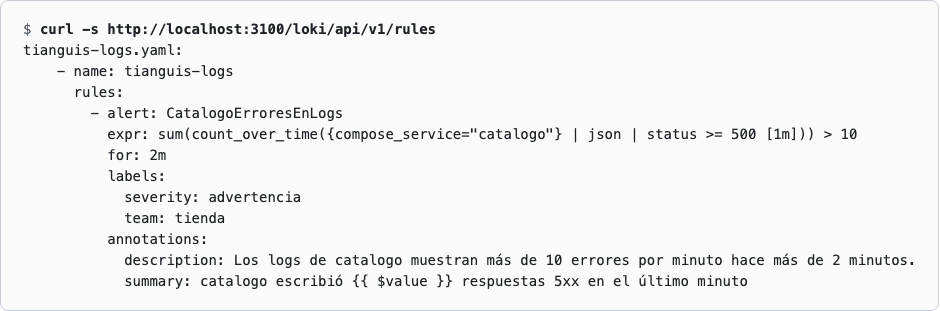

27. Esperar unos 3 minutos, el minuto de evaluación más los 2 de `for`, y ver las alertas del ruler.

```bash
curl -s http://localhost:3100/prometheus/api/v1/alerts
```

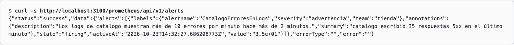

28. Abrir Alertmanager en `http://localhost:9093`. La alerta llegó desde Loki igual que llegan las de Prometheus.

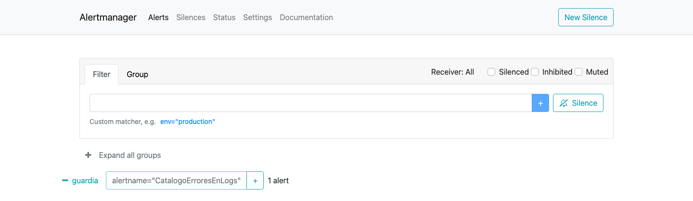

29. En Explore ejecutar esta consulta. gpe-webhook recibió la notificación unos 30 segundos después.

```logql
{compose_service="webhook"} | json | alertnames="CatalogoErroresEnLogs"
```

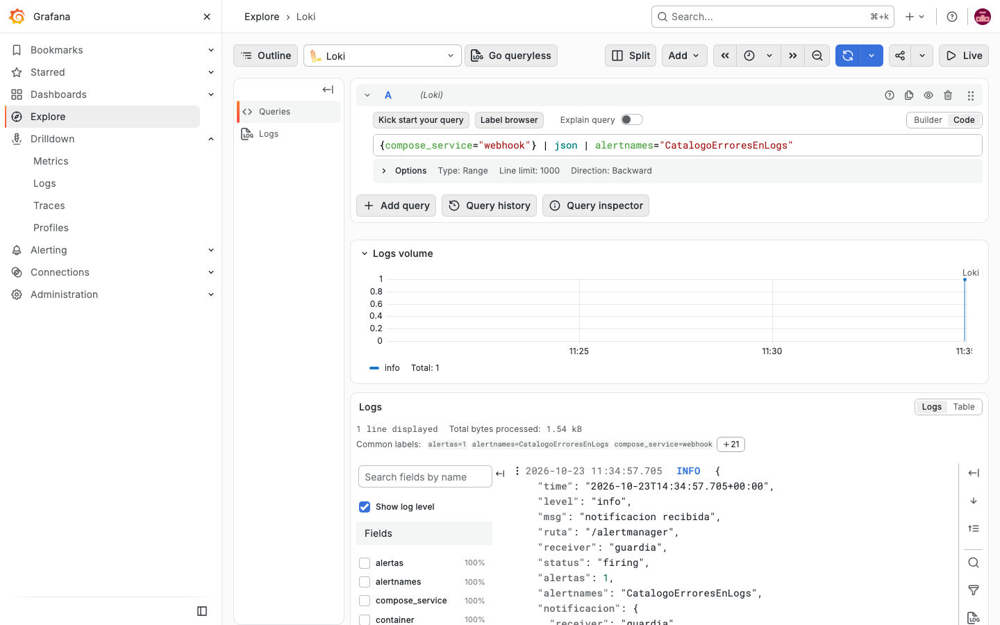

### Apagar la falla

Una alerta también tiene que avisar cuando el problema termina.
Al apagar la falla se sigue el aviso de cierre hasta el final del camino.

30. Apagar la falla de catalogo.

```bash
bin/caos.sh apagar
```

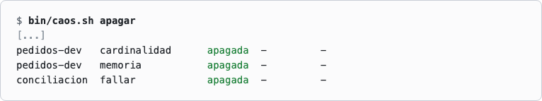

31. Esperar unos 5 minutos y ejecutar la consulta del paso 29 agregando `| status="resolved"`. El resuelto tarda porque Alertmanager agrupa los avisos de una misma alerta y manda el siguiente cada 5 minutos.

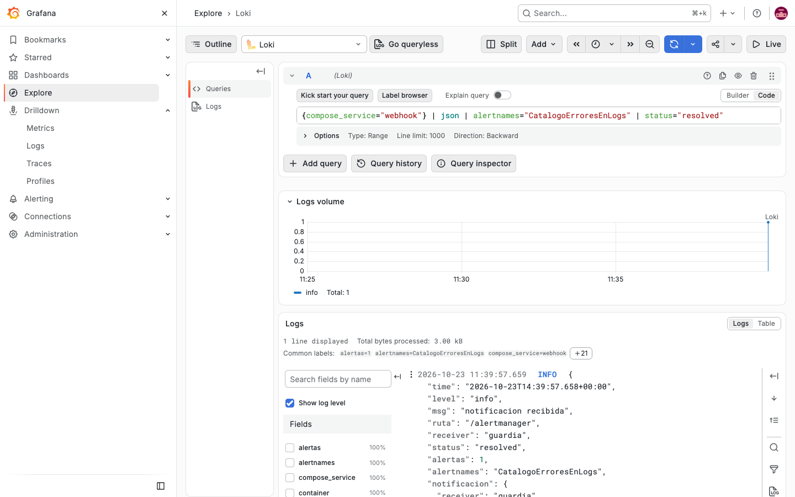

### Verificar

Al cerrar el turno se revisa que cada bandeja tenga lo suyo.
El script recorre lo hecho en la práctica y marca lo que falta.

32. Ejecutar la verificación. Cada línea queda en verde si está lograda o en rojo con una pista de lo que falta.

```bash
Capitulo8/verificar.sh
```

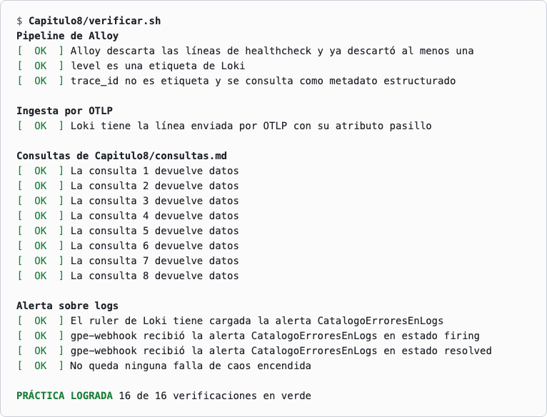

## Preguntas frecuentes

**¿Qué es un log?**
Es una línea de texto que un programa escribe para contar lo que hizo, como una petición atendida o un error. En Tianguis cada servicio escribe sus logs en JSON.

**¿De dónde saca Alloy los logs de los contenedores?**
De Docker. Cada contenedor escribe en su salida estándar, Docker guarda esas líneas y `loki.source.docker` las lee desde ahí.

**¿Por qué se recarga Alloy y en cambio Loki se reinicia?**
Alloy vuelve a leer su archivo con `POST /-/reload` sin reiniciar el contenedor. Loki no recarga su archivo de configuración en caliente, por eso el cambio de `ruler` necesita `docker restart gpe-loki`.

**¿Por qué Explore no muestra datos?**
Lo más común es que el rango de tiempo no incluya las líneas o que el selector tenga un nombre mal escrito. Se amplía el rango y se revisan las etiquetas que conoce Loki con `/loki/api/v1/labels`.

**¿Qué es un tenant?**
Es un cliente separado dentro de Loki, con sus propios datos y límites. Este stack no usa autenticación, así que todo queda en un solo tenant llamado fake.

**¿Qué hace `MSYS_NO_PATHCONV=1`?**
En Git Bash de Windows evita que las rutas que empiezan con `/` se conviertan en rutas de Windows. En macOS y Linux no cambia nada.

**¿Qué pasa si el pipeline de Alloy tiene un error?**
`alloy validate` lo informa antes de recargar y el reload responde con un error. Alloy evalúa el grafo completo, así que se corrige la línea indicada y se vuelve a validar.

**¿Cómo silencio la alerta de logs durante una mantención?**
La alerta del ruler pasa por Alertmanager, así que se silencia ahí, igual que en la Práctica 5. En `http://localhost:9093` se abre **Silences** y se crea un silencio para `alertname="CatalogoErroresEnLogs"` con la duración de la ventana. Desde la terminal es así.

```bash
docker exec gpe-alertmanager amtool --alertmanager.url=http://localhost:9093 silence add alertname=CatalogoErroresEnLogs --duration=2h --author=guardia --comment="mantención de catalogo"
```
 El ruler sigue evaluando la regla y solo se dejan de enviar los avisos. Los detalles están en [Silences](https://prometheus.io/docs/alerting/latest/alertmanager/#silences).

**¿Cómo sé a quién escalar una alerta de logs?**
Por sus etiquetas. La regla le pone `severity` y `team`, y el ruteo de `infra/alertmanager/alertmanager.yml` decide a qué receptor va según esas etiquetas. En este stack todas van al receptor guardia. Las etiquetas de cada alerta se ven en la interfaz de Alertmanager o en `/prometheus/api/v1/alerts` de Loki.

**¿Cómo agrego el enlace al runbook en una alerta de logs?**
Con una anotación `runbook_url` en la regla, junto a `summary` y `description`, por ejemplo `runbook_url: "https://wiki.tianguis.local/runbooks/catalogo-errores"`. El enlace viaja con la alerta hasta Alertmanager y sus receptores. El ruler vuelve a leer los archivos de reglas solo, sin reiniciar Loki.

**¿Qué reviso si los logs de un servicio dejan de llegar a Grafana?**
Primero el grafo de Alloy en `http://localhost:12345`, donde cada componente muestra si está sano, y `docker logs gpe-alloy`. Después si Loki rechaza líneas. Cuando un tenant pasa sus límites, Loki responde 429 y cuenta las líneas descartadas en `loki_discarded_samples_total` de `http://localhost:3100/metrics`, con el motivo en `reason`. Los límites y sus motivos están en [Rate limits](https://grafana.com/docs/loki/latest/operations/request-validation-rate-limits/).

## Resultado esperado

Alloy descarta los healthchecks, lee el JSON de los servicios y manda `level` como etiqueta y `trace_id` como metadato estructurado. Loki tiene la línea del refrigerador enviada por OTLP, responde las consultas de `Capitulo8/consultas.md` y su ruler hizo sonar y resolver la alerta de errores de catalogo hasta gpe-webhook.

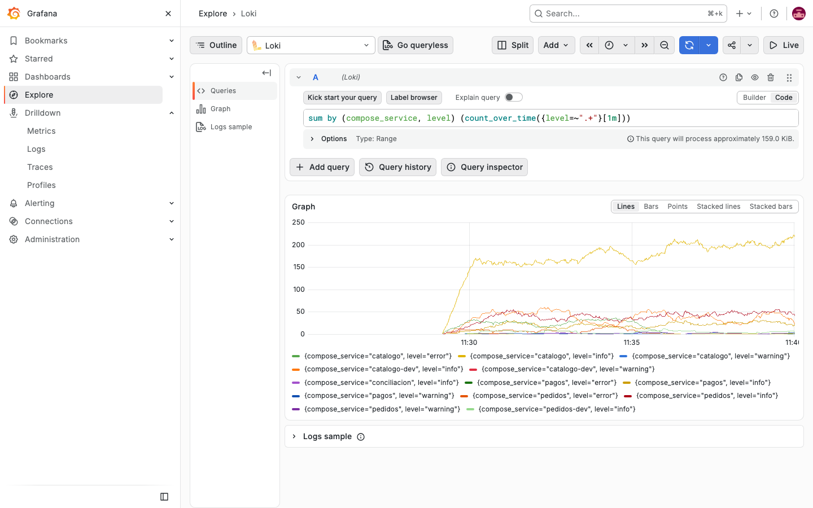

## Volver al stack base

33. Devolver Alloy, Loki y `Capitulo8/consultas.md` a su versión original. El script pide escribir `SI`, borra las reglas del ruler, recarga Alloy y reinicia Loki.

```bash
Capitulo8/restaurar.sh
```

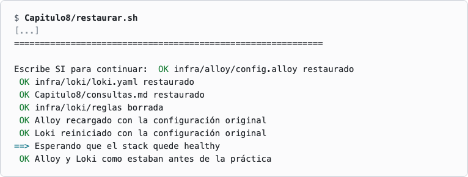

La carpeta `Capitulo8/solucion` trae `consultas.md` resuelto y los archivos de Alloy y Loki con la misma ruta que tienen en el repositorio.

Para ver la práctica resuelta de una vez, `Capitulo8/solucion/aplicar.sh` copia los archivos, manda la línea por OTLP y espera a que la alerta suene y se resuelva. Tarda unos 10 minutos. Avisa qué reemplaza y pide escribir SI.
<!--  -->
