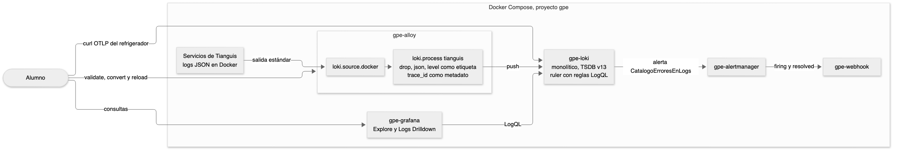

<!--  -->
# Guía del relator. Práctica 8. Implementación de Loki y Alloy con microservicios

Capítulo 8 del temario. Duración provisoria de 150 minutos.

La práctica tiene una idea. Loki es barato porque indexa poco. Solo las etiquetas arman el índice y cada combinación de etiquetas es un stream. Todo lo demás se lee en el momento de la consulta. Por eso la decisión que más pesa es qué sube como etiqueta y qué no, y esa decisión se toma en Alloy, antes de que la línea llegue a Loki.

## Diagrama



La fuente editable está en `images/8/diagrama.mmd` y se vuelve a dibujar con `tools/diagramas/render.sh 8`.

## Familia de analogías

Toda la práctica usa la oficina de correos del mercado. No mezclar con otras analogías.

| Concepto | En la oficina de correos |
|---|---|
| Línea de log | Una carta |
| Loki | La sala de casilleros donde se guardan las cartas |
| Stream | Un casillero. Las cartas con el mismo remitente y el mismo tipo van al mismo |
| Etiqueta | Lo que está escrito en la puerta del casillero |
| Metadato estructurado | El número de seguimiento escrito en el sobre. Se puede buscar, pero no abre casilleros nuevos |
| Alloy | La mesa del cartero, donde se ordenan las cartas antes de guardarlas |
| `stage.drop` | Tirar la propaganda antes de que ocupe lugar |
| OTLP | La carta que llega por courier con el formulario estándar ya lleno |
| Promtail convertido | La planilla del cartero anterior pasada al formato nuevo |
| LogQL | Abrir casilleros y leer o contar cartas |
| Ruler | El encargado que cada minuto cuenta las cartas de reclamo y avisa si son muchas |

## Reparto del tiempo

| Bloque | Minutos |
|---|---|
| Preparar y arquitectura de Loki | 15 |
| Interfaz de Alloy | 10 |
| Pipeline de Alloy y la predicción de trace_id | 30 |
| Migración desde Promtail | 10 |
| Ingesta por OTLP | 10 |
| LogQL y consultas.md | 30 |
| Logs Drilldown | 10 |
| Alerta sobre logs, resolución y verificar | 30 |
| Volver al stack base | 5 |

## Antes de la clase

- Correr `bin/up.sh` y confirmar con `bin/estado.sh` que todo está healthy.
- Si alguien hizo la Práctica 7, correr `Capitulo7/restaurar.sh`. Con la capa de seguridad arriba pagos no puede empujar y el stack no es el base.
- Si alguien ya hizo esta práctica, correr `Capitulo8/restaurar.sh`. Devuelve Alloy y Loki a la configuración del repositorio.
- La falla de catalogo dura 60 minutos. Si la clase se atrasa y la alerta del paso 7 no llega, volver a correr `Capitulo8/preparar.sh`.
- La alerta y su resuelto toman unos 8 minutos en total. Conviene llenar esas esperas con las preguntas del final.

---

## Paso 1. Arquitectura de Loki

**🎯 Problema.** Antes de mandarle logs a Loki hay que saber cómo guarda, cuánto guarda y qué límites tiene. Esos límites son los que rechazan líneas cuando un pipeline crea demasiados streams.

**👵 Analogía.** La sala de casilleros. Hay un solo edificio con todo adentro, las cartas se guardan siete días y hay un máximo de casilleros por cliente.

**🔮 Predicción.** Preguntar cuántos procesos de Loki hay en el stack. Uno solo, porque corre en modo monolítico con `target: all`.

**💻 Comando.**

```bash
cat infra/loki/loki.yaml
curl -s http://localhost:3100/config | grep -E '^target:|retention_period:|ingestion_rate_mb:|max_global_streams_per_user:|allow_structured_metadata:|otlp_config:'
```

| Parte | Qué es |
|---|---|
| `/config` | La configuración completa en uso, con los valores por defecto incluidos |
| `target` | Qué componentes corre este proceso |
| `retention_period` | Cuánto tiempo se guardan las líneas |
| `max_global_streams_per_user` | Límite de streams por tenant |

**⚙️ Técnico.** En modo monolítico un proceso hace de distributor, ingester, querier, compactor y ruler. Los chunks y el índice TSDB van a disco local con el esquema v13. A escala se separa en lectura, escritura y backend, o en microservicios, y el almacenamiento pasa a un bucket S3 o GCS. Algunas instalaciones grandes ponen Kafka delante de los ingesters para que una caída no pierda líneas. El compactor aplica la retención borrando chunks viejos.

**📺 Salida.** El archivo con `auth_enabled: false`, `schema: v13` y `retention_period: 168h`. Del `/config`, `target: all` y los límites con sus valores.

**⚠️ Fallas.**

| Qué se ve | Causa | Arreglo |
|---|---|---|
| `curl` no responde | Loki está reiniciando o abajo | `bin/estado.sh` y esperar healthy |
| El `grep` sale vacío | Se copió el patrón incompleto | Copiar la línea completa de la guía |

---

## Paso 2. La interfaz de Alloy

**🎯 Problema.** Alloy es el que lee los logs de Docker y se los manda a Loki. Su configuración es un grafo de componentes y hay que poder verlo para saber por dónde pasa cada línea.

**👵 Analogía.** La mesa del cartero. Las cartas entran por un lado, pasan por las bandejas en orden y salen hacia la sala de casilleros.

**🔮 Predicción.** Preguntar cuántos componentes tiene el pipeline de logs hoy. Cuatro, el descubrimiento de Docker, el relabel, la fuente y el envío a Loki. No hay ninguno que lea el JSON.

**💻 Comando.**

```text
http://localhost:12345/graph
http://localhost:12345/component/loki.source.docker.contenedores
```

| Parte | Qué es |
|---|---|
| `/graph` | El grafo con las flechas de quién entrega a quién |
| `/component/...` | Argumentos, estado y exportaciones de un componente |

**⚙️ Técnico.** Cada bloque de `config.alloy` es un componente con un nombre. Uno usa lo que exporta otro, como `loki.write.loki.receiver`, y de ahí salen las flechas. Alloy evalúa el grafo completo al cargar, así que un error en un bloque impide cargar el archivo entero.

**📺 Salida.** Cuatro cajas en fila. En el componente, `forward_to` apunta a `loki.write.loki.receiver` y el estado es healthy.

**⚠️ Fallas.**

| Qué se ve | Causa | Arreglo |
|---|---|---|
| La página no carga | Alloy está abajo | `bin/estado.sh` |
| Aparece `loki.process.tianguis` antes de empezar | Quedó la solución de otra corrida | `Capitulo8/restaurar.sh` |

---

## Paso 3. El pipeline de Alloy

**🎯 Problema.** Las líneas llegan a Loki como texto. Para filtrar por nivel hay que parsear en cada consulta, y no hay forma de descartar ruido antes de guardarlo. Además hay que decidir qué campos subir como etiqueta sin multiplicar los streams.

**👵 Analogía.** En la mesa del cartero se tira la propaganda, se lee el remitente y el tipo de cada carta, se escribe el tipo en la puerta del casillero y el número de seguimiento queda en el sobre. Si cada número de seguimiento abriera un casillero, la sala se llenaría en una hora.

**🔮 Predicción.** Preguntar qué pasaría si `trace_id` fuera etiqueta. Cada traza abriría un stream nuevo, decenas por minuto en pagos, y Loki empezaría a rechazar líneas por el límite de streams. Es lo mismo que pasó con la ráfaga de skus en la Práctica 3. Anotar la cuenta de streams antes de cambiar nada.

**💻 Comando.**

```bash
MSYS_NO_PATHCONV=1 docker exec gpe-alloy alloy validate /etc/alloy/config.alloy && echo "configuración válida"
curl -s -w '%{http_code}\n' -X POST http://localhost:12345/-/reload
curl -s http://localhost:12345/metrics | grep 'loki_process_dropped_lines_total{'
```

| Parte | Qué es |
|---|---|
| `alloy validate` | Revisa la sintaxis y el grafo sin cargarlo |
| `MSYS_NO_PATHCONV=1` | Evita que Git Bash convierta la ruta del contenedor |
| `POST /-/reload` | Vuelve a leer el archivo sin reiniciar el contenedor |
| `stage.drop` | Descarta las líneas que calzan con la expresión |
| `drop_counter_reason` | El motivo con que se cuenta la línea descartada |
| `stage.json` | Saca campos del JSON a valores internos del pipeline |
| `stage.labels` | Convierte un valor en etiqueta del stream |
| `stage.structured_metadata` | Lo guarda junto a la línea sin crear streams |

**⚙️ Técnico.** Las etapas corren en orden y cada una ve lo que dejó la anterior. La expresión del drop tiene `": ?"` porque los servicios escriben el JSON con un espacio después de los dos puntos. Los servicios de Tianguis ya no escriben líneas de healthcheck, por eso la guía inyecta una de prueba en la salida del proceso principal de catalogo. Con `level` como etiqueta los streams suben de 9 a 11 o 12, porque cada servicio separa sus niveles. Con `trace_id` en metadatos no sube ninguno, aunque pagos genera decenas de trazas por minuto. El metadato estructurado se filtra después del selector, como `| trace_id != ""`, sin `json`.

**📺 Salida.** `configuración válida` y `200`. El grafo con `loki.process.tianguis` entre la fuente y el envío. La métrica con `reason="healthcheck"` en 1. `level` en la lista de etiquetas y `trace_id` fuera de ella.

**⚠️ Fallas.**

| Qué se ve | Causa | Arreglo |
|---|---|---|
| `validate` marca `component not found` | `forward_to` apunta a un nombre mal escrito | Usar `loki.process.tianguis.receiver` |
| El reload responde 400 | El archivo tiene un error | Leer el mensaje y corregir la línea que indica |
| La métrica no aparece | La línea de prueba no calzó | Revisar el espacio después de `"route":` |
| `level` no aparece | Se consultó antes de que llegaran líneas nuevas | Esperar 2 minutos |

---

## Paso 4. Migración desde Promtail

**🎯 Problema.** Promtail llegó al fin de su soporte y muchas instalaciones todavía lo usan. Reescribir a mano cada configuración es lento y fácil de equivocar.

**👵 Analogía.** La planilla del cartero anterior pasada al formato nuevo. Las reglas de orden son las mismas, solo cambia cómo se escriben.

**🔮 Predicción.** Preguntar en qué se convierte `pipeline_stages`. En un `loki.process` con una etapa por cada una de Promtail.

**💻 Comando.**

```bash
MSYS_NO_PATHCONV=1 docker exec -i gpe-alloy alloy convert --source-format=promtail --output=/dev/stdout /dev/stdin < Capitulo8/promtail-ejemplo.yaml
```

| Parte | Qué es |
|---|---|
| `docker exec -i` | Pasa la entrada estándar al contenedor |
| `--source-format=promtail` | El formato de origen. También acepta prometheus y otelcol |
| `/dev/stdin` y `/dev/stdout` | Lee del archivo redirigido y escribe en la terminal |

**⚙️ Técnico.** `alloy convert` traduce `docker_sd_configs` a `discovery.docker`, `relabel_configs` a `discovery.relabel` y cada scrape a un `loki.source.docker` con su `loki.process`. Los nombres de componente quedan genéricos y conviene cambiarlos. Lo que no puede traducir lo informa como diagnóstico, y con `--bypass-errors` convierte el resto.

**📺 Salida.** Un `config.alloy` con `discovery.docker`, `discovery.relabel`, `loki.source.docker`, `loki.process` con drop, json, labels y structured_metadata, y `loki.write`.

**⚠️ Fallas.**

| Qué se ve | Causa | Arreglo |
|---|---|---|
| Sale vacío | Falta `-i` en `docker exec` | Copiar el comando completo |
| `no such file` en Git Bash | Falta `MSYS_NO_PATHCONV=1` | Copiar el comando completo |

---

## Paso 5. Ingesta por OTLP

**🎯 Problema.** No todo log viene de un contenedor. Una aplicación instrumentada con OpenTelemetry puede mandar sus logs directo a Loki, sin Alloy ni archivos.

**👵 Analogía.** La carta que llega por courier con el formulario estándar ya lleno. No pasa por la mesa del cartero porque ya viene ordenada.

**🔮 Predicción.** Preguntar con qué etiqueta aparece la línea en Loki. Con `service_name`, porque Loki convierte `service.name` en etiqueta y cambia el punto por guion bajo.

**💻 Comando.**

```bash
curl -s -o /dev/null -w '%{http_code}\n' -X POST http://localhost:3100/otlp/v1/logs -H 'Content-Type: application/json' -d '{"resourceLogs":[...]}'
```

| Parte | Qué es |
|---|---|
| `/otlp/v1/logs` | El receptor OTLP HTTP de Loki |
| `resource.attributes` | Atributos del emisor. Algunos, como `service.name`, suben a etiqueta |
| `logRecords[].attributes` | Atributos de la línea. Quedan como metadatos estructurados |
| `severityText` | Queda como el metadato `severity_text` |

**⚙️ Técnico.** Loki necesita `allow_structured_metadata` en true para recibir OTLP. La lista de atributos de recurso que suben a etiqueta se cambia con `otlp_config` en `limits_config`. El cuerpo es JSON de OTLP, el mismo que manda un SDK por HTTP.

**📺 Salida.** `204`. En Explore la línea `la puerta del refrigerador quedó abierta` con `pasillo`, `temperatura` y `severity_text` entre los campos.

**⚠️ Fallas.**

| Qué se ve | Causa | Arreglo |
|---|---|---|
| `400` | El JSON quedó cortado al copiar | Copiar el comando completo |
| Explore no la encuentra | El rango de tiempo no la incluye | Poner los últimos 15 minutos |

---

## Paso 6. LogQL y Logs Drilldown

**🎯 Problema.** Con las líneas guardadas hay que encontrarlas, darles formato y contarlas. LogQL tiene consultas de líneas y consultas de métrica, y se escriben distinto.

**👵 Analogía.** Abrir casilleros y leer o contar cartas. El selector elige los casilleros, los filtros apartan las cartas y las funciones las cuentan.

**🔮 Predicción.** Antes del percentil, preguntar si se puede calcular el p95 de latencia sin métricas. Sí, con `unwrap duration_ms`, porque el valor está en cada línea.

**💻 Comando.**

```logql
{compose_service="catalogo"} | json | status >= 500 | line_format "{{.method}} {{.route}} {{.status}} {{.duration_ms}} ms"
sum by (status) (count_over_time({compose_service="catalogo"} | json [5m]))
quantile_over_time(0.95, {compose_service="catalogo"} | json | unwrap duration_ms [5m]) by (route)
```

| Parte | Qué es |
|---|---|
| `{...}` | Selector de streams por etiquetas. Es lo único que usa el índice |
| `!=`, `|=` | Filtros de línea por texto. Son los más baratos |
| `| json` | Parser. Convierte los campos del JSON en etiquetas de la consulta |
| `line_format` | Reescribe la línea con una plantilla |
| `count_over_time`, `rate` | Convierten líneas en números por intervalo |
| `unwrap` | Usa el valor de un campo como número de la serie |

**⚙️ Técnico.** Conviene poner los filtros de línea antes del parser, porque descartan sin parsear. Las consultas de métrica devuelven series como PromQL y se pueden usar en paneles y en reglas. Logs Drilldown detecta las etiquetas y los campos de las líneas y grafica cada uno sin escribir consultas. La guía no usa la pestaña Patterns, que agrupa las líneas que solo cambian en sus valores. Necesita el pattern ingester de Loki, y con los logs de Tianguis quedaría vacía aunque estuviera encendido. En una línea JSON el pattern ingester solo arma patrones con campos de texto libre como `msg`, y en Tianguis `msg` tiene dos palabras fijas, como `peticion atendida`, porque lo que cambia va en campos aparte. Loki descarta esas líneas por `too_few_tokens`, y se ve en la métrica `loki_pattern_ingester_patterns_dropped_total`. Por eso el stack lo deja apagado. Patterns sirve con logs de texto libre. Con logs JSON bien estructurados, Fields muestra lo mismo. Es una buena discusión sobre logs estructurados contra texto libre.

**📺 Salida.** Líneas como `GET /productos 500 12 ms`. Una serie por status, con 500 bastante más baja que 200. Un percentil por ruta. En Drilldown, el campo status con los 500 junto a los 200.

**⚠️ Fallas.**

| Qué se ve | Causa | Arreglo |
|---|---|---|
| `parse error` | Falta cerrar llaves o comillas | Revisar el selector |
| `unwrap` sin datos | El campo tiene otro nombre | Mirar el nombre exacto en una línea |
| `verificar` dice que una consulta no usa lo pedido | Falta la palabra que exige la pregunta | Leer el título de la pregunta |

---

## Paso 7. Alerta sobre logs con el ruler

**🎯 Problema.** Algunos problemas solo se ven en los logs. Hace falta alertar sobre ellos con el mismo Alertmanager que ya avisa por las métricas.

**👵 Analogía.** El encargado que cada minuto cuenta las cartas de reclamo de un casillero y avisa si pasan de diez durante dos minutos seguidos.

**🔮 Predicción.** Preguntar cuánto tarda en llegar la alerta a gpe-webhook. Un minuto de evaluación, dos de `for` y unos treinta segundos de `group_wait`, cerca de 3 minutos. Y el resuelto, unos 5 minutos después de apagar la falla, por el `group_interval`.

**💻 Comando.**

```bash
docker restart gpe-loki
curl -s http://localhost:3100/loki/api/v1/rules
curl -s http://localhost:3100/prometheus/api/v1/alerts
bin/caos.sh apagar
```

| Parte | Qué es |
|---|---|
| `ruler.storage.local.directory` | Dónde busca Loki los archivos de reglas |
| `reglas/fake` | La carpeta del tenant. Sin autenticación el tenant se llama fake |
| `alertmanager_url` | A dónde manda las alertas |
| `/loki/api/v1/rules` | Las reglas cargadas, en YAML |
| `/prometheus/api/v1/alerts` | Las alertas activas, en el formato de Prometheus |

**⚙️ Técnico.** Las reglas del ruler tienen el mismo formato que las de Prometheus, con LogQL en `expr`. Loki no recarga `loki.yaml` en caliente, por eso se reinicia. Los archivos de reglas sí los relee solo. También puede tener reglas de grabación que escriben series en Prometheus con `remote_write`. En esta práctica Alertmanager tiene un receptor con correo y gpe-webhook, ambos con `send_resolved`.

**📺 Salida.** La regla `CatalogoErroresEnLogs`. La alerta en `pending` y después en `firing`. La alerta en la interfaz de Alertmanager. En Explore, la notificación firing en los logs de gpe-webhook y, después de apagar la falla, la resolved.

**⚠️ Fallas.**

| Qué se ve | Causa | Arreglo |
|---|---|---|
| `/rules` responde `no rule groups found` | El archivo no está en la carpeta `fake` | Mover a `infra/loki/reglas/fake` |
| Loki no arranca | Error de indentación en `ruler` | `docker logs gpe-loki` y corregir |
| La alerta no pasa a firing | La falla de catalogo se apagó o venció | `Capitulo8/preparar.sh` |
| El resuelto no llega | No pasaron los 5 minutos del grupo | Esperar |

---

## Paso 8. Verificar y volver al stack base

**🎯 Problema.** Hay que confirmar que cada pieza quedó hecha y dejar Alloy y Loki como estaban para la práctica siguiente.

**👵 Analogía.** Al cerrar la oficina se revisa que cada bandeja tenga lo suyo y se deja la mesa como la encontró el turno siguiente.

**🔮 Predicción.** Preguntar qué pasa con las líneas que ya llegaron a Loki con `level` cuando se restaura Alloy. Se quedan como están hasta que venza la retención. Las nuevas llegan sin `level`.

**💻 Comando.**

```bash
Capitulo8/verificar.sh
Capitulo8/restaurar.sh
```

| Parte | Qué es |
|---|---|
| `verificar.sh` | Revisa el pipeline, OTLP, las consultas, la regla y las notificaciones |
| `restaurar.sh` | Pide `SI`, devuelve los archivos al repositorio, borra las reglas, recarga Alloy y reinicia Loki |

**⚙️ Técnico.** `verificar.sh` ejecuta cada consulta de `consultas.md` contra Loki y exige lo que pide su pregunta. Las notificaciones las busca en los logs de gpe-webhook de las últimas 24 horas, así que no se pierden si la verificación se corre más tarde.

**📺 Salida.** Todas las líneas en verde. Después de restaurar, `bin/estado.sh` igual que antes de empezar.

**⚠️ Fallas.**

| Qué se ve | Causa | Arreglo |
|---|---|---|
| Rojo en healthcheck | Se recargó Alloy después de la línea de prueba y la métrica volvió a 0 | Repetir la línea de prueba |
| Rojo en una consulta | Quedó vacía o sin lo pedido | La pista dice cuál |
| Rojo en la falla de caos | No se apagó | `bin/caos.sh apagar` |

---

## ❓ Preguntas del alumno

Son preguntas de un alumno de nivel intermedio, que maneja la terminal y Docker básico pero no conoce Prometheus ni Grafana.

**¿Qué es un log?**
Es una línea de texto que un programa escribe para contar lo que hizo. En Tianguis cada servicio escribe una línea JSON por petición, con campos como `level`, `route`, `status` y `duration_ms`.

**¿Qué es un contenedor y por qué Alloy lee los logs desde Docker?**
Un contenedor es un proceso aislado que corre desde una imagen. Lo que escribe en su salida estándar lo guarda Docker, y `loki.source.docker` lo lee desde ahí.

**¿Qué es una etiqueta en Loki?**
Es un par de nombre y valor que identifica un stream, como `compose_service="catalogo"`. Las etiquetas son lo único que Loki indexa, y el selector `{...}` de LogQL elige por ellas.

**¿Por qué Explore no muestra datos?**
Puede que el rango de tiempo no incluya las líneas, que el selector tenga un nombre mal escrito o que las líneas todavía no lleguen. Se amplía el rango y se revisan las etiquetas con `/loki/api/v1/labels`.

**¿Qué es Alertmanager?**
Recibe las alertas de Prometheus y del ruler de Loki, las agrupa y las manda a sus receptores. En esta práctica los receptores son correo y gpe-webhook.

**¿Por qué Loki y no Elasticsearch?**
Elasticsearch indexa cada palabra de cada línea, y eso cuesta disco y memoria. Loki indexa solo las etiquetas y guarda las líneas comprimidas. Busca más lento en textos libres, pero guarda mucho más barato.

**¿Cuántas etiquetas son demasiadas?**
No importa tanto la cantidad de etiquetas como la cantidad de valores que combinan. Una etiqueta con millones de valores, como un id de usuario o de traza, ya es demasiado. La regla práctica es que cada etiqueta tenga pocos valores y que se use para elegir streams.

**¿Qué pasa si igual mando trace_id como etiqueta?**
Loki crea un stream por traza hasta llegar a `max_global_streams_per_user` y después rechaza líneas con error 429. Las consultas también se vuelven lentas porque abren miles de streams chicos.

**¿Promtail todavía sirve?**
Funciona, pero ya no recibe cambios. Alloy hace lo mismo y además recoge métricas y trazas, por eso la migración se hace con `alloy convert`.

**¿Cómo escala Loki en producción?**
Se separa en lectura, escritura y backend, o en microservicios, con almacenamiento en un bucket. Las versiones nuevas pueden poner Kafka entre los distributors y los ingesters. La escritura queda en Kafka y los ingesters la consumen, así que una caída de un ingester no pierde líneas y la lectura escala aparte.

**¿Puedo alertar sobre logs desde Grafana en vez del ruler?**
Sí. Grafana Alerting acepta consultas de métrica de LogQL. El ruler tiene la ventaja de vivir junto a los datos y de usar el mismo formato de reglas que Prometheus.

**¿Los metadatos estructurados se pueden usar en una alerta?**
Sí, como filtro después del selector, por ejemplo `| trace_id != ""`. No sirven para agrupar streams porque no son etiquetas, pero sí para agrupar con `by` después de una consulta de métrica.

**¿Cómo borro logs que no debían guardarse?**
Loki tiene una API de borrado que se habilita en el compactor, con `delete_request_store`. Borra por selector y rango de tiempo, y el borrado ocurre en la siguiente compactación. Lo más sano es evitarlo con un `stage.drop` o con `stage.replace` para tapar datos sensibles antes de enviar.
<!--  -->
