# Práctica 9. Proxy inverso y escritura remota hacia almacenamiento de largo plazo

En esta práctica el stack de Tianguis crece. En la Parte A se separan organizaciones y equipos, Grafana pasa a PostgreSQL con dos réplicas detrás de nginx, un dashboard se aprovisiona como código, Prometheus descubre destinos desde archivos y por HTTP, un Prometheus de borde federa las series de negocio, todo se copia a Mimir y se ponen límites a lo que se guarda. En la Parte B llega El Buen Fin, con tráfico alto y varias fallas a la vez que hay que diagnosticar con todo lo del curso.

## Objetivos
- Separar datos y permisos con organizaciones, equipos y carpetas.
- Pasar Grafana de SQLite a PostgreSQL sin perder los dashboards y correr dos réplicas sobre la misma base.
- Aprovisionar un dashboard desde un archivo JSON.
- Publicar Grafana y Prometheus detrás de un proxy inverso bajo una ruta.
- Descubrir destinos con file_sd y con descubrimiento HTTP.
- Federar un subconjunto de series en un Prometheus de borde.
- Enviar las métricas a Mimir con remote_write y consultarlas desde Grafana.
- Limitar lo que se guarda con sample_limit, label_limit, metric_relabel_configs y retención por tamaño.
- Revisar la instancia de Grafana con Advisor.
- Diagnosticar varios problemas simultáneos con métricas, alertas, trazas y logs.

## El problema y la solución

Un mercado de barrio funciona bien con una sola oficina y un solo libro de actas.
Cuando el mercado crece, ese libro único se vuelve un riesgo, porque si la oficina cierra nadie puede atender.
Llegan sindicatos que no deben ver los papeles de los otros, puestos nuevos cada semana y visitantes que no saben a qué puerta ir.
Los cuadernos se acumulan y el libro del mercado no alcanza para guardar la historia de años.

Con Tianguis pasa lo mismo.
Un Grafana sobre un archivo SQLite y un Prometheus con destinos escritos a mano sirven para una persona, pero no para una empresa.

En esta práctica el libro de actas pasa a la bóveda municipal, que es PostgreSQL, y dos oficinas de Grafana atienden con el mismo libro.
nginx hace de portería única y dirige a cada visitante a Grafana o a Prometheus.
Prometheus consulta una lista de puestos en vez de un reglamento fijo, un mercado chico recibe solo los totales y una copia del libro va al archivo nacional, que es Mimir.
Cada puesto tiene un cupo de cuadernos y un inspector, Advisor, revisa el reglamento.
Al final llega el día de más gente del año y hay que encontrar qué está fallando con todo lo aprendido.

En el NOC esto se ve como un 502 al abrir Grafana mientras una réplica está en mantención, un destino que queda DOWN porque superó su cupo o una cola de escritura remota que se atrasa.
En El Buen Fin llegan varias alertas a la vez y hay que separar la causa de las consecuencias antes de escalar al equipo dueño de cada servicio.

## Duración aproximada
- 180 minutos.

---
<div style="width: 400px;">
        <table width="50%">
            <tr>
                <td style="text-align: center;">
                    <a href="../Capitulo8/"></a>
                    <br>anterior
                </td>
                <td style="text-align: center;">
                   <a href="../README.md">Lista Laboratorios</a>
                </td>
            </tr>
        </table>
</div>

---

## Diagrama


<br>

## Instrucciones

>**Nota.** Todo lo nuevo vive en `Capitulo9` y se suma al stack con `Capitulo9/compose.escala.yaml`. La configuración de `infra` no se toca. Al terminar, `Capitulo9/restaurar.sh` deja el stack como estaba.

### Preparar el punto de partida

Antes de agrandar el mercado se deja cada puesto como estaba al abrir.
Así la práctica parte del stack base, con tráfico normal y sin fallas encendidas.
Los cambios que vienen se notan sobre algo conocido.

1. Abrir una terminal en la carpeta del repositorio. En Windows usar Git Bash.

2. Dejar el stack en el punto de partida. El script levanta el stack base, deja el tráfico en nivel normal y apaga cualquier falla de caos.

```bash
Capitulo9/preparar.sh
```

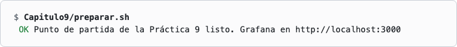

3. Guardar la clave de admin de Grafana en una variable. Los comandos de la práctica la usan como `$CLAVE`. Si se abre otra terminal, hay que volver a definirla.

```bash
CLAVE=$(grep '^GRAFANA_ADMIN_PASSWORD=' infra/.env | cut -d= -f2-)
```

## Parte A. Administración y escalamiento

### Base de datos y réplicas

Grafana guarda sus actas en un archivo SQLite dentro de su volumen, como una sola oficina con su libro.
Para abrir una segunda oficina de atención, las dos tienen que leer el mismo libro de actas.
Por eso el libro pasa a la bóveda municipal, que es PostgreSQL, y antes se respalda lo que se creó a mano.

4. Grafana guarda todo en un archivo SQLite dentro de su volumen. Antes de pasarlo a PostgreSQL, respaldar los dashboards de las prácticas anteriores.

```bash
mkdir -p Capitulo9/respaldo
for uid in $(curl -s -u "admin:$CLAVE" "http://localhost:3000/api/search?type=dash-db" | grep -o '"uid":"[^"]*"' | cut -d'"' -f4); do
  curl -s -u "admin:$CLAVE" "http://localhost:3000/api/dashboards/uid/$uid" > "Capitulo9/respaldo/$uid.json"
done
ls Capitulo9/respaldo
```

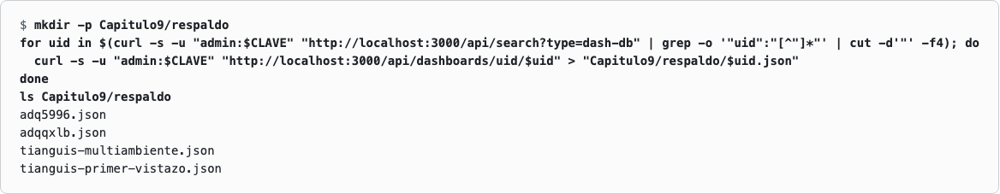

5. Abrir `Capitulo9/compose.escala.yaml` y leerlo. Suma nginx, PostgreSQL, una segunda réplica de Grafana, Mimir y un Prometheus de borde. Al Grafana y al Prometheus del stack les cambia la configuración y les quita el puerto propio. La clave de PostgreSQL no está escrita en el archivo. Grafana la lee con `GF_DATABASE_PASSWORD__FILE` y PostgreSQL con `POSTGRES_PASSWORD_FILE`, las dos desde `Capitulo9/secretos/postgres`. Crear ese archivo desde el ejemplo. Git lo ignora, igual que los secretos de la Práctica 7.

```bash
cp Capitulo9/secretos/postgres.ejemplo Capitulo9/secretos/postgres
```

6. Levantar la capa de escala.

```bash
docker compose -p gpe --env-file infra/.env -f infra/compose.yaml -f Capitulo9/compose.escala.yaml up -d
```

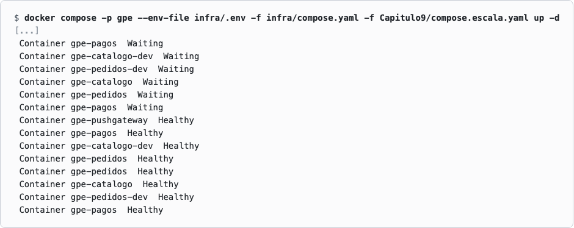

7. Esperar un minuto a que todo quede healthy y ver las tablas que Grafana creó en PostgreSQL.

```bash
docker exec gpe-postgres psql -U grafana -d grafana -c '\dt' | head -n 16
```

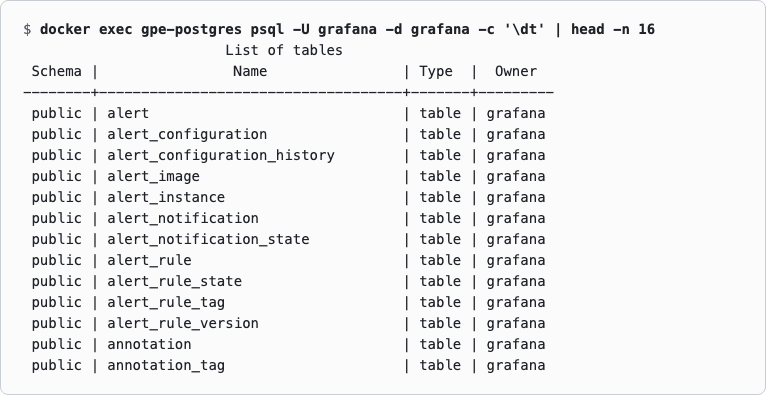

8. La base nueva está vacía. Importar el respaldo a través de nginx, que ahora es la única entrada.

```bash
for archivo in Capitulo9/respaldo/*.json; do
  curl -s -u "admin:$CLAVE" -H 'Content-Type: application/json' -X POST http://localhost:8088/grafana/api/dashboards/db -d @"$archivo"; echo
done
```

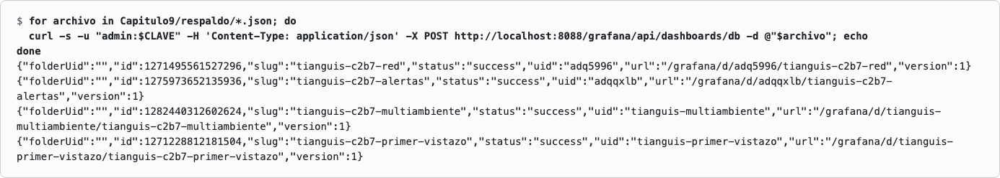

9. Abrir Grafana en `http://localhost:8088/grafana/` y entrar como admin. En **Dashboards** están los dashboards respaldados, la carpeta Tianguis Digital y una carpeta nueva, Como código.

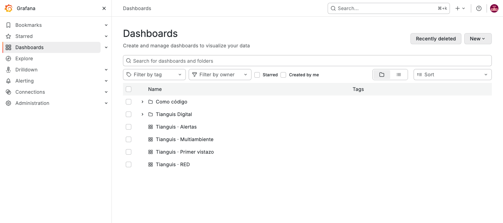

>**Nota.** Al cambiar de base no se pierde nada de lo que se aprovisiona desde archivos, como los datasources y los dashboards de la carpeta Tianguis Digital. Los dashboards creados a mano vuelven con el respaldo. No pasan los usuarios, la regla PagosLentos y los puntos de contacto de la Práctica 5, ni las anotaciones y preferencias. Para moverlos habría que exportarlos uno por uno. Nada de eso se borra, sigue en el SQLite del volumen y vuelve con `Capitulo9/restaurar.sh`.

10. Ver qué réplica atiende cada petición. nginx agrega la cabecera `X-Replica` con la dirección de la réplica.

```bash
for i in 1 2 3 4; do curl -s -o /dev/null -D - http://localhost:8088/grafana/api/health | grep -i x-replica; done
```

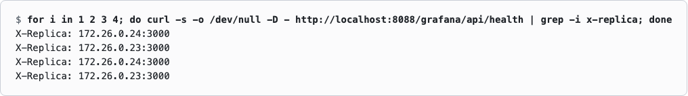

11. Antes de seguir, anotar una predicción. ¿Si se cae una réplica de Grafana, se pierden los dashboards?

12. Detener la segunda réplica, esperar 15 segundos y volver a pedir la salud de Grafana.

```bash
docker stop gpe-grafana-2 && sleep 15
for i in 1 2 3 4 5 6; do curl -s -o /dev/null -w '%{http_code} ' http://localhost:8088/grafana/api/health; done; echo
```

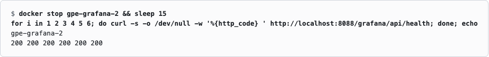

>**Nota.** Las dos réplicas leen y escriben la misma base, así que no se pierde nada. nginx vuelve a preguntar al DNS de Docker cada 10 segundos y deja de mandarle peticiones a la réplica detenida. Mientras no se entera, si una réplica no responde, repite la petición en la otra. Con varias réplicas, las alertas de Grafana necesitan `GF_UNIFIED_ALERTING_HA_PEERS` para no mandar dos veces la misma notificación.

13. Volver a encender la réplica.

```bash
docker start gpe-grafana-2
```

### Organizaciones, equipos y carpetas

En un mercado grande hay sindicatos de puesteros, cada uno con su pizarrón, y gremios que no deben escribir en la sección de otro.
Grafana resuelve lo mismo con organizaciones, equipos y permisos de carpeta.
Los pasos que siguen crean una organización, un equipo y una carpeta con permisos propios.

14. Crear una segunda organización con la API de Grafana. Una organización es un espacio aparte, con sus propios datasources, dashboards y usuarios.

```bash
curl -s -u "admin:$CLAVE" -H 'Content-Type: application/json' -X POST http://localhost:8088/grafana/api/orgs -d '{"name":"Sindicato de Fruteros"}'
```

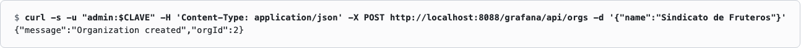

15. En Grafana abrir **Administration**, **General**, **Organizations**. Aparecen Main Org. y Sindicato de Fruteros.

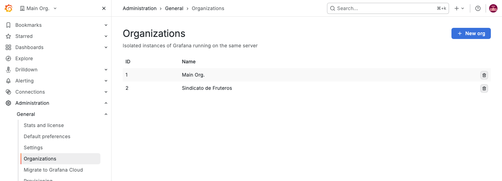

16. Abrir `http://localhost:8088/grafana/connections/datasources?orgId=2`. Grafana cambia a la organización nueva, que no tiene ningún datasource.

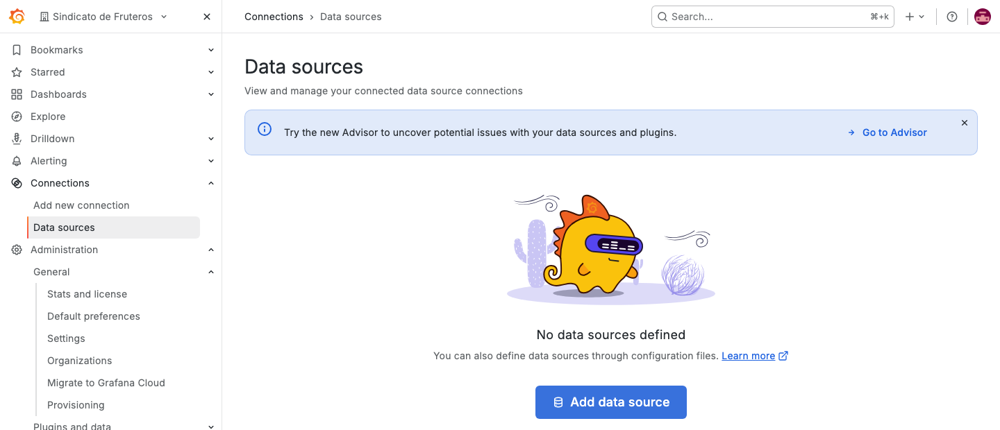

17. Abrir `http://localhost:8088/grafana/dashboards?orgId=2`. Tampoco hay dashboards.

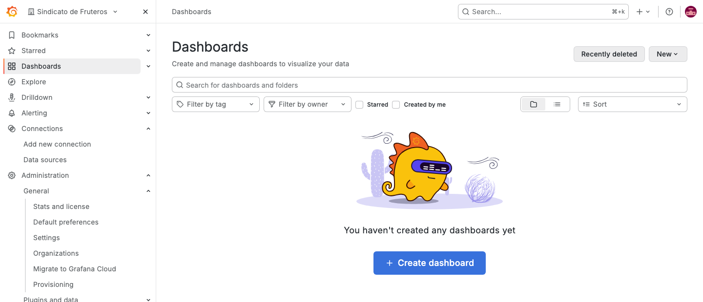

18. Volver a Main Org. con `http://localhost:8088/grafana/?orgId=1`.

19. Dentro de Main Org. crear un equipo y una carpeta que solo ese equipo puede editar. El último comando reemplaza los permisos de la carpeta. Los roles Viewer y Editor dejan de verla y solo quedan el equipo y los administradores.

```bash
EQUIPO=$(curl -s -u "admin:$CLAVE" -H 'Content-Type: application/json' -X POST http://localhost:8088/grafana/api/teams -d '{"name":"equipo-lacteos"}' | grep -o '"teamId":[0-9]*' | cut -d: -f2)
curl -s -u "admin:$CLAVE" -H 'Content-Type: application/json' -X POST http://localhost:8088/grafana/api/folders -d '{"uid":"lacteos","title":"L\u00e1cteos"}' | grep -o '"title":"[^"]*"'
curl -s -u "admin:$CLAVE" -H 'Content-Type: application/json' -X POST http://localhost:8088/grafana/api/folders/lacteos/permissions -d '{"items":[{"teamId":'"$EQUIPO"',"permission":2}]}'
```

>**Nota.** En el JSON la tilde de Lácteos va como `\u00e1`. Grafana guarda `Lácteos` igual. Así el comando funciona también en Git Bash de Windows, donde curl no recibe bien las tildes escritas en la línea de comandos.

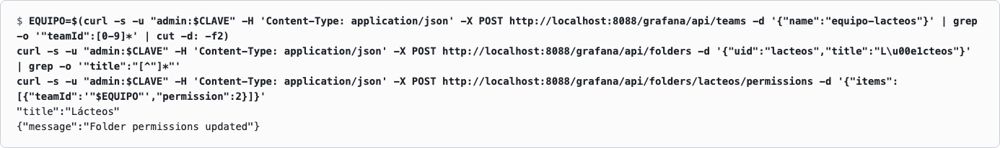

20. Abrir **Dashboards**, entrar a la carpeta **Lácteos** y elegir **Folder actions**, **Manage permissions**.

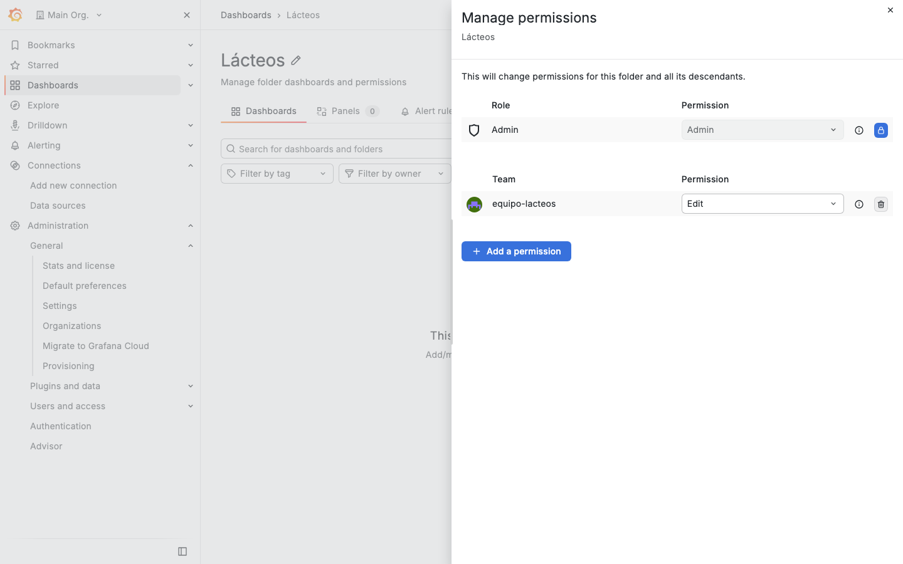

>**Nota.** La organización separa todo, también los datasources. El equipo con su carpeta separa solo los dashboards dentro de la misma organización. En el permiso, 1 es View, 2 es Edit y 4 es Admin. Todo esto queda en PostgreSQL y lo ven las dos réplicas.

### Dashboards como código

Un dashboard editado a mano no deja registro de quién lo cambió ni de cómo era antes.
Guardar los planos del pizarrón en la oficina de partes permite revisarlos y volver a una versión anterior.
En Grafana ese plano es un archivo JSON que se aprovisiona desde una carpeta.

21. Ver el proveedor que carga los dashboards de `Capitulo9/dashboards`.

```bash
cat Capitulo9/escala/grafana/dashboards/proveedores.yaml
```

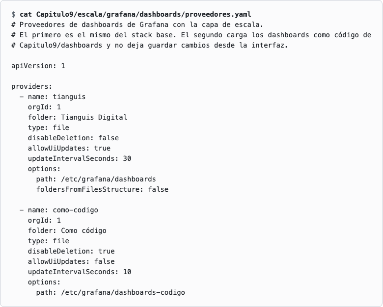

22. En Grafana abrir el dashboard **Tianguis · Pizarrón** de la carpeta Como código.

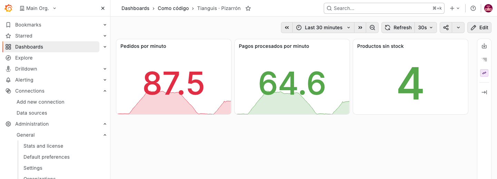

23. Pulsar **Edit** y después **Save**. Grafana no deja guardarlo porque viene de un archivo, y ofrece copiar el JSON para cambiarlo en el origen.

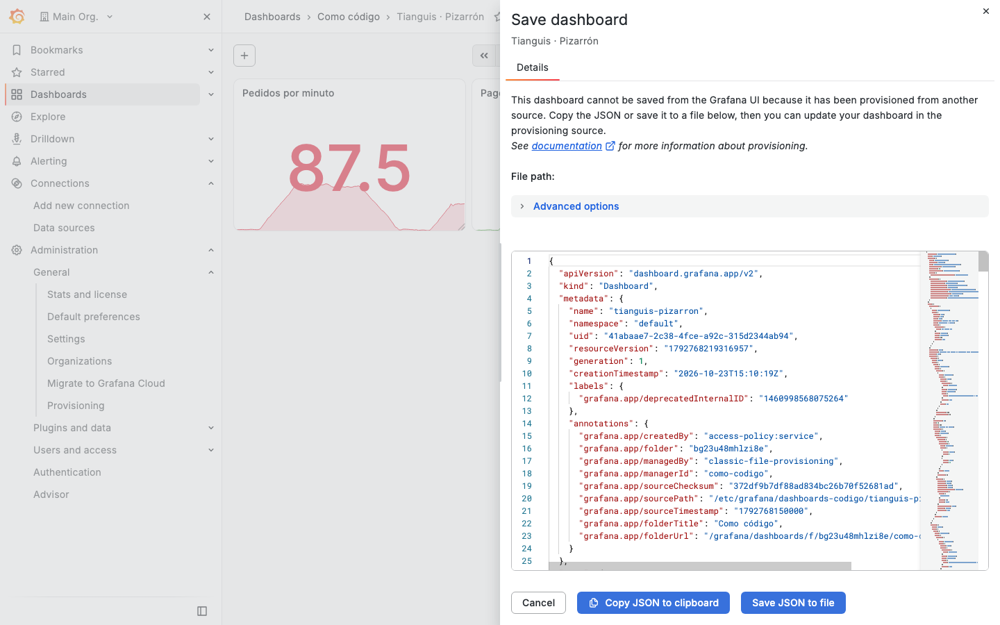

24. Pulsar **Cancel** y después **Exit edit**, sin guardar. Abrir `Capitulo9/dashboards/tianguis-pizarron.json` en el editor, cambiar el título `Productos sin stock` por `Productos agotados` y guardar. Esperar 15 segundos y recargar el dashboard.

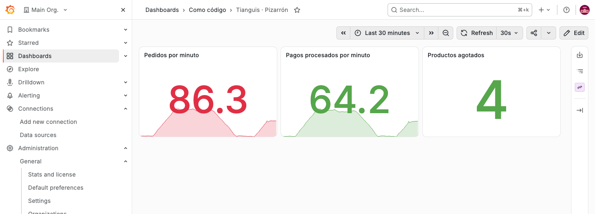

>**Nota.** Grafana 13 trae Git Sync, que guarda los dashboards en un repositorio Git y los sincroniza en las dos direcciones. Necesita un servidor Git con un token, como GitHub. No acepta un repositorio local, así que en esta práctica el código vive en archivos aprovisionados. En un equipo, esa carpeta es la que se versiona en Git.

### Proxy inverso

Con cada herramienta en su propio puerto, el visitante tiene que saber a qué puerta ir y cada puerta se protege por separado.
La portería única del mercado recibe a todos en un solo lugar y dirige a cada uno a su oficina.
Estos pasos revisan cómo se comportan Grafana y Prometheus detrás de esa portería.

25. Abrir Prometheus en `http://localhost:8088/prometheus/`. Ya no responde en su puerto propio.

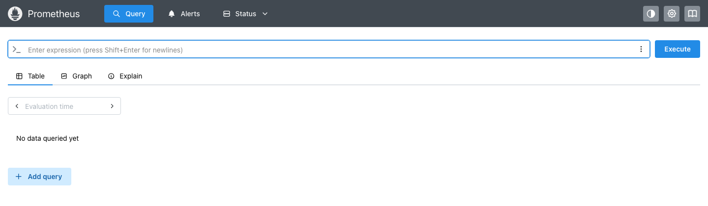

26. Ver a dónde redirigen Grafana y Prometheus cuando se entra por la portería.

```bash
curl -s -o /dev/null -w '%{http_code} %{redirect_url}\n' http://localhost:8088/grafana/
curl -s -o /dev/null -w '%{http_code} %{redirect_url}\n' http://localhost:8088/prometheus/
```

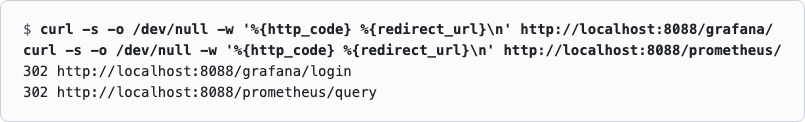

27. En `Capitulo9/compose.escala.yaml` poner un `#` al principio de la línea de `GF_SERVER_ROOT_URL`. Recrear las dos réplicas, esperar a que estén healthy y repetir la prueba.

```bash
docker compose -p gpe --env-file infra/.env -f infra/compose.yaml -f Capitulo9/compose.escala.yaml up -d grafana grafana-2
curl -s -o /dev/null -w '%{http_code} %{redirect_url}\n' http://localhost:8088/grafana/
curl -s -o /dev/null -w '%{http_code}\n' http://localhost:8088/login
```

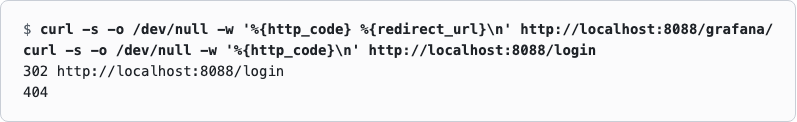

28. Quitar el `#` de `GF_SERVER_ROOT_URL` y ponerlo al principio de la línea `--web.external-url` de Prometheus. Recrear Grafana y Prometheus y repetir la prueba con Prometheus.

```bash
docker compose -p gpe --env-file infra/.env -f infra/compose.yaml -f Capitulo9/compose.escala.yaml up -d grafana grafana-2 prometheus
curl -s -o /dev/null -w '%{http_code} %{redirect_url}\n' http://localhost:8088/prometheus/
curl -s -o /dev/null -w '%{http_code}\n' http://localhost:8088/query
```

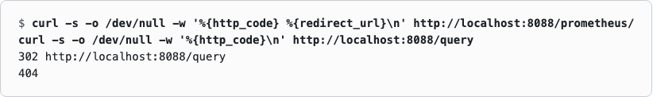

>**Nota.** nginx le saca el prefijo a la petición, así que Grafana y Prometheus creen que están en la raíz. Sin `root_url` ni `external_url`, sus redirecciones apuntan a `/login` y a `/query`, fuera de su ruta, y nginx responde 404.

29. Quitar el `#` de `--web.external-url` y recrear Prometheus.

```bash
docker compose -p gpe --env-file infra/.env -f infra/compose.yaml -f Capitulo9/compose.escala.yaml up -d prometheus
```

### Descubrimiento de servicios

Con los destinos escritos en `prometheus.yml`, cada puesto nuevo obliga a reimprimir el reglamento.
Con cientos de puestos que llegan y se van, eso no alcanza.
El descubrimiento le da a Prometheus una lista de puestos que mantiene otra herramienta, en un archivo o por HTTP.

30. Antes de seguir, anotar una predicción. Si Prometheus lee sus destinos de un archivo, ¿hace falta recargarlo para que aparezca un destino nuevo?

31. Crear la carpeta `Capitulo9/prometheus/destinos` con dos archivos. `catalogo.yml` con catalogo-dev y `pedidos.yml` todavía sin destinos.

```yaml
# Capitulo9/prometheus/destinos/catalogo.yml
# Destinos del job catalogo que vienen de archivo. Prometheus vuelve a leerlo cuando cambia.
- targets: ["catalogo-dev:8000"]
  labels:
    ambiente: dev
```

```yaml
# Capitulo9/prometheus/destinos/pedidos.yml
# Destinos del job pedidos que vienen de archivo. Prometheus vuelve a leerlo cuando cambia.
[]
```

| Línea | Qué hace |
|---|---|
| `# ...` | Comentario. Prometheus no lo lee, sirve para quien abra el archivo |
| `- targets: ["catalogo-dev:8000"]` | Un grupo de destinos. Cada destino es nombre del contenedor y puerto |
| `labels:` | Etiquetas que se agregan a todas las series de ese grupo |
| `ambiente: dev` | La etiqueta que distingue dev de prod en las consultas |
| `[]` | Lista vacía. El archivo existe pero todavía no trae destinos |

>**Nota.** No hace falta saber programar para esta práctica. Todo lo que se escribe en archivos de configuración viene completo en la guía. Basta copiar cada bloque respetando los espacios del principio de cada línea, porque en YAML la sangría indica qué va dentro de qué. `promtool check config` avisa si algo quedó mal alineado.

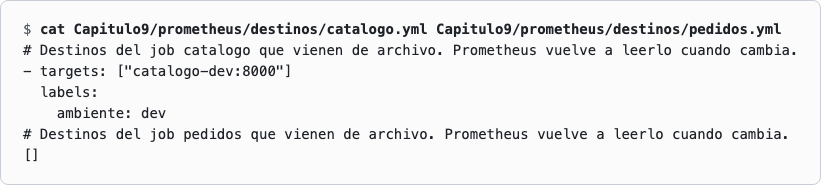

32. Abrir `Capitulo9/prometheus/prometheus.yml`. En el job `catalogo`, reemplazar el destino `catalogo-dev:8000` y sus etiquetas por esto.

```yaml
    # Descubrimiento. El ambiente dev sale de un archivo. Prometheus lo vuelve a leer cuando cambia.
    file_sd_configs:
      - files: ["/etc/prometheus-escala/destinos/catalogo.yml"]
        refresh_interval: 30s
```

El job `catalogo` queda así. `file_sd_configs` va a la misma altura que `static_configs`.

```yaml
  - job_name: catalogo
    scrape_interval: 15s
    static_configs:
      - targets: ["catalogo:8000"]
        labels:
          ambiente: prod
    # Descubrimiento. El ambiente dev sale de un archivo. Prometheus lo vuelve a leer cuando cambia.
    file_sd_configs:
      - files: ["/etc/prometheus-escala/destinos/catalogo.yml"]
        refresh_interval: 30s
```

| Línea | Qué hace |
|---|---|
| `static_configs` | El destino de prod sigue escrito a mano, como antes |
| `file_sd_configs` | Suma los destinos que vienen de archivos |
| `files` | El archivo que se lee. Es la ruta dentro del contenedor, donde se monta `Capitulo9/prometheus` |
| `refresh_interval: 30s` | Cada cuánto se vuelve a leer el archivo, por si el aviso de cambio no llega |

33. En el job `pedidos`, reemplazar el destino `pedidos-dev:8080` y sus etiquetas por esto.

```yaml
    file_sd_configs:
      - files: ["/etc/prometheus-escala/destinos/pedidos.yml"]
        refresh_interval: 30s
```

El job `pedidos` queda así. Las líneas de histogramas y el destino de prod no cambian.

```yaml
  - job_name: pedidos
    scrape_interval: 15s
    scrape_native_histograms: true
    always_scrape_classic_histograms: true
    static_configs:
      - targets: ["pedidos:8080"]
        labels:
          ambiente: prod
    file_sd_configs:
      - files: ["/etc/prometheus-escala/destinos/pedidos.yml"]
        refresh_interval: 30s
```

34. Al final del archivo agregar un job que descubre sus destinos por HTTP. nginx sirve la lista desde `Capitulo9/escala/sd/destinos.json`.

```yaml

  # Descubrimiento HTTP. nginx sirve la lista de destinos como un archivo JSON.
  - job_name: descubierto-por-http
    http_sd_configs:
      - url: http://nginx/sd/destinos.json
        refresh_interval: 30s
```

| Línea | Qué hace |
|---|---|
| `- job_name: descubierto-por-http` | Un job nuevo, a la misma altura que los demás jobs |
| `http_sd_configs` | Pide la lista de destinos a una dirección web en vez de leer un archivo |
| `url` | La dirección donde nginx publica la lista en JSON |
| `refresh_interval: 30s` | Cada cuánto vuelve a pedir la lista |

35. Revisar la configuración y recargar Prometheus.

```bash
MSYS_NO_PATHCONV=1 docker exec gpe-prometheus promtool check config /etc/prometheus-escala/prometheus.yml
docker exec gpe-prometheus kill -HUP 1
```

36. Abrir `http://localhost:8088/prometheus/targets?search=dev`. Está catalogo-dev y falta pedidos-dev.

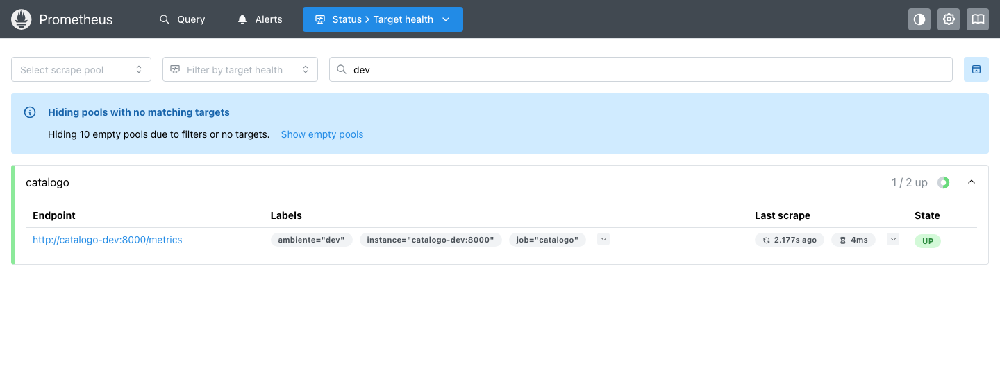

37. Agregar pedidos-dev en `Capitulo9/prometheus/destinos/pedidos.yml`, sin tocar `prometheus.yml` y sin recargar.

```yaml
# Destinos del job pedidos que vienen de archivo. Prometheus vuelve a leerlo cuando cambia.
- targets: ["pedidos-dev:8080"]
  labels:
    ambiente: dev
```

38. Esperar unos segundos, recargar la página de destinos y buscar pedidos-dev. Comparar con la predicción del paso 30.

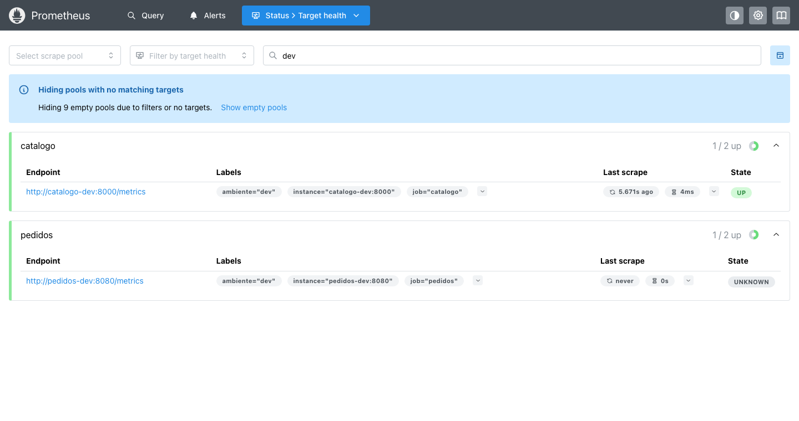

>**Nota.** pedidos-dev aparece sin recargar Prometheus. Prometheus vigila los archivos de `file_sd_configs` y los vuelve a leer apenas cambian. `refresh_interval` es el respaldo para cuando el aviso del sistema de archivos no llega, como pasa a veces con Docker en Windows. En Kubernetes se usa `kubernetes_sd_configs`, que le pregunta la lista de pods a la API del clúster.

39. Buscar `descubierto` en la página de destinos. El job por HTTP encontró al Prometheus de borde.

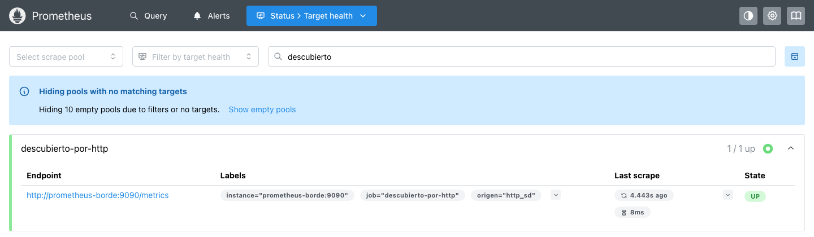

### Federación

Un mercado central que anote cada boleta de todos los mercados chicos no da abasto.
Lo que se busca es que entre mercados se pasen solo los totales que importan.
En esta práctica un Prometheus de borde le pide al principal solo las series de negocio.

40. Abrir `Capitulo9/borde/prometheus.yml` y agregar al final un job que federa del Prometheus principal solo las series de negocio.

```yaml

  # Federación. Le pide al Prometheus principal solo las series de negocio de Tianguis.
  # honor_labels conserva el job y la instance originales en vez de reemplazarlos por los de
  # este raspado.
  - job_name: federacion
    honor_labels: true
    metrics_path: /federate
    params:
      "match[]":
        - '{__name__=~"orders_.+|payments_.+|catalog_.+|conciliacion_.+"}'
    static_configs:
      - targets: ["prometheus:9090"]
```

| Línea | Qué hace |
|---|---|
| `- job_name: federacion` | El job nuevo del borde, a la misma altura que `prometheus-borde` |
| `honor_labels: true` | Deja las etiquetas `job` e `instance` que trae cada serie del principal |
| `metrics_path: /federate` | Raspa la ruta de federación del principal en vez de `/metrics` |
| `params` y `"match[]"` | Qué series pedir. Sin este filtro no llega nada |
| `'{__name__=~"orders_.+\|payments_.+\|catalog_.+\|conciliacion_.+"}'` | Solo las métricas cuyo nombre empieza con esos prefijos de negocio |
| `targets: ["prometheus:9090"]` | El Prometheus principal, por su nombre dentro de la red de Docker |

41. Recargar el Prometheus de borde y abrir sus destinos en `http://localhost:8088/borde/targets`.

```bash
docker exec gpe-prometheus-borde kill -HUP 1
```

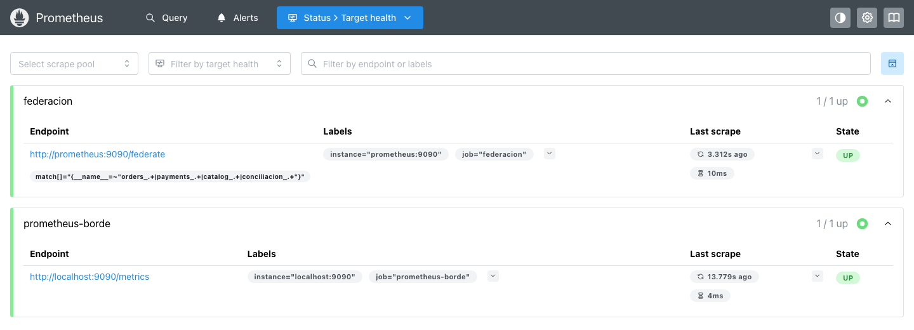

42. Comparar las series que tiene el borde con las del principal.

```bash
curl -s -G http://localhost:8088/borde/api/v1/query --data-urlencode 'query=count({__name__=~".+", job!="prometheus-borde"})' | grep -o '"value":\[[^]]*\]'
curl -s -G http://localhost:8088/prometheus/api/v1/query --data-urlencode 'query=prometheus_tsdb_head_series{job="prometheus"}' | grep -o '"value":\[[^]]*\]'
```

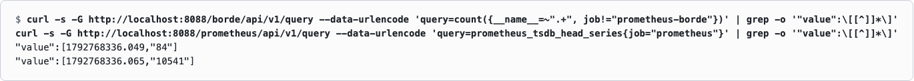

### Escritura remota

Prometheus guarda en su propio disco y por poco tiempo.
Para tener meses de historia, o juntar varios Prometheus, se manda una copia del libro al archivo nacional.
El archivo nacional de esta práctica es Mimir, y Grafana lo consulta como a cualquier otro Prometheus.

43. En `Capitulo9/prometheus/prometheus.yml`, antes de `rule_files:`, agregar el envío a Mimir. Revisar y recargar como en el paso 35.

```yaml
# Escritura remota. Copia de todo lo que se raspa hacia Mimir, el archivo nacional.
remote_write:
  - name: mimir
    url: http://mimir:9009/api/v1/push

```

| Línea | Qué hace |
|---|---|
| `remote_write:` | Sección de primer nivel, sin espacios al principio, igual que `rule_files:` |
| `- name: mimir` | Nombre del destino remoto. Aparece en las métricas de la cola |
| `url` | La dirección de Mimir que recibe las muestras |

44. Agregar Mimir como datasource de Grafana. Es un datasource de tipo Prometheus, porque Mimir responde la misma API de consulta bajo `/prometheus`.

```bash
curl -s -u "admin:$CLAVE" -H 'Content-Type: application/json' -X POST http://localhost:8088/grafana/api/datasources -d '{"name":"Mimir","uid":"mimir","type":"prometheus","access":"proxy","url":"http://mimir:9009/prometheus","jsonData":{"httpMethod":"POST","prometheusType":"Mimir"}}' | grep -o '"message":"[^"]*"'
```

En Grafana abrir **Connections**, **Data sources**, **Mimir** y pulsar **Save & test**.

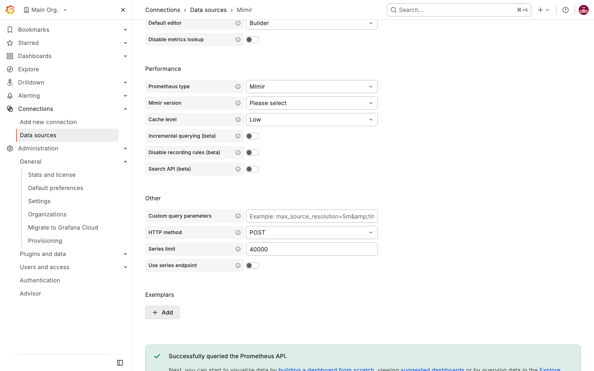

45. Esperar un minuto. En **Explore** elegir el datasource **Mimir** y ejecutar `up{job="catalogo"}`. Son las series que Prometheus escribió en Mimir.

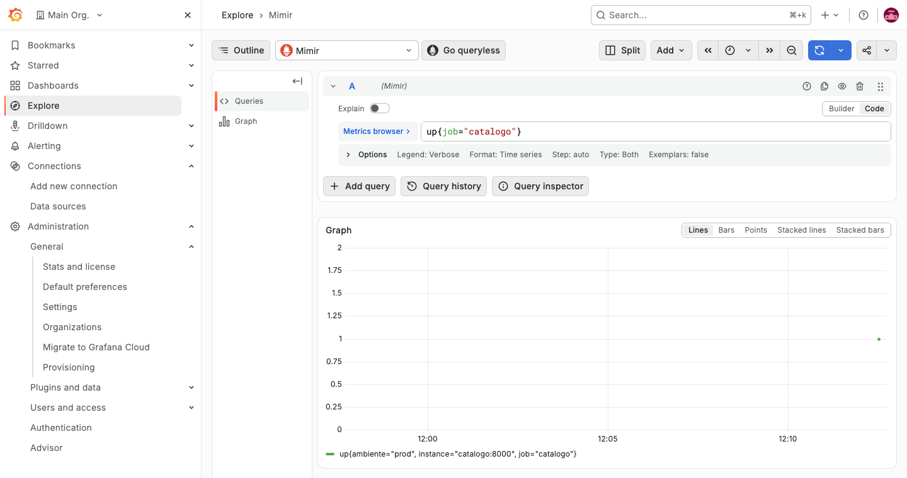

46. Ver las métricas de la cola de escritura remota en el Prometheus principal.

```bash
for q in 'prometheus_remote_storage_samples_total' 'prometheus_remote_storage_shards' 'prometheus_remote_storage_highest_timestamp_in_seconds - ignoring(remote_name, url) group_right prometheus_remote_storage_queue_highest_sent_timestamp_seconds'; do
  echo "$q"; curl -s -G http://localhost:8088/prometheus/api/v1/query --data-urlencode "query=$q" | grep -o '"value":\[[^]]*\]'
done
```

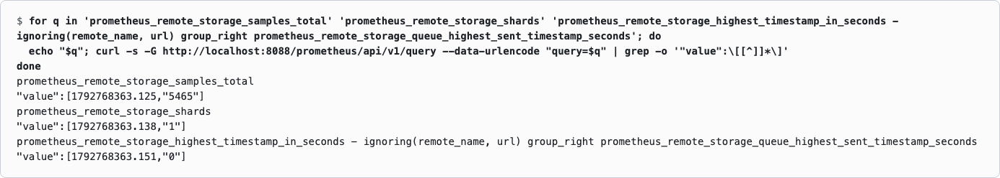

>**Nota.** La primera es cuántas muestras salieron hacia Mimir. La segunda, cuántos envíos en paralelo usa la cola. La tercera es el atraso en segundos entre lo último que Prometheus guardó y lo último que mandó. Si crece, Mimir no da abasto o la red está lenta.

### Control de recursos

Un exportador que de golpe entrega muchas más series puede dejar sin memoria a Prometheus.
Además hay familias de métricas que ocupan espacio y que nadie mira.
Por eso cada puesto recibe un cupo de cuadernos, se dejan de comprar los que nadie lee y el disco tiene un tamaño máximo.

47. Medir antes de cambiar nada. Las series en memoria del principal, las series del job loki y cuántas muestras trae cada raspado de Loki.

```bash
for q in 'prometheus_tsdb_head_series{job="prometheus"}' 'count({job="loki"})' 'scrape_samples_scraped{job="loki"}'; do
  echo "$q"; curl -s -G http://localhost:8088/prometheus/api/v1/query --data-urlencode "query=$q" | grep -o '"value":\[[^]]*\]'
done
```

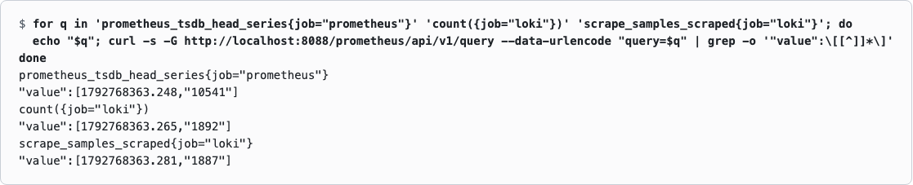

48. En `Capitulo9/prometheus/prometheus.yml` reemplazar el job `loki` por este, con un cupo chico a propósito. Revisar y recargar.

```yaml
  - job_name: loki
    # Cupos. Si un raspado trae más de 1000 muestras o una serie con más de 30
    # etiquetas, Prometheus descarta el raspado completo y el destino queda abajo.
    sample_limit: 1000
    label_limit: 30
    static_configs:
      - targets: ["loki:3100"]
```

| Línea | Qué hace |
|---|---|
| `sample_limit: 1000` | Máximo de muestras que acepta en cada raspado de este job |
| `label_limit: 30` | Máximo de etiquetas que puede tener una serie |
| `static_configs` y `targets` | El destino de siempre, sin cambios |

49. Abrir `http://localhost:8088/prometheus/targets?search=loki`. El destino quedó abajo porque Loki entrega más de 1000 muestras. Prometheus no guarda una parte, descarta el raspado completo.

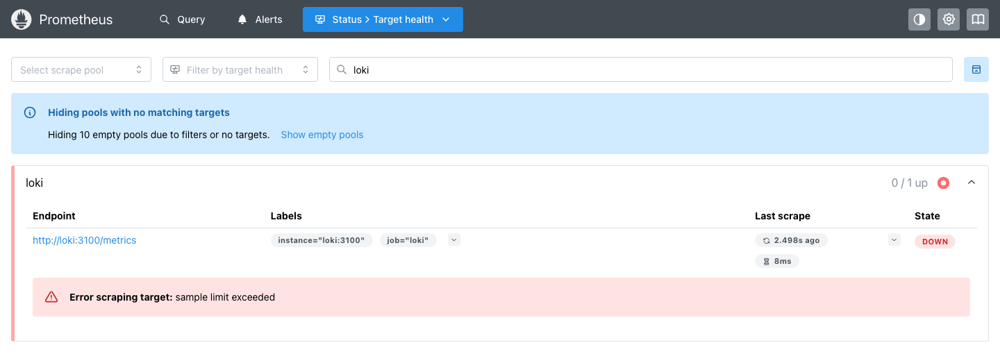

50. Cambiar el cupo a uno con margen y, debajo de `targets: ["loki:3100"]`, agregar un descarte de los histogramas del tamaño de los mensajes de Loki. El job queda así.

```yaml
  - job_name: loki
    # Cupos. Si un raspado trae más de 5000 muestras o una serie con más de 30
    # etiquetas, Prometheus descarta el raspado completo y el destino queda abajo.
    sample_limit: 5000
    label_limit: 30
    static_configs:
      - targets: ["loki:3100"]
    # Descarta los histogramas del tamaño de los mensajes de Loki. Son cientos de series que
    # nadie mira.
    metric_relabel_configs:
      - source_labels: [__name__]
        regex: loki_(request|response)_message_bytes_.*
        action: drop
```

| Línea | Qué hace |
|---|---|
| `sample_limit: 5000` | El cupo nuevo, con margen sobre lo que Loki entrega normalmente |
| `metric_relabel_configs` | Reglas que se aplican a cada serie después de rasparla y antes de guardarla |
| `source_labels: [__name__]` | Mira el nombre de la métrica |
| `regex` | El patrón de nombres que se busca. `.*` es cualquier resto |
| `action: drop` | Las series que calzan con el patrón no se guardan |

51. En la sección `storage`, la retención por tiempo ya viene con `time: 7d`. Debajo de esa línea agregar la retención por tamaño. Revisar y recargar.

```yaml
      # Retención por tamaño además de por tiempo. Se borra el bloque más viejo cuando se
      # cumple cualquiera de los dos.
      size: 2GB
```

La sección queda así. `size` va a la misma altura que `time`.

```yaml
    retention:
      time: 7d
      # Retención por tamaño además de por tiempo. Se borra el bloque más viejo cuando se
      # cumple cualquiera de los dos.
      size: 2GB
```

| Línea | Qué hace |
|---|---|
| `time: 7d` | Ya estaba. Borra lo que tiene más de siete días |
| `size: 2GB` | Borra lo más viejo cuando los datos pasan de 2 GB |

52. Esperar 30 segundos y medir otra vez, ahora también con las muestras que quedan después del descarte.

```bash
for q in 'prometheus_tsdb_head_series{job="prometheus"}' 'count({job="loki"})' 'scrape_samples_scraped{job="loki"}' 'scrape_samples_post_metric_relabeling{job="loki"}'; do
  echo "$q"; curl -s -G http://localhost:8088/prometheus/api/v1/query --data-urlencode "query=$q" | grep -o '"value":\[[^]]*\]'
done
```

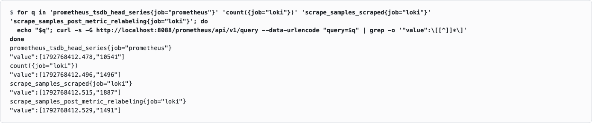

>**Nota.** El cupo se pone con margen sobre lo normal, para que salte solo cuando un exportador se descontrola. Se compara con lo que queda después de `metric_relabel_configs`, así que el descarte también ayuda a no superarlo. Las series del job loki bajan enseguida. `prometheus_tsdb_head_series` baja recién cuando Prometheus compacta la memoria a disco, cada dos horas, porque las series descartadas siguen ahí hasta entonces.

53. Ver la retención que quedó.

```bash
curl -s http://localhost:8088/prometheus/api/v1/status/runtimeinfo | grep -o '"storageRetention":"[^"]*"'
```

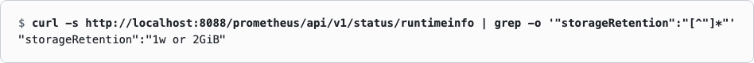

### Grafana Advisor

Con los años una instancia de Grafana junta datasources que ya no responden y plugins viejos.
Advisor es el inspector que revisa el reglamento del mercado y anota fallas.
No arregla nada, deja la lista para que alguien la lea.

54. En Grafana abrir **Administration**, **Advisor** y pulsar el botón de recargar, arriba a la derecha. Advisor revisa los datasources, los plugins y la configuración y anota lo que encuentra.

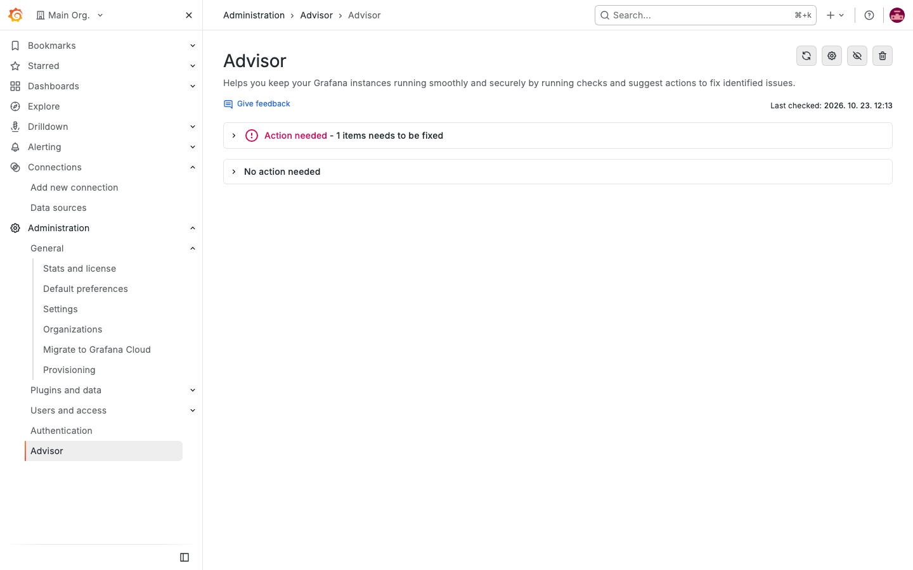

55. Si hay hallazgos, leer cada uno con su sugerencia. Si dice No issues found, abrir **No action needed** para ver qué revisó.

## Parte B. El Buen Fin

El Buen Fin es el día de más gente del año en el mercado.
Llegan síntomas de varios puestos a la vez y las alertas solo dicen dónde duele.
Esta parte junta todo el curso para llegar de cada síntoma a su causa, con evidencia.

56. Antes de mirar nada, anotar una predicción. Con 40 clientes comprando a la vez, ¿cuál de los servicios espera que falle primero?

57. Empezar El Buen Fin. El script sube el tráfico y enciende varias fallas sin decir cuáles. No leer el script ni correr `bin/caos.sh estado` hasta terminar.

```bash
Capitulo9/preparar-buenfin.sh
```

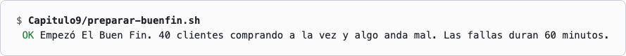

58. Esperar unos 3 minutos y abrir `http://localhost:8088/prometheus/alerts`. Las alertas dicen qué servicio está mal, pero no por qué.

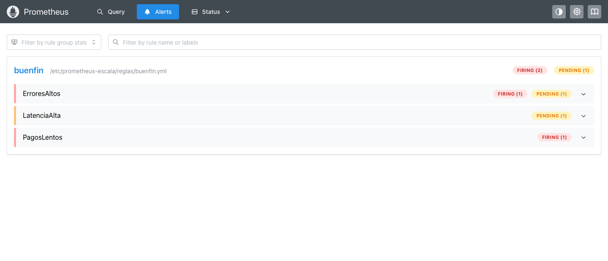

59. Diagnosticar con lo visto en el curso. Algunas vistas que sirven.

- El dashboard Tianguis · RED, con la tasa, los errores y la duración de cada servicio.
- Explore con Tempo y TraceQL, para encontrar las trazas lentas. Por ejemplo `{ duration > 2s }`.
- Una traza lenta abierta en Tempo, con el tiempo de cada span.
- Explore con Loki, para leer los errores de un servicio.

>**Nota.** Las consultas de tasa, errores y p95 están en el Capítulo 3, sección 3.5 de la presentación del curso. El salto de una métrica a la traza y de la traza a sus registros está en el Capítulo 6, sección 6.4, y LogQL en el Capítulo 8, sección 8.5. La sintaxis de TraceQL está en https://grafana.com/docs/tempo/latest/traceql/ y la de LogQL en https://grafana.com/docs/loki/latest/query/.

60. Abrir `Capitulo9/diagnostico.md` y escribir un bloque por cada problema, con el servicio, el síntoma, la evidencia y la causa. La evidencia de pagos tiene que ser el trace_id de un pago lento. La de los otros servicios, una consulta de PromQL o de LogQL.

>**Nota.** Una alerta dice dónde duele, no siempre dónde está la causa. Si dos servicios fallan a la vez, revisar si uno le pide datos al otro antes de escribir la causa de cada uno. Un servicio puede fallar solo porque falla aquel del que depende.

61. Cuando el diagnóstico esté listo, apagar las fallas y bajar el tráfico.

```bash
bin/caos.sh apagar && bin/trafico.sh nivel normal
```

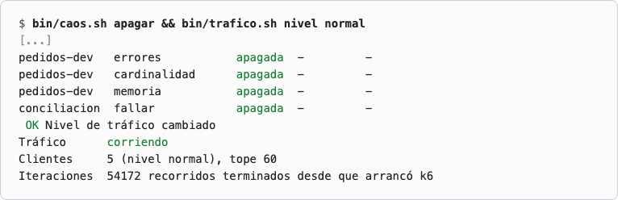

62. Esperar unos 3 minutos y volver a la página de alertas. Ninguna sigue sonando.

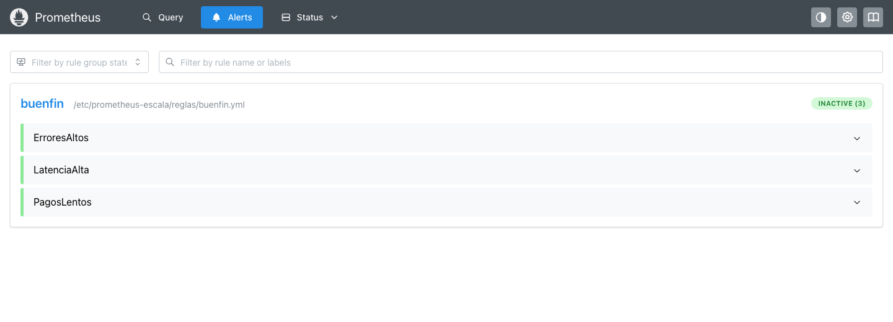

### Verificar

Al cerrar el mercado se revisa que cada puesto esté en orden.
La verificación hace esa ronda con un script y marca lo que falta antes de volver al stack base.

63. Ejecutar la verificación. Cada línea queda en verde si está lograda o en rojo con una pista de lo que falta. La verificación detiene un momento la segunda réplica de Grafana para probar que nginx sigue atendiendo.

```bash
Capitulo9/verificar.sh
```

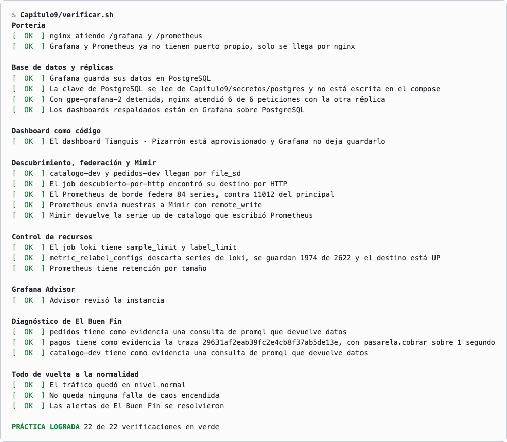

## Preguntas frecuentes

**¿Qué es un proxy inverso?**
Es un servidor que recibe todas las peticiones en una sola dirección y las pasa a las aplicaciones que están detrás. En esta práctica es nginx, en el puerto 8088.

**¿Por qué Grafana y Prometheus ya no responden en los puertos 3000 y 9090?**
La capa de escala les quita el puerto propio para que la única entrada sea nginx. Se entra por `http://localhost:8088/grafana/` y `http://localhost:8088/prometheus/`.

**¿Qué es Mimir?**
Es un almacenamiento de métricas de largo plazo. Recibe las muestras de Prometheus por escritura remota y responde con la misma API de consulta, por eso Grafana lo agrega como datasource de tipo Prometheus.

**¿Qué es el Prometheus de borde?**
Es un segundo Prometheus, más chico, que representa otro sitio. Por federación toma del principal solo las series que se le piden.

**¿Qué hace `kill -HUP 1` dentro del contenedor?**
Le manda al proceso 1 del contenedor, que es Prometheus, la señal para volver a leer su configuración. Los cambios se aplican sin reiniciar el contenedor.

**¿Qué es aprovisionar un dashboard?**
Grafana carga dashboards desde archivos JSON de una carpeta, según lo que indica un archivo de proveedores. Esa carpeta se puede versionar en Git como cualquier código.

**¿Se pierde algo del stack base al terminar?**
No. `Capitulo9/restaurar.sh` levanta otra vez Grafana sobre SQLite con lo que tenía antes. Lo que se va es lo creado dentro de la capa, como la organización, el equipo y la carpeta.

**¿Qué reviso si Grafana o Prometheus no responden detrás de nginx?**
Primero el código que devuelve. Si no hay respuesta en el puerto 8088, el que falla es nginx y se mira con `docker logs gpe-nginx`. Un 502 dice que nginx está bien pero no llega al servicio de atrás, así que se revisa con `docker ps` que gpe-grafana, gpe-grafana-2 o gpe-prometheus estén healthy. Un 404 después de una redirección suele ser `GF_SERVER_ROOT_URL` o `--web.external-url` mal puestos, como en los pasos 27 y 28.

**¿Cómo hago la mantención de una réplica de Grafana sin cortar el servicio?**
Se detiene una réplica a la vez, como en el paso 12. nginx manda todo a la otra en unos 10 segundos. Al terminar se enciende, se espera a que `docker ps` la muestre healthy y recién entonces se pasa a la siguiente. Los dashboards no se pierden porque viven en PostgreSQL.

**¿Cómo silencio las alertas durante una mantención?**
Las alertas de esta práctica son de Prometheus y avisan por Alertmanager. Se crea un silencio con `amtool silence add`, como en la Práctica 5, o en Grafana en **Alerting**, **Silences**, eligiendo el Alertmanager. El silencio lleva autor, comentario y fecha de término, y la alerta sigue visible aunque no notifica. Las alertas gestionadas por Grafana se callan en esa misma pantalla eligiendo Grafana, o con un mute timing si la mantención se repite. Está en el Capítulo 5, secciones 5.5 y 5.6 de la presentación del curso, y en https://prometheus.io/docs/alerting/latest/alertmanager/.

**¿Cómo me entero si un destino superó su cupo?**
El destino queda DOWN en la página de destinos con el error `sample limit exceeded`, y su serie `up` vale 0, así que una alerta sobre `up == 0` lo detecta. La métrica `prometheus_target_scrapes_exceeded_sample_limit_total` cuenta cuántos raspados se descartaron por el cupo.

## Resultado esperado

Grafana corre en dos réplicas sobre PostgreSQL detrás de nginx, con los dashboards de las prácticas anteriores y uno aprovisionado como código. Prometheus descubre el ambiente dev desde archivos, envía todo a Mimir y tiene cupos, descarte y retención por tamaño. El Prometheus de borde federa solo las series de negocio. El diagnóstico nombra cada problema que se encontró en El Buen Fin con su servicio, su síntoma, su evidencia y su causa, y el stack volvió a la normalidad.

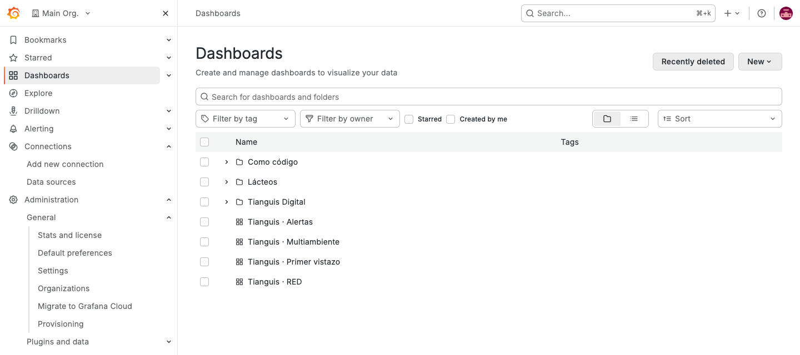

## Volver al stack base

64. Bajar la capa de escala. El script pide escribir `SI`, devuelve `Capitulo9` a git, borra el respaldo y los volúmenes de la capa y levanta el stack base con Grafana sobre SQLite. Con ese volumen se van también la organización, el equipo y la carpeta de los pasos 14 a 20.

```bash
Capitulo9/restaurar.sh
```

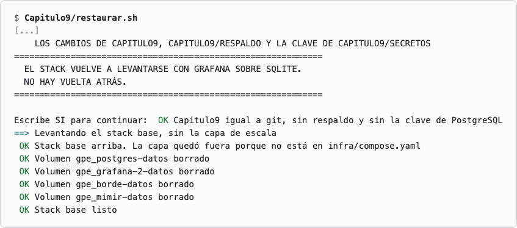

65. Confirmar que el stack quedó como al principio.

```bash
bin/estado.sh
```

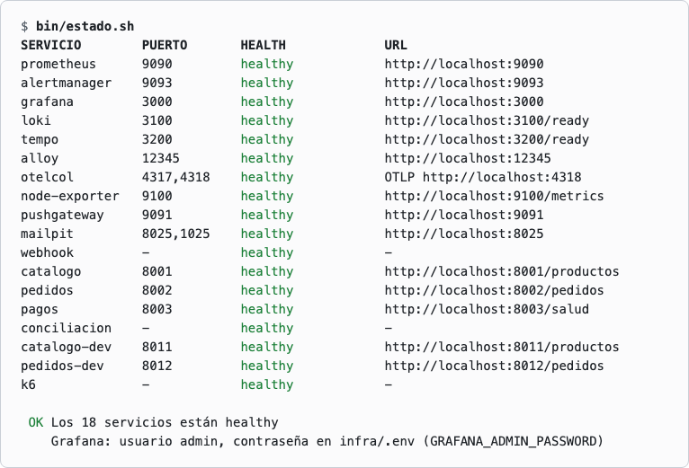

La carpeta `Capitulo9/solucion` trae los archivos de Prometheus con la misma ruta que tienen en `Capitulo9` y un `diagnostico.md` resuelto.

Para ver la práctica resuelta de una vez, `Capitulo9/solucion/aplicar.sh` hace la Parte A completa sobre el stack base, corre El Buen Fin y escribe el diagnóstico con un pago lento real. Tarda unos 15 minutos. Avisa qué reemplaza y pide escribir SI.
