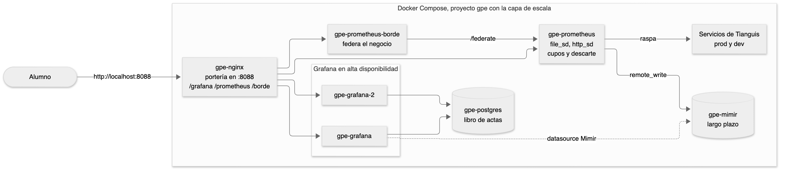
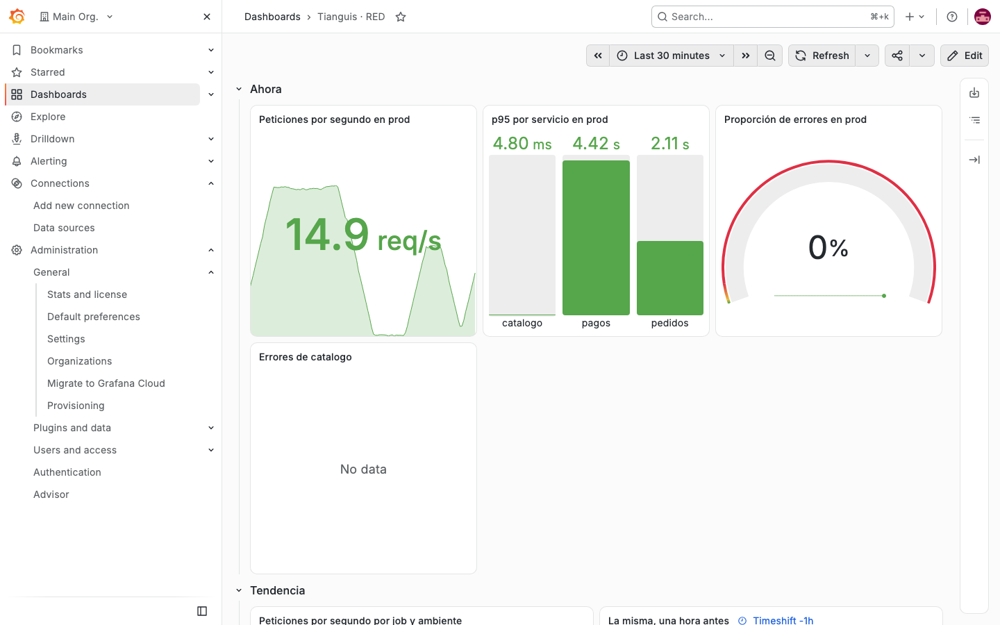
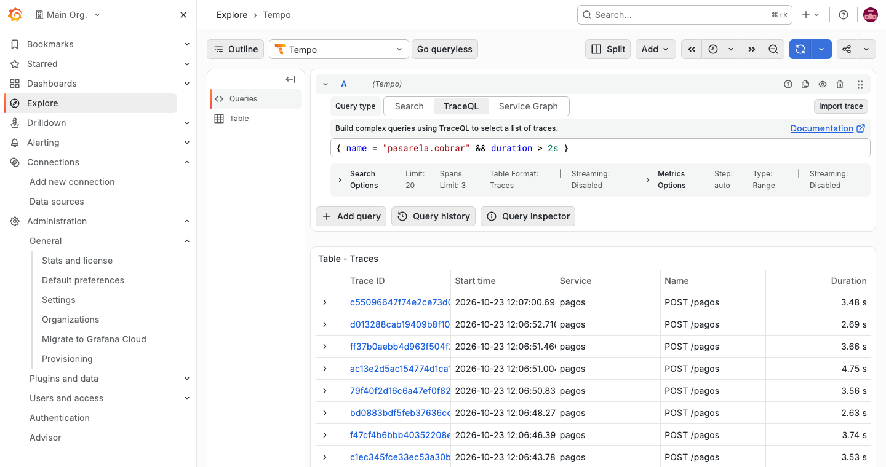
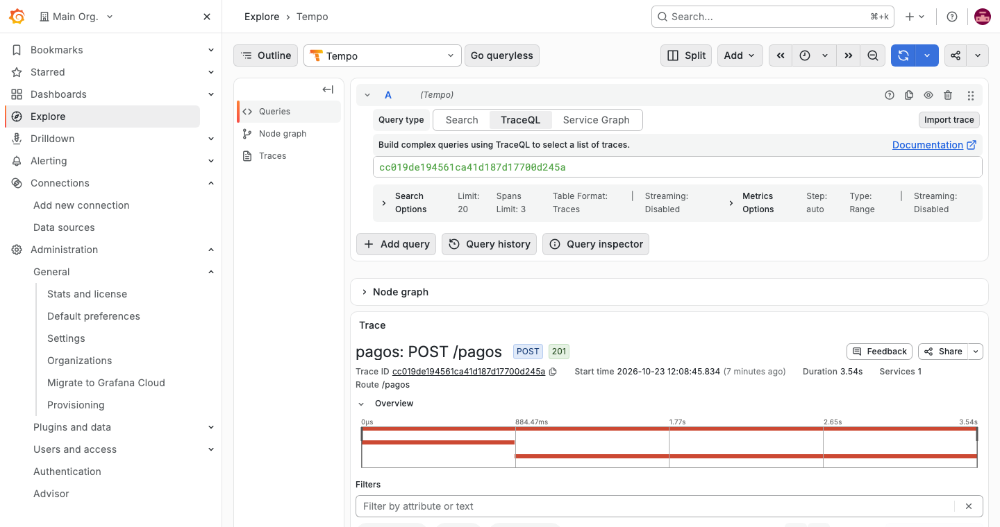
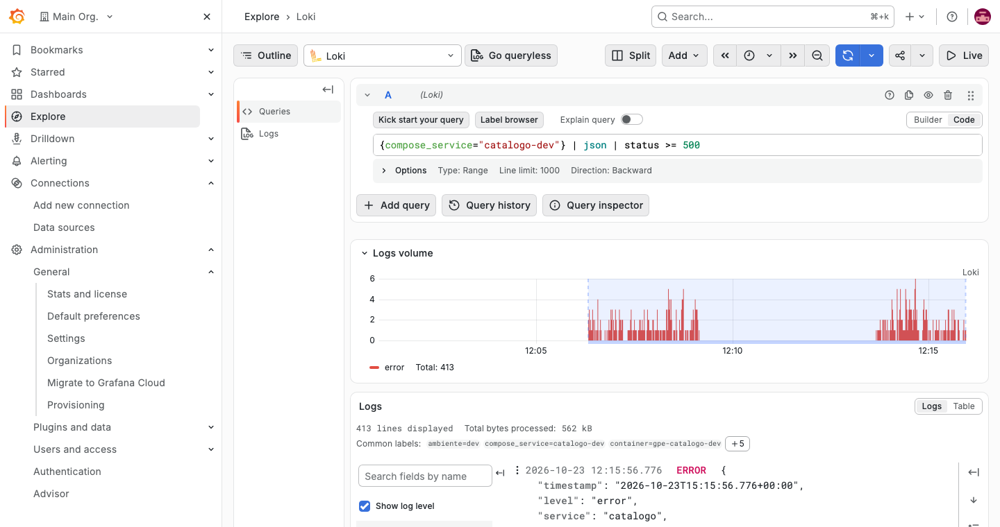

# Guía del relator. Práctica 9. Proxy inverso y escritura remota hacia almacenamiento de largo plazo

Capítulo 9 del temario. Duración provisoria de 180 minutos, en dos partes.

La práctica tiene una idea. Un stack que funciona para una persona no funciona igual para una empresa. Crecer pide tres cosas. Que Grafana no dependa de un archivo ni de una sola copia, que Prometheus encuentre solo lo que tiene que mirar y guarde solo lo que vale la pena, y que lo de largo plazo viva en otro lugar. La Parte B junta todo el curso en un incidente con tres problemas a la vez.

## Diagrama



La fuente editable está en `images/9/diagrama.mmd` y se vuelve a dibujar con `tools/diagramas/render.sh 9`.

## Familia de analogías

Toda la práctica usa el mercado que crece. No mezclar con otras analogías.

| Concepto | En el mercado que crece |
|---|---|
| Organización y equipos | Los sindicatos de puesteros, cada uno con su pizarrón |
| Base de datos externa | Pasar el libro de actas de la oficina a la bóveda municipal |
| Alta disponibilidad | Dos oficinas de atención con el mismo libro de actas |
| Dashboards como código | Los planos del pizarrón guardados en la oficina de partes |
| Proxy inverso | La portería única del mercado, que dirige a cada visitante |
| Descubrimiento | La lista de puestos que se actualiza sola cuando llega uno nuevo |
| Federación | El mercado chico que le pasa sus totales al mercado central |
| Escritura remota | Mandar cada noche la copia del libro al archivo nacional |
| Límites | El cupo de cuadernos que puede abrir cada puesto |
| Advisor | El inspector que revisa el reglamento del mercado y anota fallas |

## Reparto del tiempo

| Bloque | Minutos |
|---|---|
| Preparar, respaldo y migración a PostgreSQL | 20 |
| Réplicas y la predicción de la réplica caída | 10 |
| Organizaciones, equipos y carpetas | 10 |
| Dashboards como código | 10 |
| Proxy inverso y lo que se rompe | 15 |
| Descubrimiento con archivos y por HTTP | 15 |
| Federación | 10 |
| Escritura remota a Mimir | 15 |
| Control de recursos | 15 |
| Advisor | 5 |
| El Buen Fin, diagnóstico | 30 |
| Vuelta a la normalidad, verificar y restaurar | 15 |

## Antes de la clase

- Correr `bin/up.sh` y dejar descargadas las imágenes `nginx:1.30.6-alpine`, `postgres:18.6-alpine` y `grafana/mimir:3.2.2` con `docker pull`. La red de la sala puede ser lenta.
- El puerto 8088 tiene que estar libre en la máquina del alumno. Es la portería.
- Si alguien hizo la Práctica 7 o la 8, correr su `restaurar.sh`. La 9 parte del stack base.
- Si alguien ya hizo esta práctica, correr `Capitulo9/restaurar.sh`.
- Con la capa arriba el stack usa unos 3 GiB de RAM, también en nivel buenfin. Docker Desktop necesita por lo menos 6 GiB asignados.
- Las fallas de El Buen Fin duran 60 minutos. Si la Parte B se atrasa, volver a correr `Capitulo9/preparar-buenfin.sh`.
- No mostrar `Capitulo9/preparar-buenfin.sh` ni `bin/caos.sh estado` antes del diagnóstico. Dicen las tres fallas.
- Grafana 13.2.3 no puede borrar organizaciones, la API responde 500. Por eso la organización de la práctica se crea sobre PostgreSQL, y `restaurar.sh` se la lleva con el volumen. No crear organizaciones en el Grafana base.

---

## Paso 1. Base de datos y réplicas

**🎯 Problema.** Grafana guarda todo en un archivo SQLite dentro de su contenedor. Una sola copia, en un solo disco, que no se puede compartir. Para tener dos Grafana atendiendo a la vez hace falta una base que los dos lean.

**👵 Analogía.** Pasar el libro de actas de la oficina a la bóveda municipal, y abrir dos oficinas de atención con el mismo libro de actas. Si una oficina cierra, la otra sigue atendiendo y no se pierde ninguna acta.

**🔮 Predicción.** Antes de detener la réplica, preguntar si se pierden los dashboards. No, porque viven en PostgreSQL y no en la réplica. Lo único que se pierde es la petición que estaba en curso, y nginx la repite en la otra.

**💻 Comando.**

```bash
cp Capitulo9/secretos/postgres.ejemplo Capitulo9/secretos/postgres
docker compose -p gpe --env-file infra/.env -f infra/compose.yaml -f Capitulo9/compose.escala.yaml up -d
docker exec gpe-postgres psql -U grafana -d grafana -c '\dt' | head -n 16
docker stop gpe-grafana-2 && sleep 15
```

| Parte | Qué es |
|---|---|
| Segundo `-f` | Suma la capa al compose base. Lo que se repite se reemplaza y lo nuevo se agrega |
| `ports: !reset []` | Le quita el puerto propio a Grafana y a Prometheus |
| `GF_DATABASE_TYPE: postgres` | Grafana guarda en PostgreSQL y no en SQLite |
| `GF_DATABASE_PASSWORD__FILE` y `POSTGRES_PASSWORD_FILE` | Grafana y PostgreSQL leen la clave de `Capitulo9/secretos/postgres`, que git ignora |
| `psql -c '\dt'` | Lista las tablas que creó Grafana al arrancar |
| `X-Replica` | Cabecera que agrega nginx con la dirección de la réplica que atendió |

**⚙️ Técnico.** Grafana no migra solo de SQLite a PostgreSQL. Arranca con la base vacía, crea sus tablas y vuelve a aprovisionar lo que viene de archivos. Lo creado a mano hay que moverlo. La guía respalda los dashboards con la API clásica y los importa en la base nueva. Los uid se conservan, así que los enlaces siguen funcionando. Usuarios, reglas de alerta, puntos de contacto y anotaciones no pasan. Siguen en el SQLite del volumen. Con varias réplicas, las alertas de Grafana se coordinan con `GF_UNIFIED_ALERTING_HA_PEERS` para no notificar dos veces. nginx pregunta al DNS de Docker cada 10 segundos. Por eso la prueba espera 15 antes de medir.

**📺 Salida.** Las tablas `alert`, `dashboard`, `org`, `user` y las demás. La importación con `"status":"success"` por cada dashboard. `X-Replica` alternando entre dos IP. Seis 200 con una réplica detenida.

**⚠️ Fallas.**

| Qué se ve | Causa | Arreglo |
|---|---|---|
| `bind: address already in use` en 8088 | Otro programa usa el puerto | Cerrar ese programa |
| gpe-postgres se reinicia sin parar o Grafana dice `failed to read file` | Falta `Capitulo9/secretos/postgres` | Copiarlo desde `postgres.ejemplo` y volver a levantar la capa |
| Grafana dice `password authentication failed` | La clave del archivo cambió después de crear el volumen. PostgreSQL guarda la primera | Volver a dejar la clave del ejemplo o correr `restaurar.sh` |
| 502 justo después de levantar | Las réplicas todavía arrancan | Esperar a que estén healthy |
| La importación responde 401 | `$CLAVE` vacía en esta terminal | Volver a definirla |
| Un 502 entre los 200 | Se midió sin esperar los 15 segundos | Repetir con la espera |

---

## Paso 2. Organizaciones, equipos y carpetas

**🎯 Problema.** En una empresa hay áreas que no deben ver los datos de otras, y equipos que comparten datos pero no deben tocar los dashboards de los demás.

**👵 Analogía.** Los sindicatos de puesteros, cada uno con su pizarrón. Un sindicato nuevo tiene su propio pizarrón vacío. Dentro de un sindicato, cada gremio puede tener su sección del pizarrón que solo él escribe.

**🔮 Predicción.** Preguntar qué datasources tiene la organización nueva. Ninguno. Una organización no hereda nada de la otra.

**💻 Comando.**

```bash
curl -s -u "admin:$CLAVE" -H 'Content-Type: application/json' -X POST http://localhost:8088/grafana/api/orgs -d '{"name":"Sindicato de Fruteros"}'
curl -s -u "admin:$CLAVE" -H 'Content-Type: application/json' -X POST http://localhost:8088/grafana/api/folders/lacteos/permissions -d '{"items":[{"teamId":'"$EQUIPO"',"permission":2}]}'
```

| Parte | Qué es |
|---|---|
| `/api/orgs` | Crea una organización. El admin que la crea queda como su administrador |
| `?orgId=2` | Cambia la organización actual del usuario |
| `/api/teams` | Crea un equipo en la organización actual |
| `/api/folders/UID/permissions` | Reemplaza todos los permisos de la carpeta |
| `permission` | 1 View, 2 Edit, 4 Admin |

**⚙️ Técnico.** La organización es el límite fuerte. Datasources, dashboards, alertas y usuarios son de una organización. El equipo es un límite dentro de la organización, y se aplica con permisos de carpeta. El POST de permisos reemplaza la lista completa, así que los roles Viewer y Editor quedan fuera. En Grafana 13.2.3 borrar una organización falla con un error 500 de la nueva capa de almacenamiento. Por eso la práctica la crea en PostgreSQL.

**📺 Salida.** `"message":"Organization created"` con su `orgId`. La lista con Main Org. y Sindicato de Fruteros. La organización nueva sin datasources ni dashboards. `Folder permissions updated` y el cajón de permisos con equipo-lacteos en Edit.

**⚠️ Fallas.**

| Qué se ve | Causa | Arreglo |
|---|---|---|
| `Organization name taken` | Ya existe de una corrida anterior | `Capitulo9/restaurar.sh` y empezar de nuevo |
| La interfaz sigue en Sindicato de Fruteros | Quedó cambiada la organización actual | Abrir `/grafana/?orgId=1` |
| `EQUIPO` vacía | El equipo ya existía | Buscar su id con `/api/teams/search` |

---

## Paso 3. Dashboards como código

**🎯 Problema.** Un dashboard editado a mano no tiene historia ni revisión. Si alguien lo rompe, no hay cómo volver atrás.

**👵 Analogía.** Los planos del pizarrón guardados en la oficina de partes. El pizarrón se pinta según el plano, y para cambiarlo hay que cambiar el plano.

**🔮 Predicción.** Preguntar qué pasa al guardar desde la interfaz. Grafana no deja, porque el proveedor tiene `allowUiUpdates: false`.

**💻 Comando.**

```bash
cat Capitulo9/escala/grafana/dashboards/proveedores.yaml
```

| Parte | Qué es |
|---|---|
| `providers` | Lista de carpetas de donde Grafana lee dashboards |
| `allowUiUpdates: false` | No deja guardar cambios desde la interfaz |
| `disableDeletion: true` | No deja borrar el dashboard desde la interfaz |
| `updateIntervalSeconds` | Cada cuánto vuelve a leer la carpeta |

**⚙️ Técnico.** El aprovisionamiento por archivo es la forma más simple de dashboards como código. El archivo se versiona en Git y un cambio llega a Grafana en segundos. Grafana 13 también trae Git Sync, con la API `provisioning.grafana.app`. Sus tipos de repositorio son `github`, `git` y `local`. Lo probamos con un repositorio local. `git` exige una URL http o https y un token, y rechaza `file://`. `local` es otra cosa, lee una carpeta permitida sin Git. Git Sync necesita un servidor Git, así que en la sala se usa el archivo.

**📺 Salida.** El dashboard Tianguis · Pizarrón en la carpeta Como código. El aviso de que no se puede guardar un dashboard aprovisionado. El título nuevo después de editar el archivo.

**⚠️ Fallas.**

| Qué se ve | Causa | Arreglo |
|---|---|---|
| El cambio no aparece | Error de JSON en el archivo | `docker logs gpe-grafana` y corregir |
| La carpeta Como código no está | La capa no montó la carpeta | Revisar que se levantó con el segundo `-f` |

---

## Paso 4. Proxy inverso

**🎯 Problema.** Cada herramienta con su puerto es difícil de proteger y de recordar. Se quiere una sola entrada, con TLS y autenticación en un solo lugar.

**👵 Analogía.** La portería única del mercado, que dirige a cada visitante. El visitante pregunta en la portería por la oficina de Grafana y el portero lo lleva.

**🔮 Predicción.** Antes de comentar `GF_SERVER_ROOT_URL`, preguntar qué se va a romper. La redirección al login sale a `/login`, fuera de `/grafana`, y nginx no tiene esa ruta.

**💻 Comando.**

```bash
curl -s -o /dev/null -w '%{http_code} %{redirect_url}\n' http://localhost:8088/grafana/
curl -s -o /dev/null -w '%{http_code} %{redirect_url}\n' http://localhost:8088/prometheus/
```

| Parte | Qué es |
|---|---|
| `location /grafana/` | La ruta que nginx atiende para Grafana |
| `proxy_pass http://grafanas/` | La barra final hace que nginx le saque el prefijo |
| `GF_SERVER_ROOT_URL` | La dirección con que Grafana se ve desde afuera |
| `--web.external-url` | Lo mismo para Prometheus |
| `--web.route-prefix=/` | Prometheus sigue atendiendo en la raíz dentro de la red |

**⚙️ Técnico.** Hay dos formas de servir bajo una ruta. Que nginx saque el prefijo y la aplicación siga en la raíz, o que la aplicación sirva con el prefijo, con `serve_from_sub_path` en Grafana. La práctica usa la primera para que Grafana, pagos y el Collector sigan hablando con `prometheus:9090` como siempre. `route-prefix` en la raíz es lo que permite eso. Sin `root_url` ni `external_url` las redirecciones y los enlaces salen sin el prefijo.

**📺 Salida.** Con todo configurado, `302 http://localhost:8088/grafana/login` y `302 http://localhost:8088/prometheus/query`. Sin `root_url`, `302 http://localhost:8088/login` y después 404. Sin `external_url`, `302 http://localhost:8088/query` y después 404.

**⚠️ Fallas.**

| Qué se ve | Causa | Arreglo |
|---|---|---|
| Página en blanco | El navegador guardó una redirección vieja | Recargar sin caché |
| 502 después de recrear | La réplica todavía arranca | Esperar a que esté healthy |
| El archivo quedó con el `#` | No se volvió a dejar como estaba | `git checkout -- Capitulo9/compose.escala.yaml` |

---

## Paso 5. Descubrimiento de servicios

**🎯 Problema.** Con destinos fijos en `prometheus.yml`, cada puesto nuevo pide editar la configuración y recargar. Con cientos de destinos que aparecen y desaparecen, eso no escala.

**👵 Analogía.** La lista de puestos que se actualiza sola cuando llega uno nuevo. El inspector no espera a que le reimpriman el reglamento, mira la lista.

**🔮 Predicción.** Preguntar si hace falta recargar Prometheus al agregar pedidos-dev al archivo. No. Prometheus vigila el archivo y lo vuelve a leer en cuanto cambia.

**💻 Comando.**

```bash
MSYS_NO_PATHCONV=1 docker exec gpe-prometheus promtool check config /etc/prometheus-escala/prometheus.yml
docker exec gpe-prometheus kill -HUP 1
```

| Parte | Qué es |
|---|---|
| `file_sd_configs` | Lee los destinos de archivos YAML o JSON |
| `refresh_interval` | Respaldo por si el aviso del sistema de archivos no llega |
| `http_sd_configs` | Pide la lista de destinos a una URL que responde JSON |
| `MSYS_NO_PATHCONV=1` | Evita que Git Bash convierta la ruta del contenedor |

**⚙️ Técnico.** Prometheus trae descubrimiento para Kubernetes, Consul, EC2, Docker y otros. `file_sd` es el comodín, cualquier herramienta que escriba un archivo puede alimentarlo. `http_sd` es lo mismo por HTTP. En Kubernetes se usa `kubernetes_sd_configs`, que le pregunta a la API del clúster por pods, servicios o endpoints, y `relabel_configs` para quedarse con los que tienen una anotación. En Docker Desktop sobre Windows los avisos de cambios de archivo pueden no llegar al contenedor, por eso `refresh_interval` de 30 segundos.

**📺 Salida.** catalogo-dev UP y sin pedidos-dev. Después de editar el archivo, pedidos-dev UP en segundos. El job descubierto-por-http con prometheus-borde.

**⚠️ Fallas.**

| Qué se ve | Causa | Arreglo |
|---|---|---|
| `promtool` marca error de YAML | Indentación de `file_sd_configs` | Alinearlo con `static_configs` |
| pedidos-dev no aparece | Se editó el archivo equivocado | Es `Capitulo9/prometheus/destinos/pedidos.yml` |
| Tarda 30 segundos | No llegó el aviso del archivo | Es normal en Windows |

---

## Paso 6. Federación

**🎯 Problema.** Un Prometheus central que raspe todo de todos los sitios no escala. Se quiere que cada sitio tenga el suyo y que el central reciba solo lo importante.

**👵 Analogía.** El mercado chico que le pasa sus totales al mercado central. No le manda cada boleta, solo los totales que importan.

**🔮 Predicción.** Preguntar cuántas series trae el borde. Unas 80, contra más de 10 mil del principal.

**💻 Comando.**

```bash
docker exec gpe-prometheus-borde kill -HUP 1
curl -s -G http://localhost:8088/borde/api/v1/query --data-urlencode 'query=count({__name__=~".+", job!="prometheus-borde"})'
```

| Parte | Qué es |
|---|---|
| `metrics_path: /federate` | El endpoint que expone las series actuales del principal |
| `match[]` | Qué series pedir. Sin match no devuelve nada |
| `honor_labels: true` | Conserva job e instance originales |

**⚙️ Técnico.** La federación jerárquica sirve para resúmenes, por ejemplo reglas de grabación de cada sitio que suben al central. No sirve para copiar todo, porque cada raspado de `/federate` es pesado. Para copiar todo se usa escritura remota. Hay también federación cruzada, entre Prometheus del mismo nivel.

**📺 Salida.** El job federacion UP en el borde. Un número chico de series en el borde y uno grande en el principal.

**⚠️ Fallas.**

| Qué se ve | Causa | Arreglo |
|---|---|---|
| El job queda sin series | Las comillas de `match[]` | Copiar el bloque completo |
| Las series llegan con `exported_job` | Falta `honor_labels: true` | Agregarlo |

---

## Paso 7. Escritura remota hacia Mimir

**🎯 Problema.** Prometheus guarda en su disco local con una retención corta. Para meses o años, y para consultar varios Prometheus juntos, hace falta otro almacenamiento.

**👵 Analogía.** Mandar cada noche la copia del libro al archivo nacional. El mercado sigue con su libro, y el archivo guarda la historia de todos los mercados.

**🔮 Predicción.** Preguntar si Mimir tendrá las series de antes de configurar `remote_write`. No. Solo lo que llega desde que se recarga Prometheus.

**💻 Comando.**

```bash
curl -s -G http://localhost:8088/prometheus/api/v1/query --data-urlencode 'query=prometheus_remote_storage_samples_total'
```

| Parte | Qué es |
|---|---|
| `remote_write.url` | El endpoint de Mimir que recibe muestras |
| `http://mimir:9009/prometheus` | La API de consulta de Mimir, compatible con la de Prometheus |
| `prometheus_remote_storage_samples_total` | Muestras enviadas |
| `prometheus_remote_storage_shards` | Envíos en paralelo que usa la cola |
| La resta de timestamps | El atraso entre lo que Prometheus guardó y lo que mandó |

**⚙️ Técnico.** Prometheus manda lo que escribe en su WAL a una cola por cada destino remoto. La cola agrega shards si se atrasa y reintenta si falla. Si Mimir cae, Prometheus guarda en el WAL y reenvía al volver, mientras el WAL lo tenga. Mimir corre aquí en modo monolítico, con disco local. En producción corre en microservicios con un bucket de objetos. Thanos y VictoriaMetrics resuelven lo mismo con otras arquitecturas.

**📺 Salida.** `Successfully queried the Prometheus API` al guardar el datasource. `up{job="catalogo"}` en Explore con Mimir. Las tres métricas de la cola con valores y un atraso de pocos segundos.

**⚠️ Fallas.**

| Qué se ve | Causa | Arreglo |
|---|---|---|
| El datasource falla con 404 | Falta `/prometheus` al final de la URL | Corregir la URL |
| Mimir no tiene series | No se recargó Prometheus | `docker exec gpe-prometheus kill -HUP 1` |
| El atraso crece sin parar | Mimir sin memoria | `docker stats gpe-mimir` |

---

## Paso 8. Control de recursos

**🎯 Problema.** Un exportador que de golpe entrega diez veces más series puede tumbar a Prometheus. Y hay familias de métricas que cuestan mucho y nadie mira.

**👵 Analogía.** El cupo de cuadernos que puede abrir cada puesto. Si un puesto pide más del cupo, ese día no se le anota nada. Y los cuadernos que nadie lee se dejan de comprar.

**🔮 Predicción.** Con el cupo de 1000, preguntar si Prometheus guarda las primeras 1000 muestras de Loki. No, descarta el raspado completo y el destino queda abajo.

**💻 Comando.**

```bash
curl -s http://localhost:8088/prometheus/api/v1/status/runtimeinfo | grep -o '"storageRetention":"[^"]*"'
```

| Parte | Qué es |
|---|---|
| `sample_limit` | Máximo de muestras por raspado. Si se pasa, el raspado entero se descarta |
| `label_limit` | Máximo de etiquetas por serie |
| `metric_relabel_configs` con `drop` | Descarta series después de raspar y antes de guardar |
| `retention.size` | Borra los bloques más viejos cuando el disco pasa ese tamaño |
| `scrape_samples_post_metric_relabeling` | Muestras que quedan después del descarte |

**⚙️ Técnico.** Los cupos protegen a Prometheus de un exportador que se descontrola, a costa de perder ese destino entero. Por eso se ponen con margen sobre lo normal. `sample_limit` se compara con lo que queda después de `metric_relabel_configs`. El descarte se hace con `metric_relabel_configs` y no con `relabel_configs`, que actúa sobre los destinos. `prometheus_tsdb_head_series` no baja enseguida. Las series descartadas siguen en memoria hasta la próxima compactación de la cabeza, cada dos horas. Lo que sí baja enseguida es `count({job="loki"})`. Retención por tiempo y por tamaño se combinan, gana la que se cumpla primero.

**📺 Salida.** Antes, entre 1600 y 3200 muestras por raspado de Loki, según cuánto lleve arriba. Con el cupo de 1000, el destino abajo con `sample limit exceeded`. Con el cupo de 5000 y el descarte, entre un 20 y un 30 % menos de muestras y el destino UP. `storageRetention` con `1w or 2GiB`. Prometheus escribe los 7 días como una semana.

**⚠️ Fallas.**

| Qué se ve | Causa | Arreglo |
|---|---|---|
| El destino sigue abajo | La expresión del descarte está mal escrita | Copiar el bloque de la guía |
| `head_series` no baja | Es lo esperado | Mirar `count({job="loki"})` |

---

## Paso 9. Grafana Advisor

**🎯 Problema.** Una instancia de Grafana acumula datasources rotos, plugins viejos y configuraciones inseguras sin que nadie lo note.

**👵 Analogía.** El inspector que revisa el reglamento del mercado y anota fallas. No arregla nada, deja la lista.

**🔮 Predicción.** Preguntar si Advisor va a encontrar algo en un stack recién armado. No, todo está al día y los datasources responden. En una instancia con años de uso suele encontrar plugins viejos y datasources rotos.

**💻 Comando.** En Grafana, **Administration**, **Advisor** y el botón de recargar.

| Parte | Qué es |
|---|---|
| Advisor | La app `grafana-advisor-app`, activa de fábrica en Grafana 13 |
| Checks | Revisiones de datasources, plugins y configuración |
| Botón de recargar | Corre todas las revisiones de nuevo |

**⚙️ Técnico.** Advisor guarda cada revisión como un recurso `Check` en la API `advisor.grafana.app`. Por eso la verificación lo puede consultar. Corre solo cada cierto tiempo y también a pedido.

**📺 Salida.** En el stack del curso, No issues found y la lista No action needed con lo que revisó. Si algo falla, por ejemplo un datasource que no responde, aparece arriba con su gravedad y su sugerencia.

**⚠️ Fallas.**

| Qué se ve | Causa | Arreglo |
|---|---|---|
| No aparece Advisor en el menú | El usuario no es administrador | Entrar como admin |
| La revisión no termina | Algún datasource no responde | Esperar, la revisión tiene tiempo límite |

---

## Paso 10. El Buen Fin

**🎯 Problema.** Tráfico ocho veces mayor y tres fallas a la vez, sin aviso de cuáles. Las alertas dicen dónde duele, no por qué.

**👵 Analogía.** El día de más gente del año en el mercado. Se juntan problemas de distintos puestos y hay que separar cuál es causa y cuál es consecuencia.

**🔮 Predicción.** Antes de mirar, preguntar qué servicio espera que falle primero. Anotar las respuestas y volver a ellas al final.

**💻 Comando.**

```bash
Capitulo9/preparar-buenfin.sh
```

| Parte | Qué es |
|---|---|
| `nivel buenfin` | 40 clientes, unas 30 peticiones por segundo |
| ErroresAltos, LatenciaAlta, PagosLentos | Alertas que vienen con la práctica en `Capitulo9/prometheus/reglas` |
| `diagnostico.md` | Servicio, síntoma, evidencia y causa de cada problema |

**⚙️ Técnico.** Las fallas son latencia en pedidos al 60 %, pasarela lenta en pagos al 30 % con 2.5 segundos y errores en catalogo-dev al 40 %. Hay un cuarto síntoma que es consecuencia. pedidos-dev también da errores, porque le pide los productos a catalogo-dev. Un buen diagnóstico lo nombra como consecuencia y no como causa. pagos es el único servicio con trazas. Su evidencia es un trace_id con `pasarela.cobrar` sobre 1 segundo. Para pedidos sirve el p95 por ambiente. Para catalogo-dev, la tasa por status con `ambiente="dev"` o los logs con `status >= 500`.

**📺 Salida.** Tres alertas en Firing, ErroresAltos para catalogo dev y pedidos dev, LatenciaAlta para pedidos prod y PagosLentos. En el RED, pedidos con p95 cerca de 2 segundos y catalogo dev con errores. En Tempo, pagos con `pasarela.cobrar` de más de 2 segundos.

Estas son las vistas con la evidencia. La guía del alumno las nombra sin mostrarlas, para no adelantar el diagnóstico.









**⚠️ Fallas.**

| Qué se ve | Causa | Arreglo |
|---|---|---|
| No suena ninguna alerta | Las reglas no se cargaron | Revisar `rule_files` en `prometheus.yml` |
| Tempo no muestra pagos lentos | Rango de tiempo corto | Poner los últimos 15 minutos |
| El diagnóstico solo nombra pedidos-dev | Se confundió consecuencia con causa | Mirar de quién depende pedidos |

---

## Paso 11. Vuelta a la normalidad, verificar y restaurar

**🎯 Problema.** Confirmar que todo quedó hecho, que el incidente se cerró y dejar el stack base como estaba.

**👵 Analogía.** Al cerrar el mercado se revisa que cada puesto esté en orden y se guarda el libro de actas en su lugar.

**🔮 Predicción.** Preguntar cuánto tardan en resolverse las alertas. Unos 3 minutos, por la ventana de 2 minutos de las consultas y el `for` de 2 minutos.

**💻 Comando.**

```bash
bin/caos.sh apagar && bin/trafico.sh nivel normal
Capitulo9/verificar.sh
Capitulo9/restaurar.sh
```

| Parte | Qué es |
|---|---|
| `verificar.sh` | Revisa la capa, Advisor, el diagnóstico y la vuelta a la normalidad |
| `restaurar.sh` | Pide `SI`, devuelve `Capitulo9` a git, baja la capa y borra sus volúmenes |

**⚙️ Técnico.** La verificación detiene gpe-grafana-2 por unos segundos para probar que nginx sigue atendiendo, y la vuelve a encender. Las evidencias del diagnóstico se ejecutan contra Prometheus y Loki sobre la última hora, y el trace_id se busca en Tempo. Al restaurar, Grafana vuelve a SQLite con todo lo que tenía antes de la práctica.

**📺 Salida.** Todas las líneas en verde. Después de restaurar, `bin/estado.sh` igual que al principio.

**⚠️ Fallas.**

| Qué se ve | Causa | Arreglo |
|---|---|---|
| Rojo en las alertas | No pasaron los 3 minutos | Esperar |
| Rojo en una evidencia | La consulta no nombra al servicio o no devuelve datos | La pista dice cuál |
| Rojo en pagos | El trace_id es de un pago rápido | Elegir uno con `duration > 2s` |

---

## ❓ Preguntas del alumno

Son preguntas de un alumno de nivel intermedio, que maneja la terminal y Docker básico pero no conoce Prometheus ni Grafana.

**¿Qué es un contenedor?**
Un proceso aislado con su propio sistema de archivos, que Docker arranca desde una imagen. En la práctica cada servicio corre en uno, como gpe-postgres, gpe-grafana-2 o gpe-prometheus-borde. Se listan con `docker ps`.

**¿Qué es un volumen y por qué importa aquí?**
Un espacio de disco que Docker guarda fuera del contenedor y que sobrevive cuando el contenedor se recrea. El SQLite de Grafana sigue en su volumen después de pasar a PostgreSQL, y `restaurar.sh` borra los volúmenes de la capa para volver al punto de partida.

**¿Qué es una réplica?**
Otra copia del mismo servicio, con la misma configuración, que atiende en paralelo. gpe-grafana y gpe-grafana-2 son dos réplicas de Grafana sobre la misma base PostgreSQL, y nginx reparte las peticiones entre las dos.

**¿Qué es un proxy inverso?**
Un servidor que recibe las peticiones en una sola dirección y las pasa a las aplicaciones de atrás. Aquí es nginx en el puerto 8088, con una ruta para Grafana, otra para Prometheus y otra para el borde.

**¿Por qué no veo datos en Grafana?**
Lo más común en esta práctica es haber quedado en Sindicato de Fruteros, que no tiene datasources. Se vuelve con `/grafana/?orgId=1`. Si la consulta es contra Mimir, solo hay datos desde que se configuró `remote_write`.

**¿Por qué PostgreSQL y no MySQL?**
Grafana acepta las dos. Se eligió PostgreSQL porque es la más común en las empresas para este uso. Lo importante es que sea una base que se pueda respaldar y compartir entre réplicas.

**¿Qué pasa con las sesiones cuando nginx cambia de réplica?**
Nada. Las sesiones viven en la base, así que cualquier réplica reconoce la cookie. En instalaciones grandes se mueven a Redis para no cargar la base.

**¿Cómo se hace el descubrimiento en Kubernetes?**
Con `kubernetes_sd_configs`. Prometheus le pregunta a la API del clúster por pods, servicios, endpoints o nodos, y con `relabel_configs` se queda con los que tienen una anotación como `prometheus.io/scrape`. En la práctica se usa el Prometheus Operator, que lo arma a partir de recursos ServiceMonitor y PodMonitor.

**¿Federación o escritura remota?**
Federación para pasar resúmenes de un Prometheus a otro. Escritura remota para copiar todo a un almacenamiento de largo plazo. La federación copia el estado actual cada raspado. La escritura remota manda cada muestra.

**¿Mimir, Thanos o VictoriaMetrics?**
Los tres guardan métricas de Prometheus a largo plazo. Mimir recibe por escritura remota y escala en microservicios. Thanos se pega a cada Prometheus con un sidecar y lee sus bloques desde un bucket. VictoriaMetrics es un binario muy eficiente con su propio lenguaje compatible con PromQL.

**¿Por qué no se usó Git Sync?**
Porque en Grafana 13.2 necesita un servidor Git con token, como GitHub. Con un repositorio local la API lo rechaza. El aprovisionamiento por archivo da lo mismo para un curso, y la carpeta se versiona en Git igual.

**¿Qué pasa si Mimir se cae?**
Prometheus sigue raspando y guardando en su disco. Las muestras quedan en el WAL y la cola las reenvía cuando Mimir vuelve, mientras el WAL no las haya rotado, unas dos horas.

**¿Cómo se protege la portería?**
Con lo de la Práctica 7, TLS en nginx y autenticación delante de Prometheus. Para Grafana se usa su propio login u OAuth, y nginx puede pasarle el usuario con `auth_proxy`.
